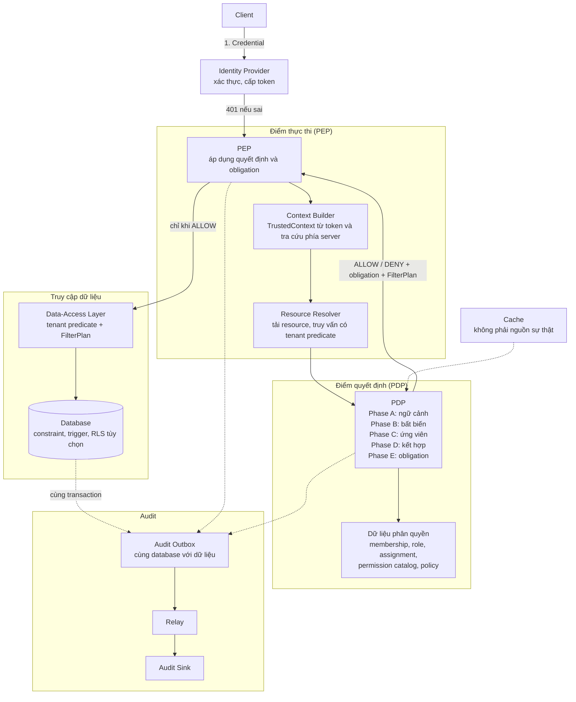
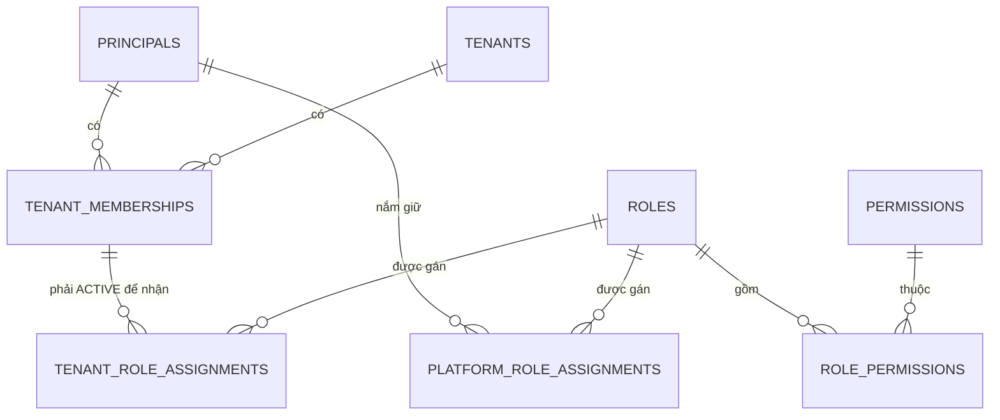

# Enterprise Authorization Architecture

Kiến trúc tham chiếu và đặc tả triển khai cho hệ thống phân quyền (authorization) trong ứng dụng doanh nghiệp đa tenant.

> **Lưu ý:** Đây là tài liệu đặc tả (specification), không phải hệ thống đã được triển khai hay kiểm chứng trong môi trường thực tế.

## Tài liệu

Bộ tài liệu có hai phần với hai mục tiêu khác nhau, đều bằng tiếng Việt:

| Tài liệu | Mục tiêu | Dùng khi |
|---|---|---|
| [enterprise-authorization-architecture-v1_4_1-vi.md](enterprise-authorization-architecture-v1_4_1-vi.md) | **Reference Architecture:** kiến trúc nền tảng, nguyên tắc bảo mật, một cách triển khai tham chiếu | Cần hiểu hệ thống phân quyền tốt trông như thế nào và những bất biến phải giữ |
| [authorization-design-options-vi.md](authorization-design-options-vi.md) | **Design Options Catalog:** các pattern độc lập theo 5 trục (mô hình, permission, scope, gán role, enforcement), mỗi pattern có What, Architecture, Database Model, Authorization Flow, ưu/nhược, trade-off, use case, migration path | Cần chọn phương án phù hợp cho dự án và biết khi nào chuyển sang phương án khác |

Một dự án mới nên đọc Design Options Catalog trước để chọn hồ sơ (mục 2), rồi dùng Reference Architecture làm chuẩn cho các bất biến, thuật toán và lỗi.

Cấu trúc Reference Architecture: **Tổng quan nhanh (T1 đến T13)** ở đầu tài liệu, rồi **đặc tả chi tiết (mục 1 đến 31 và phụ lục giả định)**. DDL/SQL, danh mục test và nhật ký thay đổi đã được lược bỏ (còn trong lịch sử git).

## Kiến trúc tổng quan

### Luồng xử lý một request

Nguyên tắc chính:

- Deny-by-default: không có `ALLOW` tường minh thì từ chối; thiếu dữ liệu hoặc lỗi phụ thuộc thì **fail closed**.
- Authentication chỉ xác định danh tính, không đồng nghĩa với quyền.
- Giá trị từ client chỉ là gợi ý, không bao giờ là đầu vào của quyết định.
- Data-Access Layer luôn thêm tenant predicate và `FilterPlan` cho mọi truy vấn dữ liệu của tenant.
- PEP và PDP có thể là hai module trong cùng một ứng dụng, miễn là trách nhiệm được tách bạch.

### Mô hình dữ liệu phân quyền (hồ sơ tham chiếu)

Sơ đồ dưới đây là một cách hiện thực hóa minh họa (scope gắn vào assignment), không phải thiết kế bắt buộc. Mỗi dự án chọn chiến lược gắn scope và cấu trúc bảng phù hợp rồi ghi lại bằng ADR.

- **Hai bảng gán quyền riêng:** `tenant_role_assignments` (có tenant và scope) và `platform_role_assignments` (không có tenant, không có scope), để cơ sở dữ liệu bảo đảm quyền platform và quyền tenant không bao giờ lẫn nhau.
- **Scope không bị gắn cứng vào một nơi.** Các loại scope gồm `TENANT`, `COMPANY`, `DEPARTMENT`, `TEAM`, `RESOURCE`, `SELF`. Hồ sơ tham chiếu gắn scope vào assignment (S1, role không mang scope), nhưng dự án có thể chọn gắn vào liên kết role-permission (S2), khóa permission (S3), thuộc tính user (S4), quan hệ (S5), policy (S6) hoặc kết hợp. Xem mục 9.3.
- **Quyền hiệu lực** của một assignment cần đồng thời: trạng thái `ACTIVE`, trong thời hạn hiệu lực, role được phép dùng trong tenant, membership `ACTIVE` và tenant `ACTIVE`.

## Nội dung chính

- **Mục tiêu và baseline khuyến nghị:** least privilege, deny-by-default, fail-closed (mục 1)
- **Mô hình phân quyền:** permission catalog, role, assignment, scope (mục 6 - 9); các chiến lược gắn scope S1 đến S6 và bất biến chung (mục 9.3)
- **Tenant isolation:** mô hình tenant/company/department, database RLS (mục 5, 20)
- **Đánh giá quyền:** trusted context, PDP/PEP, thuật toán kết hợp quyết định, ma trận xử lý lỗi (mục 10 - 16)
- **Phân quyền cho collection và bulk:** `FilterPlan` có kiểu (mục 13)
- **Nâng cao (tùy chọn):** delegation, impersonation, break-glass, governance (mục 18 - 21)
- **Audit, caching, thu hồi quyền:** mục 22 - 23
- **Kiểm thử và triển khai:** threat model, các nhóm kiểm thử cần có, các giai đoạn và tiêu chí hoàn thành (mục 24 - 25)
- **Phụ lục:** giả định và các quyết định còn mở

## Cách đọc

Các mục được gắn nhãn:

- **[Baseline]**: khuyến nghị cho hầu hết ứng dụng doanh nghiệp.
- **[Optional]**: chỉ áp dụng khi có yêu cầu cụ thể.
- **Assumption An**: lựa chọn thiết kế phụ thuộc yêu cầu nghiệp vụ, liệt kê ở phụ lục giả định.

Tài liệu là baseline có thể tái sử dụng, không bắt buộc triển khai mọi pattern. Hãy chọn thiết kế đơn giản nhất đáp ứng yêu cầu và ghi lại các quyết định lớn bằng ADR.

Các thiết kế cụ thể trong tài liệu (scope trên assignment, hai bảng phân công) là **hồ sơ tham chiếu**: một ví dụ nhất quán và đã kiểm thử, không phải đáp án duy nhất. Các bất biến an toàn (deny-by-default, fail-closed, cô lập tenant, không tin scope từ client) cần giữ; cách lưu scope và cấu trúc bảng là lựa chọn của từng dự án. Mô hình dữ liệu chi tiết chỉ mô tả hồ sơ tham chiếu (S1); tài liệu không có bằng chứng kiểm chứng cho các chiến lược khác.
