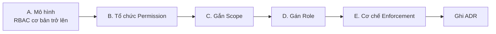
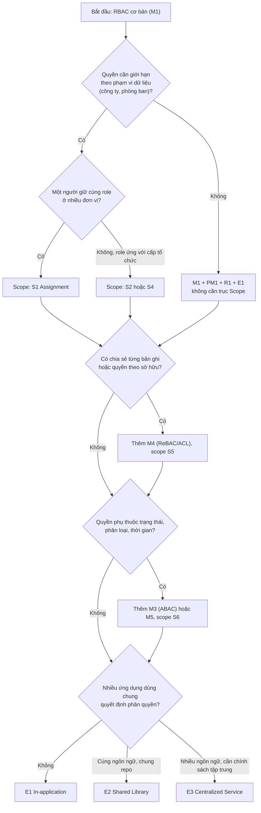
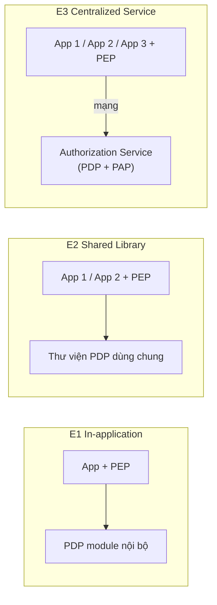

# Authorization Design Options Catalog

**Mục đích:** danh mục các phương án thiết kế phân quyền, mỗi phương án là một **pattern độc lập** để dự án đọc, so sánh và chọn, không phải thiết kế lại từ đầu.
**Tài liệu đi kèm:** [enterprise-authorization-architecture-v1_4_1-vi.md](enterprise-authorization-architecture-v1_4_1-vi.md) là **Reference Architecture** (kiến trúc nền tảng, nguyên tắc bảo mật, một cách triển khai tham chiếu). Các ký hiệu `§n` trong tài liệu này trỏ tới đó.
**Trạng thái:** đặc tả thiết kế, chưa được kiểm chứng trong môi trường sản phẩm. Chỉ hồ sơ tham chiếu (M1 + PM1 + S1 + R1 + E1) có mô tả dữ liệu và thuật toán đầy đủ ở Reference Architecture; các pattern còn lại là hướng dẫn thiết kế, cần dự án tự viết test.

---

## 0. Cách dùng tài liệu

### 0.1 Hai tài liệu, hai mục tiêu

| | Reference Architecture | Design Options Catalog (tài liệu này) |
|---|---|---|
| Câu hỏi trả lời | "Một hệ thống phân quyền tốt trông như thế nào và phải giữ những nguyên tắc nào?" | "Có những cách nào để làm từng phần, và dự án của tôi nên chọn cách nào?" |
| Nội dung | Thành phần PEP/PDP, bất biến an toàn, thuật toán quyết định, mô hình dữ liệu tham chiếu, lỗi, cache, audit | Các pattern độc lập theo 5 trục lựa chọn, tiêu chí chọn, đường chuyển đổi |
| Tính ràng buộc | Các bất biến cần giữ | Không ràng buộc: mỗi dự án tự chọn và ghi ADR |

Không biến kiến trúc thành một hệ thống duy nhất với thật nhiều cờ cấu hình. Mỗi pattern dưới đây đứng riêng, có đủ cấu trúc để triển khai mà không cần đọc các pattern khác; ghép chúng lại chỉ qua các bất biến chung ở mục 1.

### 0.2 Năm trục lựa chọn

Một dự án mới đi qua năm quyết định, theo thứ tự:



| Trục | Câu hỏi | Pattern |
|---|---|---|
| **A. Mô hình** | Quyền được quyết định dựa trên gì? | M1 Basic RBAC, M2 Hierarchical RBAC, M3 RBAC + ABAC, M4 RBAC + ReBAC/ACL, M5 Policy-based |
| **B. Tổ chức Permission** | Permission được đặt tên và cấu trúc ra sao? | PM1 Resource.Action, PM2 Business Actions, PM3 Module Namespace, PM4 Permission + Policy Reference |
| **C. Gắn Scope** | Phạm vi dữ liệu được lưu hoặc suy ra ở đâu? | S1 Assignment, S2 Role-permission, S3 Permission key, S4 Principal attribute, S5 Relationship, S6 Policy/query |
| **D. Gán Role** | Ai nhận role, qua kênh nào? | R1 User→Role, R2 Group→Role, R3 Org Unit→Role, R4 Hybrid |
| **E. Enforcement** | Logic kiểm tra quyền chạy ở đâu? | E1 In-application, E2 Shared Library, E3 Centralized Service, kèm lớp tăng cường E+ (database RLS) |

Ranh giới tenant (một tenant một công ty, nhiều công ty, nhiều tenant) là quyết định nền tảng, được mô tả ở Reference Architecture (§5, §20) chứ không phải một pattern trong catalog này.

### 0.3 Khuôn của mỗi pattern

Mỗi pattern có đủ tám mục:

1. **What:** phương án là gì.
2. **Architecture:** cấu trúc hoạt động.
3. **Database Model:** cách tổ chức dữ liệu (dạng bảng, không phải SQL).
4. **Authorization Flow:** các bước đánh giá quyền.
5. **Advantages / Disadvantages.**
6. **Trade-offs:** đánh đổi cần cân nhắc.
7. **Suitable Use Cases:** khi nào hợp.
8. **Migration Path:** khi nào cần chuyển sang phương án khác và chuyển thế nào.

---

## 1. Bất biến chung cho mọi pattern

Các bất biến này đúng bất kể chọn pattern nào ở mọi trục; chi tiết ở Reference Architecture. Pattern nào làm vỡ một bất biến thì không được chấp nhận.

| # | Bất biến | Tham chiếu |
|---|---|---|
| 1 | Deny-by-default, fail closed: thiếu dữ liệu hoặc lỗi phụ thuộc thì từ chối | T1, §11, §15 |
| 2 | Authentication không phải authorization; token không mang danh sách quyền | §4 |
| 3 | Tenant lấy từ membership phía server, không tin client; tenant isolation độc lập với scope | §10.3, §20 |
| 4 | Scope không bao giờ đến từ client; giá trị client chỉ được thu hẹp kết quả | §9.3 |
| 5 | Scope đã lưu hoặc suy ra không phải bằng chứng: kiểm với resource tải từ nguồn chính thức | §9.1 |
| 6 | Một đường đánh giá duy nhất cho API, danh sách, export, bulk, job nền | §11.5 |
| 7 | Quyết định danh sách đi qua `FilterPlan` có kiểu, thêm trước phân trang và đếm | §13 |
| 8 | Quyền quản trị không cho leo thang đặc quyền và không tự gán | §7.8 |
| 9 | Thay đổi quyền được audit; cache key chứa mọi đầu vào ảnh hưởng quyết định | §22, §23 |
| 10 | Mọi pattern cùng trả một contract đầu ra: quyết định `ALLOW`/`DENY` và `FilterPlan`, để PEP và data layer không phụ thuộc pattern | §11, §16 |

Bất biến số 10 là điều giúp các pattern **hoán đổi được**: đổi cách gắn scope hay cách gán role không buộc sửa PEP hay tầng truy cập dữ liệu.

---

## 2. Chọn pattern

### 2.1 Cây quyết định nhanh



### 2.2 Hồ sơ khởi đầu (Starter Profile)

Nếu chưa có yêu cầu nào buộc khác, bắt đầu bằng hồ sơ này. Đây cũng là hồ sơ mà Reference Architecture mô tả đầy đủ.

| Trục | Chọn |
|---|---|
| A. Mô hình | M1 Basic RBAC |
| B. Permission | PM1 Resource.Action |
| C. Scope | S1 Assignment (bỏ qua nếu không cần giới hạn dữ liệu) |
| D. Gán Role | R1 User→Role |
| E. Enforcement | E1 In-application, có PEP/PDP là hai module tách bạch |

### 2.3 Tương thích giữa các trục

| Pattern | Đi cùng tốt với | Cần lưu ý khi ghép |
|---|---|---|
| M1 | Mọi pattern ở trục B, C, D, E | Nền tảng của mọi hồ sơ |
| M2 | PM1, PM3; S1, S2; R1, R2 | Role cha ảnh hưởng nhiều role con; cần cấm vòng lặp và cache hủy theo hierarchy |
| M3 | PM4; S4, S6; E1, E2, E3 | Cần attribute registry và nguồn thuộc tính tin cậy |
| M4 | S5; E1, E3 | Cần kho quan hệ; lọc tập hợp phải có chiến lược riêng |
| M5 | PM4; S6; E3 (hoặc E2 nhúng engine) | Cần quản lý vòng đời policy và công cụ giải thích |
| PM3 | Mọi pattern ở trục C | Namespace không thay thế context kind `PLATFORM`/`TENANT` |
| S3 | PM1 nhưng khóa phình theo tổ hợp | Không đi cùng PM4 (policy thay cho scope cố định) |
| R2, R3 | S1, S2, S4 | Phải giải thích được nguồn gốc quyền khi một người thuộc nhiều nhóm |
| E3 | Mọi mô hình | Cần SLA và fail-closed rõ ràng khi service không khả dụng |

---

## 3. Trục A: Mô hình phân quyền

Mọi hồ sơ bắt đầu từ M1. Các pattern còn lại **bổ sung** lên M1 khi có yêu cầu cụ thể, không thay thế.

### M1. Basic RBAC

**1. What.** Quyền được xác định qua role: người dùng được gán role, role chứa permission. Không có điều kiện dữ liệu.

**2. Architecture.**

```text
Principal --(được gán)--> Role --(chứa)--> Permission
```

PEP gọi PDP; PDP chỉ cần tra cứu các role đang hiệu lực của principal rồi hợp các permission của chúng.

**3. Database Model.**

| Bảng | Cột chính |
|---|---|
| `principals` | id, loại, trạng thái |
| `roles` | id, key, loại, tenant sở hữu (nếu role tùy chỉnh) |
| `permissions` | id, key, mức rủi ro |
| `role_permissions` | role_id, permission_id |
| `role_assignments` | principal_id, role_id, thời hạn, trạng thái (xem trục D) |

**4. Authorization Flow.**

1. Xác thực principal, xác định tenant từ membership.
2. Lấy các role đang hiệu lực (còn hạn, membership `ACTIVE`).
3. Hợp các permission của các role đó.
4. Permission cần có thuộc tập đó thì `ALLOW`, ngược lại `DENY`.

**5. Advantages / Disadvantages.**

| Ưu điểm | Nhược điểm |
|---|---|
| Đơn giản, dễ hiểu, dễ kiểm toán, dễ cache | Không giới hạn được theo dữ liệu |
| Dễ quản trị bằng giao diện | Số role phình khi nghiệp vụ phức tạp ("role explosion") |
| Phù hợp mọi framework | Không biểu diễn được điều kiện phụ thuộc dữ liệu |

**6. Trade-offs.** Đơn giản đổi lấy độ chi tiết. Mọi nhu cầu giới hạn dữ liệu phải đi qua trục Scope hoặc được bổ sung bằng M3/M4.

**7. Suitable Use Cases.** Ứng dụng nhỏ đến vừa, hệ thống CRUD, ít nhóm người dùng, vai trò ổn định; điểm xuất phát của mọi dự án.

**8. Migration Path.** Chuyển hoặc bổ sung khi: cần giới hạn theo phòng ban/công ty (thêm trục Scope, S1 trước), role bắt đầu nhân bản theo đơn vị (đổi cách gắn scope sang S1 hoặc S4), cần điều kiện theo trạng thái dữ liệu (thêm M3), cần chia sẻ từng bản ghi (thêm M4). Không phải bỏ M1: các pattern kia chồng lên và dùng lại role-permission hiện có.

---

### M2. Hierarchical RBAC

**1. What.** Role được tổ chức thành cây; role cấp cao kế thừa permission của role cấp thấp.

**2. Architecture.**

```text
Admin -> Manager -> Supervisor -> Employee   (mũi tên: kế thừa quyền từ role bên phải)
```

PDP mở rộng tập role của principal thành tập role cộng mọi role mà chúng kế thừa, rồi áp M1.

**3. Database Model.**

| Bảng | Cột chính |
|---|---|
| `role_inheritance` | parent_role_id, child_role_id |
| Ràng buộc | cấm chu trình; giới hạn độ sâu; cha và con cùng loại role và cùng chủ sở hữu |

**4. Authorization Flow.**

1. Lấy role hiệu lực của principal như M1.
2. Duyệt cây để thêm các role được kế thừa (có thể tính trước và cache theo phiên bản hierarchy).
3. Hợp permission, rồi đánh giá như M1.

**5. Advantages / Disadvantages.**

| Ưu điểm | Nhược điểm |
|---|---|
| Giảm khai báo permission trùng lặp | Đổi quyền ở role cha lan sang nhiều role con |
| Khớp tổ chức có cấp bậc rõ | Khó giải thích nguồn gốc một quyền |
| Tái sử dụng quyền | Cần xử lý chu trình, độ sâu, xung đột |

**6. Trade-offs.** Giảm trùng lặp nhưng tăng độ khó khi audit và khi cache (đổi hierarchy phải hủy cache rộng). Quyết định trước: kế thừa đơn hay đa, toàn bộ hay chọn lọc.

**7. Suitable Use Cases.** Tổ chức có cấp bậc ổn định, role mở rộng từ nhau theo một chiều.

**8. Migration Path.** Từ M1 khi thấy nhiều role lặp lại cùng nhóm permission. Quay về M1 phẳng (sao chép permission xuống từng role) khi hierarchy rối đến mức không giải thích được quyền. Nếu "kế thừa" thực chất là kế thừa theo phạm vi tổ chức, nên dùng trục Scope (S1/S2/S4) thay vì hierarchy role.

---

### M3. RBAC + ABAC

**1. What.** Giữ RBAC cho "được làm gì" và thêm điều kiện dựa trên thuộc tính của subject, resource và môi trường.

**2. Architecture.**

```text
PEP --> PDP --(grant từ role)--> kiểm tra điều kiện thuộc tính --> quyết định
                                  ^
                          PIP: attribute registry (user, resource, môi trường)
```

Chỉ thuộc tính nằm trong **attribute registry** mới được dùng; giá trị client bị bỏ qua.

**3. Database Model.**

| Thành phần | Nội dung |
|---|---|
| Attribute registry | tên thuộc tính, kiểu, nguồn có thẩm quyền, chủ sở hữu, độ tươi tối đa |
| Thuộc tính resource | cột trên chính resource (`status`, `department_id`, `classification`) |
| Thuộc tính subject | từ hệ thống HR/IdP hoặc bảng nội bộ |
| Điều kiện (ràng buộc bắt buộc) | định nghĩa theo permission: bảng quy tắc hoặc mã chính sách |

**4. Authorization Flow.**

1. Như M1: xác định có grant cho permission.
2. Nạp thuộc tính cần thiết (resource từ nguồn chính thức, subject từ nguồn tin cậy).
3. Đánh giá từng điều kiện; thuộc tính thiếu hoặc không tin cậy thì `INDETERMINATE` (từ chối).
4. Tất cả điều kiện đạt thì `ALLOW`. Với danh sách, điều kiện trở thành các node trong `FilterPlan`.

**5. Advantages / Disadvantages.**

| Ưu điểm | Nhược điểm |
|---|---|
| Biểu diễn điều kiện nghiệp vụ không cần thêm role | Policy khó debug nếu không có giải thích quyết định |
| Quyền theo trạng thái, thời gian, phân loại | Phụ thuộc chất lượng và độ tươi của thuộc tính |
| Kết hợp được với mọi cách gắn scope | Điều kiện phải dịch được sang `FilterPlan` cho danh sách |

**6. Trade-offs.** Linh hoạt đổi lấy khả năng giải thích và kiểm thử. Nên giới hạn số thuộc tính và chỉ thêm khi có yêu cầu cụ thể.

**7. Suitable Use Cases.** Quyền phụ thuộc trạng thái bản ghi (chỉ sửa khi `DRAFT`), cấp độ phân loại, giờ làm việc, mức xác thực.

**8. Migration Path.** Từ M1 khi một quy tắc không thể diễn đạt bằng role và scope. Bắt đầu bằng vài ràng buộc bắt buộc đặt cạnh grant. Chuyển sang M5 khi số quy tắc nhiều đến mức cần quản lý vòng đời policy, versioning và công cụ giải thích riêng.

---

### M4. RBAC + ReBAC / ACL

**1. What.** Quyền phụ thuộc quan hệ giữa principal và resource (chủ sở hữu, thành viên, người được chia sẻ), hoặc danh sách quyền gắn trực tiếp vào resource.

**2. Architecture.**

```text
PDP --(role: có permission?)--> grant
    --(quan hệ: principal có quan hệ gì với resource?)--> kho quan hệ / ACL
```

Role cho biết loại hành động được phép; quan hệ cho biết trên bản ghi nào.

**3. Database Model.**

| Bảng | Cột chính |
|---|---|
| `resource_relationships` | tenant_id, subject (principal hoặc nhóm), relation (`owner`, `member`, `viewer`), resource_type, resource_id, hiệu lực |
| `resource_acl` (biến thể ACL) | tenant_id, resource_id, subject, permissions cho phép |
| Quy tắc kế thừa quan hệ (tùy chọn) | resource con kế thừa quan hệ của resource cha |

**4. Authorization Flow.**

1. Kiểm tra permission qua role (M1).
2. Tải resource kèm tenant predicate; tra quan hệ giữa principal và resource.
3. Quan hệ đủ cho hành động thì `ALLOW`.
4. Với danh sách: sinh `FilterPlan` từ các resource mà principal có quan hệ (ví dụ `id IN (...)` hoặc điều kiện sở hữu), áp trước phân trang.

**5. Advantages / Disadvantages.**

| Ưu điểm | Nhược điểm |
|---|---|
| Chính xác đến từng resource, không cần role cho từng resource | Cần quản lý kho quan hệ và vòng đời của nó |
| Biểu diễn chia sẻ và sở hữu tự nhiên | Đánh giá phức tạp khi quan hệ nhiều tầng |
| Hỗ trợ quyền kế thừa theo cấu trúc | Khó lọc tập hợp lớn; số bản ghi quan hệ tăng nhanh |

**6. Trade-offs.** ACL đơn giản nhưng khó quản trị tập trung khi số resource lớn; ReBAC mạnh hơn nhưng cần hạ tầng đánh giá đồ thị. Phải chọn nguồn sự thật duy nhất cho mỗi quan hệ.

**7. Suitable Use Cases.** Nền tảng cộng tác, quản lý tài liệu, quản lý dự án, chia sẻ tài nguyên cho người dùng hoặc nhóm.

**8. Migration Path.** Thêm vào M1 khi xuất hiện yêu cầu "chia sẻ cho người này" hoặc "chỉ chủ sở hữu được sửa". Bắt đầu với quan hệ phẳng (`owner`, `member`); chuyển sang đồ thị hoặc engine chuyên dụng khi cần kế thừa nhiều tầng và hiệu năng kiểm tra lớn. Nếu quan hệ thực chất là thuộc về đơn vị tổ chức, dùng S1/S4 thay vì M4.

---

### M5. Policy-Based Access Control (PBAC)

**1. What.** Quyết định do một tập policy có phiên bản đưa ra, có thể kết hợp RBAC, ABAC, ReBAC và điều kiện khác; logic tách khỏi mã nghiệp vụ.

**2. Architecture.**

```text
PEP --> PDP (policy engine) <-- policy bundle có phiên bản (PAP quản lý, phát hành, rollback)
              ^
         PIP cung cấp thuộc tính, quan hệ
```

**3. Database Model.**

| Thành phần | Nội dung |
|---|---|
| Policy bundle | tập policy có phiên bản, chữ ký hoặc checksum |
| Lịch sử phát hành | ai phát hành, khi nào, bản trước đó (phục vụ rollback) |
| Liên kết permission–policy | permission nào dùng policy nào |
| Dữ liệu cho policy | thuộc tính, quan hệ qua PIP |

**4. Authorization Flow.**

1. PEP gửi (principal, action, resource, context) tới PDP.
2. PDP nạp bundle đang hiệu lực, thu thập dữ liệu qua PIP.
3. Đánh giá policy theo thuật toán kết hợp đã định (ví dụ deny-override, cần allow tường minh).
4. Trả quyết định, obligation và mã lý do; với danh sách trả `FilterPlan`.

**5. Advantages / Disadvantages.**

| Ưu điểm | Nhược điểm |
|---|---|
| Tách authorization khỏi business logic; policy tái sử dụng | Thêm hạ tầng: engine, pipeline phát hành, công cụ test policy |
| Phù hợp nhiều quy tắc nghiệp vụ và chính sách thay đổi thường xuyên | Phát sinh độ trễ nếu engine ở xa |
| Có thể chia sẻ giữa nhiều ứng dụng | Bundle hỏng hoặc không đọc được phải xử lý fail-closed |

**6. Trade-offs.** Mạnh và tập trung đổi lấy chi phí vận hành. Cần quy trình review policy, test hồi quy và giải thích quyết định.

**7. Suitable Use Cases.** Doanh nghiệp lớn, nhiều ứng dụng cùng một chính sách, yêu cầu tuân thủ buộc phải có vòng đời policy được quản trị.

**8. Migration Path.** Từ M3 khi số quy tắc và số đội viết quy tắc tăng đến mức mã chính sách nằm rải rác trong nhiều ứng dụng. Cách chuyển: đưa từng nhóm ràng buộc hiện có vào policy, chạy song song (so sánh quyết định) trước khi chuyển hẳn. Đi cùng E3 hoặc E2 nhúng engine.

---

## 4. Trục B: Tổ chức Permission

Permission là **năng lực nghiệp vụ**, không phải tên màn hình hay nút bấm. Mọi pattern dưới đây đều cần một catalog tập trung, có phiên bản, khai báo loại ngữ cảnh và mức rủi ro (Reference Architecture §6).

### PM1. Resource.Action

**1. What.** Permission là cặp tài nguyên và hành động: `document.read`, `document.update`.

**2. Architecture.** Danh mục phẳng, một permission thuộc đúng một resource type và một action. Kiểm tra là so khớp khóa.

**3. Database Model.**

| Bảng `permissions` | Cột |
|---|---|
| | id, key (`resource.action`), resource_type, action, context_kind, risk_level, mô tả, deprecated_at |

**4. Authorization Flow.** Yêu cầu mang `action` là khóa permission; PDP kiểm khóa có trong catalog (không có thì lỗi của bên gọi), rồi tra grant như M1.

**5. Advantages / Disadvantages.**

| Ưu điểm | Nhược điểm |
|---|---|
| Rõ ràng, dễ đặt tên và tìm | Ít biểu đạt hành động nghiệp vụ phức tạp |
| Resource và action mở rộng độc lập | Số permission có thể phình nếu action quá mịn |
| Không phụ thuộc giao diện | Chưa nói gì về phạm vi dữ liệu |

**6. Trade-offs.** Hành động CRUD thuần dễ cài đặt nhưng che mất các hành động nghiệp vụ (duyệt, xuất, chuyển); khi cần, chuyển sang PM2.

**7. Suitable Use Cases.** Hầu hết ứng dụng web và API; điểm xuất phát chuẩn.

**8. Migration Path.** Sang PM2 khi xuất hiện hành động không khớp CRUD (approve, export, transfer): thêm permission mới, không phải đổi tên permission cũ. Sang PM3 khi số module tăng và khóa bắt đầu va chạm.

---

### PM2. Business-oriented (Hybrid) Actions

**1. What.** Ngoài CRUD, permission mô tả hành động nghiệp vụ: `project.approve`, `project.archive`, `document.export`, `order.refund`.

**2. Architecture.** Cùng danh mục phẳng như PM1, nhưng tập action gồm cả CRUD, nhóm mở rộng (list, export, import, download) và nhóm nghiệp vụ (approve, reject, submit, publish, assign, transfer, archive, restore).

**3. Database Model.** Như PM1, thêm cột `action_kind` (`CRUD`, `EXTENDED`, `BUSINESS`) và `risk_level` chính xác hơn (hành động nhạy cảm là `HIGH`, không qua cache).

**4. Authorization Flow.** Như PM1; hành động nghiệp vụ thường kèm ràng buộc trạng thái (chỉ duyệt khi `SUBMITTED`) và obligation (bước xác thực mạnh hơn), nên hay đi cùng M3 hoặc PM4.

**5. Advantages / Disadvantages.**

| Ưu điểm | Nhược điểm |
|---|---|
| Khớp ngôn ngữ nghiệp vụ, phân quyền đúng chức năng | Danh mục lớn hơn, cần quản trị chặt |
| Kiểm soát riêng các hành động rủi ro cao | Dễ đặt tên không nhất quán nếu thiếu quy ước |

**6. Trade-offs.** Độ chi tiết cao hơn cho nghiệp vụ nhưng tăng chi phí quản trị role. Nên gom hành động theo năng lực nghiệp vụ, không theo từng nút.

**7. Suitable Use Cases.** Workflow doanh nghiệp, phê duyệt nhiều bước, hệ thống tài chính hoặc nhân sự.

**8. Migration Path.** Từ PM1 bằng cách thêm permission mới và đưa vào role phù hợp; role hiện có không bị ảnh hưởng nếu chỉ thêm. Chỉ tách permission cũ khi một hành động CRUD thực chất mang nhiều ý nghĩa nghiệp vụ khác nhau; làm bằng migration danh mục có phiên bản (Reference Architecture §6.3).

---

### PM3. Module Namespace

**1. What.** Khóa permission có tiền tố module: `project.milestone.update`, `document.folder.create`, hoặc cấu trúc `<module>.<resource>.<action>`.

**2. Architecture.** Danh mục có chủ sở hữu theo module; mỗi module đăng ký permission của mình vào catalog trung tâm. Quy ước đặt tên được lint trong CI.

**3. Database Model.** Như PM1, thêm `module` và `owner_team`; ràng buộc khóa duy nhất toàn cục. Permission nền tảng (`platform.*`) giữ tiền tố riêng để loại ngữ cảnh nhìn thấy được trong khóa.

**4. Authorization Flow.** Như PM1; module không được kiểm permission của module khác bằng cách đọc bảng trực tiếp mà qua PDP.

**5. Advantages / Disadvantages.**

| Ưu điểm | Nhược điểm |
|---|---|
| Không va chạm tên khi nhiều đội, nhiều module | Khóa dài hơn |
| Có chủ sở hữu rõ cho từng nhóm permission | Cần quy ước và lint để giữ nhất quán |
| Hỗ trợ lọc, báo cáo theo module | Đổi tên module kéo theo migration danh mục |

**6. Trade-offs.** Chi phí đặt tên và quản trị đổi lấy khả năng mở rộng theo số đội.

**7. Suitable Use Cases.** Hệ thống nhiều module hoặc nhiều đội phát triển, kiến trúc modular monolith hoặc microservice dùng chung catalog.

**8. Migration Path.** Từ PM1 khi catalog có nhiều đội cùng sửa hoặc xuất hiện khóa trùng ý nghĩa. Cách chuyển: ánh xạ khóa cũ sang khóa mới bằng bảng map có phiên bản, hỗ trợ cả hai khóa trong một giai đoạn chuyển tiếp, rồi ngừng dùng khóa cũ (đánh dấu `deprecated_at`).

---

### PM4. Permission + Policy Reference

**1. What.** Mỗi permission (hoặc cặp role–permission) tham chiếu một policy quy định điều kiện áp dụng: `project.update` dùng `project_update_policy`.

**2. Architecture.** Catalog có thêm liên kết permission → policy. PDP tra grant, rồi nạp và đánh giá policy tham chiếu.

**3. Database Model.**

| Bảng | Cột |
|---|---|
| `permission_policies` | permission_id, policy_id, phạm vi áp dụng (tùy chọn theo role) |
| `policies` | id, tên, phiên bản, trạng thái phát hành |

**4. Authorization Flow.**

1. Tra grant cho permission (M1).
2. Nạp policy gắn với permission đó (theo phiên bản đang hiệu lực).
3. Đánh giá policy với thuộc tính; policy lỗi hoặc không đọc được thì `INDETERMINATE`.
4. Cả hai đạt thì `ALLOW`.

**5. Advantages / Disadvantages.**

| Ưu điểm | Nhược điểm |
|---|---|
| Tách permission khỏi điều kiện nghiệp vụ | Cần policy engine hoặc lớp đánh giá |
| Đổi điều kiện không cần đổi role | Thêm một chiều cần version và cache |

**6. Trade-offs.** Linh hoạt đổi lấy độ phức tạp; chỉ nên dùng cho permission thật sự có điều kiện, không gắn policy cho mọi permission.

**7. Suitable Use Cases.** Hệ thống dùng M3 hoặc M5, nhiều quy tắc gắn với từng hành động.

**8. Migration Path.** Từ PM1/PM2 khi điều kiện bắt đầu nằm trong mã nghiệp vụ: trích điều kiện ra thành policy, gắn vào permission, chạy song song để so sánh trước khi bỏ kiểm tra trong mã.

---

## 5. Trục C: Gắn Scope

Scope trả lời "grant này áp dụng trên dữ liệu nào". **Không bắt buộc gắn vào assignment.** Mọi pattern dưới đây tuân thủ cùng bộ loại scope (`TENANT`, `COMPANY`, `DEPARTMENT`, `TEAM`, `RESOURCE`, `SELF`) và cùng bất biến chung (mục 1); khác nhau ở **nơi lưu hoặc cách suy ra**. Tóm tắt nằm ở §9.3 của Reference Architecture; dưới đây là bản đầy đủ theo khuôn pattern.

Quy tắc phủ resource, áp dụng cho mọi pattern:

| `scope_type` | Phủ resource khi |
|---|---|
| `TENANT` | luôn luôn trong tenant đó |
| `COMPANY` / `DEPARTMENT` / `TEAM` | `resource.<unit>_id` thuộc tập scope |
| `RESOURCE` | `resource.id` thuộc tập scope |
| `SELF` | `resource.owner_principal_id = principal.id` |

Nhiều scope cho cùng permission kết hợp bằng **hợp (union)**; không có deny ngầm. Giả định mặc định: resource mang khóa ngoại trực tiếp tới đơn vị tổ chức (Reference Architecture A6); nếu cần duyệt cây tổ chức, thêm bước mở rộng scope và ghi vào ADR.

### S1. Assignment-bound Scope

**1. What.** Scope là một phần của phân công role: "gán role `editor` tại `COMPANY company-a`". Bản thân role không mang scope.

**2. Architecture.**

```text
Principal --(assignment: role + scope + thời hạn)--> Role --> Permission
```

**3. Database Model.**

| Bảng `role_assignments` | Cột |
|---|---|
| | tenant_id, principal_id, role_id, **scope_type, scope_id**, valid_from, valid_until, status, created_by, approval_reference |

Ràng buộc: `scope_id` rỗng chỉ với `TENANT`/`SELF`; không có hai dòng `ACTIVE` trùng (principal, role, scope); assignment đã thu hồi là trạng thái cuối. Mô hình dữ liệu đầy đủ: Reference Architecture §8.

**4. Authorization Flow.**

1. Lấy các assignment hiệu lực chứa permission cần kiểm.
2. Với thao tác một resource: tải resource kèm tenant predicate, kiểm có assignment nào có scope phủ resource.
3. Với danh sách: hợp các scope của các assignment thành `FilterPlan` (`team_id IN (...)`).

**5. Advantages / Disadvantages.**

| Ưu điểm | Nhược điểm |
|---|---|
| Một role dùng lại cho mọi scope, ít role | Mỗi (principal, role, scope) một dòng; số dòng lớn với tổ chức lớn |
| Grant tường minh, audit rõ "ai cấp quyền này, ở đâu" | Đổi cơ cấu tổ chức phải bảo trì assignment |
| Thu hồi và hết hạn theo từng scope | Quản trị phức tạp hơn nếu người dùng có nhiều scope |

**6. Trade-offs.** Minh bạch và linh hoạt đổi lấy chi phí bảo trì dữ liệu assignment.

**7. Suitable Use Cases.** Một người giữ cùng role ở nhiều đơn vị; quản trị viên ủy quyền theo từng đơn vị; yêu cầu audit chi tiết.

**8. Migration Path.** Sang S2 hoặc S4 khi số assignment tăng vì mọi người đều "gắn" với đơn vị của chính họ và scope luôn trùng đơn vị đó: scope có thể suy ra thay vì lưu. Cách chuyển: dùng dữ liệu đơn vị của người dùng sinh phép tính tương đương, so sánh hai kết quả (shadow evaluation), rồi bỏ cột scope. Ngược lại, chuyển từ S2/S4 về S1 khi bắt đầu cần ngoại lệ theo người hoặc ủy quyền chéo đơn vị.

---

### S2. Role-Permission-bound Scope (Permission + Scope Type)

**1. What.** Role chứa cặp (permission, **scope type**) như "`project.read` ở mức `DEPARTMENT`". Đơn vị cụ thể được suy ra từ vị trí tổ chức của chính người dùng.

**2. Architecture.**

```text
Role --(permission + scope_type)--> kết quả phân giải bằng đơn vị của Principal
```

**3. Database Model.**

| Bảng | Cột |
|---|---|
| `role_permissions` | role_id, permission_id, **scope_type** |
| `principal_org_units` | principal_id, tenant_id, loại đơn vị, unit_id (vị trí tổ chức có thẩm quyền) |

**4. Authorization Flow.**

1. Lấy role hiệu lực và các cặp (permission, scope_type) khớp.
2. Phân giải `scope_type` thành giá trị cụ thể bằng đơn vị của principal (`DEPARTMENT` → phòng ban hiện tại).
3. Phủ resource hoặc sinh `FilterPlan` như S1. Không phân giải được đơn vị thì `INDETERMINATE`.

**5. Advantages / Disadvantages.**

| Ưu điểm | Nhược điểm |
|---|---|
| Ít dòng assignment; scope tự theo người khi chuyển đơn vị | Role nhân lên theo mức scope (`dept_manager`, `company_manager`) |
| Danh mục role đọc là biết phạm vi | Không có ngoại lệ theo người nếu thiếu cơ chế khác |
| Dễ cache theo (role, đơn vị) | Cần dữ liệu vị trí tổ chức tin cậy |

**6. Trade-offs.** Giảm dữ liệu cấp quyền, đổi lấy việc role gắn chặt với cấp tổ chức.

**7. Suitable Use Cases.** Role tương ứng một-một với cấp tổ chức, người dùng ít khi giữ cùng role ở đơn vị khác.

**8. Migration Path.** Sang S1 khi cần cấp role cho người ở đơn vị ngoài đơn vị của họ. Cách chuyển: tạo assignment S1 cho các ngoại lệ trước (hai cơ chế chạy song song theo nguyên tắc hợp), rồi dần chuyển phần còn lại. Sang S4 nếu scope hoàn toàn suy ra từ thuộc tính người dùng và không còn nhu cầu gắn vào role.

---

### S3. Permission-key-bound Scope (Resource + Action + Scope)

**1. What.** Scope là một phần của khóa permission: `project.read.own`, `project.read.department`, `project.read.company`, `project.read.all`.

**2. Architecture.** Mỗi tổ hợp là một permission độc lập trong catalog; role chứa chính xác những permission cần. Đơn vị cụ thể vẫn suy ra như S2 hoặc S4.

**3. Database Model.** Như PM1; khóa permission có hậu tố scope, thêm cột `scope_type` để lọc, lint kiểm khóa khớp cột.

**4. Authorization Flow.** Yêu cầu chọn khóa theo mức scope cần; PDP tìm các permission cùng gốc (`project.read.*`) mà principal nắm, lấy scope rộng nhất hoặc hợp các scope tương ứng.

**5. Advantages / Disadvantages.**

| Ưu điểm | Nhược điểm |
|---|---|
| Tự mô tả; hiển thị trên giao diện rất rõ | Catalog phình theo resource x action x scope |
| Kiểm tra đơn giản | Thêm scope mới phải migrate catalog |
| Không cần cột scope ở nơi khác | Dễ trùng lặp, khó giữ nhất quán |

**6. Trade-offs.** Đơn giản và minh bạch với ít mức scope cố định; trả giá bằng kích thước catalog.

**7. Suitable Use Cases.** Số mức scope nhỏ và cố định (ví dụ own/department/all), giao diện cần hiển thị quyền rõ ràng.

**8. Migration Path.** Sang S2 khi catalog phình: gộp các khóa `project.read.*` thành một permission `project.read` cộng `scope_type` trên role-permission; viết bảng ánh xạ khóa cũ sang cặp mới và hỗ trợ cả hai trong giai đoạn chuyển tiếp.

---

### S4. Principal-attribute-derived Scope

**1. What.** Scope được suy ra lúc đánh giá từ thuộc tính hoặc membership của principal: công ty, phòng ban đang thuộc hoặc quản lý. Không lưu `scope_id` trong grant.

**2. Architecture.**

```text
PDP --> PIP (HR / IdP / bảng nội bộ): principal thuộc những đơn vị nào? --> scope --> FilterPlan
```

**3. Database Model.**

| Thành phần | Nội dung |
|---|---|
| `principal_org_units` hoặc nguồn HR | principal_id, loại đơn vị, unit_id, quan hệ (thuộc về, quản lý), hiệu lực |
| Attribute registry | khai báo thuộc tính, nguồn có thẩm quyền, độ tươi tối đa |

**4. Authorization Flow.**

1. Xác định grant (role → permission) như M1, với scope được khai báo là "theo thuộc tính".
2. Đọc đơn vị của principal từ nguồn có thẩm quyền (kèm cache có hạn).
3. Phủ resource hoặc sinh `FilterPlan`. Nguồn lỗi hoặc thuộc tính quá cũ thì `INDETERMINATE`.

**5. Advantages / Disadvantages.**

| Ưu điểm | Nhược điểm |
|---|---|
| Không phải bảo trì dữ liệu scope; theo HR tự động | Đúng sai phụ thuộc chất lượng nguồn thuộc tính |
| Người chuyển phòng ban đổi quyền ngay | Khó trả lời "ai cấp quyền này": quyền là hệ quả của dữ liệu |
| Ít dòng phân công | Thay đổi nguồn HR tác động tới quyền mà không qua quy trình cấp quyền |

**6. Trade-offs.** Tự động hóa đổi lấy kiểm soát: thay đổi dữ liệu HR trở thành thay đổi quyền, nên cần audit và cảnh báo khi phạm vi đổi bất thường.

**7. Suitable Use Cases.** Có nguồn tổ chức/HR đáng tin; quyền theo "đơn vị của tôi" và hiếm ngoại lệ.

**8. Migration Path.** Sang S1 khi cần cấp scope độc lập với dữ liệu HR (kiêm nhiệm, ủy quyền tạm): thêm assignment cho các trường hợp đó, giữ S4 cho phần còn lại (hybrid). Cache key phải có epoch của thuộc tính để thu hồi nhanh khi đổi đơn vị.

---

### S5. Relationship-derived Scope (Ownership, Membership, Sharing)

**1. What.** Scope là tập resource mà principal có quan hệ với chúng: sở hữu, là thành viên team sở hữu, được chia sẻ. Gắn với M4.

**2. Architecture.**

```text
PDP --> kho quan hệ: principal có quan hệ gì với resource nào? --> scope động --> FilterPlan
```

**3. Database Model.** Như M4: `resource_relationships` hoặc `resource_acl`, tenant_id bắt buộc, hiệu lực; nguồn sự thật duy nhất cho mỗi quan hệ.

**4. Authorization Flow.**

1. Grant theo role cho hành động.
2. Một resource: tải kèm tenant predicate, kiểm quan hệ. Danh sách: sinh điều kiện từ quan hệ (`owner_principal_id = :me OR id IN (SELECT shared...)` dưới dạng `FilterPlan`, không phải chuỗi SQL do client tạo).
3. Không phân giải được quan hệ thì `INDETERMINATE`.

**5. Advantages / Disadvantages.**

| Ưu điểm | Nhược điểm |
|---|---|
| Chính xác từng resource, không phải tạo role theo resource | Kho quan hệ và đánh giá phức tạp hơn |
| Mô hình sở hữu và chia sẻ tự nhiên | Lọc danh sách lớn đòi hỏi index và thiết kế plan cẩn thận |
| Quyền thay đổi theo hành động chia sẻ | Khó thấy tổng quan "ai truy cập được gì" nếu thiếu công cụ |

**6. Trade-offs.** Tinh vi đổi lấy chi phí truy vấn và quản trị quan hệ; nhớ giữ giới hạn kích thước plan.

**7. Suitable Use Cases.** Nền tảng cộng tác, tài liệu, dự án; mô hình "chủ sở hữu và người được mời".

**8. Migration Path.** Từ S1 khi assignment `RESOURCE` bắt đầu chiếm phần lớn dòng (dấu hiệu cần quan hệ). Cách chuyển: nhập các assignment `RESOURCE` thành bản ghi quan hệ, chạy song song, rồi bỏ. Khi đồ thị quan hệ quá lớn hoặc cần kế thừa nhiều tầng, cân nhắc engine ReBAC chuyên dụng (E3).

---

### S6. Policy / Query-based Scope

**1. What.** Scope là kết quả của một policy sinh ra điều kiện hoặc `FilterPlan`: `status = ACTIVE AND department_id IN user.managed_departments`.

**2. Architecture.**

```text
PDP (policy engine) --(thuộc tính + quan hệ)--> điều kiện --> FilterPlan có kiểu
```

**3. Database Model.** Không có bảng scope riêng. Cần: policy bundle có phiên bản, attribute registry, danh sách trường và toán tử được phép trong `FilterPlan`.

**4. Authorization Flow.**

1. Policy được chọn theo permission (PM4) và đánh giá với thuộc tính đã nạp.
2. Một resource: kiểm điều kiện trên resource. Danh sách: policy xuất điều kiện, hệ thống dịch sang `FilterPlan` đã đăng ký kiểu và kiểm tra runtime trước khi sinh truy vấn tham số hóa.
3. Plan sai kiểu hoặc không dịch được thì không truy vấn, trả lỗi (không bao giờ fallback sang truy vấn không lọc).

**5. Advantages / Disadvantages.**

| Ưu điểm | Nhược điểm |
|---|---|
| Linh hoạt nhất, không lưu dữ liệu scope | Phải có policy lifecycle, công cụ test và giải thích |
| Biểu diễn điều kiện phụ thuộc trạng thái, thời gian | Điều kiện phải dịch được sang plan an toàn; không phải mọi điều kiện đều dịch được |
| Thay đổi chính sách không đổi dữ liệu | Khó dự đoán hiệu năng truy vấn |

**6. Trade-offs.** Biểu đạt tối đa đổi lấy độ phức tạp vận hành và rủi ro sai điều kiện; nên đặt lên trên một pattern khác thay vì dùng một mình.

**7. Suitable Use Cases.** Quyền phụ thuộc trạng thái bản ghi, phân loại, mức xác thực, giờ làm việc; kết hợp S1 hoặc S4 cho phần tổ chức.

**8. Migration Path.** Từ S1/S4 khi xuất hiện điều kiện không biểu diễn được bằng đơn vị. Chuyển bằng cách thêm điều kiện thành ràng buộc ở M3, giữ nguyên cách gắn scope cũ; chỉ chuyển toàn bộ scope sang S6 khi hầu hết quy tắc đã nằm trong policy.

---

### S-Hybrid. Kết hợp nhiều cách gắn scope

Không bắt buộc một cách cho cả hệ thống. Chọn theo từng permission hoặc loại resource:

| Phần của hệ thống | Cách gắn | Lý do |
|---|---|---|
| Vai trò quản trị toàn tenant | S1 (`TENANT`) | Ít, tường minh, cần audit |
| Dữ liệu theo phòng ban của nhân viên | S4 hoặc S2 | Tự theo dữ liệu tổ chức |
| Tài liệu được chia sẻ | S5 | Quan hệ theo từng bản ghi |
| Quy tắc phụ thuộc trạng thái | S6 trên một cách khác | Điều kiện, không phải đơn vị |

Khi kết hợp: cùng một permission có nhiều nguồn scope thì kết hợp bằng **hợp**; mỗi nguồn vẫn phải qua bất biến chung (đặc biệt: kiểm với resource chính thức; không phân giải được thì `INDETERMINATE`). Cache key chứa mọi nguồn.

---

## 6. Trục D: Gán Role

### R1. User → Role

**1. What.** Role được gán trực tiếp cho từng principal.

**2. Architecture.** `Principal --(assignment)--> Role`. Quản trị viên thao tác trên từng người.

**3. Database Model.** Bảng `role_assignments`: tenant_id, principal_id, role_id, hiệu lực, trạng thái, người cấp, mã phê duyệt (cộng cột scope nếu dùng S1). Role phải thuộc hệ thống hoặc đúng tenant; chỉ gán cho membership `ACTIVE`.

**4. Authorization Flow.** Lấy assignment hiệu lực của principal (membership `ACTIVE`, trong thời hạn, role dùng được trong tenant), hợp permission.

**5. Advantages / Disadvantages.**

| Ưu điểm | Nhược điểm |
|---|---|
| Đơn giản nhất, nguồn gốc quyền rõ | Quản trị nặng khi số người lớn |
| Dễ audit từng người | Khó đồng bộ khi tổ chức đổi |

**6. Trade-offs.** Rõ ràng đổi lấy chi phí thao tác khi quy mô tăng.

**7. Suitable Use Cases.** Tổ chức nhỏ hoặc vừa, ít nhóm, số lượng người dùng quản lý được thủ công hoặc qua API.

**8. Migration Path.** Sang R2 khi quản trị theo từng người trở thành gánh nặng hoặc cần đồng bộ từ IdP; sang R3 khi quyền theo cơ cấu tổ chức. Cách chuyển: giữ R1 cho ngoại lệ, đưa phần còn lại sang nhóm hoặc đơn vị; nguồn quyền được hợp nên chuyển dần không làm mất quyền.

---

### R2. Group → Role

**1. What.** Role gán cho nhóm; người dùng kế thừa role qua thành viên nhóm.

**2. Architecture.** `Principal --(membership)--> Group --(group assignment)--> Role`. Nhóm có thể đồng bộ từ Identity Provider.

**3. Database Model.**

| Bảng | Cột |
|---|---|
| `groups` | id, tenant_id, nguồn (nội bộ hoặc IdP), trạng thái |
| `group_memberships` | group_id, principal_id, hiệu lực |
| `group_role_assignments` | group_id, role_id, hiệu lực (và scope nếu dùng S1) |

**4. Authorization Flow.**

1. Tìm các nhóm hiệu lực của principal.
2. Tìm assignment hiệu lực của các nhóm đó.
3. Hợp với assignment trực tiếp (nếu có), rồi đánh giá. Phải ghi lại nguồn của từng grant (qua nhóm nào) để giải thích.

**5. Advantages / Disadvantages.**

| Ưu điểm | Nhược điểm |
|---|---|
| Quản trị theo nhóm, dễ đồng bộ IdP | Khó trả lời "vì sao người này có quyền" khi thuộc nhiều nhóm |
| Thêm người vào nhóm là đủ | Thành viên nhóm thay đổi thay đổi quyền ngầm, cần audit |

**6. Trade-offs.** Quản trị nhẹ đổi lấy truy vết khó; ghi rõ nguồn grant trong decision log. Role chỉ được trao qua nhóm khi ánh xạ nhóm-role tồn tại và được audit.

**7. Suitable Use Cases.** Tổ chức dùng IdP/AD, quản trị theo nhóm chức năng.

**8. Migration Path.** Từ R1 khi nhiều người có cùng tập role. Cách chuyển: tạo nhóm tương ứng, gán role cho nhóm, bỏ assignment trực tiếp trùng. Sang R3 khi nhóm thực chất phản ánh cơ cấu tổ chức. Cache phải hủy theo sự kiện thay đổi membership nhóm.

---

### R3. Organization Unit → Role

**1. What.** Role gán cho đơn vị tổ chức; người nhận role theo vị trí hoặc membership trong đơn vị ("Department Manager của Department A").

**2. Architecture.** `Principal --(vị trí trong đơn vị)--> OrgUnit --(gán role)--> Role`. Hay đi cùng S2/S4 vì scope tự theo đơn vị.

**3. Database Model.**

| Bảng | Cột |
|---|---|
| `org_units` | id, tenant_id, loại, cha (nếu có cây) |
| `org_unit_positions` | principal_id, unit_id, chức danh, hiệu lực |
| `org_unit_role_mappings` | unit_type hoặc chức danh, role_id |

**4. Authorization Flow.**

1. Xác định vị trí hiệu lực của principal trong các đơn vị.
2. Ánh xạ vị trí thành role qua mapping.
3. Phạm vi thường là chính đơn vị đó (xem S2/S4); hợp với các nguồn khác rồi đánh giá.

**5. Advantages / Disadvantages.**

| Ưu điểm | Nhược điểm |
|---|---|
| Khớp cơ cấu tổ chức, tự theo thay đổi tổ chức | Phụ thuộc dữ liệu cơ cấu chính xác |
| Ít thao tác cấp quyền thủ công | Thay đổi tổ chức (sáp nhập, tách) phải xử lý hiệu lực |

**6. Trade-offs.** Tự động hóa đổi lấy phụ thuộc dữ liệu tổ chức; cần quy trình duyệt khi đổi cơ cấu.

**7. Suitable Use Cases.** Doanh nghiệp có cơ cấu rõ, chức danh quyết định quyền.

**8. Migration Path.** Từ R1/R2 khi quyền gần như suy ra được từ chức danh. Giữ R1 cho ngoại lệ (hybrid). Cần xử lý thời điểm hiệu lực khi người điều chuyển để không có khoảng hở quyền.

---

### R4. Hybrid Role Assignment

**1. What.** Kết hợp R1, R2, R3: tùy loại quyền mà chọn kênh gán phù hợp.

**2. Architecture.** Các nguồn grant được gom thành một tập grant hiệu lực duy nhất trước khi đánh giá; mỗi grant mang nhãn nguồn.

**3. Database Model.** Các bảng của R1, R2, R3 cần dùng, cộng một khung nhìn hợp nhất hoặc bước hợp nhất trong PDP; cột `source` (`DIRECT`, `GROUP`, `ORG_UNIT`).

**4. Authorization Flow.** Thu thập grant từ mọi nguồn hiệu lực, hợp, loại grant không còn hiệu lực, đánh giá; ghi nguồn vào decision log.

**5. Advantages / Disadvantages.**

| Ưu điểm | Nhược điểm |
|---|---|
| Mỗi nhu cầu dùng kênh tự nhiên nhất | Nhiều nguồn, khó giải thích và test |
| Phù hợp nhiều nguồn danh tính và cơ cấu | Cache và thu hồi phải xét mọi nguồn |

**6. Trade-offs.** Linh hoạt đổi lấy độ phức tạp; cần công cụ "vì sao người này có quyền X" để vận hành được.

**7. Suitable Use Cases.** Doanh nghiệp lớn với IdP, cơ cấu tổ chức và ngoại lệ cá nhân cùng tồn tại.

**8. Migration Path.** Đạt được dần từ R1 bằng cách thêm từng kênh; không cần chuyển đổi một lần. Nếu quá khó vận hành, thu gọn về hai kênh và ghi lại trong ADR.

---

## 7. Trục E: Cơ chế Enforcement

PEP/PDP là vai trò chức năng, không bắt buộc là service riêng. Dù chọn cách nào, mọi đường truy cập (API, danh sách, export, bulk, job nền, consumer) đều phải qua PEP; data layer luôn thêm tenant predicate.



### E1. In-application Authorization

**1. What.** Mỗi ứng dụng tự kiểm tra quyền trong backend của nó. PEP và PDP là hai module tách bạch trong cùng ứng dụng.

**2. Architecture.** Middleware/service layer gọi module PDP cục bộ; data-access layer thêm tenant predicate và `FilterPlan`; dữ liệu phân quyền nằm trong cùng cơ sở dữ liệu với dữ liệu ứng dụng.

**3. Database Model.** Bảng phân quyền (principals, memberships, roles, permissions, assignments, audit outbox) nằm cùng database với dữ liệu nghiệp vụ, nên ghi audit cùng giao dịch được.

**4. Authorization Flow.** Request → xác thực → context builder → resource resolver (có tenant predicate) → PDP cục bộ → PEP áp quyết định và obligation → data layer thực thi.

**5. Advantages / Disadvantages.**

| Ưu điểm | Nhược điểm |
|---|---|
| Đơn giản, không thêm dịch vụ, không có độ trễ mạng | Logic dễ trùng lặp khi có nhiều ứng dụng |
| Audit và dữ liệu cùng giao dịch | Khó đồng bộ chính sách giữa các ứng dụng |
| Dễ debug | Mỗi ứng dụng tự gánh chi phí cache và test |

**6. Trade-offs.** Đơn giản đổi lấy khó chia sẻ. Phù hợp khi chỉ có một ứng dụng hoặc ít ứng dụng độc lập.

**7. Suitable Use Cases.** Một ứng dụng hoặc modular monolith; điểm xuất phát chuẩn.

**8. Migration Path.** Sang E2 khi có từ hai ứng dụng cùng ngôn ngữ phải dùng cùng logic. Chuẩn bị từ đầu: giữ PDP sau một interface ổn định (`check`, `resolveDataScope`) để đổi nơi chạy không ảnh hưởng PEP.

---

### E2. Shared Authorization Library

**1. What.** Logic PDP đóng gói thành thư viện dùng chung giữa các module hoặc service.

**2. Architecture.** Mỗi service nhúng thư viện, nạp dữ liệu phân quyền (qua database dùng chung hoặc API đọc) và tự đánh giá tại chỗ.

**3. Database Model.** Dữ liệu phân quyền có thể ở database dùng chung hoặc được sao chép sang từng service; xác định rõ nguồn sự thật. Mỗi service giữ cache riêng, phải có khóa cache đủ chiều và cơ chế hủy theo sự kiện.

**4. Authorization Flow.** Như E1 nhưng PDP là thư viện có phiên bản; không có network call cho mỗi lần kiểm tra.

**5. Advantages / Disadvantages.**

| Ưu điểm | Nhược điểm |
|---|---|
| Tái sử dụng logic, không có độ trễ mạng cho quyết định | Quản lý phiên bản thư viện; service cũ có thể chạy logic cũ |
| Không có điểm nghẽn tập trung | Dữ liệu và cache vẫn phân tán |
| Thống nhất hành vi nếu cùng phiên bản | Chỉ dùng được cho cùng hệ sinh thái ngôn ngữ |

**6. Trade-offs.** Giảm trùng lặp mà không thêm dịch vụ, đổi lấy kỷ luật phiên bản và đồng bộ dữ liệu.

**7. Suitable Use Cases.** Nhiều service cùng ngôn ngữ, cùng mô hình phân quyền, đội kiểm soát được việc nâng phiên bản.

**8. Migration Path.** Sang E3 khi có ngôn ngữ khác nhau, khi chính sách cần phát hành tập trung, hoặc khi không thể ép các service nâng phiên bản đồng loạt. Cách chuyển: bọc thư viện thành service, giữ interface `check`/`resolveDataScope`, các service dần đổi sang client gọi service.

---

### E3. Centralized Authorization Service

**1. What.** Các ứng dụng gọi một service tập trung để kiểm tra quyền; service sở hữu PDP (và thường PAP, policy bundle).

**2. Architecture.** PEP ở từng ứng dụng gọi service qua API; service có PIP truy cập dữ liệu và cache riêng; policy phát hành tập trung.

**3. Database Model.** Dữ liệu phân quyền thuộc service. Ứng dụng chỉ giữ dữ liệu nghiệp vụ và các khóa tổ chức trên resource. Audit: sự kiện quyết định do service ghi; sự kiện thay đổi nghiệp vụ vẫn ghi ở ứng dụng. Các thay đổi quyền cần cơ chế phát hành sự kiện hủy cache.

**4. Authorization Flow.**

1. PEP gửi (principal, action, resource, context) tới service.
2. Service đánh giá và trả quyết định, obligation, `FilterPlan` (cho danh sách).
3. PEP thực thi; data layer của ứng dụng áp tenant predicate và plan. Service không sinh SQL; plan là dữ liệu có kiểu.
4. Service không khả dụng thì ứng dụng từ chối (503), trừ ngoại lệ cache grace đã được phê duyệt bằng ADR.

**5. Advantages / Disadvantages.**

| Ưu điểm | Nhược điểm |
|---|---|
| Thống nhất quyết định giữa nhiều ứng dụng và ngôn ngữ | Độ trễ mạng; phải đảm bảo khả dụng và mở rộng |
| Policy quản lý và phát hành tập trung | Nguy cơ trở thành điểm nghẽn và điểm lỗi chung |
| Một nơi để audit và quan sát | Ranh giới giao dịch với audit khó hơn |

**6. Trade-offs.** Tập trung và nhất quán đổi lấy độ khả dụng, độ trễ và chi phí vận hành. Phải định nghĩa SLA, timeout, breaker và hành vi khi lỗi (fail closed).

**7. Suitable Use Cases.** Nhiều ứng dụng, nhiều ngôn ngữ, yêu cầu chính sách tập trung và tuân thủ.

**8. Migration Path.** Từ E1/E2 khi số ứng dụng hoặc ngôn ngữ vượt khả năng đồng bộ thư viện. Chuyển theo từng ứng dụng, chạy song song so sánh quyết định, giữ interface ổn định. Nếu độ trễ không chấp nhận được, quay về E2 cho các đường nóng (có cache theo epoch) và giữ E3 cho quản trị.

---

### E+. Database Row-Level Security (lớp tăng cường)

Không phải một cơ chế thay thế E1–E3 mà là **lớp phòng thủ sâu** đặt cạnh chúng.

**1. What.** Cơ sở dữ liệu tự áp điều kiện tenant (và có thể cả scope) cho mọi truy vấn qua chính sách RLS.

**2. Architecture.** Ứng dụng đặt tenant context cho mỗi giao dịch; database lọc dòng theo chính sách. Authorization ở ứng dụng vẫn là nguồn quyết định.

**3. Database Model.** Cột `tenant_id` bắt buộc; chính sách RLS theo bảng; role ứng dụng không có quyền bỏ qua RLS và không phải chủ sở hữu bảng.

**4. Authorization Flow.** Ứng dụng đặt và xóa context an toàn theo giao dịch (connection pool không được rò context); RLS chặn truy vấn sai tenant ngay cả khi mã ứng dụng có lỗi.

**5. Advantages / Disadvantages.**

| Ưu điểm | Nhược điểm |
|---|---|
| Chặn rò rỉ tenant do lỗi ứng dụng | Phức tạp vận hành (pool, migration, hiệu năng) |
| Là lớp bảo vệ độc lập | Không thay thế authorization ở ứng dụng; scope phức tạp khó diễn đạt trong RLS |

**6. Trade-offs.** Thêm an toàn cho cô lập tenant, đổi lấy phức tạp vận hành.

**7. Suitable Use Cases.** Yêu cầu cô lập tenant nghiêm ngặt hoặc quy định tuân thủ.

**8. Migration Path.** Thêm vào bất kỳ hồ sơ nào khi rủi ro rò rỉ tenant cần thêm một lớp; bắt đầu với tenant predicate, chưa đưa scope vào RLS. Nếu không dùng, ghi biện pháp thay thế ở tầng ứng dụng và data-access vào ADR.

---

## 8. Ví dụ ghép hồ sơ

Ba hồ sơ mẫu cho thấy cách ghép các trục; đây là ví dụ minh họa, không phải khuyến nghị bắt buộc.

| Trục | Hồ sơ 1: Ứng dụng nội bộ nhỏ | Hồ sơ 2: Doanh nghiệp nhiều công ty | Hồ sơ 3: Nền tảng cộng tác |
|---|---|---|---|
| A. Mô hình | M1 | M1 + M3 (ràng buộc trạng thái) | M1 + M4 |
| B. Permission | PM1 | PM2 + PM3 | PM1 |
| C. Scope | Không cần | S1 cho quản trị, S4 cho dữ liệu theo phòng ban (hybrid) | S5 (chia sẻ, sở hữu) + S1 cho quản trị tenant |
| D. Gán Role | R1 | R4 (R2 từ IdP + R3 theo cơ cấu + R1 ngoại lệ) | R1 + R2 |
| E. Enforcement | E1 | E3 (nhiều ứng dụng), thêm E+ | E1 hoặc E2 |

Điểm chung của cả ba: cùng bất biến ở mục 1, cùng contract `ALLOW`/`DENY` + `FilterPlan`, cùng tenant isolation. Chỉ các pattern ở từng trục là khác nhau.

---

## 9. Ghi ADR và checklist chọn

### 9.1 ADR cho mỗi trục

Dùng khuôn sau cho mỗi trục (A đến E) và cho quyết định tenant boundary (Reference Architecture §5):

```text
Decision:        [Trục và pattern đã chọn, ví dụ "C. Scope: S1 + S4 (hybrid)"]
Context:         [Yêu cầu, quy mô, rủi ro, nguồn dữ liệu tổ chức]
Options:         [Các pattern đã cân nhắc]
Selected:        [Pattern được chọn]
Rationale:       [Lý do, so với mục "Suitable Use Cases"]
Trade-offs:      [Ưu, nhược, giới hạn đã chấp nhận]
Invariants:      [Xác nhận giữ đủ các bất biến ở mục 1]
Migration:       [Dấu hiệu sẽ buộc đổi pattern và đường chuyển (mục 8 của pattern)]
Evidence:        [Test đã viết cho pattern này; pattern ngoài hồ sơ tham chiếu cần test riêng]
```

### 9.2 Checklist khi chốt

- [ ] Đã bắt đầu từ M1 và chỉ thêm M2–M5 khi có yêu cầu cụ thể.
- [ ] Đã chọn một tổ chức permission (PM1–PM4) và một quy ước đặt tên, có lint trong CI.
- [ ] Đã chọn cách gắn scope cho từng nhóm permission (S1–S6 hoặc hybrid) và nguồn có thẩm quyền của scope.
- [ ] Đã chọn kênh gán role (R1–R4) và có cách giải thích "vì sao người này có quyền".
- [ ] Đã chọn enforcement (E1–E3, có hoặc không E+) và giữ interface `check`/`resolveDataScope` ổn định để đổi sau này.
- [ ] Đã xác nhận đủ 10 bất biến ở mục 1 cho tổ hợp đã chọn.
- [ ] Với mọi pattern ngoài hồ sơ tham chiếu: đã viết test cho scope, hết hạn, thu hồi, chéo tenant, danh sách, bulk, lỗi phụ thuộc.
- [ ] Đã ghi ADR cho từng trục, kèm dấu hiệu và đường chuyển đổi.
