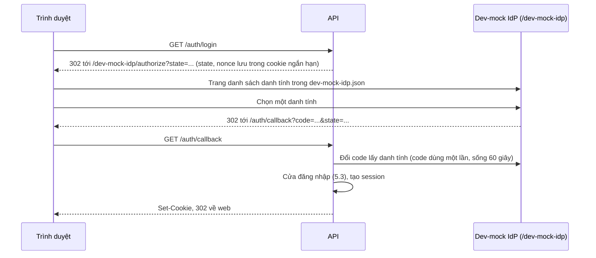
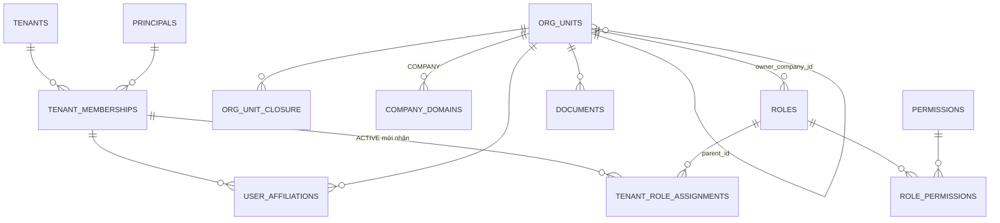

# Mini app quản lý user và phân quyền — Đặc tả rút gọn

Phiên bản 0.1 · 2026-11-06 · Dựa trên `../enterprise-authorization-architecture-v1_4_1-vi.md` (gọi tắt là **"tài liệu gốc"**, số mục ghi dạng `§8.5`).

Mục đích của app: **hiểu luồng phân quyền** bằng cách tự tay quản lý user, role, scope và nhìn thấy từng bước PDP ra quyết định. App không phải sản phẩm production.

---

## 1. Phạm vi

**Làm:**
- Đăng nhập SSO, tạm thời dùng IdP giả lập `dev-mock`, sau này thay bằng OIDC thật mà không đụng tới phần phân quyền.
- Một tenant, nhiều công ty có cấp bậc, phòng ban, team.
- Quản lý user, membership, affiliation, domain email của công ty.
- Permission catalog, role hệ thống, custom role cấp tổ chức và cấp công ty.
- Gán, thu hồi role có scope và thời hạn, kèm quy tắc cấp bậc.
- PEP / ContextBuilder / PDP / FilterPlan đúng tinh thần tài liệu gốc §3, §10, §11, §13.
- Tài nguyên demo `document` để thấy data scope hoạt động và phân biệt 403 với 404.
- Simulator giải thích quyết định, ma trận quyền hiệu lực, "Ai có quyền X", nhật ký audit.

**Không làm** (tài liệu gốc §1.3 và các mục tùy chọn): đa tenant, tầng platform, support session, impersonation, break-glass, delegation, explicit deny, cấp quyền trực tiếp, kế thừa role, map group từ IdP, SCIM, RLS, policy engine, cache, bulk, obligation, quản lý phiên bản catalog, outbox relay/sink, chuyển tài nguyên giữa các đơn vị.

## 2. Thuật ngữ nhanh

| Thuật ngữ | Trong app này |
|---|---|
| Principal | Một user (bảng `principals`). |
| Membership | "Thẻ ra vào" tổ chức: `ACTIVE` / `SUSPENDED` / `REMOVED`. Tạm ngưng thì mọi quyền mất hiệu lực nhưng vẫn được giữ lại. Loại bỏ thì mọi quyền bị thu hồi vĩnh viễn. |
| Affiliation | User thuộc công ty nào, phòng ban nào. **Không trao quyền**, chỉ quyết định admin nào nhìn thấy và quản lý được user đó. |
| Org unit | Công ty, phòng ban hoặc team (bảng `org_units`, có `parent_id`). |
| Role | Một gói quyền có `level` (1 cao nhất, 5 thấp nhất). Role không mang scope. |
| Assignment | Gán role R cho user U tại scope S, kèm thời hạn. |
| Scope | Nơi assignment có hiệu lực: `TENANT`, `COMPANY`, `DEPARTMENT`, `TEAM`, `RESOURCE`, `SELF`. |
| Grant hiệu lực | Assignment `ACTIVE`, đang trong thời hạn, và membership `ACTIVE` (§8.5.1). |
| Rank | Level nhỏ nhất (tức cao nhất) mà actor đang có cho một quyền tại một scope (§10.1). |

## 3. Các quyết định đã chốt

| Chủ đề | Quyết định |
|---|---|
| IdP | `AUTH_PROVIDER=dev-mock` trong `.env`. Code đi theo đúng luồng OIDC Authorization Code để sau này đổi sang IdP thật. |
| Tạo user | Admin tạo trước. Lần đăng nhập đầu tiên sẽ gắn `sub` của IdP vào user. Không tự tạo user khi đăng nhập. |
| Định danh | `(auth_provider, auth_subject)`, tức `sub`. Email chỉ dùng để gắn ở lần đầu. |
| Domain | Mỗi công ty có domain riêng. Admin công ty thêm thì ở trạng thái chờ tenant admin duyệt. Tenant admin trở lên thêm thì có hiệu lực ngay. |
| Map group | Không làm. |
| MFA | Chưa làm (dev-mock không có MFA). |
| Bootstrap | Seed sẵn một `system_admin`. |
| Tenant | Một tenant seed sẵn (`nhg-demo`). Không có màn hình chọn tenant. Mỗi request vẫn kiểm tra membership. |
| Tầng platform | Bỏ. |
| Cây tổ chức | Gộp vào `org_units` có `parent_id`, dùng closure table. **Quyền chảy xuống các đơn vị con.** |
| User và công ty | Một user thuộc nhiều công ty, mỗi công ty tối đa một phòng ban. Nhập tay. |
| Scope | Đủ 6 loại. `RESOURCE` có kèm `scope_resource_type`. |
| Admin cấp dưới | Được phép, theo quy tắc rank và tập con (§10.1). |
| Role | 5 role hệ thống không sửa được. Custom role có 2 loại: cấp tổ chức và cấp công ty. |
| 403 / 404 | Dựa trên khả năng nhìn thấy (tài liệu gốc §12.3). |
| Reason code | Không trả cho client. Chỉ hiện trong Simulator và trang audit cho người có quyền. |
| Cache | Không dùng. Đọc DB mỗi request, thu hồi quyền có hiệu lực ngay. |
| Audit | Một bảng, ghi bằng trigger trong cùng transaction. Không relay. Admin công ty xem được audit trong cây công ty mình (§13.1). |
| Dữ liệu | Toàn bộ là dữ liệu giả, domain `.test`, không có PII. |

## 4. Stack và cấu trúc repo

| Tầng | Lựa chọn |
|---|---|
| Monorepo | pnpm workspace |
| Backend | NestJS (TypeScript) |
| DB | PostgreSQL 16 (docker compose). Migration bằng SQL thuần. Truy cập bằng `pg` với SQL tham số hóa: hầu hết truy vấn phân quyền gọi `effective_grants` và closure, để SQL hiện rõ dễ đối chiếu với tài liệu gốc hơn (đổi từ Drizzle khi làm giai đoạn 1). |
| Frontend | Vite + React + TypeScript + **shadcn/ui** + Tailwind v4 + TanStack Router / Query / Table + react-hook-form + zod |
| Test | Vitest. Test DB chạy trên Postgres thật. |

```
demo/
├── SPEC.md
├── docker-compose.yml            Postgres 16, tự chạy db/*.sql ở lần đầu
├── .env.example
├── dev-mock-idp.json             danh bạ của IdP giả lập
├── db/
│   ├── 0001_schema.sql           bảng, trigger, hàm effective_grants
│   ├── 0002_seed.sql             tenant, catalog, role hệ thống, system admin
│   ├── 0003_demo_data.sql        dữ liệu demo (tùy chọn)
│   └── tests/invariants.sql      49 kiểm thử bất biến ở tầng DB
├── apps/api                      NestJS                (giai đoạn 1)
├── apps/web                      Vite + React + shadcn (giai đoạn 1)
└── packages/authz-types          TrustedContext, Decision, AuthzPlan, ReasonCode, DecisionTrace
```

Các module NestJS tương ứng với sơ đồ của tài liệu gốc §3.1:

| Module | Vai trò |
|---|---|
| `AuthModule` | `AuthProvider` (`DevMockAuthProvider`, `OidcAuthProvider`), callback, cửa đăng nhập (§5.3). |
| `SessionModule` | Cookie, bảng `auth_sessions`. |
| `AuthzModule` | `ContextBuilder`, `Pdp` (`check`, `resolveDataScope`, `explain`), `PermissionCatalog`, PEP = global `AuthzGuard`. |
| `DataAccessModule` | `withActor(tx)` đặt `SET LOCAL app.actor_id / app.correlation_id / app.reason`. Biến FilterPlan thành SQL có tham số. Luôn thêm `tenant_id` và `deleted_at IS NULL` vào truy vấn. |
| Các module nghiệp vụ | `OrgModule`, `DomainModule`, `UsersModule`, `RolesModule`, `AssignmentsModule`, `DocumentsModule`, `AuditModule`, `AuthzToolsModule`. |

**Mặc định từ chối ở tầng route:** mỗi route phải có đúng một decorator `@Public()`, `@AuthenticatedOnly()` (chỉ cần session, không gọi PDP: `/me`, logout), `@Authorize(action, resolver)` hoặc `@AuthorizeCollection(action, resourceType)`. Lúc khởi động, app duyệt toàn bộ route. Nếu có route thiếu decorator, hoặc dùng action không có trong catalog, thì app không khởi động (tài liệu gốc §25.1: "mọi endpoint đều đi qua PEP").

## 5. Đăng nhập

### 5.1 Provider

`.env` chọn provider: `AUTH_PROVIDER=dev-mock | oidc`. Cả hai cài đặt cùng một interface:

```ts
interface AuthProvider {
  startLogin(state: string, nonce: string): URL;            // URL chuyển hướng tới IdP
  handleCallback(params: URLSearchParams): Promise<IdpIdentity>;
}
type IdpIdentity = { provider: string; sub: string; email: string; emailVerified: boolean; name: string };
```

Phần còn lại của app chỉ thấy `IdpIdentity`. Vì vậy đổi IdP không ảnh hưởng tới phân quyền.

### 5.2 Luồng dev-mock

Luồng dev-mock mô phỏng đúng OIDC Authorization Code. IdP giả lập chạy trong API dưới đường dẫn `/dev-mock-idp/*` và chỉ được bật khi `AUTH_PROVIDER=dev-mock`. **API từ chối khởi động nếu `NODE_ENV=production` mà vẫn để dev-mock.**



`dev-mock-idp.json` là danh bạ phía IdP, tách khỏi DB của app. Danh bạ này cố ý có các danh tính mà app sẽ từ chối, để thấy được cửa đăng nhập hoạt động (§15).

### 5.3 Cửa đăng nhập

Các bước kiểm tra theo thứ tự, áp cho mọi provider:

1. `email_verified = true`. Nếu không: từ chối, lý do `EMAIL_UNVERIFIED`.
2. Domain của email là domain `ACTIVE` của một công ty nào đó. Nếu không: `DOMAIN_NOT_ALLOWED`.
3. Tìm principal theo `(provider, sub)`.
   - Nếu chưa có: tìm theo email trong những principal chưa gắn `auth_subject`. Tìm thấy thì gắn `sub` (ghi audit lớp A). Không thấy thì `NOT_PROVISIONED`.
   - Email trùng nhưng đã gắn với một `sub` khác: `SUBJECT_MISMATCH`.
4. `principals.status = ACTIVE`. Nếu không: `PRINCIPAL_DISABLED`.
5. Tạo session.

Mọi trường hợp từ chối hiện **cùng một thông báo**: "Không thể đăng nhập bằng tài khoản này". Lý do thật chỉ ghi vào sự kiện audit lớp B `auth.login_denied`, để không ai dò được email nào đã có tài khoản.

**Membership không `ACTIVE` vẫn đăng nhập được**, nhưng mọi API sẽ trả `403 tenant_access_denied`. Cố ý để vậy, nhằm minh họa rằng xác thực thành công không có nghĩa là có quyền (tài liệu gốc §4).

### 5.4 Session

- Token ngẫu nhiên 32 byte nằm trong cookie `httpOnly`, `SameSite=Lax`, `Secure` khi chạy production. DB chỉ lưu SHA-256 của token.
- Mỗi request tra session: phải còn hạn và chưa bị thu hồi. Logout sẽ thu hồi session.
- Web dev server proxy `/api/*` sang API, nên cookie là first-party. Với request thay đổi dữ liệu, API kiểm tra header `Origin`.
- Session không mang quyền. Quyền luôn được đọc từ DB (tài liệu gốc §4).

## 6. Mô hình dữ liệu

DDL đầy đủ nằm ở `db/0001_schema.sql`.



### 6.1 Bảng

| Bảng | Ý nghĩa | Bất biến chính (DB thực thi) |
|---|---|---|
| `tenants` | Một dòng `nhg-demo` | |
| `principals` | User | `email` viết thường; `(auth_provider, auth_subject)` duy nhất; không vô hiệu hóa system admin ngoài seed/CLI |
| `tenant_memberships` | Thẻ ra vào | R1–R5 (tài liệu gốc §8.5); `ended_at` có giá trị khi và chỉ khi `REMOVED` |
| `org_units` | Công ty / phòng ban / team | Quy tắc lồng nhau (§6.2); `company_id` do trigger điền; cấu trúc bất biến ở v1 |
| `org_unit_closure` | Mọi cặp (tổ tiên, hậu duệ) | Do trigger duy trì |
| `company_domains` | Domain email của công ty | Mỗi domain chỉ sống ở một công ty; chuyển trạng thái hợp lệ; không thu hồi domain mà system admin đang dùng |
| `user_affiliations` | User thuộc công ty / phòng ban | Duy nhất `(user, company)`; phòng ban phải thuộc đúng công ty đó |
| `permissions` | Catalog | Khóa `resource.action`; cấm tiền tố `platform.` |
| `roles` | Role | Ba loại chủ sở hữu (§7.3); chủ sở hữu và key bất biến; role hệ thống chỉ đọc |
| `role_permissions` | Quyền của role | Role hệ thống chỉ đọc |
| `tenant_role_assignments` | Assignment | §8.4 |
| `documents` | Tài nguyên demo | Đơn vị đúng loại và cùng công ty; vị trí và chủ sở hữu bất biến |
| `auth_sessions` | Session | |
| `audit_events` | Audit lớp A và B | Chỉ được thêm, không sửa, không xóa |

### 6.2 Cây tổ chức

| Loại | Cha hợp lệ |
|---|---|
| `COMPANY` | Không có cha (gốc), hoặc một `COMPANY` (tạo thành công ty con) |
| `DEPARTMENT` | `COMPANY`, hoặc một `DEPARTMENT` của cùng công ty (tạo thành phòng con) |
| `TEAM` | `DEPARTMENT` |

- Cột `company_id` của mỗi đơn vị là công ty gần nhất phía trên nó. Với COMPANY thì `company_id` bằng chính `id`.
- `org_unit_closure` chứa mọi cặp (tổ tiên, hậu duệ), kể cả cặp (u, u). Câu hỏi "scope S có bao phủ đơn vị U không" được trả lời bằng một lần tra closure.
- **`parent_id` bất biến ở v1.** Chuyển đơn vị sang chỗ khác là chuyển tài nguyên (tài liệu gốc §17.2): nó làm thay đổi các grant hiện có và có thể đẩy role công ty ra ngoài cây của chủ sở hữu.
- Lưu trữ (archive) một đơn vị chỉ chặn việc tạo mới bên dưới nó. Ở tầng app, chỉ cho lưu trữ khi đơn vị không còn đơn vị con `ACTIVE`, assignment `ACTIVE` hay tài liệu.

### 6.3 Ví dụ cây trong dữ liệu demo

```
HOLDING (công ty gốc, holding.test)
├── ALPHA (alpha.test)
│   ├── ALPHA_LOG (công ty con, alpha-log.test) ── ALPHA_LOG_OPS
│   ├── ALPHA_FIN ── ALPHA_FIN_AP (team)
│   └── ALPHA_IT ── ALPHA_IT_INFRA (phòng con) ── ALPHA_IT_INFRA_NET (team)
└── BETA (beta.test; beta-partner.test đang chờ duyệt)
    └── BETA_SALES ── BETA_SALES_NORTH (team)
```

### 6.4 Affiliation

- Bảng `user_affiliations(principal, company, department?)`. Cột `org_unit_id` = `coalesce(department_id, company_id)`.
- Affiliation **không trao quyền**. Nó chỉ dùng để xác định user nằm trong phạm vi nào khi kiểm tra `user.*` (§8.2).
- Gỡ affiliation khỏi công ty C sẽ đồng thời thu hồi các assignment của user đó trong cây của C, trong cùng transaction, với lý do `AFFILIATION_ENDED` (§10.6).

### 6.5 Domain

Vòng đời domain: `PENDING` sang `ACTIVE` hoặc `REJECTED`; `ACTIVE` sang `REVOKED`. Hai trạng thái `REJECTED` và `REVOKED` là trạng thái cuối. Domain được dùng ở cửa đăng nhập (§5.3) và khi tạo user (§10.5). Thu hồi một domain sẽ chặn đăng nhập của mọi user dùng domain đó. UI phải cảnh báo "ảnh hưởng N user" trước khi xác nhận.

## 7. Quyền và role

### 7.1 Permission catalog

`tenant_scope_only = true` nghĩa là chỉ assignment ở scope `TENANT` mới trao quyền đó. Cách này hiện thực hóa quyết định "chỉ cấp tổ chức mới được tạm ngưng membership", và tương tự cho các quyền khác có cờ này.

| Khóa | Rủi ro | Nhìn thấy | Chỉ TENANT | Ý nghĩa |
|---|---|---|---|---|
| `org_unit.read` | LOW | ✓ | | Xem công ty, phòng ban, team |
| `org_unit.manage` | HIGH | | | Tạo, sửa, lưu trữ đơn vị con trong phạm vi |
| `company_domain.manage` | HIGH | | | Đề xuất thêm hoặc thu hồi domain của công ty |
| `company_domain.approve` | HIGH | | ✓ | Duyệt hoặc từ chối domain đang chờ |
| `user.read` | LOW | ✓ | | Xem user trong phạm vi |
| `user.create` | HIGH | | | Tạo trước user vào một công ty |
| `user_affiliation.manage` | HIGH | | | Thêm, gỡ, đổi phòng ban của user trong công ty |
| `tenant_membership.manage` | HIGH | | ✓ | Tạm ngưng, khôi phục, loại bỏ membership |
| `role.read` | LOW | ✓ | | Xem role và quyền của role |
| `role.manage` | HIGH | | | Tạo, sửa, lưu trữ custom role |
| `user_role.read` | LOW | ✓ | | Xem assignment của user |
| `user_role.assign` | HIGH | | | Gán role |
| `user_role.revoke` | HIGH | | | Thu hồi assignment |
| `document.read` | LOW | ✓ | | Xem tài liệu |
| `document.create` / `.update` | LOW | | | Tạo, sửa tài liệu |
| `document.delete` | HIGH | | | Xóa mềm tài liệu |
| `authorization_audit.read` | HIGH | | | Xem audit trong phạm vi (§13.1) |
| `authz_simulation.run` | HIGH | | ✓ | Simulator, ma trận quyền, "Ai có quyền" |

Mọi `action` được khai báo trong code (trong các decorator) phải có trong catalog. Nếu không, app không khởi động. Lúc chạy, một action lạ cho kết quả `INDETERMINATE / UNKNOWN_PERMISSION` và HTTP 500 (tài liệu gốc §6.4).

### 7.2 Role hệ thống

Các role này được seed sẵn. DB chặn mọi thao tác sửa hay xóa ngoài seed mode.

| Role | Level | Quyền | Scope thường dùng |
|---|---|---|---|
| `system_admin` | 1 | Tất cả | `TENANT`, chỉ cấp hoặc thu hồi qua seed/CLI (§8.5) |
| `tenant_admin` | 2 | Tất cả | `TENANT` |
| `company_admin` | 3 | `org_unit.*`, `company_domain.manage`, `user.read/create`, `user_affiliation.manage`, `role.read/manage`, `user_role.*`, `document.*`, `authorization_audit.read` | `COMPANY` |
| `department_manager` | 4 | `org_unit.read`, `user.read`, `role.read`, `user_role.*`, `document.*` | `DEPARTMENT` |
| `member` | 5 | `org_unit.read`, `user.read`, `role.read`, `document.read/create/update` | `TEAM`, `DEPARTMENT`, `SELF`, `RESOURCE` |

`system_admin` và `tenant_admin` có cùng tập quyền. Khác biệt duy nhất là level, nên tenant admin không đụng được tới system admin. Không có role hệ thống `team_lead`: với 5 bậc, ai ở level 5 không gán được cho ai. Muốn có vai trò trưởng team thì tạo custom role ở scope `TEAM`.

### 7.3 Ba loại chủ sở hữu role

Đây là phần mở rộng của tài liệu gốc §8.2.1, vốn chỉ có hai loại chủ sở hữu.

| `owner_kind` | `tenant_id` | `owner_company_id` | Key | Ai tạo, sửa | Dùng được ở scope |
|---|---|---|---|---|---|
| `SYSTEM` | NULL | NULL | không có `custom.` | Chỉ seed | Mọi scope |
| `TENANT` | tenant | NULL | `custom.*` | `role.manage` ở scope `TENANT` | Mọi scope |
| `COMPANY` | tenant | công ty C | `custom.*` | `role.manage` có scope bao phủ C | Chỉ `COMPANY` / `DEPARTMENT` / `TEAM` / `RESOURCE` nằm trong cây của C, tức C và các công ty con |

- Chủ sở hữu và key bất biến. Muốn "nâng cấp" role thì tạo role mới.
- Custom role có level từ 2 đến 5.
- Không xóa cứng role đã từng được gán. Chỉ lưu trữ: không gán mới được nữa, assignment cũ vẫn có hiệu lực cho tới khi bị thu hồi.
- Admin công ty con được *gán* role của công ty mẹ trong phạm vi của mình, nhưng không *sửa* được, vì scope của họ không bao phủ công ty mẹ.

## 8. Scope

### 8.1 Loại scope

| `scope_type` | `scope_id` | Ghi chú |
|---|---|---|
| `TENANT` | NULL | Bao phủ mọi thứ trong tenant |
| `COMPANY` / `DEPARTMENT` / `TEAM` | id đơn vị đúng loại | Bao phủ đơn vị đó **và toàn bộ cây con** (closure) |
| `RESOURCE` | id tài nguyên | Kèm `scope_resource_type`. Ở v1 chỉ hỗ trợ `document` |
| `SELF` | NULL | Bao phủ tài nguyên mà user là chủ sở hữu, và hồ sơ của chính user |

### 8.2 Grant bao phủ tài nguyên khi nào

Gọi `u(res)` là đơn vị của tài nguyên. Một grant ở scope đơn vị S bao phủ `res` khi `u(res)` nằm trong `closure(S)`. Grant ở scope `TENANT` luôn bao phủ.

| Tài nguyên | `u(res)` | `SELF` bao phủ khi | `RESOURCE` |
|---|---|---|---|
| `document` | `documents.org_unit_id` = team, nếu không có thì phòng ban, nếu không có thì công ty | `owner_principal_id` = tôi | `(document, id)` |
| `user` U | Bất kỳ `user_affiliations.org_unit_id` nào của U | U = tôi | — |
| `org_unit` O | O | — | — |
| `company_domain` | Công ty của domain | — | — |
| `role` thuộc công ty C, khi **manage** | C | — | — |
| `role` SYSTEM hoặc TENANT, khi **manage** | Cấp tenant: chỉ `TENANT` bao phủ | — | — |
| `role`, khi **read** | Role SYSTEM và TENANT: mọi grant `role.read` đều bao phủ. Role công ty C: bao phủ nếu cây của grant và cây của C giao nhau | — | — |
| `assignment` A (khi gán, thu hồi) | Đơn vị scope của A. Nếu A là `RESOURCE`: đơn vị của tài nguyên. Nếu A là `TENANT` hoặc `SELF`: cấp tenant | — | — |
| `audit_event` | `audit_events.org_unit_id`. NULL là cấp tenant (§13.1) | — | — |
| `tenant_membership`, `simulation` | Cấp tenant | — | — |

Hệ quả cần biết:
- Grant `TEAM` không bao phủ user nào, vì affiliation chỉ tới mức phòng ban.
- Grant `DEPARTMENT` không bao phủ tài liệu đặt trực tiếp ở cấp công ty.
- Assignment ở scope `TENANT` hoặc `SELF` chỉ người có grant `TENANT` mới gán hay thu hồi được.

### 8.3 Data scope và FilterPlan

`resolveDataScope(action)` lấy hợp (union) của tất cả grant hiệu lực, rồi biến nó thành một plan có kiểu (tài liệu gốc §13.2, rút gọn):

```ts
type AuthzPlan =
  | { kind: "TRUE" }                                   // có grant TENANT
  | { kind: "FALSE" }                                  // có grant nhưng không bao phủ gì: không truy vấn, trả trang rỗng
  | { kind: "ANY_OF"; predicates: Predicate[] };       // OR của các predicate

type Predicate =
  | { field: "org_unit_id"; op: "IN"; values: string[] }        // COMPANY/DEPARTMENT/TEAM, đã mở rộng qua closure
  | { field: "id"; op: "IN"; values: string[] }                 // RESOURCE
  | { field: "owner_principal_id"; op: "EQ"; value: string };   // SELF
```

- Mỗi loại tài nguyên có một registry ánh xạ field sang cột SQL. Với `user`, field `org_unit_id` được dịch thành `EXISTS (SELECT 1 FROM user_affiliations ... org_unit_id = ANY($n))`.
- Data-access layer luôn AND thêm `tenant_id = $tenant` (lấy từ `TrustedContext`), cộng `deleted_at IS NULL` nếu bảng có cột này. Bộ lọc do người dùng gửi lên được AND vào sau cùng và không thể ghi đè hai điều kiện trên.
- Giới hạn: `IN` tối đa 1000 giá trị (giả định A10). Vượt giới hạn thì trả `INDETERMINATE`, HTTP 500.

Ví dụ: Em giữ `member` ở `DEPARTMENT ALPHA_IT` và ở `COMPANY BETA`, rồi gọi `GET /documents`:

```sql
SELECT ... FROM documents
WHERE tenant_id = $1 AND deleted_at IS NULL
  AND (org_unit_id = ANY($2))     -- closure(ALPHA_IT) ∪ closure(BETA)
ORDER BY created_at DESC, id DESC LIMIT $3;
```

### 8.4 Bất biến của assignment

Tất cả các quy tắc sau do DB thực thi (`trg_assignment_integrity`). Mã kiểm thử nằm trong `db/tests/invariants.sql`.

- Assignment đã `REVOKED` là trạng thái cuối. Cấp lại nghĩa là tạo dòng mới.
- Không có hai assignment `ACTIVE` trùng nhau.
- Người, role và scope của một assignment là bất biến. Chỉ được sửa thời hạn hoặc thu hồi.
- **Không tự cấp:** `created_by ≠ principal_id`. `created_by = NULL` chỉ dùng cho seed.
- `scope_id` phải trỏ tới đúng loại đơn vị, hoặc tới tài liệu tồn tại.
- Role phải `ACTIVE`. Role công ty chỉ được gán trong cây của công ty chủ sở hữu, và không bao giờ ở scope `TENANT` hay `SELF`.
- Chỉ membership `ACTIVE` mới nhận assignment mới (R1). Trigger khóa dòng membership bằng `FOR SHARE` để tránh tranh chấp với thao tác loại bỏ.
- Hết hạn không cần job dọn: `effective_grants` so sánh với thời điểm hiện tại.

### 8.5 system_admin

- Chỉ cấp hoặc thu hồi được trong seed mode, nghĩa là qua script seed hoặc CLI. API không có đường nào làm việc này.
- Không tạm ngưng hay loại bỏ membership, không vô hiệu hóa principal, không thu hồi domain email của người đang giữ `system_admin`.
- Luôn phải còn ít nhất một `system_admin` có hiệu lực. Ràng buộc này giữ cả khi chạy qua CLI.

## 9. Luồng đánh giá (PDP)

Rút gọn từ tài liệu gốc §11.3. Không có context kind (bỏ B3) và không có obligation (bỏ phase E).

| Bước | Kiểm tra | Thất bại thì |
|---|---|---|
| PA1 | Session hợp lệ | 401 `unauthenticated`, không đánh giá |
| PA2 | Request đúng cấu trúc | 400 / 422 `invalid_request` |
| PA3 | Dựng `TrustedContext`. `tenantId` lấy từ `TENANT_KEY` trong cấu hình, `principalId` lấy từ session | `INDETERMINATE / MISSING_REQUIRED_ATTRIBUTE` |
| PA4 | Action có trong catalog | `INDETERMINATE / UNKNOWN_PERMISSION` (500) |
| B1 | `principals.status = ACTIVE` | `DENY / PRINCIPAL_INACTIVE` |
| B2 | Tenant `ACTIVE` và membership `ACTIVE`, đọc trong một lần tra | `DENY / TENANT_SUSPENDED` hoặc `NOT_A_MEMBER` → 403 `tenant_access_denied` |
| B4 | Tài nguyên được nạp bằng `WHERE tenant_id = $t AND id = $id` | Không có dòng nào → 404 |
| C1 | `effective_grants(tenant, principal, action, now)` | Lỗi DB → `INDETERMINATE / EVALUATION_FAILURE` (503) |
| C2 | Ràng buộc quản trị cho các action quản trị (§10) | |
| D3 | Có grant không | `NOT_APPLICABLE / NO_GRANT` |
| D4 | Có grant nào bao phủ tài nguyên không (§8.2). Với danh sách thì tạo FilterPlan | `DENY / OUT_OF_SCOPE` |
| D5 | Các ràng buộc ở C2 đều đạt | `DENY / CONSTRAINT_FAILED` kèm `constraint` (§10) |
| D6 | | `ALLOW / ALLOW_GRANT` |

Các kiểu `TrustedContext`, `EvaluationResult` và `Decision` lấy từ tài liệu gốc §10.1 và §11.1, bỏ các trường platform và delegation, rồi đặt vào `packages/authz-types`.

`Pdp.explain(request)` chạy đúng đường đánh giá ở trên nhưng ghi lại từng bước. Simulator dùng hàm này:

```ts
type DecisionTrace = {
  request: { principalId: string; action: string; resource: ResourceRef };
  steps: { id: "PA4" | "B1" | "B2" | "B4" | "C1" | "C2" | "D3" | "D4" | "D5" | "D6";
           outcome: "PASS" | "FAIL" | "SKIP"; detail?: unknown }[];
  grants: { assignmentId: string; roleKey: string; roleLevel: number;
            scopeType: string; scopeLabel: string; coversResource: boolean }[];
  constraints: { id: ConstraintId; outcome: "PASS" | "FAIL"; detail?: unknown }[];
  result: { state: EvaluationState; reasonCode: ReasonCode; httpStatus: number; errorCode: string };
};
type ConstraintId = "RANK" | "PERMISSION_SUBSET" | "NOT_SELF" | "TARGET_VISIBLE"
                  | "ROLE_ASSIGNABLE_HERE" | "SYSTEM_ADMIN_PROTECTED" | "EMAIL_DOMAIN";
```

## 10. Quy tắc quản trị

Định nghĩa: **`rank(actor, p, S)`** = level nhỏ nhất trong các grant hiệu lực của actor mà vừa trao quyền `p` vừa bao phủ S. Nếu actor không có grant nào như vậy thì rank không tồn tại.

### 10.1 Gán role R cho user U tại scope S (`user_role.assign`)

Phải thỏa **tất cả** các điều kiện:

| # | Điều kiện | Ràng buộc |
|---|---|---|
| 1 | Actor có `user_role.assign` với scope bao phủ S | (thiếu thì `NO_GRANT` / `OUT_OF_SCOPE`) |
| 2 | `R.level > rank(actor, user_role.assign, S)`, tức chỉ được gán role **thấp hơn hẳn** mình | `RANK` |
| 3 | Với mọi quyền p của R, actor có p với scope bao phủ S | `PERMISSION_SUBSET` |
| 4 | U ≠ actor (DB cũng chặn) | `NOT_SELF` |
| 5 | U nằm trong phạm vi `user.read` của actor | `TARGET_VISIBLE` |
| 6 | R gán được tại S: thuộc tenant, đang `ACTIVE`, và nếu là role công ty thì S nằm trong cây của công ty đó (DB cũng chặn) | `ROLE_ASSIGNABLE_HERE` |
| 7 | R ≠ `system_admin` (DB cũng chặn) | `SYSTEM_ADMIN_PROTECTED` |

Ví dụ: Bình là `company_admin` (level 3) tại ALPHA.

| Thao tác | Kết quả |
|---|---|
| Gán `department_manager` (level 4) cho Chi tại ALPHA_FIN | Được |
| Gán `company_admin` (level 3) cho Chi | `RANK`: cùng cấp với Bình |
| Gán `member` tại BETA | `OUT_OF_SCOPE` |
| Gán `custom.auditor` (level 3) | `RANK`: cùng cấp với Bình, dù Bình có đủ mọi quyền của role này |
| Gán cho Chi một custom role cấp tổ chức, level 4, có `tenant_membership.manage` | Qua được `RANK` nhưng trượt `PERMISSION_SUBSET`: quyền này chỉ trao ở scope TENANT, Bình không có |
| Thu hồi `company_admin` của chính Bình | `NOT_SELF`. Phải là người có level 1 hoặc 2, tức An hoặc system admin |

### 10.2 Thu hồi assignment A, sửa thời hạn (`user_role.revoke`)

- Actor có `user_role.revoke` với scope bao phủ scope của A.
- `A.role.level > rank(actor, user_role.revoke, scope của A)`.
- `A.principal ≠ actor`. A không phải `system_admin`.
- Sửa thời hạn phải thỏa cả các điều kiện thu hồi và các điều kiện gán ở §10.1.

### 10.3 Tạo, sửa, lưu trữ custom role (`role.manage`)

- Chủ sở hữu `TENANT` đòi hỏi grant `role.manage` ở scope `TENANT`. Chủ sở hữu `COMPANY` C đòi hỏi grant `role.manage` có scope bao phủ C.
- Level của role mới, và cả level cũ khi sửa, phải lớn hơn `rank(actor, role.manage, scope chủ sở hữu)`.
- Thêm một quyền vào role thì actor phải đang có quyền đó tại scope chủ sở hữu. Bớt quyền thì không cần.
- Sửa role ảnh hưởng ngay tới mọi người đang giữ nó. UI hiển thị trước "ảnh hưởng N assignment".

### 10.4 Membership (`tenant_membership.manage`, chỉ TENANT)

- Các thao tác: tạm ngưng, khôi phục, loại bỏ, thêm lại sau khi đã loại bỏ.
- Actor có rank cao hơn hẳn mọi assignment `ACTIVE` của user đích. Nói cách khác, không tạm ngưng được người cùng cấp hoặc cao hơn mình.
- DB tự lo phần còn lại: R2–R5 và quy tắc bảo vệ system admin.

### 10.5 Tạo user (`user.create`)

- Đích là công ty C. Actor có `user.create` với scope bao phủ C.
- Domain của email phải là domain `ACTIVE` của C hoặc của một công ty tổ tiên của C (ràng buộc `EMAIL_DOMAIN`).
- Trong một transaction: tạo principal, tạo membership `ACTIVE`, tạo affiliation `(C, phòng ban?)`. Không tự cấp role nào.
- Email đã tồn tại thì trả 409 `conflict`. Chỉ người có `user.create` mới gặp phản hồi này.

### 10.6 Affiliation (`user_affiliation.manage`)

- **Thêm** U vào công ty C: actor có quyền bao phủ C, và U nằm trong phạm vi `user.read` của actor. Domain không cần khớp, vì một user có thể thuộc nhiều công ty.
  - Hệ quả: admin công ty không "kéo" được user của công ty khác về mình. Việc đó do người cấp tổ chức làm.
- **Đổi phòng ban** trong cùng công ty C: actor có quyền bao phủ C.
- **Gỡ** U khỏi C:
  - Actor phải thu hồi được **mọi** assignment `ACTIVE` của U nằm trong cây của C, theo §10.2. Nếu có một cái không thu hồi được thì từ chối cả thao tác.
  - Nếu được, thu hồi các assignment đó và xóa affiliation trong cùng một transaction, lý do `AFFILIATION_ENDED`.

### 10.7 Domain

| Thao tác | Quyền | Kết quả |
|---|---|---|
| Thêm domain cho công ty C | `company_domain.manage` bao phủ C | `PENDING`. Nếu actor có thêm `company_domain.approve` thì `ACTIVE` ngay |
| Duyệt / từ chối | `company_domain.approve` (chỉ TENANT) | `ACTIVE` / `REJECTED` |
| Thu hồi | `company_domain.manage` bao phủ C | `REVOKED`, sau khi UI cảnh báo |

Ở tầng app có danh sách chặn domain công cộng: `gmail.com`, `outlook.com`, `hotmail.com`, `yahoo.com`, `icloud.com`, `example.com`... Khi chuyển sang IdP thật, nên bổ sung bước xác minh sở hữu domain bằng bản ghi DNS TXT.

### 10.8 Org unit (`org_unit.manage`)

- Tạo đơn vị con dưới cha P: actor có quyền bao phủ P.
- Tạo công ty gốc: chỉ grant `TENANT`.
- Sửa tên, lưu trữ: actor có quyền bao phủ chính đơn vị đó.

### 10.9 Document

| Thao tác | Kiểm tra |
|---|---|
| Danh sách | `resolveDataScope(document.read)` |
| Xem, sửa, xóa | `check` trên tài liệu đã nạp. Khi bị từ chối: nếu user có `document.read` bao phủ tài liệu thì 403, nếu không thì 404 |
| Tạo | `document.create` bao phủ đơn vị đích. **Grant `SELF` không bao phủ việc tạo**: nếu có, `member@SELF` sẽ tạo được tài liệu ở bất kỳ đơn vị nào, kể cả công ty khác. Đích không nhìn thấy (`org_unit.read`) thì 404, nhìn thấy nhưng không được tạo thì 403 |

## 11. HTTP và hợp đồng lỗi

Theo tài liệu gốc §12.3 và §12.4. Thân lỗi luôn có dạng:

```json
{ "error": "forbidden", "message": "You do not have permission to perform this action.", "correlationId": "c-7f21" }
```

| Tình huống | HTTP | `error` |
|---|---|---|
| Không có session, session hết hạn | 401 | `unauthenticated` |
| Request sai | 400 / 422 | `invalid_request` (kèm `details`) |
| Membership không `ACTIVE`, hoặc tenant bị tạm ngưng | 403 | `tenant_access_denied` |
| Principal bị vô hiệu hóa | 403 | `forbidden` |
| Tài nguyên không tồn tại, hoặc tồn tại nhưng không nhìn thấy | 404 | `not_found`, **giống hệt nhau từng byte** trừ `correlationId` |
| Nhìn thấy nhưng không được làm | 403 | `forbidden` |
| Vi phạm ràng buộc quản trị (§10) | 403 | `forbidden` |
| Trùng (email, domain, key role) | 409 | `conflict` |
| PDP lỗi do phụ thuộc (DB) | 503 + `Retry-After` | `authorization_unavailable` |
| Action không có trong catalog, lỗi khác | 500 | `internal_error` |

`reasonCode` và `constraint` không bao giờ được trả cho client. Chúng nằm trong audit lớp B và trong Simulator. UI vẫn có thể hiện câu giải thích thân thiện, ví dụ "Bạn chỉ gán được role thấp hơn role của mình", vì đó là kết quả của API `options` (§12), không phải reason code.

## 12. API

Mọi route ghi rõ quyền mà PEP kiểm tra. `(C)` nghĩa là danh sách có FilterPlan.

| Method + path | Quyền |
|---|---|
| `GET /auth/login`, `GET /auth/callback`, `POST /auth/logout` | Public |
| `GET /dev-mock-idp/*` | Public, chỉ khi dùng dev-mock |
| `GET /me` | Đã đăng nhập: danh tính, membership, affiliation, assignment, quyền hiệu lực của chính mình |
| `GET /org-units` | `org_unit.read` (C), trả về dạng cây |
| `POST /org-units`, `PATCH /org-units/:id`, `POST /org-units/:id/archive` | `org_unit.manage` |
| `GET /companies/:id/domains` | `org_unit.read` |
| `POST /companies/:id/domains`, `POST /domains/:id/revoke` | `company_domain.manage` |
| `POST /domains/:id/approve`, `POST /domains/:id/reject` | `company_domain.approve` |
| `GET /users`, `GET /users/:id` | `user.read` (C) |
| `POST /users` | `user.create` |
| `POST /users/:id/affiliations`, `PATCH /users/:id/affiliations/:companyId`, `DELETE /users/:id/affiliations/:companyId` | `user_affiliation.manage` |
| `POST /users/:id/membership/{suspend,restore,remove,readd}` | `tenant_membership.manage` |
| `GET /permissions` | `role.read` |
| `GET /roles`, `GET /roles/:id` | `role.read` (C) |
| `POST /roles`, `PATCH /roles/:id`, `PUT /roles/:id/permissions`, `POST /roles/:id/archive` | `role.manage` |
| `GET /users/:id/assignments` | `user_role.read` |
| `GET /assignments/options?userId=` | `user_role.assign`: các cặp (role, scope) mà actor được gán cho user đó, tính bằng chính PDP |
| `POST /assignments`, `PATCH /assignments/:id` | `user_role.assign` |
| `POST /assignments/:id/revoke` | `user_role.revoke` |
| `GET /documents` | `document.read` (C) |
| `GET /documents/:id` | `document.read` |
| `POST /documents` | `document.create` |
| `PATCH /documents/:id` | `document.update` |
| `DELETE /documents/:id` | `document.delete` |
| `POST /authz/simulate` | `authz_simulation.run`: trả `DecisionTrace` |
| `GET /authz/effective?principalId=` | `authz_simulation.run`: ma trận quyền × scope |
| `GET /authz/who-can?action=&resourceType=&resourceId=` | `authz_simulation.run` |
| `GET /audit-events` | `authorization_audit.read` |

Mỗi phần tử trong danh sách trả về kèm `_actions: string[]`, là các action mà user hiện tại được làm trên phần tử đó, tính bằng PDP. UI dùng trường này để ẩn hoặc hiện nút. Đây **chỉ phục vụ UX**: API vẫn kiểm tra lại ở mọi request (tài liệu gốc §3.3).

## 13. Audit

| Lớp | Nội dung | Ghi bởi | Bảo đảm |
|---|---|---|---|
| A | Thay đổi principal, membership, org unit, domain, affiliation, role, quyền của role, assignment, kèm giá trị trước và sau | Trigger DB, cùng transaction | Thay đổi được commit thì sự kiện cũng được commit |
| B | Từ chối truy cập (kèm `reasonCode`, `constraint`), lỗi đánh giá, `auth.login_denied` | App, sau khi có quyết định | Ghi tốt nhất có thể. Ghi thất bại thì đếm và log, sự từ chối vẫn giữ nguyên |

- Actor được truyền vào bằng `SET LOCAL app.actor_id / app.correlation_id / app.reason` trong `withActor(tx)`. Thay đổi không đi qua dịch vụ sẽ có `actor_attributed = false`.
- Bảng `audit_events` chỉ được thêm. Không có lớp D (ghi log mọi lần đọc thành công).

### 13.1 Lọc audit theo phạm vi

Admin công ty được xem audit trong cây công ty của mình. Mỗi sự kiện mang cột `org_unit_id`, là **đơn vị của sự kiện tại thời điểm ghi**. Trigger điền cột này cho lớp A; app điền cho lớp B. `GET /audit-events` dùng `resolveDataScope(authorization_audit.read)` để lọc, giống như danh sách tài liệu.

| Sự kiện về | `org_unit_id` |
|---|---|
| `org_units` | Chính đơn vị đó |
| `company_domains` | Công ty của domain |
| `user_affiliations` | Phòng ban nếu có, nếu không thì công ty |
| `roles`, `role_permissions` | Công ty chủ sở hữu nếu là role công ty. Role SYSTEM hoặc TENANT: NULL |
| `tenant_role_assignments` | Đơn vị scope. Scope `RESOURCE`: đơn vị của tài liệu. Scope `TENANT` hoặc `SELF`: NULL |
| `principals`, `tenant_memberships`, `auth.login_denied` | NULL |
| Lớp B, từ chối trên một tài nguyên | Đơn vị của tài nguyên (§8.2). Không xác định được thì NULL |

`NULL` nghĩa là sự kiện cấp tenant, chỉ grant `TENANT` mới nhìn thấy. Hệ quả: admin công ty thấy việc gán và thu hồi quyền trong công ty mình, nhưng **không** thấy việc tạm ngưng hay loại bỏ membership. Membership có hiệu lực trên toàn tổ chức nên thuộc cấp tenant.

## 14. Frontend

Dùng shadcn/ui. Layout gồm sidebar cộng nội dung chính. Danh sách dùng DataTable (TanStack Table). Form dùng react-hook-form và zod, hiển thị trong Sheet hoặc Dialog.

| Màn hình | Nội dung chính |
|---|---|
| Đăng nhập | Nút "Đăng nhập bằng SSO" chuyển tới trang dev-mock |
| Trang IdP dev-mock | Trang do API phục vụ, có banner "IdP giả lập". Liệt kê danh tính kèm mô tả tình huống |
| Tôi | Danh tính, trạng thái membership, các công ty mình thuộc, assignment (kể cả đã hết hạn, có nhãn), quyền hiệu lực |
| Tổ chức | Cây đơn vị (Collapsible), chi tiết đơn vị, domain của công ty |
| User | Danh sách theo phạm vi. Chi tiết có các tab: Affiliation, Assignment, Membership, Quyền hiệu lực |
| Gán role | Combobox chọn role, rồi scope picker (cây đơn vị hoặc chọn tài liệu), rồi thời hạn. Chỉ hiện các lựa chọn hợp lệ từ `/assignments/options` |
| Role | Danh sách lọc theo loại chủ sở hữu và level. Editor có checklist quyền; quyền mà actor không có thì bị khóa và có tooltip giải thích |
| Catalog | Bảng quyền: rủi ro, nhìn thấy, chỉ TENANT |
| Tài liệu | Danh sách, chi tiết, form |
| Simulator | Chọn user, action, tài nguyên. Hiện các bước PA đến D dạng timeline, bảng grant (cái nào bao phủ), ràng buộc, kết quả và mã HTTP |
| Ma trận và "Ai có quyền" | Bảng user × quyền × scope; danh sách người có quyền X trên tài nguyên Y |
| Audit | Bảng sự kiện lọc theo lớp, loại, actor, target. Có diff giá trị trước và sau |

UI được thiết kế theo skill `ui-ux` có sẵn trong `.claude/skills` (gồm brief, wireframe, duyệt rồi mới dựng).

## 15. Kịch bản demo

Đăng nhập lần lượt bằng từng danh tính trong `dev-mock-idp.json`:

| Danh tính | Điều sẽ thấy |
|---|---|
| `sysadmin@holding.test` | Toàn quyền. Không ai sửa được assignment của người này qua UI |
| `an.tenant@holding.test` | Tenant admin (level 2): duyệt domain `beta-partner.test`, tạm ngưng hoặc khôi phục Hoa, sửa được quyền của Bình. Không đụng được tới system admin |
| `binh.alpha@alpha.test` | Admin Alpha: thấy cả công ty con Alpha Logistics, không thấy Beta. Gán được level 4–5, không gán được `company_admin`. Đã tạo `custom.finance_reviewer`. Xem được audit của Alpha và Alpha Logistics, không thấy việc tạm ngưng Hoa (cấp tenant) |
| `chi.fin@alpha.test` | Trưởng phòng Tài chính: thấy cả team ALPHA_FIN_AP bên dưới. Gán được `member` (level 5) trong phòng mình |
| `dung.ap@alpha.test` | `member` @TEAM + @SELF: chỉ thấy tài liệu của team mình và tài liệu của chính mình. Mở "Quy chế tài chính" sẽ nhận 404 |
| `em.multi@alpha.test` | Thuộc hai công ty: thấy tài liệu của ALPHA_IT (kể cả team con) và toàn bộ Beta |
| `giang.beta@beta.test` | Admin Beta, cộng `member` @RESOURCE trên đúng một tài liệu của Alpha. Đề xuất domain `beta-partner.test` |
| `hoa.log@alpha-log.test` | Đăng nhập được, nhưng mọi API trả `403 tenant_access_denied` (membership SUSPENDED). Sau khi An khôi phục thì quyền cũ có hiệu lực lại |
| `khanh.temp@alpha.test` | `member` @ALPHA_IT đã hết hạn nên không thấy tài liệu IT. `department_manager` @ALPHA_IT_INFRA chưa tới ngày hiệu lực. Vẫn có `custom.finance_reviewer` @ALPHA_FIN do Bình gán |
| `thao.ngo@alpha.test` | Đã có tài khoản nhưng chưa có vai trò nào: đăng nhập được, màn Tôi ở trạng thái rỗng, danh sách tài liệu trả 403 |
| `new.hire@alpha.test` | Bị từ chối đăng nhập (`NOT_PROVISIONED`). Bình tạo user này xong thì đăng nhập được |
| `outsider@example.com` | Bị từ chối (`DOMAIN_NOT_ALLOWED`) |
| `lan@beta-partner.test` | Bị từ chối vì domain đang chờ duyệt. Sau khi An duyệt và Giang tạo user thì đăng nhập được |
| `unverified@beta.test` | Bị từ chối (`EMAIL_UNVERIFIED`) |

## 16. Kiểm thử

- **DB:** `db/tests/invariants.sql` có 49 kiểm thử: grant hiệu lực, phạm vi dữ liệu qua closure, role, assignment, system admin, vòng đời membership, tổ chức, domain, audit (kể cả `org_unit_id` của sự kiện). **Tất cả đã chạy và đạt trên PostgreSQL 16** khi viết spec này.
  ```bash
  pnpm db:up
  pnpm db:test
  ```
- **API:** `apps/api/test/*.e2e-spec.ts`, chạy bằng `pnpm test:api` (cần `pnpm db:up`). Mỗi lần chạy, `globalSetup` tạo lại database `authz_test` từ `db/*.sql`.
  - **Đã có (giai đoạn 1):** luồng dev-mock đầy đủ; mọi lý do từ chối đăng nhập ở §5.3 và audit lớp B của chúng; gắn `sub` ở lần đầu; state sai; `redirect_uri` lạ; 401; logout; chặn origin lạ; danh sách tài liệu và đơn vị của Bình, Dũng, Em, Giang, Khánh; `_actions`; 404 "không nhìn thấy" giống hệt 404 "không tồn tại"; 403 khi nhìn thấy; scope `RESOURCE`; 400 cho id sai; tạo tài liệu (201 / 403 / 404); Hoa nhận `tenant_access_denied` kể cả với id có thật; `/me` của Hoa và Khánh; tạm ngưng có hiệu lực ngay ở request kế tiếp; route thiếu decorator hoặc dùng action lạ làm app không khởi động.
  - **Đã có (giai đoạn 2, `admin.e2e-spec.ts`, chạy trên bản sao DB riêng):** các ví dụ ở §10.1 (gán được, `RANK`, `OUT_OF_SCOPE`, `PERMISSION_SUBSET`, `NOT_SELF`, `SYSTEM_ADMIN_PROTECTED`, `ROLE_ASSIGNABLE_HERE`); `/assignments/options` khớp với API thật; membership (R2, rank, system admin được bảo vệ, loại bỏ rồi thêm lại); affiliation (không kéo user công ty khác, gỡ thu hồi assignment trong cùng transaction hoặc từ chối cả thao tác); domain (kịch bản `lan`, chặn domain công cộng, trạng thái cuối); tổ chức; role (rank, tập con, lưu trữ, lọc theo phạm vi); tạo user và kịch bản `new.hire`; audit (lọc theo phạm vi §13.1, phân trang theo con trỏ, constraint chỉ nằm trong audit).
  - **Đã có (giai đoạn 3):** `authz-tools.e2e-spec.ts` (Simulator giải thích các ô của §15, ma trận, "Ai có quyền", và kiểm tra `Pdp.check` = `GrantSet` = API thật trên mọi cặp user × tài liệu); `oidc.e2e-spec.ts` (OIDC Authorization Code + PKCE với một IdP giả ký RS256 dựng trong test: gắn `sub`, `SUBJECT_MISMATCH`, email chưa xác minh, sai audience, sai state).
  - **Chưa có:** mỗi reason code ở §9 có test riêng ngoài Simulator (`TENANT_MISMATCH`, `MISSING_REQUIRED_ATTRIBUTE`, `EVALUATION_FAILURE` chưa có test); kiểm thử `OidcAuthProvider` với IdP thật (Entra ID, Google, Keycloak).

## 17. Điểm lệch so với tài liệu gốc

| # | Lệch | Lý do |
|---|---|---|
| 1 | Không có tầng platform. `system_admin` là role tenant level 1, chỉ quản lý qua seed/CLI | Một tenant, không cần platform (tài liệu gốc §7.1, §8.2.1) |
| 2 | Thêm loại chủ sở hữu role `COMPANY` | Admin công ty tạo role chỉ dùng trong công ty mình |
| 3 | Role có `level`, cộng quy tắc rank bên cạnh quy tắc tập con của tài liệu gốc §7.8 | Người cùng cấp không sửa được quyền của nhau |
| 4 | Đơn vị tổ chức có cấp bậc. Scope mở rộng qua closure lúc ra quyết định (tài liệu gốc giả định A6 là cấu trúc phẳng) | Công ty mẹ, con và phòng ban con. Vẫn giữ khóa phi chuẩn hóa trên tài nguyên |
| 5 | `RESOURCE` có thêm `scope_resource_type` | `scope_id` một mình không cho biết đó là tài nguyên gì |
| 6 | Permission có cờ `tenant_scope_only` | Hiện thực "chỉ cấp tổ chức mới được..." mà không thêm luồng riêng |
| 7 | Thêm `company_domains` và cửa đăng nhập theo domain; thêm `user_affiliations` | Yêu cầu của app; tài liệu gốc không đề cập |
| 8 | Audit dùng một bảng, không có outbox, relay hay sink. Trigger không dùng `SECURITY DEFINER` | Mini app chạy một role DB. Xem tài liệu gốc §22.6 cho mô hình đặc quyền đầy đủ |
| 9 | `app.seed_mode` là chốt chặn chống thao tác nhầm, **không phải ranh giới bảo mật**: bất kỳ phiên DB nào cũng tự đặt được biến này | Ranh giới thật là API không có endpoint nào làm việc đó. Production cần một role DB riêng cho CLI |
| 10 | Không dùng cache | Đơn giản, thu hồi quyền có hiệu lực ngay |
| 11 | Tenant cố định theo cấu hình (`TENANT_KEY`); vẫn kiểm tra membership mỗi request | Một tenant |

## 18. Giai đoạn triển khai

| Giai đoạn | Nội dung | Xong khi |
|---|---|---|
| 1. Khung xương | Monorepo, docker, NestJS, `pg`. Đăng nhập dev-mock, session, ContextBuilder, PDP (`check`, `resolveDataScope`), PEP guard, hợp đồng lỗi, `/me`, CRUD tài liệu. Web: layout, Tôi, Tài liệu | Các kịch bản của Dũng, Em, Giang, Hoa, Khánh ở §15 chạy đúng; test duyệt route đạt |
| 2. Quản trị | Tổ chức, domain, user (tạo, affiliation, membership), role (custom), assignment (gán, thu hồi theo §10), `/assignments/options`, màn hình audit | Các ví dụ ở §10.1 và kịch bản `new.hire`, `lan` đạt |
| 3. Học luồng | Simulator (`explain`), ma trận quyền, "Ai có quyền", audit lớp B chi tiết, `OidcAuthProvider` | Simulator giải thích đúng mọi ô trong §15 |

## 19. Các quyết định chốt sau vòng hỏi đáp cuối

| # | Câu hỏi | Chốt |
|---|---|---|
| 1 | Admin công ty có kéo được user của công ty khác về công ty mình không? | **Không.** Chỉ người cấp tổ chức làm được (§10.6) |
| 2 | Lần đăng nhập đầu, gắn tài khoản SSO với user theo email? | **Đồng ý**, chỉ khi `email_verified` và domain `ACTIVE` (§5.3) |
| 3 | Admin công ty có được xem audit không? | **Có**, trong cây công ty của mình (§13.1). `authorization_audit.read` không còn là quyền chỉ-TENANT, và được cấp cho `company_admin` |
| 4 | Thêm export / share tài liệu? | **Không cần** |

Hiện không còn câu hỏi nào bỏ ngỏ.
