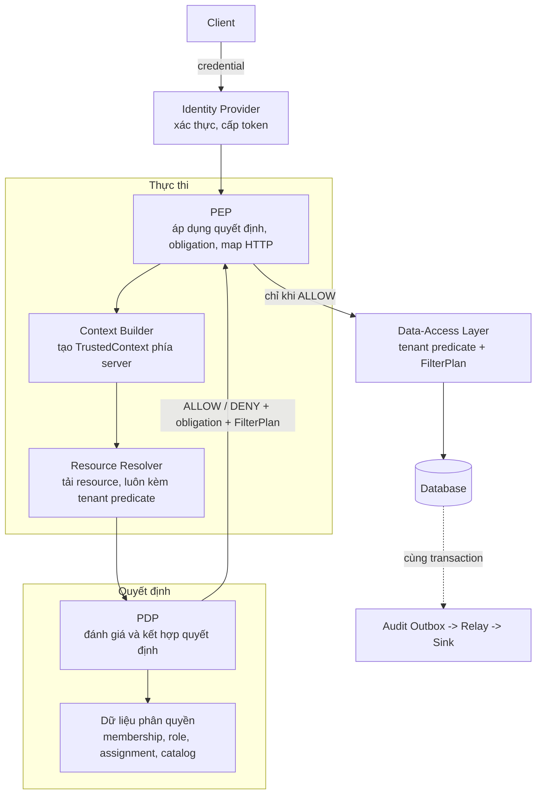
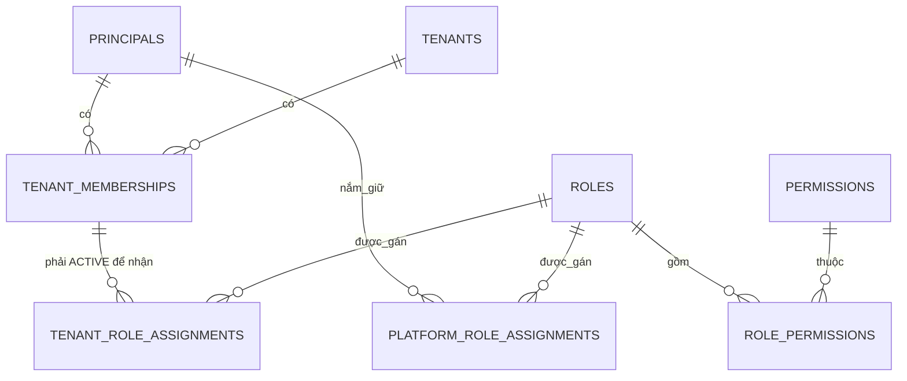
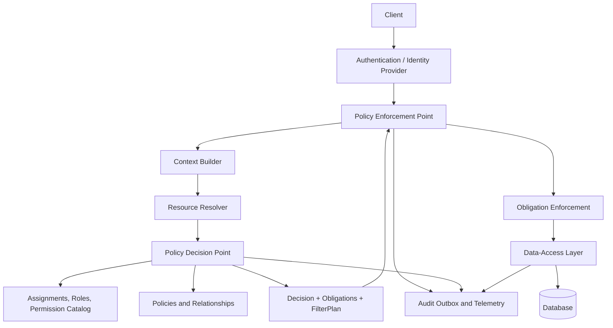
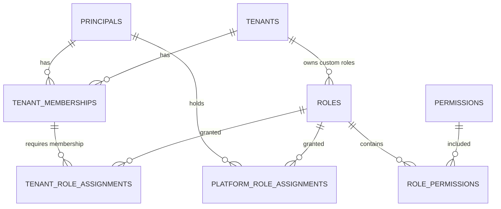

# Kiến trúc Phân quyền Doanh nghiệp (Enterprise Authorization Architecture)

**Cấu trúc tài liệu:** Tổng quan nhanh (T1 đến T13), sau đó đặc tả chi tiết (mục 1 đến 31) và phụ lục giả định. Đây là bản tiếng Việt duy nhất, thay thế bản tổng quan riêng và bản tiếng Anh trước đây.

**Phiên bản:** 1.4.1
**Trạng thái:** Kiến trúc tham chiếu và đặc tả triển khai (mức cơ sở). Đây là một đặc tả, không phải một hệ thống đã được triển khai hay kiểm chứng (xem ghi chú rút gọn bên dưới).
**Thay thế:** v1.4

Tài liệu này là một nền tảng cơ sở có thể tái sử dụng, không phải yêu cầu bắt buộc phải triển khai mọi mẫu thiết kế. Hãy chọn thiết kế đơn giản nhất đáp ứng mô hình tài nguyên, mức rủi ro, quy mô và các yêu cầu tuân thủ của sản phẩm. Ghi lại các lựa chọn quan trọng trong một ADR.

**Tài liệu đi kèm.** Các phương án thiết kế thay thế (mô hình, tổ chức permission, gắn phạm vi, gán vai trò, cơ chế enforcement), mỗi phương án là một pattern độc lập có cấu trúc, mô hình dữ liệu, luồng đánh giá, đánh đổi và đường chuyển đổi, nằm ở [authorization-design-options-vi.md](authorization-design-options-vi.md). Tài liệu này là Reference Architecture; tài liệu kia là Design Options Catalog.

**Hồ sơ tham chiếu so với quy tắc cố định.** Ở những chỗ tài liệu này mô tả một thiết kế cụ thể (ví dụ phạm vi lưu trên phân công vai trò, hai bảng phân công, DDL ở mục 8.3), thiết kế đó là **hồ sơ tham chiếu (reference profile)**: một ví dụ hoàn chỉnh, nhất quán nội bộ và đã được kiểm thử. Nó không phải thiết kế hợp lệ duy nhất. Phần nào là bất biến mà mọi dự án áp dụng nên giữ, phần nào là lựa chọn dự án có thể thay thế, được nêu ở mục 9.3 (gắn phạm vi) và ở các gợi ý ADR (mục 29). Đặc biệt, **phạm vi không bắt buộc phải gắn với phân công vai trò**; mục 9.3 liệt kê các phương án thay thế.

**Hướng dẫn đọc.** Các mục và quy tắc được gắn nhãn:

- **[Cơ sở]** Được khuyến nghị cho hầu hết các ứng dụng doanh nghiệp; là hợp đồng (contract) mà hai nhóm độc lập có thể triển khai tương thích với nhau.
- **[Tùy chọn]** Chỉ áp dụng khi có một yêu cầu được ghi nhận cần đến. Với những năng lực tùy chọn, tài liệu này vẫn nêu các quy tắc an toàn tối thiểu cần tuân theo nếu bạn áp dụng chúng.
- **Giả định An** Một lựa chọn thiết kế phụ thuộc vào các yêu cầu nghiệp vụ mà tài liệu này không biết. Mỗi giả định được liệt kê trong Phụ lục cùng với sự đánh đổi và điều kiện để thay đổi nó. Hãy coi các giả định là giá trị mặc định cần xác nhận, không phải sự thật.
- **Cấu trúc quy tắc.** Các quy tắc quan trọng được nêu dưới dạng một quy tắc thiết kế (cần làm gì), một bất biến (điều gì luôn phải đúng), cơ chế thực thi (điều gì khiến nó đúng) và một kiểm thử (cách xác minh nó). Một quy tắc mà cơ chế hoặc kiểm thử của nó mới chỉ được đặc tả thì **không** được đảm bảo.

Phụ lục ở cuối tài liệu: giả định và các quyết định còn mở.

Bản này là phiên bản rút gọn, tập trung vào thành phần, sơ đồ và quyết định kiến trúc. Đã lược bỏ DDL và các câu lệnh SQL, danh mục kiểm thử chi tiết, nhật ký thay đổi và bằng chứng chạy thử của các phiên bản trước (xem lịch sử git). Vì vậy các tham chiếu tới mã kiểm thử (`T-...`), tệp đi kèm và nhãn trạng thái `S/NR`, `RI/PS` không còn tài liệu đi kèm; hãy coi mọi nội dung là **đặc tả chưa được kiểm chứng**.

---

## Tổng quan nhanh (Quick reference)

Phần này là bản tóm tắt ngắn để đọc trước, dành cho các hệ thống cần tích hợp hoặc tự xây phân quyền theo cùng một mô hình. Các mục của phần này được đánh số `T1` đến `T13`; ký hiệu `§n` và "mục n" ở các phần còn lại trỏ tới đặc tả chi tiết bên dưới (ràng buộc dữ liệu, thuật toán đầy đủ, phụ lục). Khi hai phần khác nhau, đặc tả chi tiết là căn cứ.

Phần này vẫn chỉ là đặc tả thiết kế, chưa được kiểm chứng trong môi trường sản phẩm. Đây là baseline, không bắt buộc làm hết: chọn thiết kế đơn giản nhất đáp ứng yêu cầu và ghi lại quyết định lớn bằng ADR. Những thiết kế cụ thể ở T4 và T5 (role, assignment, scope, mô hình dữ liệu) là **hồ sơ tham chiếu**, không phải đáp án duy nhất; điều bắt buộc giữ lại là các bất biến an toàn (T1, T4.3), không phải một sơ đồ bảng cụ thể.

### T1. Nguyên tắc cốt lõi

1. **Deny-by-default:** không có `ALLOW` tường minh thì từ chối.
2. **Fail closed:** thiếu dữ liệu hoặc lỗi phụ thuộc thì từ chối, không bao giờ mở quyền.
3. **Authentication không phải authorization:** token chỉ cho biết bạn là ai, không mang danh sách quyền.
4. **Không tin client:** tenant, role, scope từ client chỉ là gợi ý, luôn được server kiểm tra lại.
5. **Một đường đánh giá duy nhất** cho mọi lối truy cập: API, danh sách, export, bulk, job nền.
6. **Tenant isolation là bất biến,** không phụ thuộc UI hay tham số client.
7. **Mọi thay đổi quyền đều được audit.**
8. **Bắt đầu bằng RBAC;** chỉ thêm ABAC, ReBAC, policy engine khi có yêu cầu cụ thể.

---

### T2. Kiến trúc tổng quan



| Thành phần | Trách nhiệm | Không chịu trách nhiệm |
|---|---|---|
| Identity Provider | Xác thực, cấp token ngắn hạn | Quyết định quyền truy cập resource |
| Context Builder | Tạo `TrustedContext` từ token và tra cứu server | Đánh giá policy |
| Resource Resolver | Tải resource và thuộc tính tenant/scope chính thức | Quyết định quyền |
| **PEP** | Gọi PDP, thực thi quyết định và obligation, map ra HTTP | Tính quyết định |
| **PDP** | Đánh giá grant, ràng buộc, policy; trả quyết định và `FilterPlan` | Chạy hành động, sinh SQL |
| Data-Access Layer | Thêm tenant predicate, áp `FilterPlan`, từ chối query không có bảo vệ | Chọn scope |
| Database | Constraint, trigger; RLS tùy chọn | Thay thế authorization ở ứng dụng |
| Audit outbox | Ghi bền các sự kiện quan trọng cùng transaction | Chờ sink downstream |
| Cache | Tăng tốc đọc | Là nguồn sự thật |

PEP và PDP có thể là hai module trong cùng một ứng dụng, miễn là tách bạch trách nhiệm. Mỗi lối truy cập có ý nghĩa đều phải qua PEP, kể cả endpoint phụ, export, job nền, message consumer, bulk và các thao tác quản trị role/membership.

#### Luồng xử lý một request

1. Xác thực. Lỗi thì trả 401, không đánh giá.
2. Kiểm tra hình dạng request. Lỗi thì trả 400/422.
3. Tạo trusted context, bao gồm xác định tenant từ membership (§10).
4. Với thao tác trên một resource: tải resource bằng `WHERE tenant_id = :tenant AND id = :id`.
5. PDP đánh giá (mục T6.3 dưới đây).
6. PEP map kết quả ra HTTP và thực thi obligation.
7. Data-Access Layer áp tenant predicate và `FilterPlan`, rồi thực thi.
8. Ghi audit theo lớp sự kiện.

---

### T3. Mô hình tenant

Không đồng nhất `tenant`, `company`, `department`, `scope`.

```text
Platform
├── Tenant: Tập đoàn A          <- ranh giới bảo mật và quản trị
│   ├── Company A1
│   │   ├── Department Finance
│   │   └── Department Operations
│   └── Company A2
└── Tenant: Tập đoàn B
```

- **Tenant** là ranh giới cô lập dữ liệu, membership và quản trị.
- **Company/department/team** là đơn vị tổ chức bên trong tenant, biểu diễn bằng scope (gắn theo chiến lược đã chọn, mục T4.3).
- Cần cô lập rất chặt giữa các công ty thì dùng tenant riêng. Dùng chung danh tính và quản trị thì chung tenant, tách bằng scope.
- **Giả định A6:** mỗi resource lưu trực tiếp khóa ngoại tới đơn vị tổ chức (`company_id`, `department_id`, `team_id`). Baseline không duyệt cây tổ chức lúc quyết định.
- Một principal có thể thuộc nhiều tenant. Tenant đang dùng được chọn mỗi request và phải khớp một membership `ACTIVE`.

---

### T4. Mô hình phân quyền

#### T4.1 Các khái niệm

| Khái niệm | Ý nghĩa |
|---|---|
| **Permission** | Năng lực nghiệp vụ, đặt tên `<resource>[.<sub>].<action>`, ví dụ `document.update`. Thuộc đúng một context kind |
| **Role** | Tập permission. Trong hồ sơ tham chiếu, role không mang scope (xem T4.3 cho các cách gắn scope khác) |
| **Assignment** | Gán một role cho một principal. Thời hạn nằm ở đây; trong hồ sơ tham chiếu scope cũng nằm ở đây |
| **Context kind** | `TENANT` hoặc `PLATFORM`. Permission `PLATFORM` luôn có tiền tố `platform.` |
| **Membership** | Principal thuộc tenant, trạng thái `ACTIVE`/`SUSPENDED`/`REMOVED` |

Quy tắc đặt tên permission: chữ thường `snake_case`, dấu chấm là phân cách cấu trúc, mô tả năng lực nghiệp vụ chứ không phải màn hình. Mỗi permission có context kind, module sở hữu, mức rủi ro (`LOW`/`HIGH`) và mô tả. Mỗi loại resource khai báo một permission **visibility** (thường `<resource>.read`) để chọn 403 hay 404.

Permission thiếu trong catalog thì không cấp quyền gì và là lỗi của caller (500 kèm cảnh báo).

#### T4.2 Hai loại role, hai bảng gán

| Loại | Lưu ở | Có tenant/scope | Ví dụ |
|---|---|---|---|
| Platform role | `platform_role_assignments` | Không | `platform_admin` |
| Shared template role (platform định nghĩa, dùng cho mọi tenant) | `tenant_role_assignments` | Có | `tenant_admin`, `editor`, `viewer` |
| Custom role (một tenant sở hữu, key bắt đầu `custom.`) | `tenant_role_assignments` | Có | `custom.reviewer` |

Tách hai bảng để **database bảo đảm** quyền platform và quyền tenant không bao giờ lẫn nhau. Platform admin không có quyền dữ liệu tenant mặc định. Nhân viên platform muốn vào dữ liệu tenant phải mở **support session** có thời hạn, có phê duyệt (§19).

#### T4.3 Scope: loại scope và nơi gắn scope

Hai câu hỏi tách biệt: **scope có những loại nào** (bảng dưới) và **scope được lưu hoặc suy ra ở đâu** (bảng "Nơi gắn scope" tiếp theo). Phần lớn tài liệu này minh họa bằng S1 (gắn vào assignment), nhưng đó chỉ là một lựa chọn.

##### Nơi gắn scope

| ID | Chiến lược | Scope nằm ở | Ví dụ | Phù hợp khi |
|---|---|---|---|---|
| S1 | Gắn vào assignment (hồ sơ tham chiếu) | `scope_type`/`scope_id` trên assignment | `editor` tại `COMPANY company-a` | Một role dùng cho nhiều scope; ủy quyền theo từng đơn vị |
| S2 | Gắn vào liên kết role-permission | `scope_type` trên role-permission; đơn vị lấy từ vị trí tổ chức của user | Role `dept_manager` có `project.read` mức `DEPARTMENT` | Role tương ứng một-một với cấp tổ chức |
| S3 | Gắn vào khóa permission | Trong tên permission | `project.read.own`, `project.read.department` | Ít mức scope, cố định |
| S4 | Suy ra từ thuộc tính user | Membership hoặc thuộc tính (`user.company_id`, đơn vị quản lý) | Scope = đơn vị user thuộc về hoặc quản lý | Có nguồn tổ chức/HR đáng tin |
| S5 | Suy ra từ quan hệ (ReBAC/ACL) | Quan hệ user-resource | Chủ sở hữu, thành viên team, được chia sẻ | Cộng tác, chia sẻ từng bản ghi |
| S6 | Dựa trên policy/query (ABAC) | Policy sinh điều kiện hoặc `FilterPlan` | `status = ACTIVE AND department_id IN user.managed_departments` | Quyền phụ thuộc trạng thái, phân loại, thời gian |
| Lai | Kết hợp | Theo từng permission hoặc resource | S1 cho admin toàn tenant, S5 cho chia sẻ tài liệu | Yêu cầu hỗn hợp |

**Bất biến cho mọi chiến lược:**

1. Tenant isolation độc lập với scope; scope không thay hay nới tenant predicate.
2. Scope không bao giờ lấy từ client; giá trị client chỉ được thu hẹp kết quả.
3. Scope đã lưu hoặc suy ra không phải bằng chứng; luôn kiểm với resource tải từ nguồn chính thức.
4. Không có scope phủ thì từ chối; không phân giải được scope thì `INDETERMINATE`, không bao giờ allow.
5. Mọi chiến lược trả cùng contract: quyết định và `FilterPlan` có kiểu, để PEP và data layer không phụ thuộc cách gắn.
6. Nhiều scope chồng nhau kết hợp bằng hợp (union).
7. Thay đổi cách gắn scope được audit; cache key gồm mọi đầu vào ảnh hưởng scope.
8. Người cấp scope không thể cấp scope mình không có.

Chi tiết, ưu nhược điểm và cách chọn: §9.3. Mô hình dữ liệu và thuật toán chi tiết của đặc tả chỉ bao phủ S1; với chiến lược khác, giữ các bất biến trên và tự viết test tương đương.

##### Loại scope (áp dụng cho mọi chiến lược)

| `scope_type` | Phủ resource khi |
|---|---|
| `TENANT` | luôn luôn (trong tenant đó) |
| `COMPANY` / `DEPARTMENT` / `TEAM` | `resource.<unit>_id = scope_id` |
| `RESOURCE` | `resource.id = scope_id` |
| `SELF` | `resource.owner_principal_id = principal.id` |

Chỉ hỗ trợ loại scope nào bạn cần. `scope_id` không phải bằng chứng truy cập: PDP phải kiểm tra resource tải từ nguồn chính thức thực sự thuộc scope đó. Nhiều assignment cho cùng permission thì lấy **hợp (union)** các scope; không có deny ngầm.

**Ví dụ (theo S1).** Maya có `editor` ở `COMPANY company-a` trong tenant X.

| Document | Kết quả cho `document.update` |
|---|---|
| tenant X, company-a | Cho phép |
| tenant X, company-b | Từ chối (ngoài scope, trả 404 vì Maya không thấy) |
| tenant Y | Không tìm thấy (tenant predicate loại luôn) |

#### T4.4 Quyền hiệu lực (effective authorization)

Assignment lưu `ACTIVE` chưa chắc có hiệu lực. Nó chỉ đóng góp vào quyết định khi **đồng thời**:

- assignment `ACTIVE` và đang trong `valid_from`/`valid_until` (hết hạn được tính lúc đánh giá, không dựa vào job);
- role dùng được trong tenant đó;
- membership `ACTIVE`;
- tenant `ACTIVE`.

Vòng đời membership:

| Sự kiện | Assignment đã lưu | Có hiệu lực? |
|---|---|---|
| Suspend | Giữ nguyên `ACTIVE` | Không, trong lúc suspended |
| Reinstate | Giữ nguyên | Có, nếu còn hợp lệ |
| Remove | Tất cả `ACTIVE` chuyển `REVOKED` ngay trong transaction | Không, vĩnh viễn; cấp lại phải gán mới |
| Gán role cho membership không `ACTIVE` | Bị từ chối | - |

#### T4.5 Quyền quản trị: không leo thang đặc quyền

Một principal chỉ được tạo/sửa custom role hoặc gán role **trong phạm vi quyền mình đang có hiệu lực**:

- Custom role chỉ chứa permission mà người tạo đang nắm.
- Gán role: mọi permission của role phải do người gán nắm, và scope phải nằm trong scope của họ.
- Không tự gán cho chính mình; cần người duyệt thứ hai.
- Sửa shared template role cần `platform.role.manage` vì ảnh hưởng mọi tenant.

Các permission quản trị tiêu biểu (đều `HIGH`): `role.manage`, `user_role.assign`, `user_role.revoke`, `tenant_membership.manage`, `authorization_audit.read` (tenant); `platform.tenant.create`, `platform.role.manage`, `platform.policy.publish` (platform).

---

### T5. Mô hình dữ liệu (hồ sơ tham chiếu, scope theo S1)

Mô hình dưới đây là một cách hiện thực hóa, không phải bắt buộc. Với S2 đến S6, thay các cột scope của `tenant_role_assignments` bằng kho của bạn (ví dụ `scope_type` trên `role_permissions`, bảng thuộc tính/quan hệ, hoặc policy) và giữ các bất biến ở T4.3.



| Bảng | Nội dung chính |
|---|---|
| `principals` | `USER`/`SERVICE`, status `ACTIVE`/`DISABLED` |
| `tenants` | status `ACTIVE`/`SUSPENDED` |
| `tenant_memberships` | unique `(tenant_id, principal_id)`, status, `ended_at` (đặt khi và chỉ khi `REMOVED`) |
| `permissions` | `key`, `context_kind`, `risk_level`, `deprecated_at` |
| `roles` | `role_kind`, `tenant_id` (null nếu hệ thống định nghĩa), `is_system_defined`, `key` |
| `role_permissions` | role chỉ chứa permission cùng context kind |
| `tenant_role_assignments` | `tenant_id`, principal, role, `scope_type`, `scope_id`, `valid_from`, `valid_until`, `status` |
| `platform_role_assignments` | Không có tenant, không có scope; bắt buộc `approval_reference` |
| `audit_outbox` | Sự kiện audit cùng database với dữ liệu |

Các bất biến được **database** bảo đảm bằng `CHECK`, composite foreign key và trigger:

- Role platform không chứa permission tenant và ngược lại.
- `(tenant_id IS NULL) = is_system_defined`; ownership của role không đổi sau khi tạo.
- Chỉ gán role cho membership `ACTIVE`, và role phải thuộc hệ thống hoặc đúng tenant đó.
- Mọi bảng dữ liệu tenant có `tenant_id NOT NULL`; ưu tiên revoke thay vì xóa.

Các ràng buộc cơ sở dữ liệu cần có: §8.3.

---

### T6. Cách ra quyết định

#### T6.1 Trusted context

Server tự tạo `TrustedContext`: `contextKind`, `tenantId`, `principalId`, `actorId` (khác `principalId` khi ủy quyền), thông tin xác thực (phương thức, thời điểm, assurance level), `requestTime` theo đồng hồ server, `correlationId`. Chỉ các thuộc tính trong attribute registry mới được dùng để quyết định. Giá trị client như `role`, `is_admin` bị bỏ qua hoàn toàn.

**Xác định tenant:** lấy gợi ý tenant, tra membership trong store của server rồi join trạng thái tenant. Không có tenant, không có membership, membership bị suspend/remove, hoặc tenant bị suspend đều cho **cùng một** phản hồi `403 tenant_access_denied`, để không lộ tenant nào tồn tại.

#### T6.2 Kết quả đánh giá

| Evaluation state | Ý nghĩa | `effect` |
|---|---|---|
| `ALLOW` | Có grant bao phủ, ràng buộc đạt | ALLOW |
| `DENY` | Quy tắc đánh giá được và từ chối | DENY |
| `NOT_APPLICABLE` | Không có grant | DENY |
| `INDETERMINATE` | Không đánh giá tin cậy được (lỗi phụ thuộc, thiếu thuộc tính) | DENY, đánh dấu `evaluationFailed` |

`INDETERMINATE` không bao giờ là `ALLOW` và không bao giờ bị trình bày như 403/404. Client không nhận evaluation state hay reason code; chỉ log và audit nhận.

#### T6.3 Thuật toán kết hợp

Deny-override trên ràng buộc bắt buộc; ngoài ra cần một allow tường minh.

| Phase | Việc làm |
|---|---|
| **A. Context** | Xác thực, kiểm request, tạo context, kiểm `action` có trong catalog |
| **B. Bất biến** (không grant nào ghi đè) | Principal `ACTIVE`; tenant `ACTIVE` và membership `ACTIVE` (hoặc support session hợp lệ); context kind của permission khớp request; tenant của resource khớp |
| **C. Thu thập** | Grant hiệu lực từ bảng gán đúng context; ràng buộc bắt buộc (trạng thái, SoD, assurance...); explicit deny nếu bật |
| **D. Kết hợp** | Explicit deny, rồi lỗi tra cứu, rồi không có grant, rồi ngoài scope, rồi ràng buộc thất bại, cuối cùng `ALLOW` |
| **E. Obligation** | Gộp obligation; PEP phải thực thi được mọi obligation bắt buộc, nếu không thì từ chối |

Với thao tác danh sách, Phase D tạo `FilterPlan` thay vì kiểm một resource.

#### T6.4 Map ra HTTP

Quy tắc: nếu principal **thấy** resource (có permission visibility trong scope) nhưng thiếu quyền hành động thì 403; nếu không thấy thì 404.

| Tình huống | HTTP | Code |
|---|---|---|
| Chưa xác thực / token sai | 401 | `unauthenticated` |
| Request sai, filter sai | 400/422 | `invalid_request` / `invalid_filter` |
| Tenant không hợp lệ (4 trường hợp con, phản hồi y hệt) | 403 | `tenant_access_denied` |
| Resource không có, khác tenant, hoặc không thấy | 404 | `not_found` |
| Thấy nhưng không được làm | 403 | `forbidden` |
| Danh sách: lọc bớt dòng | 200 | chỉ trả dòng được phép |
| Phụ thuộc lỗi (`INDETERMINATE`) | 503 + `Retry-After` | `authorization_unavailable` |
| Lỗi code, plan sai, obligation không thực thi được | 500 | `internal_error` |
| Cần xác thực mạnh hơn | 401/403 | `step_up_required` |
| Thử tenant lặp lại quá nhiều | 429 | `rate_limited` |

Mọi lỗi cùng một dạng body `{ error, message, correlationId }`. `message` cố định theo code, không bao giờ lặp lại tenant id, resource id hay chi tiết policy.

---

### T7. Phân quyền cho danh sách, tìm kiếm, export và bulk

Danh sách không có resource id để kiểm từng dòng, nên PDP trả một **FilterPlan**: dữ liệu mô tả điều kiện lọc, không phải code.

```text
truy vấn = tenantPredicate AND authzFilterPlan AND userFilter
```

- `tenantPredicate` do Data-Access Layer tự thêm từ context, độc lập với plan. Plan không thể bỏ hay ghi đè. Query trên bảng tenant mà thiếu predicate sẽ bị từ chối.
- `authzFilterPlan` do `resolveDataScope` sinh từ hợp các scope của grant hiệu lực. Chỉ dùng các field và toán tử đã đăng ký, có kiểm tra kiểu ở runtime và dịch sang SQL có tham số.
- `userFilter` chỉ được thu hẹp kết quả và chỉ dùng field cho phép.
- Không sinh được plan thì không query, không bao giờ fallback sang query không lọc.
- Áp điều kiện **trước** `ORDER BY`, `LIMIT`, `COUNT`, aggregate, facet, export. Cursor được ký và gắn với principal, tenant, hash của plan.

Ví dụ: Maya có `editor` ở `team-17` và `team-22` gọi `GET /documents?status=ACTIVE`. Truy vấn cuối cùng giới hạn theo `tenant_id` (do data layer thêm từ context), theo `team_id` thuộc `{team-17, team-22}` (FilterPlan), và theo `status = ACTIVE` (filter người dùng đã kiểm tra), rồi mới sắp xếp và phân trang.

**Bulk:** xác định tập được phép bằng một query theo tập (`id = ANY(:ids) AND <plan>`). Mục nào ngoài tập đều báo `NOT_FOUND` như nhau. Mỗi endpoint chọn một chế độ và công bố trong API contract:

| Chế độ | Dùng cho |
|---|---|
| All-or-nothing | Ghi nhạy cảm (xóa hàng loạt, đổi role) |
| Partial success | Ghi rủi ro thấp, idempotent |
| Chỉ trả mục được phép | Đọc/export hàng loạt |

**Obligation (tùy chọn):** yêu cầu PEP phải thực thi khi `ALLOW`: `ALLOWED_FIELDS`, `REQUIRE_STEP_UP_AUTH`, `REQUIRE_JUSTIFICATION`, `WATERMARK_EXPORT`. Obligation bắt buộc mà PEP không thực thi được thì từ chối, không bao giờ bỏ qua.

---

### T8. Cô lập tenant

- Tenant lấy từ membership đã kiểm, không từ client.
- Mọi lookup resource có tenant predicate. Resource khác tenant giống hệt như không tồn tại.
- `tenant_id` có trong query, unique constraint, index và cache key.
- Job nền mang tenant context tường minh; job không có thì bị từ chối.
- **RLS (tùy chọn)** là lớp phòng thủ sâu, không thay authorization ở ứng dụng. Nếu dùng: đặt và xóa context DB an toàn theo transaction (connection pool không được rò tenant context), hạn chế role bypass RLS. Nếu không dùng: ghi lại biện pháp thay thế ở tầng ứng dụng và data-access.
- Test chéo tenant cho read, update, delete, search, export, download, bulk và async.

---

### T9. Hành vi khi có lỗi

Nguyên tắc: lỗi dữ liệu phân quyền không bao giờ dẫn tới allow. Mọi từ chối dừng ở PEP, trước khi gọi service hoặc database.

| Lỗi | Hành vi |
|---|---|
| PDP hoặc policy engine không sẵn sàng | Từ chối, 503 |
| Policy bundle đọc lỗi | Dùng bản đã kiểm chứng đang nạp; chưa có bản nào thì từ chối tất cả |
| Database phân quyền lỗi | `INDETERMINATE`, 503 (cache hit còn trong hạn vẫn phục vụ bình thường) |
| `resolveDataScope` lỗi | Không query, 503 |
| `FilterPlan` sai | 500, không query, cảnh báo mức cao |
| Obligation bắt buộc không thực thi được | 500, bỏ dữ liệu đã tải |
| Ghi outbox lỗi (sự kiện bắt buộc) | Rollback cả thay đổi, 500 |
| Audit sink hoặc relay ngừng | Thay đổi **vẫn commit**, relay retry |
| Cache lỗi hoặc quá hạn | Coi như miss, đọc nguồn sự thật |
| Metrics/tracing lỗi | Không chặn request |

---

### T10. Cache và thu hồi quyền

Mặc định (giả định A4, cần xác nhận theo rủi ro nghiệp vụ):

| Dữ liệu | Độ trễ tối đa khi thu hồi |
|---|---|
| Assignment, membership, trạng thái principal/tenant | 60 giây, hủy theo sự kiện, TTL làm lưới an toàn |
| Role-permission | 300 giây (hủy ngay khi có sự kiện) |
| Policy bundle | 300 giây để hội tụ giữa các instance |
| Access token | Tối đa 15 phút; token không mang quyền |

- Permission rủi ro `HIGH` **không qua cache**, luôn đọc nguồn sự thật.
- Cache key phải chứa mọi chiều ảnh hưởng quyết định: `contextKind`, `tenantId`, `principalId`, `action`, resource hoặc scope, **authorization epoch**, `policyVersion`, assurance level. Không bao giờ key theo `user_id + action`. Không cache `INDETERMINATE` hay lỗi.
- **Grace khi phụ thuộc lỗi** là ngoại lệ tùy chọn, tắt mặc định, cần ADR và người chịu trách nhiệm bảo mật. Chỉ áp cho đọc `LOW`-risk trong tenant.
- **TOCTOU:** với thao tác nhạy cảm, kiểm và ghi trong một transaction, đặt điều kiện vào `UPDATE ... WHERE`, kiểm số dòng bị ảnh hưởng (0 dòng thì trả 409 và đánh giá lại). Với ghi `HIGH`-risk, kiểm lại cả grant, không chỉ resource.

---

### T11. Audit

Phân theo lớp sự kiện:

| Lớp | Sự kiện | Nếu không ghi bền được |
|---|---|---|
| **A** | Đổi role, assignment, membership, policy, catalog; mở/đóng support session; break-glass; impersonation; transfer | Rollback cả thay đổi |
| **C** | Ghi với permission `HIGH`; đọc/export nhạy cảm | Rollback, hoặc không trả dữ liệu |
| **B** | Từ chối, lỗi đánh giá | Không chặn (việc từ chối đã xảy ra); mất chỉ khi hàng đợi cục bộ đầy, có đếm và cảnh báo |
| **D** | Đọc thường, ghi rủi ro thấp | Được phép mất hoặc lấy mẫu |

- Sự kiện lớp A/C ghi vào **outbox cùng database** và cùng transaction với thay đổi; relay chuyển tới sink ít nhất một lần, sink khử trùng theo `event_id`. Với membership và assignment, **trigger của database** ghi sự kiện.
- Mỗi bản ghi trả lời: ai thực hiện, thay mặt ai, hành động gì, trên resource nào, tenant và scope nào, quyết định và lý do, phiên bản policy, thời điểm, `correlationId`.
- Không ghi token, mật khẩu, secret. Field bị `ALLOWED_FIELDS` loại không được xuất hiện trong audit.
- Giới hạn: bảo đảm này chỉ đúng với các đường ghi được tin cậy. Chủ bảng hoặc superuser tắt trigger vẫn qua mặt được, nên cần kiểm soát đặc quyền và đối chiếu định kỳ.

---

### T12. Năng lực tùy chọn

Chỉ thêm khi có yêu cầu cụ thể. Khi dùng, vẫn áp các quy tắc an toàn tối thiểu ở tài liệu chi tiết.

| Năng lực | Khi nào cần | Mục |
|---|---|---|
| Explicit deny (A1) | Cần cấm tường minh vượt trên grant | §11.3 |
| Direct user grant | Cấp quyền ngoài role | §7.6 |
| ABAC / ReBAC / ACL | Sở hữu, phân loại, chia sẻ, quan hệ | §16 |
| Policy engine riêng | Chính sách phức tạp, cần versioning độc lập | §16.2 |
| Delegation / on-behalf-of | Service hành động thay user; quyền = giao của quyền user và quyền service | §18 |
| Support access, impersonation, break-glass | Hỗ trợ khách hàng, tình huống khẩn cấp | §19 |
| SoD, JIT, access review, approval | Yêu cầu tuân thủ, đặc quyền cao | §21 |
| Chuyển resource giữa scope | Cần quyền ở cả nguồn và đích, một transaction | §17.2 |
| Role inheritance, group-to-role | Tổ chức lớn | §7.7 |
| Row-level security | Phòng thủ sâu ở database | §20 |

---

### T13. Checklist cho hệ thống tích hợp

Một hệ thống dùng kiến trúc này cần bảo đảm:

**Danh tính và tenant**
- [ ] Kiểm issuer, audience, chữ ký, hạn của token; token ngắn hạn, không mang permission.
- [ ] Tenant chỉ lấy từ membership phía server; 4 trường hợp tenant lỗi trả phản hồi y hệt.

**Permission và role**
- [ ] Có permission catalog tập trung, đặt tên một quy ước, khai báo context kind và mức rủi ro; CI kiểm mọi action trong code đều có trong catalog.
- [ ] Đã chọn và ghi ADR chiến lược gắn scope (S1 đến S6 hoặc lai, mục T4.3) và nguồn chính thức của scope; đã kiểm đủ 8 bất biến scope.
- [ ] Thời hạn nằm ở assignment; platform và tenant tách bảng quyền (hoặc có cách bảo đảm tương đương).
- [ ] Chỉ tính assignment hiệu lực (membership, tenant, thời hạn, role hợp lệ).
- [ ] Quyền quản trị không cho leo thang và không tự gán.

**Thực thi**
- [ ] Mọi đường truy cập đi qua PEP rồi PDP; không đọc bảng gán trực tiếp để quyết định.
- [ ] Data-Access Layer tự thêm tenant predicate; không có `FilterPlan` thì không query.
- [ ] Resource lookup có tenant predicate; "không thấy" và "không tồn tại" có phản hồi như nhau.
- [ ] Map HTTP và dạng lỗi theo mục T6.4; không lộ reason code cho client.

**Độ tin cậy**
- [ ] Fail closed mọi trường hợp lỗi; không cache `INDETERMINATE`.
- [ ] Cache key đủ chiều; `HIGH`-risk không qua cache; có SLA thu hồi đã công bố.
- [ ] Ghi sự kiện lớp A/C cùng transaction; có cảnh báo backlog.
- [ ] Job nền được đánh giá lúc chạy, mang `principalId` và `tenantId`.

**Kiểm thử tối thiểu**
- [ ] Allow, deny, chéo tenant, scope, hết hạn, suspend/remove membership, filter danh sách, bulk, lỗi phụ thuộc, thu hồi quyền.

Lộ trình triển khai theo giai đoạn: §25.

---

## 1. Mục tiêu và mức cơ sở mặc định được khuyến nghị [Cơ sở]

### 1.1 Mục tiêu

- Đặc quyền tối thiểu, mặc định từ chối (deny-by-default), đóng khi lỗi (fail-closed).
- Thực thi nhất quán trên API, truy cập dữ liệu, xuất dữ liệu, tác vụ nền và thao tác hàng loạt.
- Cô lập tenant tường minh, thay đổi quyền có thể kiểm toán và các quyết định có thể kiểm thử.
- Hỗ trợ danh tính con người và danh tính máy.
- Tách biệt các quyết định bắt buộc với các lựa chọn phụ thuộc vào yêu cầu dự án.

### 1.2 Mức cơ sở được khuyến nghị

Với hầu hết các ứng dụng doanh nghiệp mới, hãy bắt đầu với:

1. RBAC làm cơ chế cấp quyền nền tảng.
2. Một danh mục quyền (permission catalog) được quản lý tập trung; không có quyền nào nằm ngoài danh mục.
3. Cô lập tenant được thực thi phía máy chủ và trong tầng truy cập dữ liệu.
4. Một chiến lược gắn phạm vi được chọn bằng ADR (mục 9.3). Hồ sơ tham chiếu gắn phạm vi vào phân công vai trò tenant, còn phân công vai trò platform được lưu trong một bảng riêng (mục 8); các chiến lược khác cũng hợp lệ nếu giữ được các bất biến ở 9.3.
5. Các PEP được áp dụng nhất quán tại ranh giới API, dịch vụ và truy cập dữ liệu.
6. Một PDP đánh giá ngữ cảnh tin cậy và trả về quyết định (một module chạy trong cùng tiến trình với giao diện ổn định là đủ).
7. Phân quyền cho từng tài nguyên đơn lẻ và cho tập hợp thông qua một `FilterPlan` có kiểu.
8. Một thuật toán kết hợp được ghi thành văn bản và một ma trận hành vi khi lỗi (mục 11 và 15).
9. Kiểm toán được phân loại theo lớp sự kiện với các bảo đảm phân phối được xác định (mục 22).
10. Kiểm thử tự động cho cho phép, từ chối, cô lập tenant, phạm vi, hết hạn, lọc, thao tác hàng loạt và hành vi khi lỗi.
11. Từ chối khi không có `ALLOW` tường minh; đóng khi lỗi nếu một bộ đánh giá hoặc phụ thuộc bắt buộc gặp sự cố.
12. Chỉ bổ sung năng lực nâng cao khi yêu cầu thực sự đòi hỏi.

### 1.3 Những năng lực không cần có từ ngày đầu [Tùy chọn]

- Quy tắc từ chối tường minh (Giả định A1)
- ABAC nâng cao; ReBAC / đồ thị quan hệ; ACL theo từng tài nguyên
- Cấp quyền trực tiếp cho người dùng
- Policy engine chuyên dụng
- Bảo mật mức dòng (RLS) của cơ sở dữ liệu
- Phân tách nhiệm vụ (SoD), truy cập đúng lúc (JIT), quản trị truy cập đặc quyền
- Truy cập khẩn cấp (break-glass), mạo danh (impersonation), truy cập hỗ trợ
- Ủy quyền / hành động thay mặt (on-behalf-of)
- Kế thừa vai trò, ánh xạ nhóm sang vai trò
- Chuyển tài nguyên giữa các phạm vi
- Thời gian ân hạn của quyết định đã cache khi phụ thuộc gặp sự cố

---

## 2. Thuật ngữ [Cơ sở]

Sử dụng các thuật ngữ sau một cách nhất quán. Không dùng lẫn lộn "subject" và "principal".

| Thuật ngữ | Ý nghĩa |
|---|---|
| Principal | Danh tính có thẩm quyền được đánh giá: một người dùng, tài khoản dịch vụ hoặc danh tính workload |
| Actor (tác nhân) | Thực thể thực sự khởi tạo hành động hiện tại. Thường chính là principal; khác đi khi có ủy quyền hoặc mạo danh |
| Principal được đại diện | Người dùng mà actor hành động thay mặt (mục 18) |
| Loại ngữ cảnh (`context_kind`) | Ngữ cảnh thực thi của một yêu cầu phân quyền: `TENANT` hoặc `PLATFORM` |
| Tenant | Ranh giới để tách biệt dữ liệu, tư cách thành viên và quản trị ở mức tenant |
| Tài nguyên / hành động | Đối tượng được bảo vệ và thao tác được yêu cầu trên nó |
| Quyền (Permission) | Năng lực được đặt tên, ví dụ `document.update`. Mỗi quyền thuộc đúng một loại ngữ cảnh; mọi khóa quyền `PLATFORM` đều bắt đầu bằng `platform.` (mục 6.1) |
| Vai trò (Role) | Một gói quyền thuộc một loại vai trò. Trong hồ sơ tham chiếu, **vai trò không mang phạm vi** (phạm vi được gắn ở phân công); các chiến lược gắn khác được mô tả ở 9.3 |
| Gắn phạm vi (Scope binding) | Nơi phạm vi được gắn vào một grant: phân công vai trò, liên kết vai trò-quyền, khóa của quyền, thuộc tính của principal, quan hệ, hoặc chính sách (mục 9.3) |
| Quyền sở hữu vai trò | Ai định nghĩa vai trò: platform (`is_system_defined = true`, không có tenant sở hữu) hoặc đúng một tenant (vai trò tùy chỉnh). Không bao giờ suy ra chỉ từ `tenant_id IS NULL` (mục 8.2.1) |
| Grant (cấp quyền) | Một phân công vai trò (hoặc, theo Phương án B, một cấp quyền trực tiếp) trao một quyền cho một principal |
| Phân công vai trò (Role assignment) | Việc trao một vai trò cho một principal. Phân công tenant bị giới hạn bởi tenant, phạm vi và thời gian; phân công platform bị giới hạn bởi thời gian |
| Trạng thái phân công được lưu trữ | `status` được lưu của một dòng phân công vai trò (`ACTIVE` hoặc `REVOKED`). Trạng thái hết hạn không được lưu; nó được suy ra từ `valid_until` |
| Phân quyền hiệu lực (Effective authorization) | Liệu một phân công có thể góp phần vào quyết định tại thời điểm của yêu cầu hay không: được lưu là `ACTIVE`, nằm trong khoảng hiệu lực, vai trò có thể phân công trong tenant, **và** tư cách thành viên của principal là `ACTIVE` trong một tenant `ACTIVE` (mục 8.5). Một phân công được lưu là `ACTIVE` không nhất thiết có hiệu lực |
| Phạm vi phân công (`scope_type`, `scope_id`) | Nơi một phân công vai trò tenant có hiệu lực |
| Phạm vi tài nguyên | Các thuộc tính tổ chức mà một tài nguyên mang (`company_id`, `team_id`, ...) dùng để kiểm tra mức bao phủ phạm vi |
| Phạm vi dữ liệu | Tập bản ghi mà một thao tác có thể thấy hoặc tác động; được biểu diễn dưới dạng một `FilterPlan` |
| Chính sách / gói chính sách | Một quy tắc, hoặc tập quy tắc có phiên bản, dùng để quyết định quyền truy cập |
| Danh mục quyền | Danh sách quyền có phiên bản cùng siêu dữ liệu của chúng |
| Kết quả đánh giá | Kết quả nội bộ của PDP: `ALLOW`, `DENY`, `NOT_APPLICABLE`, `INDETERMINATE` (mục 11) |
| Quyết định (Decision) | Kết quả hướng ra ngoài mà PEP sử dụng: `ALLOW` hoặc `DENY` kèm siêu dữ liệu |
| Obligation (nghĩa vụ) | Một yêu cầu mà PEP phải thực thi khi áp dụng quyết định; **bắt buộc** (mandatory) hoặc **khuyến nghị** (advisory) |
| PEP / PDP | Điểm thực thi chính sách (Policy Enforcement Point) / Điểm quyết định chính sách (Policy Decision Point) |
| Lỗi xác thực | Thông tin xác thực bị thiếu, không hợp lệ hoặc hết hạn (HTTP 401); không phải là một quyết định phân quyền |
| Từ chối phân quyền | Các quy tắc được đánh giá thành công và từ chối hành động |
| Lỗi đánh giá | Không thể đánh giá các quy tắc một cách tin cậy (`INDETERMINATE`); được xử lý theo nguyên tắc đóng khi lỗi |
| Khả năng nhìn thấy (Visibility) | Liệu principal có nắm giữ quyền mức đọc, trong phạm vi, đối với một tài nguyên hay không; dùng để chọn giữa 403 và 404 (mục 12) |

---

## 3. Kiến trúc tham chiếu [Cơ sở]

### 3.1 Luồng logic



- Xác thực (authentication) xác minh danh tính; nó không hàm ý phân quyền (authorization).
- Bộ dựng ngữ cảnh tạo ra một ngữ cảnh *tin cậy* từ danh tính đã xác thực và các tra cứu phía máy chủ (mục 10). Các giá trị do client cung cấp chỉ là gợi ý, không bao giờ là đầu vào của quyết định.
- Bộ phân giải tài nguyên nạp tài nguyên cùng các thuộc tính tenant và phạm vi có thẩm quyền của nó bằng một truy vấn có điều kiện theo tenant (mục 12).
- PDP trả về quyết định; PEP thực thi quyết định đó và các obligation của nó trước khi bất kỳ dữ liệu nào được đọc hoặc thay đổi.
- Tầng truy cập dữ liệu thêm điều kiện tenant và `FilterPlan` phân quyền vào mọi truy vấn trên dữ liệu thuộc sở hữu của tenant (mục 13).

PEP và PDP không cần được triển khai tách rời. Chúng có thể là các module của cùng một ứng dụng, miễn là trách nhiệm vẫn được tách biệt.

### 3.2 Luồng yêu cầu tham chiếu

1. Xác thực bên gọi và kiểm tra thông tin xác thực (lỗi: 401, không đánh giá).
2. Kiểm tra cấu trúc yêu cầu (lỗi: 400/422, không đánh giá).
3. Dựng ngữ cảnh tin cậy (mục 10).
4. Phân giải tài nguyên và các thuộc tính có thẩm quyền của nó, khi hành động cần đến (mục 12).
5. PDP đánh giá: bất biến, ứng viên, kết hợp, obligation (mục 11).
6. PEP ánh xạ kết quả thành phản hồi theo mục 11 và 12 và thực thi các obligation.
7. Tầng truy cập dữ liệu áp dụng điều kiện tenant và `FilterPlan`; hành động được thực thi.
8. Sự kiện kiểm toán được phát ra theo từng lớp (mục 22).

Không dựa vào việc ẩn các phần tử giao diện như một ranh giới bảo mật. PEP phải bảo vệ mọi đường truy cập có ý nghĩa, bao gồm các endpoint thay thế, xuất dữ liệu, tác vụ nền và thao tác hàng loạt.

### 3.3 Ma trận trách nhiệm

| Thành phần | Chịu trách nhiệm | Không chịu trách nhiệm | Đầu vào chính -> đầu ra | Bất biến | Nếu phụ thuộc gặp sự cố |
|---|---|---|---|---|---|
| Nhà cung cấp danh tính (IdP) | Xác thực principal; phát hành token | Quyết định quyền truy cập tài nguyên | Thông tin xác thực -> token | Token được ký, thời hạn ngắn | Xác thực thất bại (401) |
| Bộ dựng ngữ cảnh | Dựng `TrustedContext` từ token đã kiểm tra và các tra cứu phía máy chủ | Đánh giá chính sách | Token + yêu cầu -> ngữ cảnh | Không giá trị nào từ client đi vào đầu vào của quyết định | Không dựng được -> `INDETERMINATE` |
| Bộ phân giải tài nguyên | Nạp tài nguyên và các thuộc tính tenant/phạm vi có thẩm quyền | Quyết định quyền truy cập | Tham chiếu tài nguyên -> thuộc tính tài nguyên | Tra cứu luôn có điều kiện theo tenant | Không phân giải được -> `INDETERMINATE` |
| PEP | Gọi PDP; thực thi quyết định và obligation; ánh xạ sang HTTP | Tính toán quyết định | Yêu cầu -> phản hồi | Không có hành động nào khi không có `ALLOW` tường minh | Coi như từ chối (mục 15) |
| PDP | Đánh giá grant, ràng buộc, chính sách; tạo ra quyết định, obligation, `FilterPlan` | Thực thi hành động; dựng SQL | Ngữ cảnh + tài nguyên -> quyết định | Chỉ dùng thuật toán của mục 11 | `INDETERMINATE` -> từ chối |
| Quản trị chính sách/danh mục | Soạn thảo, xem xét, phát hành các phiên bản | Quyết định theo từng yêu cầu | Thay đổi -> phiên bản đã phát hành | Thay đổi có phiên bản và được kiểm toán | Giữ phiên bản hợp lệ gần nhất |
| Tầng truy cập dữ liệu | Chèn điều kiện tenant; kiểm tra và áp dụng `FilterPlan`; từ chối các truy vấn không được bảo vệ | Chọn phạm vi | Truy vấn + plan -> SQL tham số hóa | Không có truy vấn nào trên dữ liệu thuộc tenant mà thiếu điều kiện tenant | Từ chối truy vấn |
| Cơ sở dữ liệu / RLS | Ràng buộc; RLS tùy chọn làm lớp phòng thủ chiều sâu | Thay thế phân quyền ở ứng dụng | SQL -> các dòng | Các ràng buộc trong mục 8 được giữ | Truy vấn thất bại; yêu cầu thất bại |
| Audit outbox, relay và sink | Ghi bền vững các sự kiện lớp A và C qua các đường ghi được hỗ trợ: dòng outbox nằm trong chính cơ sở dữ liệu của dữ liệu đó; relay tới sink theo kiểu ít nhất một lần (at-least-once); khử trùng lặp tại sink | Bắt một thay đổi nghiệp vụ đã commit phải chờ sink phía sau; ghi nhận sự kiện từ những bên ghi vượt qua ranh giới ghi tin cậy (mục 22.6) | Sự kiện -> outbox -> sink | Khi một thay đổi lớp A hoặc C được commit qua một đường được hỗ trợ, sự kiện outbox của nó được commit cùng. Lớp B và D không có bảo đảm này (mục 22.1) | Ghi outbox thất bại: thay đổi bị rollback (lớp A, C). Sink ngừng hoạt động: thay đổi vẫn được commit và relay thử lại (mục 15, dòng 8a và 8b) |
| Cache | Tăng tốc đọc dữ liệu phân quyền | Là nguồn sự thật | Khóa -> giá trị | Khóa bao gồm mọi chiều của quyết định | Coi như cache miss |
| Client / frontend | Chỉ phục vụ UX | Bất kỳ quyết định bảo mật nào | - | Không bao giờ được tin cậy | - |

---

## 4. Xác thực và vòng đời danh tính [Cơ sở]

Xác thực (authentication) và phân quyền (authorization) là hai mối quan tâm riêng biệt.

- **OIDC / OAuth 2.0:** phổ biến cho đăng nhập web/API hiện đại và truy cập API được ủy quyền; OIDC bổ sung thông tin danh tính bên trên OAuth 2.0.
- **SAML 2.0:** bổ sung khi khách hàng doanh nghiệp hoặc một IdP doanh nghiệp hiện có yêu cầu.
- **SCIM hoặc cơ chế cấp phát tương đương:** có thể tự động hóa việc cấp phát và thu hồi tài khoản/nhóm; nó không thay thế phân quyền của ứng dụng.
- **Gia nhập / thuyên chuyển / rời đi (JML - joiner/mover/leaver):** xác định cách người dùng mới nhận quyền truy cập, cách áp dụng thay đổi vai trò/nhóm, và cách thu hồi quyền truy cập khi một người rời đi.
- **Danh tính máy:** cấp cho các dịch vụ danh tính riêng và thông tin xác thực có phạm vi hẹp; không mượn tài khoản của con người.

Hướng dẫn về token:

- Kiểm tra issuer, audience, chữ ký, thời hạn và các claim bắt buộc.
- Giữ access token có thời hạn ngắn (Giả định A4: tối đa 15 phút) và xác định hành vi kết thúc phiên và thu hồi.
- Token mang danh tính, mức độ bảo đảm xác thực và nhiều nhất là một *gợi ý chọn tenant*. Token không mang tập quyền. Quyền luôn được đọc từ nguồn sự thật (mục 23).
- Coi các claim là đầu vào cho việc dựng ngữ cảnh, không phải bằng chứng rằng bên gọi có thể truy cập bất kỳ tài nguyên nào.
- Không bao giờ tin các ID tenant, người dùng hoặc phạm vi do client cung cấp nếu chưa được kiểm tra phía máy chủ.
- Một principal có thể thuộc nhiều tenant (Giả định A7). Tenant đang hoạt động được chọn theo từng yêu cầu hoặc phiên và phải được kiểm tra đối chiếu với một tư cách thành viên đang hoạt động.

---

## 5. Mô hình tenant, công ty và phòng ban [Cơ sở]

Đừng đánh đồng `tenant`, `company`, `department` và `scope`. Hãy xác định ranh giới của chúng cho từng sản phẩm.

```text
Platform
├── Tenant: Corporate Group A
│   ├── Company A1
│   │   ├── Department Finance
│   │   └── Department Operations
│   └── Company A2
└── Tenant: Corporate Group B
    └── Company B1
```

Đây là một ví dụ, không phải một cấu trúc phân cấp bắt buộc.

- Tenant là ranh giới bảo mật và quản trị ở mức tenant.
- Công ty và phòng ban là các cấp tổ chức bên trong một tenant. Đừng giả định rằng mọi công ty là một tenant, hay mọi tập đoàn là một tenant.
- Quyết định ranh giới tenant dựa trên nhu cầu cô lập dữ liệu, tư cách thành viên, quản trị, chia sẻ dữ liệu có kiểm soát và vòng đời tổ chức.
- Nếu các công ty trong cùng một tập đoàn cần cô lập rất nghiêm ngặt, hãy dùng các tenant riêng (hoặc các cơ chế cô lập bổ sung). Nếu chúng dùng chung danh tính, quản trị và dữ liệu có kiểm soát, chúng có thể dùng chung một tenant và được tách biệt bằng phạm vi phân công.
- **Giả định A6:** mọi tài nguyên thuộc tenant lưu khóa ngoại trực tiếp tới các đơn vị tổ chức mà nó thuộc về (`company_id`, `department_id`, `team_id`, ...). Mức cơ sở không duyệt cây phân cấp tổ chức tại thời điểm ra quyết định. Nếu bạn cần "tất cả phòng ban thuộc công ty X" mà không có khóa phi chuẩn hóa, hoặc các đơn vị tổ chức tạo thành một đồ thị thay vì các thuộc tính độc lập, hãy mô hình hóa bằng năng lực quan hệ (mục 16) và ghi lại một ADR.

Ngữ cảnh tenant phải được suy ra phía máy chủ từ danh tính và tư cách thành viên. Cô lập tenant không bao giờ dựa vào việc frontend ẩn dữ liệu hay vào ID tenant do client cung cấp.

---

## 6. Mô hình quyền và danh mục quyền [Cơ sở]

### 6.1 Đặt tên

Dùng một cú pháp duy nhất: `<resource>[.<subresource>].<action>`

Ví dụ, ngữ cảnh tenant: `document.read`, `document.update`, `document.share`, `project.member.manage`, `invoice.read_sensitive`, `document.export`, `role.manage`, `user_role.assign`. Ví dụ, ngữ cảnh platform: `platform.tenant.create`, `platform.role.manage`.

- Chữ thường dạng `snake_case` bên trong mỗi token; dấu chấm là dấu phân tách cấu trúc.
- Tên tài nguyên nghiệp vụ ổn định và một bộ từ vựng hành động được kiểm soát.
- Không dùng lẫn `read_document`, `document.read` và `Document.Read`.
- Quyền mô tả năng lực nghiệp vụ, không phải màn hình hay menu.
- Tách riêng các quyền nhạy cảm (`invoice.read_sensitive`, `platform.user.impersonate`, `user_role.assign`).
- Chỉ phân biệt quyền mức tập hợp với quyền mức thực thể khi miền nghiệp vụ cần.
- Mỗi quyền có một **loại ngữ cảnh** (`TENANT` hoặc `PLATFORM`), một module sở hữu, một mức rủi ro (`LOW`, `HIGH`) và một mô tả.
- **Quy tắc không gian tên ngữ cảnh:** một quyền có loại ngữ cảnh `PLATFORM` có khóa bắt đầu bằng `platform.`; khóa của quyền `TENANT` thì không bao giờ như vậy. Quy tắc: chỉ riêng khóa đã cho người đọc (trong mã, chính sách, log và tài liệu) biết nó thuộc ngữ cảnh nào. Bất biến: `(key LIKE 'platform.%') = (context_kind = 'PLATFORM')`. Cơ chế: một ràng buộc `CHECK` trên bảng quyền (mục 8.3) cộng với lint danh mục.
- Bổ sung lint/kiểm thử cho trùng lặp, token không xác định, sai lệch cách đặt tên, quyền thiếu loại ngữ cảnh, và vi phạm quy tắc không gian tên.

Đây là một hợp đồng của ứng dụng, không phải một tiêu chuẩn chung.

### 6.2 Quyền mức đọc (khả năng nhìn thấy)

Mỗi loại tài nguyên khai báo một quyền xác định *khả năng nhìn thấy*, thông thường là `<resource>.read`. Mục 12 dùng quyền này để quyết định giữa 403 và 404.

### 6.3 Quản lý phiên bản danh mục và di trú

- Quyết định những quyền nào là hợp đồng công khai ổn định.
- Xác định cách thêm, đổi tên hoặc ngừng sử dụng (deprecate) quyền.
- Xác định cách di trú vai trò và phân công khi quyền thay đổi. Một quyền không còn tồn tại thì không cấp gì cả (không bao giờ âm thầm cho phép).
- Giữ gói chính sách và mã ứng dụng đồng bộ phiên bản.
- Kiểm toán các thay đổi của danh mục.
- Không xóa một quyền mà chưa đánh giá các vai trò, chính sách, phân công và client phụ thuộc.
- Quản lý phiên bản cho cả danh mục (hoặc gói chính sách), không phải từng quyền, trừ khi có yêu cầu khác (mục 26).

### 6.4 Quyền quản trị, ngữ cảnh và tính tương thích

Quyền quản trị là chỗ dễ nhầm lẫn nhất giữa ý nghĩa tenant và platform (ví dụ `role.manage`). Danh mục dưới đây cố định ngữ cảnh của từng quyền. Một quyền ngữ cảnh tenant luôn chỉ tác động lên tenant của ngữ cảnh; các quyền tương ứng có tiền tố `platform.` tác động lên các đối tượng ở mức platform.

| Khóa | Ngữ cảnh | Ý nghĩa | Rủi ro |
|---|---|---|---|
| `role.read` | TENANT | Đọc các vai trò và quyền của chúng có thể thấy trong tenant của ngữ cảnh | LOW |
| `role.manage` | TENANT | Tạo, thay đổi, xóa vai trò tùy chỉnh của tenant và tập quyền của chúng, giới hạn trong các quyền mà người thực hiện đang nắm giữ (7.8) | HIGH |
| `user_role.assign` | TENANT | Tạo phân công vai trò tenant trong tenant của ngữ cảnh, trong giới hạn thẩm quyền của chính người cấp (7.8) | HIGH |
| `user_role.revoke` | TENANT | Thu hồi phân công vai trò tenant trong tenant của ngữ cảnh | HIGH |
| `tenant_membership.manage` | TENANT | Thêm, tạm ngưng và loại bỏ tư cách thành viên trong tenant của ngữ cảnh | HIGH |
| `authz.deny.manage` | TENANT | Tạo quy tắc từ chối tường minh (chỉ khi A1 được bật) | HIGH |
| `authorization_audit.read` | TENANT | Đọc các sự kiện kiểm toán phân quyền của tenant của ngữ cảnh | HIGH |
| `platform.tenant.create`, `platform.tenant.suspend` | PLATFORM | Tạo hoặc tạm ngưng tenant | HIGH |
| `platform.role.manage` | PLATFORM | Tạo hoặc thay đổi vai trò platform và vai trò tenant dùng chung (do hệ thống định nghĩa) | HIGH |
| `platform.user_role.assign`, `platform.user_role.revoke` | PLATFORM | Tạo hoặc thu hồi phân công vai trò platform | HIGH |
| `platform.tenant.support_access` | PLATFORM | Mở một phiên hỗ trợ trong một tenant (mục 19) | HIGH |
| `platform.user.impersonate` | PLATFORM | Mạo danh một người dùng (mục 19) | HIGH |
| `platform.policy.publish` | PLATFORM | Phát hành một phiên bản chính sách hoặc danh mục (mục 26) | HIGH |

**Ghi chú tương thích (v1.3 sang v1.4).** Các khóa v1.3 sau đã thay đổi. v1.3 chỉ là tài liệu, nên không có dữ liệu nào cần di trú đối với những người chưa triển khai nó. Các nhóm đã triển khai theo tên của v1.3 nên làm theo quy trình ngừng sử dụng ở 6.3: thêm khóa mới, ánh xạ vai trò tới chúng, chuyển các bên gọi, rồi loại bỏ khóa cũ, đồng thời cập nhật các dòng danh mục, `role_permissions`, chính sách, fixture kiểm thử và truy vấn log.

| Khóa v1.3 | Khóa v1.4 | Lý do |
|---|---|---|
| `tenant.create` | `platform.tenant.create` | Quy tắc không gian tên ngữ cảnh platform |
| `tenant.suspend` | `platform.tenant.suspend` | Quy tắc không gian tên ngữ cảnh platform |
| `tenant.support_access` | `platform.tenant.support_access` | Quy tắc không gian tên ngữ cảnh platform |
| `policy.publish` | `platform.policy.publish` | Quy tắc không gian tên ngữ cảnh platform |
| `user.impersonate` (ví dụ ở 6.1) | `platform.user.impersonate` | Quy tắc không gian tên ngữ cảnh platform |
| `role.assign` (ví dụ ở 6.1) | `user_role.assign` | v1.3 dùng hai tên cho cùng một năng lực |
| `role.read`, `role.manage`, `user_role.assign`, `user_role.revoke`, `authz.deny.manage`, `authorization_audit.read` | không đổi | Được khai báo ngữ cảnh TENANT |

**Xử lý quyền không hợp lệ lúc chạy.**

| Tình huống | Kết quả | Cơ chế | Kiểm thử |
|---|---|---|---|
| Hành động không có trong danh mục | `INDETERMINATE / UNKNOWN_PERMISSION`; HTTP 500, cảnh báo (lỗi của bên gọi, không bao giờ là lỗi người dùng). Một bước build cũng phải kiểm tra rằng mọi hành động được khai báo trong mã đều tồn tại trong danh mục | Bước PA4 của PDP (mục 11.3); kiểm tra CI | |
| Quyền đã biết nhưng loại ngữ cảnh khác với loại ngữ cảnh của yêu cầu | `DENY / CONTEXT_KIND_MISMATCH` | Bước B3 của PDP | |
| Ánh xạ vai trò trộn lẫn ngữ cảnh (một vai trò tenant chứa quyền `platform.`) | Bị từ chối lúc ghi | `CHECK` trên `role_permissions` và khóa ngoại phức hợp (mục 8.3) | |
| Quyền đã ngừng sử dụng | Vẫn được đánh giá bình thường; việc sử dụng được đếm và ghi log | `deprecated_at` của danh mục | |

---

## 7. Vai trò, phân công và phạm vi [Cơ sở]

### 7.1 Các loại vai trò và cách biểu diễn quản trị viên

| Loại actor | Cách biểu diễn | Ghi chú |
|---|---|---|
| Quản trị viên platform | Dòng trong `platform_role_assignments` với một vai trò `PLATFORM` (ví dụ `platform_admin`) nắm giữ các quyền platform (`platform.tenant.create`, `platform.tenant.suspend`, ...) | Mặc định không có quyền trên dữ liệu tenant |
| Quản trị viên tenant | Dòng trong `tenant_role_assignments` với vai trò mẫu dùng chung `tenant_admin` (mục 8.2.2), `scope_type = TENANT` | Thẩm quyền giới hạn trong tenant đó |
| Người dùng có phạm vi trong tenant | Dòng trong `tenant_role_assignments` với một phân công có phạm vi của vai trò mẫu dùng chung (ví dụ `editor` tại `COMPANY`/`company-a`) | Thẩm quyền giới hạn trong phạm vi đó của tenant đó |
| Nhân viên platform truy cập dữ liệu tenant | Phiên hỗ trợ có giới hạn thời gian (mục 19) tạo ra một ngữ cảnh `TENANT` hạn chế | Không bao giờ là quyền mặc nhiên (Giả định A2) |

Bất biến:

- Vai trò tenant không bao giờ có thể hoạt động như vai trò platform, và vai trò platform không bao giờ có thể cấp quyền truy cập dữ liệu tenant. Điều này được thực thi bởi cơ sở dữ liệu (mục 8), không phải theo quy ước.
- Thiếu `tenant_id` không bao giờ mở rộng thẩm quyền. Một ngữ cảnh `TENANT` không có tenant sẽ bị từ chối; nó không bao giờ được diễn giải lại thành `PLATFORM`.
- Quản trị viên platform không có thẩm quyền vô hạn. Các quyền platform là những mục tường minh trong danh mục.

### 7.2 Ví dụ minh họa

Maya (principal) là thành viên `ACTIVE` của tenant X và, trong tenant X, nắm giữ một phân công của vai trò mẫu dùng chung `editor` (mục 8.2.2):

```text
Role:             editor            (permissions: document.read, document.create, document.update)
Assignment scope: COMPANY / company-a
```

Cập nhật một tài liệu:

| Tài liệu | tenant | công ty | Kết quả |
|---|---|---|---|
| doc-1 | X | company-a | Được phép (trong phạm vi) |
| doc-2 | X | company-b | Bị từ chối: ngoài phạm vi (404, vì Maya không có khả năng nhìn thấy mức đọc đối với tài liệu của company-b; mục 12) |
| doc-3 | Y | company-a | Không tìm thấy: tra cứu có điều kiện theo tenant không bao giờ trả về dòng của tenant khác |

Một yêu cầu đối với doc-1 được đánh giá bằng cách kiểm tra theo thứ tự: principal đã xác thực; tư cách thành viên đang hoạt động trong tenant X; phân công đang hoạt động và còn hiệu lực; vai trò cấp `document.update`; tenant của tài nguyên là X; `company_id = company-a` của tài nguyên; các ràng buộc bắt buộc đều đạt; các obligation bắt buộc có thể thực thi được. Chỉ khi đó việc cập nhật mới được cho phép.

### 7.3 Các loại phạm vi (phân công tenant)

Mục này mô tả hồ sơ tham chiếu, trong đó phạm vi được gắn vào phân công. Các chiến lược gắn khác vẫn tồn tại (mục 9.3); các loại phạm vi và quy tắc "bao phủ tài nguyên khi" bên dưới cũng áp dụng cho chúng, chỉ khác nơi lưu phạm vi.

| `scope_type` | `scope_id` | Bao phủ một tài nguyên khi |
|---|---|---|
| `TENANT` | NULL | luôn luôn (quyền sở hữu tenant được kiểm tra riêng) |
| `COMPANY` | id công ty | `resource.company_id = scope_id` |
| `DEPARTMENT` | id phòng ban | `resource.department_id = scope_id` |
| `TEAM` | id nhóm | `resource.team_id = scope_id` |
| `RESOURCE` | id tài nguyên | `resource.id = scope_id` |
| `SELF` | NULL | `resource.owner_principal_id = principal.id` |

Chỉ hỗ trợ những loại bạn cần và xác định cách mỗi loại ánh xạ tới một thuộc tính của tài nguyên. `PLATFORM` **không** phải là một loại phạm vi; nó là một loại ngữ cảnh. `scope_id` không phải là bằng chứng của quyền truy cập: bộ đánh giá phải xác minh rằng tài nguyên, được nạp từ kho có thẩm quyền, thuộc phạm vi đó. Đừng giả định có một thứ tự phổ quát giữa các loại phạm vi.

### 7.4 Các phân công chồng lấn

Một principal có thể nắm giữ nhiều phân công cho cùng một quyền (ví dụ `TENANT` và `TEAM`, hoặc hai phạm vi `TEAM`). Tập grant hiệu lực là **hợp** (union) của các phạm vi của mọi phân công đang còn hiệu lực có trao quyền đó. Thu hồi một phân công không làm mất hiệu lực các phân công còn lại. Sự chồng lấn không bao giờ làm giảm thẩm quyền (không có từ chối ngầm định); sự hạn chế chỉ đến từ các ràng buộc bắt buộc và, nếu được bật, từ chối tường minh (A1).

### 7.5 Thời gian và vòng đời

- `valid_from`: thời điểm phân công bắt đầu có hiệu lực (null = ngay lập tức).
- `valid_until`: thời điểm phân công hết hiệu lực (null = không hết hạn); không bao gồm mốc này.
- `status`: trạng thái quản trị, `ACTIVE` hoặc `REVOKED`. Không lưu `EXPIRED`; trạng thái này được suy ra.
- Bộ đánh giá luôn so sánh đồng hồ máy chủ với `valid_from` và `valid_until`. Không bao giờ phụ thuộc vào một tác vụ định kỳ để đổi trạng thái trước khi từ chối truy cập.
- `REVOKED` có hiệu lực theo hợp đồng thu hồi (mục 23).

```text
(valid_from IS NULL OR valid_from <= now)
AND
(valid_until IS NULL OR now < valid_until)
```

### 7.6 Cấp quyền trực tiếp cho người dùng

**Phương án A (mặc định được khuyến nghị):** quyền chỉ được cấp thông qua vai trò. Thuật toán, giao diện quản trị và API không chứa cấp quyền trực tiếp.

**Phương án B:** hỗ trợ cấp quyền trực tiếp (chỉ ngữ cảnh tenant; không hỗ trợ cấp quyền trực tiếp ở platform). Thêm `principal_permissions` (mục 8.2) và xác định: cho phép hay từ chối; cách kết hợp với grant từ vai trò (hợp với grant từ vai trò); liệu chúng có được vượt quá phạm vi của vai trò hay không (không); ai được tạo chúng; phê duyệt, hết hạn và kiểm toán. Không mô tả cấp quyền trực tiếp ở bất cứ đâu trừ khi lược đồ, API quản trị, thuật toán và kiểm thử đều hỗ trợ.

### 7.7 Nhóm và kế thừa vai trò [Tùy chọn]

- Tư cách thành viên nhóm không trao vai trò trừ khi ánh xạ nhóm sang vai trò được mô hình hóa tường minh và được kiểm toán.
- Nếu hỗ trợ kế thừa vai trò: xác định quan hệ cha-con, ngăn chặn hoặc phát hiện chu trình, giới hạn độ sâu, xác định thứ tự ưu tiên và xử lý xung đột, xác định việc vô hiệu hóa cache khi cây phân cấp thay đổi, kiểm toán thay đổi phân cấp, và kiểm thử kế thừa nhiều cấp và chu trình.
- Cả hai đều không thuộc mức cơ sở trừ khi có yêu cầu.

### 7.8 Thẩm quyền định nghĩa vai trò và cấp vai trò [Cơ sở]

Quy tắc: một principal chỉ được tạo hoặc thay đổi vai trò tùy chỉnh, hoặc tạo một phân công, trong phạm vi thẩm quyền mà nó đang thực sự nắm giữ. "Thẩm quyền của chính mình" chỉ có một định nghĩa ở đây: tập các cặp (quyền, phạm vi) mà các grant hiệu lực của principal (8.5.1) trao trong tenant của ngữ cảnh tại thời điểm thực hiện hành động.

- **Định nghĩa vai trò (`role.manage`).** Một vai trò tùy chỉnh chỉ được chứa các quyền mà principal thực hiện đang nắm giữ hiệu lực. Không thể thêm một quyền mà người thực hiện không nắm giữ, dù người đó có `role.manage`.
- **Phân công (`user_role.assign`).** Mỗi quyền của vai trò được phân công phải do người cấp nắm giữ, và phạm vi của phân công phải được phạm vi của người cấp bao phủ đối với từng quyền đó.
- **Không tự cấp.** Một principal không thể tạo phân công cho chính mình. Việc tự cấp đòi hỏi một người phê duyệt thứ hai, khác người cấp, được ghi trong `approval_reference`.
- **Vai trò mẫu dùng chung** chỉ được thay đổi bằng `platform.role.manage` (8.2.1).

Bất biến: không chuỗi thao tác mức cơ sở nào cho phép một principal có được một cặp (quyền, phạm vi) mà trước đó không principal nào đang ở trạng thái hợp lệ nắm giữ. Cơ chế: PDP đánh giá quy tắc tập con trong cùng đường tin cậy như mọi quyết định khác (các endpoint quản lý vai trò và phân công gọi nó với tập quyền và phạm vi của vai trò làm thuộc tính tài nguyên). Các cơ chế quản trị tùy chọn ở mục 21 bổ sung quy trình phê duyệt lên trên quy tắc này; chúng không thay thế quy tắc này.

---

## 8. Mô hình dữ liệu logic và các bất biến

### 8.1 Tổng quan quan hệ thực thể (các thực thể cơ sở)



### 8.2 Các thực thể

Tầng: **B** = cơ sở, **O** = tùy chọn, **L** = giai đoạn sau.

| Thực thể | Tầng | Khóa / duy nhất | Khóa ngoại | Trường và bất biến |
|---|---|---|---|---|
| `principals` | B | PK `id` | - | `principal_type` (`USER`,`SERVICE`), `status` (`ACTIVE`,`DISABLED`), `created_at`, `updated_at` |
| `tenants` | B | PK `id` | - | `status` (`ACTIVE`,`SUSPENDED`), `created_at` |
| `tenant_memberships` | B | PK `id`; duy nhất `(tenant_id, principal_id)` | `tenant_id`, `principal_id` | `status` (`ACTIVE`,`SUSPENDED`,`REMOVED`), `created_at`, `ended_at`. `ended_at` được đặt khi và chỉ khi `status = 'REMOVED'`, được thực thi bằng một `CHECK` và một trigger `BEFORE` cho mọi bên ghi (8.5). Chỉ tư cách thành viên `ACTIVE` mới có thể **nhận** phân công mới (trigger, 8.3). Các phân công đã lưu của một tư cách thành viên `SUSPENDED` được giữ lại nhưng không có hiệu lực; `REMOVED` thu hồi chúng (8.5). PDP kiểm tra lại trạng thái lúc chạy (11.3, B2) |
| `permissions` | B | PK `id`; duy nhất `key`; duy nhất `(id, context_kind)` | - | `context_kind` (`TENANT`,`PLATFORM`), `resource_type`, `action`, `risk_level`, `deprecated_at`. `CHECK ((key LIKE 'platform.%') = (context_kind = 'PLATFORM'))` |
| `roles` | B | PK `id`; duy nhất `(id, role_kind)`; duy nhất `(tenant_id, key)` NULLS NOT DISTINCT | `tenant_id` có thể null | `role_kind` (`TENANT`,`PLATFORM`), `key`, `is_system_defined`. Các tổ hợp hợp lệ và tính bất biến: mục 8.2.1 |
| `role_permissions` | B | PK `(role_id, permission_id)` | `(role_id, role_kind)` -> roles; `(permission_id, context_kind)` -> permissions | `CHECK (role_kind = context_kind)`: vai trò tenant không bao giờ có thể nắm quyền platform và ngược lại |
| `tenant_role_assignments` | B | PK `id`; duy nhất một phần (xem 8.4) | `tenant_id`; `(tenant_id, principal_id)` -> memberships; `(role_id, role_kind)` -> roles | `tenant_id NOT NULL`; vai trò phải thuộc loại `TENANT` và (do hệ thống định nghĩa hoặc thuộc sở hữu của cùng tenant), và tư cách thành viên phải là `ACTIVE` khi tạo phân công, cả hai được thực thi bằng trigger (8.3); các trường phạm vi theo 7.3; các trường vòng đời theo 7.5 |
| `platform_role_assignments` | B | PK `id`; duy nhất một phần | `principal_id`; `(role_id, role_kind)` -> roles | **Không có `tenant_id`, không có phạm vi.** Vai trò phải thuộc loại `PLATFORM`. Bắt buộc có `approval_reference` |
| `principal_permissions` | O (Phương án B) | PK `id` | như phân công tenant | Cấp quyền trực tiếp, chỉ ngữ cảnh tenant |
| `principal_denies` | O (A1) | PK `id` | như phân công tenant | Từ chối tường minh, chỉ ngữ cảnh tenant; bắt buộc có `reason` và `approval_reference`; chỉ người nắm quyền rủi ro cao `authz.deny.manage` mới được tạo |
| `resource_relationships` | O | PK `id` | `tenant_id` | `(subject, relation, object)` với trạng thái và thời hạn hiệu lực; gắn với tenant |
| `delegation_records` | O | PK `id` | `tenant_id`, actor, principal được đại diện | Các quyền/phạm vi được phép, thời hạn hiệu lực, trạng thái, `created_by` (chỉ khi ủy quyền được lưu trữ thay vì mang theo trong token) |
| `support_sessions` | O | PK `id` | `tenant_id`, principal platform | Vai trò hạn chế, `approved_by`, thời hạn hiệu lực, trạng thái (mục 19) |
| `catalog_versions` | L | PK `version` | - | `published_at`, `published_by`, `checksum` (mục 26) |
| `authorization_change_events`, `access_decision_events`, `audit_outbox` | B | PK `event_id` | - | Mục 22. Sự kiện cho thay đổi tư cách thành viên và phân công được ghi bởi trigger của cơ sở dữ liệu (8.3, 22.6) |

Quy tắc xuyên suốt: mọi bảng thuộc tenant đều mang `tenant_id NOT NULL`; dấu thời gian dùng UTC; ưu tiên xóa mềm hoặc thu hồi thay vì xóa hủy khi khả năng kiểm toán là quan trọng; `NULL`, trường bị thiếu và chuỗi rỗng không mang ý nghĩa khác nhau trừ khi tài liệu này nói vậy (ở đây, `NULL scope_id` chỉ có ý nghĩa với `TENANT` và `SELF`; với mọi loại phạm vi khác, `scope_id` không rỗng, được thực thi bằng một `CHECK`).

### 8.2.1 Bất biến về quyền sở hữu vai trò

| Loại vai trò | `tenant_id` | `is_system_defined` | Ý nghĩa | Có thể được phân công trong | Được tạo bởi |
|---|---|---|---|---|---|
| `PLATFORM` | NULL | true | Vai trò platform như `platform_admin` | Chỉ `platform_role_assignments` | Bản phát hành platform hoặc `platform.role.manage` |
| `TENANT` | NULL | true | Vai trò mẫu dùng chung do platform định nghĩa cho mọi tenant, như `editor`; khóa không có tiền tố `custom.` | `tenant_role_assignments` của bất kỳ tenant nào (dòng phân công luôn gắn với tenant) | Bản phát hành platform hoặc `platform.role.manage` |
| `TENANT` | một id tenant | false | Vai trò tùy chỉnh thuộc sở hữu của đúng một tenant; khóa bắt đầu bằng `custom.` | Chỉ `tenant_role_assignments` của tenant đó | Quản trị viên tenant có `role.manage` |
| mọi tổ hợp khác | - | - | **Không hợp lệ**, ví dụ `TENANT` với `tenant_id` NULL và `is_system_defined = false` | bị từ chối | - |

| Quy tắc | Bất biến | Cơ chế thực thi (mục 8.3) | Kiểm thử |
|---|---|---|---|
| Quyền sở hữu là tường minh | `(tenant_id IS NULL) = is_system_defined`, và vai trò `PLATFORM` luôn do hệ thống định nghĩa với `tenant_id` NULL | `CHECK roles_ownership_ck` | |
| Khóa không thể trùng giữa các chủ sở hữu | Khóa vai trò tùy chỉnh bắt đầu bằng `custom.`; khóa vai trò hệ thống thì không bao giờ | `CHECK roles_key_namespace_ck` | |
| Quyền sở hữu không thể thay đổi | `role_kind`, `tenant_id`, `is_system_defined` là bất biến sau khi chèn. Nâng cấp hoặc chuyển chủ sở hữu một vai trò nghĩa là tạo một vai trò mới | Trigger `BEFORE UPDATE` `roles_immutable_ownership` | |
| Vai trò tenant chỉ có thể phân công ở nơi nó thuộc về | Vai trò thuộc loại `TENANT` và (`is_system_defined` hoặc `roles.tenant_id = assignment.tenant_id`) | Trigger `BEFORE INSERT/UPDATE` trên `tenant_role_assignments`; một `CHECK` không thể tham chiếu bảng khác | |
| Loại platform và tenant không trộn lẫn | `role_kind` của phân công phải bằng loại của vai trò; một vai trò chỉ có thể nắm các quyền thuộc loại ngữ cảnh của chính nó | Khóa ngoại phức hợp cộng `CHECK (role_kind = context_kind)` | |

Quy tắc cho truy vấn và mã:

- Không bao giờ suy ra loại hay chủ sở hữu của vai trò chỉ từ `tenant_id IS NULL`. Hãy dùng `role_kind` và `is_system_defined`. Trong ngữ cảnh tenant, một vai trò có thể dùng được khi `r.role_kind = 'TENANT' AND (r.is_system_defined OR r.tenant_id = :context_tenant)` (xem 8.7).
- Vai trò mẫu dùng chung là một *định nghĩa* dùng chung. Các phân công của nó luôn là các dòng gắn với tenant, nên phân công của tenant A không bao giờ trao bất cứ thứ gì trong tenant B.
- Thay đổi tập quyền của một vai trò mẫu dùng chung ảnh hưởng tới mọi tenant và do đó đòi hỏi `platform.role.manage`.
- Các dòng phân công đã thu hồi trong lịch sử, có trước các quy tắc này, được chấp nhận và vẫn có thể chỉnh sửa. Kiểm tra quyền sở hữu vai trò/tenant chạy khi chèn và khi `role_id` hoặc `tenant_id` thay đổi (xem 8.6).

### 8.2.2 Các vai trò được nêu tên trong tài liệu này và loại quyền sở hữu của chúng

Mỗi khóa vai trò được dùng trong ví dụ, kiểm thử hoặc dữ liệu khởi tạo thuộc đúng một loại trong 8.2.1. Khóa vai trò viết chữ thường.

| Khóa vai trò | `role_kind` | `tenant_id` | `is_system_defined` | Nhóm | Dùng trong | Có trong dữ liệu khởi tạo |
|---|---|---|---|---|---|---|
| `platform_admin` | `PLATFORM` | NULL | true | Vai trò platform | 7.1, 27.4 | Có |
| `tenant_admin` | `TENANT` | NULL | true | Vai trò mẫu dùng chung | 7.1 | Có |
| `viewer`, `editor`, `manager`, `exporter` | `TENANT` | NULL | true | Vai trò mẫu dùng chung | 7.2, 9.2, 13.5, 24, 27 | Có |
| `custom.reviewer` (minh họa) | `TENANT` | một id tenant | false | Vai trò tùy chỉnh thuộc sở hữu tenant | 8.2.1 | Không: được tạo theo từng tenant lúc chạy |

- Không có loại nào khác trong mức cơ sở. Cụ thể, `tenant_admin`, `editor` và `manager` là **mẫu dùng chung**, không bao giờ thuộc sở hữu tenant; một tenant muốn có biến thể riêng sẽ tạo một vai trò tùy chỉnh có khóa bắt đầu bằng `custom.` (ví dụ `custom.editor`), là một khóa khác với `editor` dùng chung.
- Dữ liệu khởi tạo dưới đây chỉ tạo các vai trò do hệ thống định nghĩa. Nó thỏa mãn cùng các ràng buộc như các thao tác ghi lúc chạy và các kiểm tra di trú của 8.6 không trả về gì trên dữ liệu này.
- Dạng chữ hoa của các khóa này, và bất kỳ tên vai trò nào không có trong bảng này, đều không được dùng ở đâu trong tài liệu này.

### 8.3 Các ràng buộc cơ sở dữ liệu cần có

DDL đầy đủ đã được lược bỏ. Với bất kỳ engine nào, mô hình dữ liệu cần bảo đảm bằng ràng buộc và trigger (không chỉ bằng mã ứng dụng):

- Khóa duy nhất một phần để không có hai phân công `ACTIVE` cho cùng principal, vai trò và phạm vi; phân công đã `REVOKED` là trạng thái cuối, không kích hoạt lại.
- `(tenant_id IS NULL) = is_system_defined` cho vai trò; quyền sở hữu vai trò không đổi sau khi tạo; khóa vai trò tùy chỉnh có tiền tố `custom.`.
- Vai trò `PLATFORM` chỉ chứa quyền `PLATFORM` (khóa có tiền tố `platform.`) và ngược lại.
- Chỉ gán vai trò cho tư cách thành viên `ACTIVE`; vai trò phải thuộc hệ thống hoặc đúng tenant của phân công (composite foreign key hoặc trigger).
- `scope_id` rỗng chỉ hợp lệ với `TENANT` và `SELF`; các loại khác bắt buộc có `scope_id` không rỗng.
- `ended_at` của tư cách thành viên được đặt khi và chỉ khi trạng thái là `REMOVED`.
- Mọi bảng dữ liệu tenant có `tenant_id NOT NULL`.
- Trigger ghi sự kiện kiểm toán lớp A vào outbox cho thay đổi tư cách thành viên và phân công, trong cùng giao dịch.

Giới hạn cần biết: chủ sở hữu cơ sở dữ liệu hoặc superuser có thể tắt trigger, nên cần kiểm soát đặc quyền và đối soát định kỳ (22.6). Thiết lập actor cho audit do bên ghi khẳng định, không được xác thực. Các thay đổi lớp A khác (vai trò, quyền, chính sách, phiên hỗ trợ, chuyển tài nguyên) phải do dịch vụ tin cậy ghi vào outbox.

Vì sao dùng hai bảng phân công thay vì một bảng với `tenant_id` có thể null (quyết định D1): cơ sở dữ liệu bảo đảm một truy vấn tenant không bao giờ trả về dòng platform, một phân công tenant luôn có tenant và tư cách thành viên, và `NULL tenant_id` không bao giờ bị nhầm thành thẩm quyền platform. Cái giá là thêm một bảng và một nhánh đánh giá. Thiết kế một bảng cần cột phân biệt cùng `CHECK` và trigger phức tạp hơn, và mọi truy vấn tenant phải nhớ lọc theo cột đó.

### 8.4 Cấp lại và tính duy nhất

Các partial unique index `uq_active_tenant_assignment` và `uq_active_platform_assignment` (mục 8.3) cho phép một phân công đã thu hồi được cấp lại dưới dạng một **dòng mới**, đồng thời ngăn hai dòng `ACTIVE` cho cùng principal, vai trò và phạm vi. Phân công đã thu hồi là trạng thái cuối: nó không thể được kích hoạt lại (trigger trên cả hai bảng phân công), nên lịch sử không bao giờ bị viết lại.

`scope_id` là NULL đối với phạm vi `TENANT` và `SELF`, nên index của tenant cần `NULLS NOT DISTINCT` (PostgreSQL 15+, Giả định A8). Ở các phiên bản cũ hơn, dùng index biểu thức với `COALESCE(scope_id, '')` hoặc các partial index riêng. Partial index trên `ACTIVE` không ngăn các khoảng hiệu lực chồng lấn; nếu bạn cần cấp quyền theo lịch hoặc lịch sử, hãy định nghĩa riêng các quy tắc duy nhất theo thời gian.

### 8.5 Vòng đời tư cách thành viên, trạng thái lưu trữ và phân quyền hiệu lực

#### 8.5.1 Hai khái niệm khác nhau

- **Trạng thái phân công được lưu trữ** là những gì dòng dữ liệu ghi: `status` là `ACTIVE` hoặc `REVOKED`, cùng với `valid_from` và `valid_until`.
- **Phân quyền hiệu lực** là việc phân công có thể góp phần vào quyết định **ngay lúc này** hay không. Một phân công chỉ có hiệu lực nếu tất cả các điều sau đều đúng: trạng thái lưu trữ là `ACTIVE`; thời điểm hiện tại nằm trong khoảng hiệu lực; vai trò có thể phân công trong tenant (8.2.1); tư cách thành viên của principal trong tenant là `ACTIVE`; và tenant là `ACTIVE` (bước B2 của PDP).

Do đó, một phân công được lưu là `ACTIVE` không nhất thiết có hiệu lực. Tra cứu grant tham chiếu của 8.7 là định nghĩa duy nhất cho phần tư cách thành viên, hiệu lực thời gian và quyền sở hữu của điều kiện này; trạng thái tenant được kiểm tra ở bước B2.

#### 8.5.2 Quy tắc vòng đời

| # | Quy tắc | Loại |
|---|---|---|
| R1 | Chỉ tư cách thành viên ở trạng thái `ACTIVE` mới có thể **nhận** một phân công vai trò tenant mới | Bất biến, được cơ sở dữ liệu thực thi (trigger) |
| R2 | Chuyển sang `SUSPENDED` giữ nguyên các phân công đã lưu ở trạng thái `ACTIVE`. Chúng không trao gì trong khi tư cách thành viên bị tạm ngưng | Quy tắc thiết kế; được thực thi bởi tra cứu grant và bước B2 của PDP |
| R3 | Khi khôi phục (`SUSPENDED` sang `ACTIVE`), các phân công được giữ lại chỉ có hiệu lực trở lại **nếu** chúng vẫn còn hợp lệ: chưa hết hạn, không bị thu hồi trong thời gian đó, vai trò vẫn có thể phân công | Quy tắc thiết kế; được thực thi bởi tra cứu grant |
| R4 | Chuyển sang `REMOVED` thu hồi vĩnh viễn mọi phân công `ACTIVE` của principal đó trong tenant đó, trong cùng giao dịch. Khôi phục một tư cách thành viên đã bị loại bỏ không bao giờ khôi phục chúng; cần cấp quyền mới | Bất biến, được cơ sở dữ liệu thực thi (trigger) |
| R5 | `ended_at` được đặt khi và chỉ khi tư cách thành viên là `REMOVED` | Bất biến, được cơ sở dữ liệu thực thi (`CHECK` cộng trigger) |

| Sự kiện | Tư cách thành viên | Phân công đã lưu | Có hiệu lực? | Cơ chế |
|---|---|---|---|---|
| Thêm thành viên | Dòng mới `ACTIVE` | Không có | Khi được cấp | Dịch vụ tin cậy; trigger cơ sở dữ liệu ghi sự kiện kiểm toán (22.6) |
| Tạm ngưng | `ACTIVE` sang `SUSPENDED` (có thể đảo ngược) | Vẫn `ACTIVE` | **Không**, trong thời gian tạm ngưng | Dịch vụ tin cậy; không lan truyền; cùng sự kiện vô hiệu hóa như khi loại bỏ (23.1) |
| Khôi phục | `SUSPENDED` sang `ACTIVE` | Không đổi | Có, nếu vẫn hợp lệ (R3) | Dịch vụ tin cậy |
| Loại bỏ | sang `REMOVED`; `ended_at` được đặt | Mọi phân công `ACTIVE` trở thành `REVOKED`, lý do `MEMBERSHIP_ENDED` | Không, vĩnh viễn | Trigger `AFTER UPDATE` `membership_ended`, cùng giao dịch |
| Thêm lại sau khi loại bỏ | `REMOVED` sang `ACTIVE` (cùng dòng); `ended_at` bị xóa | Các phân công cũ vẫn `REVOKED`; bị từ chối nếu vẫn còn bất kỳ phân công `ACTIVE` nào | Không, cho tới khi có cấp quyền mới | Dịch vụ tin cậy; chốt chặn trong `membership_before` |
| Tạo phân công khi đang `SUSPENDED` hoặc `REMOVED` | không đổi | Bị từ chối | - | Trigger `BEFORE INSERT OR UPDATE` trên `tenant_role_assignments` (R1) |

Quyết định và lý do:

- **Thu hồi khi loại bỏ; giữ lại khi tạm ngưng.** Giữ các dòng `ACTIVE` sau khi loại bỏ sẽ cho phép một lần khôi phục sau đó âm thầm khôi phục thẩm quyền; xóa thì làm mất lịch sử. Tạm ngưng theo thiết kế là có thể đảo ngược, nên các phân công của nó được giữ lại, nhưng không có hiệu lực.
- **R1 chỉ liên quan đến việc tạo.** Trigger kiểm tra tư cách thành viên khi một phân công được tạo (hoặc chuyển thành `ACTIVE`). Nó không động đến các phân công hiện có khi một tư cách thành viên bị tạm ngưng.
- **Đường tạo và tình trạng tranh chấp (race).** Trigger đọc dòng tư cách thành viên với `FOR SHARE`, điều này tuần tự hóa nó với một thay đổi trạng thái đồng thời. Nếu giao dịch phân công giành khóa trước, thao tác loại bỏ sẽ chờ, rồi trigger của nó thu hồi phân công mới. Nếu thao tác loại bỏ giành khóa dòng trước, thao tác chèn phân công sẽ chờ, thấy `REMOVED` và bị từ chối. Điều này đúng dưới READ COMMITTED (mặc định) vì các câu lệnh của trigger lấy một snapshot mới; ở các mức cô lập chặt hơn, hãy dự kiến lỗi tuần tự hóa và thử lại.

#### 8.5.3 Mọi đường phân quyền đều áp dụng kiểm tra tư cách thành viên

Kiểm tra này nằm trong một đường đánh giá duy nhất, không nằm trong từng endpoint. Không đoạn mã nào được đọc `tenant_role_assignments` hoặc `tenant_memberships` để quyết định quyền truy cập ngoại trừ thông qua nó.

| Đường truy cập | Cách thực thi trạng thái tư cách thành viên |
|---|---|
| Tài nguyên đơn lẻ (`check`) | Bước B2 của PDP và tra cứu grant (8.7) |
| Tập hợp hoặc danh sách (`resolveDataScope`) | Cùng tra cứu grant; không có grant hiệu lực sẽ cho ra plan `FALSE` và không truy vấn (13.2) |
| Hàng loạt (`authorizeBulk`) | Suy ra từ cùng plan `resolveDataScope`, không bao giờ từ các quyết định đã cache cho từng phần tử (13.6) |
| Tác vụ nền, tác vụ định kỳ, bên tiêu thụ thông điệp, xuất dữ liệu bất đồng bộ | Được đánh giá **khi tác vụ chạy**, không phải khi được đưa vào hàng đợi. Tác vụ mang `principalId` và `tenantId`, không bao giờ mang một quyết định tính sẵn. Tác vụ mà tư cách thành viên không còn `ACTIVE` sẽ bị từ chối và không được thử lại như thể được phép |
| Tải xuống, xuất dữ liệu và mọi thao tác đọc khác trong phạm vi tenant | Qua cùng các điểm vào của PDP |

Cache: việc chuyển ra khỏi `ACTIVE` (tạm ngưng hoặc loại bỏ) phát ra cùng một sự kiện vô hiệu hóa, nên các quyết định đã cache được xóa trong giới hạn độ cũ (23.1); ngoại lệ ân hạn tùy chọn không bao giờ phục vụ một mục đã bị sự kiện vô hiệu hóa xóa (23.3).


#### 8.5.4 `ended_at`

Quy tắc thiết kế: `ended_at` là một bất biến được cơ sở dữ liệu thực thi, không phải quy ước của dịch vụ. Cơ chế: `CHECK memberships_ended_at_ck` (`(status = 'REMOVED') = (ended_at IS NOT NULL)`) cộng với trigger `BEFORE INSERT OR UPDATE` `membership_before`.

| Tình huống | Hành vi |
|---|---|
| Chuyển vào `REMOVED` | `ended_at` là giá trị bên ghi cung cấp, nếu không thì là `now()`; không bao giờ NULL |
| Loại bỏ lặp lại (`REMOVED` sang `REMOVED`, ví dụ một lần thử lại idempotent) | Không có gì thay đổi: `ended_at` giữ nguyên, không phân công nào bị thu hồi lại, không có sự kiện kiểm toán mới. Mọi nỗ lực thay đổi `ended_at` của một tư cách thành viên đã bị loại bỏ đều bị từ chối |
| Cập nhật không liên quan trên một tư cách thành viên đã bị loại bỏ | `ended_at` không đổi |
| Rời khỏi `REMOVED` (khôi phục) | `ended_at` bị xóa; lịch sử loại bỏ vẫn nằm trong các sự kiện kiểm toán (22.6) |
| SQL trực tiếp, bất kỳ bên ghi nào | Áp dụng cùng các quy tắc, vì chúng nằm trong cơ sở dữ liệu. Đặt `ended_at` trên dòng chưa bị loại bỏ, hoặc đặt null trên dòng đã bị loại bỏ, đều bị từ chối |

Quyết định (cần con người xác nhận, Phụ lục): xóa `ended_at` khi khôi phục giữ cho bất biến đơn giản; không thêm cột `last_removed_at` riêng vì các sự kiện kiểm toán đã chứa lịch sử đó.

#### 8.5.5 Ghi nhận kiểm toán và ranh giới ghi tin cậy

Các thay đổi tư cách thành viên và phân công tạo ra sự kiện kiểm toán lớp A từ **trigger cơ sở dữ liệu** trong cùng giao dịch với thay đổi đó (22.6). Một dịch vụ tin cậy đặt actor, correlation id và lý do bằng `SET LOCAL`; một thao tác ghi trực tiếp không có actor và được ghi nhận là không xác định danh tính. Các giới hạn và trường hợp vượt rào đặc quyền nằm ở 22.6.

Kiểm soát triển khai (DDL không bao phủ): chỉ cấp `INSERT`/`UPDATE` trên `tenant_memberships` và `tenant_role_assignments` cho role của ứng dụng; không cho role đó làm chủ sở hữu bảng; không cấp cho nó bất kỳ đặc quyền nào trên `audit_outbox`; hạn chế ai sở hữu schema và ai là superuser.

### 8.6 Di trú dữ liệu hiện có

Trước khi thêm ràng buộc vào cơ sở dữ liệu đã có dữ liệu: sao lưu và đóng băng quản trị vai trò, tư cách thành viên, phân công; phát hiện các dòng vi phạm (vai trò sai quyền sở hữu hoặc sai namespace, phân công `ACTIVE` của thành viên `REMOVED`, phân công có vai trò không thể phân công, quyền sai namespace, `ended_at` lệch trạng thái); để con người quyết định từng trường hợp, không đoán tự động; thêm ràng buộc dạng chưa xác thực rồi xác thực sau khi sửa; cài trigger sau cùng; ghi việc di trú thành một sự kiện kiểm toán lớp A.

### 8.7 Tra cứu grant hiệu lực

Việc tra cứu grant tenant của một principal cho một quyền trong một tenant phải kết hợp: phân công `ACTIVE`, đang trong cửa sổ hiệu lực theo đồng hồ máy chủ, vai trò dùng được trong tenant (hệ thống định nghĩa hoặc cùng tenant), vai trò chứa quyền đó, và tư cách thành viên `ACTIVE`. Nó chỉ dùng bảng phân công tenant, tư cách thành viên và danh mục, không đọc bảng platform. Trạng thái principal và tenant được PDP kiểm tra riêng ở các bước B1 và B2. Grant platform đến từ bảng phân công platform, chọn theo `context_kind`, không trộn lẫn. Thời điểm hiện tại luôn lấy từ máy chủ, không bao giờ từ client.

---

## 9. Phạm vi phân công và phạm vi dữ liệu [Cơ sở]

- **Phạm vi phân công:** "Grant vai trò này có hiệu lực ở đâu?" Ví dụ: `editor` chỉ cho `company-a`. Trong hồ sơ tham chiếu, nó được lưu trên phân công và bản thân vai trò không có phạm vi. Dự án khác có thể gắn phạm vi ở nơi khác (9.3).
- **Phạm vi tài nguyên:** các thuộc tính đơn vị tổ chức mà một tài nguyên mang (`company_id`, `team_id`, ...).
- **Phạm vi dữ liệu:** "Thao tác này có thể thấy hoặc tác động tới những bản ghi nào?" Được suy ra tại thời điểm quyết định, là hợp của các phạm vi từ các grant hợp lệ của principal cho quyền đó, giao với tenant. Với tập hợp, nó được cung cấp dưới dạng một `FilterPlan` (mục 13). Phạm vi dữ liệu là cùng một khái niệm dù chiến lược gắn phạm vi nào tạo ra các grant.

Hãy tách bạch ba câu hỏi: principal được làm gì (permission), grant áp dụng ở đâu (scope), và trong điều kiện nào (policy). Phạm vi được lưu ở đâu là một quyết định thiết kế, xem mục 9.3.

### 9.1 Các nguồn có thẩm quyền

Xác định một nguồn sự thật cho mỗi quy tắc, ví dụ:

- `documents.team_id` là sự thật về việc nhóm nào sở hữu một tài liệu.
- Một bảng thành viên là sự thật về tư cách thành viên nhóm.
- Một bảng quan hệ là sự thật về việc chia sẻ tài nguyên.
- Một `tenant_id` đã được kiểm tra trên tài nguyên là sự thật về quyền sở hữu tenant.

Không bao giờ lưu một quan hệ trong nhiều bảng mà không có quy tắc đồng bộ và một nguồn có thẩm quyền được chỉ định. Tránh lặp lại một quy tắc trong mã API, mã chính sách và SQL.

### 9.2 Phạm vi dữ liệu mặc định

1. Kiểm tra quyền sở hữu tenant.
2. Tính hợp của các phạm vi bao phủ từ các grant hợp lệ (bảng ở 7.3).
3. Áp dụng tư cách thành viên nhóm hoặc các điều kiện quan hệ khác khi miền nghiệp vụ cần.
4. Áp dụng kết quả vào truy vấn phía máy chủ (mục 13).

Nếu mô hình truy cập trở nên phức tạp hơn (chia sẻ, kế thừa, nhiều loại quan hệ, đồ thị tổ chức), hãy cân nhắc năng lực quan hệ. ReBAC không bắt buộc ngay từ đầu.

Ví dụ minh họa phạm vi và phạm vi dữ liệu: Maya nắm `editor` tại `TEAM team-17` và `TEAM team-22` trong tenant X. Với `document.read` trên một tập hợp, phạm vi dữ liệu của cô là `tenant_id = X AND team_id IN (team-17, team-22)`. Với `document.update` trên `doc-9` (`team_id = team-30`), bộ đánh giá không tìm thấy phạm vi bao phủ nào, nên kết quả là `DENY / OUT_OF_SCOPE`.

### 9.3 Các chiến lược gắn phạm vi [Quyết định cơ sở; chiến lược do dự án chọn]

Bản đầy đủ theo khuôn pattern (What, Architecture, Database Model, Authorization Flow, ưu/nhược, trade-off, use case, migration path) nằm ở mục 5 của [authorization-design-options-vi.md](authorization-design-options-vi.md). Mục này giữ phần tóm tắt và các bất biến.

"Phạm vi được lưu ở đâu?" là một quyết định thiết kế, không phải quy tắc cố định của kiến trúc này. Hồ sơ tham chiếu (chiến lược S1) gắn phạm vi vào phân công vai trò vì cách đó giữ vai trò tái sử dụng được cho nhiều phạm vi và cho dấu vết kiểm toán rõ nhất. Dự án khác có thể ưu tiên cách gắn khác, hoặc kết hợp nhiều cách.

| ID | Chiến lược | Phạm vi nằm ở đâu | Ví dụ | Ưu điểm | Nhược điểm | Phù hợp khi |
|---|---|---|---|---|---|---|
| S1 | **Gắn vào phân công** (hồ sơ tham chiếu) | `scope_type` / `scope_id` trên phân công vai trò | `editor` được gán tại `COMPANY company-a` | Một vai trò dùng cho mọi phạm vi; grant tường minh, dễ kiểm toán; thu hồi theo từng phạm vi | Mỗi (principal, vai trò, phạm vi) một dòng; đổi tổ chức phải bảo trì phân công | Người dùng giữ cùng vai trò ở nhiều đơn vị; ủy quyền theo từng đơn vị |
| S2 | **Gắn vào liên kết vai trò-quyền** (permission + scope type) | `scope_type` trên liên kết vai trò-quyền; đơn vị cụ thể lấy từ vị trí tổ chức của chính principal | Vai trò `dept_manager` trao `project.read` ở mức `DEPARTMENT`, phân giải thành phòng ban của user | Ít dòng phân công; phạm vi đi theo user khi chuyển đơn vị | Số vai trò tăng theo mức phạm vi; không có ngoại lệ theo user nếu thiếu cơ chế khác | Vai trò tương ứng một-một với cấp tổ chức |
| S3 | **Gắn vào khóa quyền** | Là một phần của khóa quyền | `project.read.own`, `project.read.department` | Tự mô tả; kiểm tra và hiển thị đơn giản | Danh mục phình theo tổ hợp resource x action x scope; thêm scope phải migrate danh mục | Ít mức phạm vi và cố định |
| S4 | **Suy ra từ thuộc tính principal** | Tư cách thành viên hoặc thuộc tính của principal (`user.company_id`, đơn vị quản lý) đọc lúc đánh giá | Phạm vi = các đơn vị user thuộc về hoặc quản lý | Không lưu `scope_id`; tự theo dữ liệu HR/IdP | Đúng sai phụ thuộc độ mới và nguồn của thuộc tính; khó truy vết "ai đã cấp" | Có nguồn tổ chức/HR có thẩm quyền |
| S5 | **Suy ra từ quan hệ** (sở hữu, thành viên, chia sẻ; ReBAC/ACL) | Quan hệ giữa principal và tài nguyên | Chủ sở hữu project; thành viên team sở hữu tài liệu | Chính xác đến từng tài nguyên; không cần vai trò cho từng tài nguyên | Cần kho quan hệ và đánh giá đồ thị; lọc tập hợp phải cẩn thận | Sản phẩm cộng tác, chia sẻ |
| S6 | **Dựa trên chính sách hoặc truy vấn** (ABAC/PBAC) | Một chính sách sinh ra điều kiện hoặc `FilterPlan` | `status = ACTIVE AND department_id IN user.managed_departments` | Linh hoạt nhất; không phải lưu dữ liệu phạm vi | Cần quản lý vòng đời chính sách, công cụ giải thích; phụ thuộc chất lượng thuộc tính | Nhiều điều kiện nghiệp vụ |
| Lai | Kết hợp bất kỳ | Theo từng quyền hoặc từng loại tài nguyên | S1 cho vai trò quản trị toàn tenant, S5 cho chia sẻ tài liệu, S6 cho quy tắc phụ thuộc trạng thái | Mỗi quy tắc dùng cách đơn giản nhất phù hợp | Nhiều thứ phải ghi chép và kiểm thử | Yêu cầu hỗn hợp |

**Các bất biến luôn đúng với mọi chiến lược.** Đây là điều giúp các chiến lược hoán đổi được phía sau cùng một contract của PDP:

1. **Cô lập tenant độc lập với phạm vi.** Phạm vi không bao giờ thay thế hoặc nới rộng điều kiện tenant (13.3, 20).
2. **Phạm vi không bao giờ đến từ client.** Giá trị phạm vi được đọc từ kho phía máy chủ; đơn vị do client gửi chỉ là bộ lọc người dùng và chỉ được thu hẹp kết quả.
3. **Phạm vi được xác minh với tài nguyên có thẩm quyền.** Giá trị phạm vi đã lưu hoặc suy ra không phải bằng chứng truy cập; bộ đánh giá kiểm tra tài nguyên, nạp từ nguồn có thẩm quyền (9.1), thực sự thuộc phạm vi đó.
4. **Deny-by-default và fail-closed.** Không có phạm vi bao phủ nghĩa là `NOT_APPLICABLE`/`DENY`; phạm vi không phân giải được (thiếu thuộc tính, kho quan hệ lỗi) là `INDETERMINATE`, không bao giờ là allow.
5. **Cùng một contract đầu ra.** `check()` và `resolveDataScope()` (mục 16) trả cùng quyết định và cùng `FilterPlan` có kiểu (13.2) cho mọi chiến lược, nên PEP, tầng dữ liệu và kiểm thử không phụ thuộc cách gắn phạm vi.
6. **Các phạm vi chồng lấn kết hợp bằng hợp (union)** trừ khi một mở rộng từ chối tường minh (A1) hạn chế chúng (7.4).
7. **Thay đổi cách gắn phạm vi được kiểm toán** và tuân theo quy tắc thu hồi và cache ở mục 23. Cache key gồm mọi đầu vào ảnh hưởng phạm vi (23.2), kể cả thuộc tính principal và quan hệ với S4 và S5.
8. **Thẩm quyền cấp phạm vi bị giới hạn** (7.8): ai có thể gắn hoặc đổi phạm vi cũng không thể có được phạm vi mình không nắm.

**Các chiến lược khác thay đổi gì trong tài liệu này.** Cơ chế cho S1 được đặc tả đầy đủ (ràng buộc dữ liệu mục 8, tra cứu grant 8.7, 7.8). Với S2 đến S6, giữ nguyên các mục 1 đến 6, 10 đến 16, 20 đến 23; thay `tenant_role_assignments.scope_type/scope_id` và truy vấn ở 8.7 bằng kho của bạn, giữ các bất biến trên, và viết kiểm thử tương đương cho nhóm phạm vi và vai trò và nhóm FilterPlan (mục 24). Mô hình dữ liệu ở mục 8 chỉ mô tả **S1**; tài liệu này không có bằng chứng nào cho S2 đến S6.

**Cách chọn.** Bắt đầu bằng chiến lược đơn giản nhất đáp ứng yêu cầu và ghi vào ADR (mục 29, mục 33):

- Vai trò gắn với cấp tổ chức, user hiếm khi giữ cùng vai trò ở nhiều đơn vị: S2 hoặc S4.
- User giữ cùng vai trò ở các đơn vị khác nhau, hoặc quản trị viên ủy quyền theo đơn vị: S1.
- Số mức phạm vi nhỏ, cố định và UI cần hiển thị phạm vi ngay trong tên quyền: S3.
- Bản ghi được chia sẻ riêng lẻ hoặc thuộc sở hữu của user: S5.
- Truy cập phụ thuộc trạng thái bản ghi, phân loại hoặc thời gian: S6 đặt lên trên một chiến lược khác.

---

## 10. Ngữ cảnh phân quyền tin cậy và thuộc tính [Cơ sở]

### 10.1 Hợp đồng

Ngữ cảnh được dựng bởi máy chủ. Không có gì trong đó được phép đến trực tiếp từ một trường do client kiểm soát.

```typescript
type PrincipalType = "USER" | "SERVICE";
type AssuranceLevel = "BASIC" | "MFA" | "STEP_UP";

type TrustedContext = {
  contextKind: "TENANT" | "PLATFORM";
  tenantId?: string;                 // present iff contextKind = "TENANT"; derived per 10.3
  principalId: string;               // from the validated token
  principalType: PrincipalType;
  actorId: string;                   // equals principalId unless delegation/impersonation
  representedPrincipalId?: string;   // only with a verified delegation (section 18)
  authentication: {
    method: string;
    authenticatedAt: string;         // ISO-8601 UTC, from the identity provider
    assuranceLevel: AssuranceLevel;
  };
  environment: {
    requestTime: string;             // ISO-8601 UTC, server clock
    sourceIp?: string;               // from trusted proxy chain only
  };
  correlationId: string;             // generated or validated by the server
};

type ResourceRef = {
  type: string;
  id?: string;                       // requirements per action class: section 12.1
  destination?: { scopeType: string; scopeId?: string };   // create / transfer
};

type AuthorizationRequest = {
  context: TrustedContext;
  action: string;                    // a permission key from the catalog
  resource: ResourceRef;
};
```

Các giá trị do client cung cấp được mang riêng và không bao giờ đến PDP như đầu vào của quyết định:

```typescript
type ClientHints = {
  requestedTenantId?: string;        // a selection hint, validated per 10.3
  filters?: unknown;                 // user filters, validated per 13.3
};
```

### 10.2 Sổ đăng ký thuộc tính

Chính sách và ràng buộc chỉ được dùng các thuộc tính đã đăng ký ở đây. Thêm một dòng cho mỗi thuộc tính.

| Thuộc tính | Kiểu | Nguồn có thẩm quyền | Dùng được trong chính sách | Bắt buộc | Kiểm tra / ghi chú |
|---|---|---|---|---|---|
| `principal.id` | uuid | Token đã kiểm tra (`sub`) | Có | Có | Issuer và audience đã được xác minh |
| `principal.status` | enum | Bảng `principals` | Có | Có | Phải là `ACTIVE` |
| `tenant.id` | uuid | Được suy ra (10.3) | Có | Có (TENANT) | Không bao giờ từ client |
| `membership.status` | enum | `tenant_memberships` | Có | Có (TENANT) | Phải là `ACTIVE` |
| `authentication.assuranceLevel` | enum | Nhà cung cấp danh tính | Có | Có | Dùng cho obligation xác thực tăng cường (step-up) |
| `environment.requestTime` | timestamp | Đồng hồ máy chủ | Có | Có | Không bao giờ là thời gian của client |
| `environment.sourceIp` | ip | Chuỗi proxy tin cậy | Có | Không | Chỉ khi chuỗi proxy đã được xác minh |
| `resource.tenant_id` | uuid | Kho tài nguyên | Có | Có | Phải bằng `tenant.id` |
| `resource.company_id`, `department_id`, `team_id` | id | Kho tài nguyên | Có | Tùy loại tài nguyên | Dùng để kiểm tra bao phủ phạm vi |
| `resource.owner_principal_id` | uuid | Kho tài nguyên | Có | Nếu dùng phạm vi `SELF` | Không bao giờ từ thân yêu cầu |
| `resource.status`, `resource.classification` | enum | Kho tài nguyên | Có | Tùy chính sách | Kiểm tra giá trị thuộc enum |
| `client.requestedTenantId` | uuid | Client | **Không** (chỉ là gợi ý) | Không | Được kiểm tra đối chiếu với tư cách thành viên |
| `client.role`, `client.is_admin`, mọi cờ quyền hoặc phạm vi | bất kỳ | Client | **Không** | - | Bị bỏ qua; PDP không bao giờ đọc |

Quy tắc:

- Một dòng `principals` hoặc `tenant_memberships` vắng mặt là một **giá trị đã được định nghĩa**, không phải thuộc tính bị thiếu: nó cho ra `DENY / PRINCIPAL_INACTIVE` hoặc `DENY / NOT_A_MEMBER` (10.3, B1, B2).
- Một thuộc tính **bắt buộc** bị thiếu, sai định dạng hoặc không lấy được từ nguồn có thẩm quyền sẽ khiến kết quả là `INDETERMINATE` (nguyên nhân `MISSING_REQUIRED_ATTRIBUTE` hoặc `EVALUATION_FAILURE`). Không bao giờ gán cho nó một giá trị mang tính cho phép theo mặc định. Nó cũng phát ra cảnh báo, vì thường chỉ ra một lỗi dữ liệu.
- Một thuộc tính **tùy chọn** vắng mặt được coi là "không xác định"; mọi ràng buộc phụ thuộc vào nó đều đóng khi lỗi.
- Phân biệt dữ liệu dùng cho logic nghiệp vụ với dữ liệu được phép dùng để biện minh cho quyền truy cập. Chỉ các dòng "dùng được trong chính sách" ở trên mới được dùng cho mục đích sau.
- Các thuộc tính có thời hạn (chẳng hạn thời điểm xác thực) được kiểm tra đối chiếu với thời hạn đó.

### 10.3 Phân giải tenant

1. Lấy gợi ý chọn tenant (đường dẫn, header, lựa chọn trong phiên).
2. Tra cứu `tenant_memberships` cho `(hint, principalId)` bằng kho dữ liệu riêng của máy chủ.
3. Nếu tenant không `ACTIVE`, hoặc tư cách thành viên không tồn tại hoặc không `ACTIVE`: kết quả là `DENY / TENANT_SUSPENDED` hoặc `DENY / NOT_A_MEMBER`, và phản hồi HTTP là `403 tenant_access_denied` cố định của mục 12.4. Phản hồi giống hệt nhau khi id đúng định dạng nhưng không tồn tại tenant đó, khi tenant tồn tại nhưng principal không có tư cách thành viên, khi tư cách thành viên là `SUSPENDED` hoặc `REMOVED`, và khi chính tenant bị tạm ngưng. Quy tắc triển khai: một lần tra cứu `(tenantHint, principalId)` kết hợp với trạng thái tenant; không có truy vấn riêng "tenant có tồn tại không" và không có nhánh mã riêng cho từng trường hợp. Một gợi ý tenant sai định dạng (không phải định dạng id hợp lệ) là lỗi yêu cầu: `400 invalid_request`.
4. Ngược lại, `context.tenantId = hint`.
5. Với mọi hành động trên thực thể, tài nguyên sau đó được nạp bằng một truy vấn có điều kiện theo tenant (mục 12); không khớp sẽ cho ra kết quả không tìm thấy.

Ví dụ: một client gọi `GET /documents/doc-42` với `X-Tenant: tenant-b`. Token của nó xác định một principal chỉ là thành viên đang hoạt động của `tenant-a`. Bước 2 không tìm thấy tư cách thành viên; yêu cầu bị từ chối với `403 tenant_access_denied` trước khi tra cứu bất kỳ tài nguyên nào, và phản hồi y hệt được trả về nếu `tenant-b` hoàn toàn không tồn tại. Gửi `X-Tenant: tenant-a` với thân yêu cầu chứa `"role": "admin"` không có tác dụng gì, vì trường trong thân yêu cầu không có trong sổ đăng ký thuộc tính ở dạng dùng được.

---

## 11. Đánh giá, quyết định và thuật toán kết hợp [Cơ sở]

### 11.1 Hai kiểu dữ liệu, được tách riêng có chủ đích

```typescript
type EvaluationState = "ALLOW" | "DENY" | "NOT_APPLICABLE" | "INDETERMINATE";

type ReasonCode =
  | "ALLOW_GRANT"
  | "NO_GRANT"                    // NOT_APPLICABLE
  | "OUT_OF_SCOPE"
  | "NOT_A_MEMBER"
  | "TENANT_SUSPENDED"
  | "TENANT_MISMATCH"
  | "PRINCIPAL_INACTIVE"
  | "CONTEXT_KIND_MISMATCH"
  | "CONSTRAINT_FAILED"
  | "EXPLICIT_DENY"               // only when A1 extension is enabled
  | "EVALUATION_FAILURE"          // INDETERMINATE
  | "MISSING_REQUIRED_ATTRIBUTE"  // INDETERMINATE
  | "UNKNOWN_PERMISSION"          // INDETERMINATE: action is not in the catalog (caller defect)
  | "OBLIGATION_UNSUPPORTED";     // raised by the PEP

// PDP-internal. Visible to the PDP, the audit pipeline, and operators.
type EvaluationResult = {
  state: EvaluationState;
  reasonCode: ReasonCode;
  matchedGrantIds: string[];
  obligations: Obligation[];
  filterPlan?: AuthzPlan;         // AuthzPlan is defined in 13.2
  policyVersion: string;
  failedDependency?: string;
};

// Outward contract consumed by the PEP.
type Decision = {
  effect: "ALLOW" | "DENY";
  reasonCode: ReasonCode;         // for logs and audit only; never serialized to clients
  evaluationFailed: boolean;      // lets the PEP choose 503/500 instead of 403/404
  obligations: Obligation[];      // empty unless effect = ALLOW
  policyVersion: string;
  correlationId: string;
};
```

### 11.2 Ánh xạ

| Trạng thái đánh giá | Mã lý do điển hình | `Decision.effect` | `evaluationFailed` | Hành vi của PEP | Được thấy bởi |
|---|---|---|---|---|---|
| `ALLOW` | `ALLOW_GRANT` | `ALLOW` | false | Thực thi obligation, rồi tiếp tục | PDP, PEP, kiểm toán |
| `DENY` | `OUT_OF_SCOPE`, `NOT_A_MEMBER`, `TENANT_SUSPENDED`, `TENANT_MISMATCH`, `PRINCIPAL_INACTIVE`, `CONTEXT_KIND_MISMATCH`, `CONSTRAINT_FAILED`, `EXPLICIT_DENY` | `DENY` | false | Từ chối; HTTP theo mục 12 | PDP, PEP (log), kiểm toán |
| `NOT_APPLICABLE` | `NO_GRANT` | `DENY` | false | Từ chối; HTTP theo mục 12 | PDP, PEP (log), kiểm toán |
| `INDETERMINATE` | `EVALUATION_FAILURE`, `MISSING_REQUIRED_ATTRIBUTE`, `UNKNOWN_PERMISSION` | `DENY` | true | Từ chối; 503 (phụ thuộc gặp sự cố) hoặc 500 (`UNKNOWN_PERMISSION` và các lỗi khác); cảnh báo | PDP, PEP (log), kiểm toán |

Quy tắc:

- `NOT_APPLICABLE` không bao giờ là `ALLOW`. `INDETERMINATE` không bao giờ là `ALLOW` và không bao giờ được trình bày như một từ chối phân quyền thông thường (không phải 403/404).
- Client không bao giờ nhận được trạng thái đánh giá hay mã lý do. Log và kiểm toán nhận cả hai.
- Từ chối tường minh, không có grant và lỗi đánh giá đều cho ra `effect = DENY`, nhưng chúng là các sự kiện khác nhau đối với kiểm toán, cảnh báo và ánh xạ HTTP.

### 11.3 Thuật toán kết hợp

**Thuật toán được chọn: deny-overrides (từ chối thắng) đối với các ràng buộc bắt buộc (và đối với từ chối tường minh khi A1 được bật); ngoài ra cần có một cho phép tường minh.** Đánh giá ở mức cơ sở (chỉ dùng vai trò, không có từ chối tường minh), theo thứ tự sau:

**Giai đoạn A: ngữ cảnh** (các bước PA1 đến PA4; tiền tố PA giúp phân biệt chúng với các Giả định A1 đến A16).
PA1. Nếu xác thực không hợp lệ, dừng: 401 (không phải quyết định phân quyền).
PA2. Nếu yêu cầu sai định dạng, dừng: 400/422.
PA3. Dựng ngữ cảnh tin cậy. Nếu không lấy được một thuộc tính bắt buộc do phụ thuộc gặp sự cố hoặc lỗi, trạng thái = `INDETERMINATE`.
PA4. Kiểm tra rằng `action` là một khóa của danh mục quyền; nếu không, trạng thái = `INDETERMINATE / UNKNOWN_PERMISSION` (lỗi của bên gọi, mục 6.4).

**Giai đoạn B: bất biến** (tất cả đều phải đúng; thất bại ở đây là cuối cùng và không grant nào có thể ghi đè).
B1. Principal tồn tại và là `ACTIVE`, nếu không thì `DENY / PRINCIPAL_INACTIVE`.
B2. Với ngữ cảnh `TENANT`: tenant là `ACTIVE`, nếu không thì `DENY / TENANT_SUSPENDED`; tư cách thành viên là `ACTIVE`, hoặc một phiên hỗ trợ `ACTIVE`, chưa hết hạn gắn principal với tenant (mục 19), nếu không thì `DENY / NOT_A_MEMBER`. Một lần tra cứu trả lời cả hai, và cả hai ánh xạ tới cùng một phản hồi HTTP (12.4). Một tư cách thành viên `SUSPENDED` bị từ chối ở đây dù các phân công đã lưu của nó vẫn là `ACTIVE` (8.5).
B3. Loại ngữ cảnh của quyền được yêu cầu bằng `contextKind`, nếu không thì `DENY / CONTEXT_KIND_MISMATCH`.
B4. Với hành động trên thực thể: tenant của tài nguyên bằng `tenantId` (đã được bảo đảm bởi tra cứu có điều kiện theo tenant; không tìm thấy là "not found", được ánh xạ ở mục 12), nếu không thì `DENY / TENANT_MISMATCH`.

**Giai đoạn C: thu thập ứng viên** (tất cả được thu thập trước khi kết hợp; không bỏ qua cái nào vì thiếu cái khác).
C1. Grant: từ `tenant_role_assignments` (ngữ cảnh TENANT) hoặc `platform_role_assignments` (ngữ cảnh PLATFORM) đang `ACTIVE`, nằm trong khoảng hiệu lực, với vai trò trao quyền đó. Phương án B bổ sung cấp quyền trực tiếp.
C2. Các ràng buộc bắt buộc áp dụng được: trạng thái tài nguyên, quy tắc thuộc tính, SoD, kiểm tra quan hệ, yêu cầu về mức bảo đảm.
C3. Từ chối tường minh (chỉ khi A1 được bật): các dòng `principal_denies` và các quy tắc từ chối ở mức chính sách.
Nếu bất kỳ tra cứu nào trong C thất bại, ghi nhận `failedDependency`.

**Giai đoạn D: kết hợp.**
D1. Nếu tồn tại bất kỳ từ chối tường minh nào áp dụng được: `DENY / EXPLICIT_DENY`. Điều này được ưu tiên hơn việc thiếu grant, nên việc thiếu grant không bao giờ che giấu một từ chối tường minh.
D2. Ngược lại, nếu bất kỳ tra cứu nào trong C thất bại: `INDETERMINATE / EVALUATION_FAILURE`.
D3. Ngược lại, nếu không có grant: `NOT_APPLICABLE / NO_GRANT`.
D4. Ngược lại, tính tập phạm vi hiệu lực (hợp của các phạm vi bao phủ, mục 9). Với hành động trên thực thể, nếu không grant nào bao phủ tài nguyên: `DENY / OUT_OF_SCOPE`. Với hành động trên tập hợp, tạo `FilterPlan` từ hợp đó.
D5. Nếu bất kỳ ràng buộc bắt buộc nào thất bại: `DENY / CONSTRAINT_FAILED`. Với thao tác tập hợp hoặc hàng loạt không có một thể hiện tài nguyên đơn lẻ: các ràng buộc trên thuộc tính tài nguyên (trạng thái, phân loại) phải biểu diễn được dưới dạng predicate và được thêm vào `FilterPlan` bằng `AND`. Một ràng buộc không thể biểu diễn thành predicate của plan (SoD, quan hệ, kiểm tra theo từng thể hiện) được đánh giá theo từng mục, hoặc thao tác bị từ chối với `CONSTRAINT_FAILED`; nó không bao giờ bị bỏ qua.
D6. Ngược lại `ALLOW / ALLOW_GRANT`.

**Giai đoạn E: obligation.** Gộp các obligation từ grant, chính sách và ràng buộc đã khớp (mục 14). PEP xác minh rằng nó có thể thực thi mọi obligation bắt buộc; nếu không, nó từ chối với `OBLIGATION_UNSUPPORTED`.

Các tính chất bắt buộc đối với mọi bản triển khai:

- Kết quả và mã lý do phải bằng với định nghĩa tuần tự ở trên. Một bản triển khai có thể dừng sớm (ví dụ sau một thất bại ở Giai đoạn B, điều mà không grant nào có thể ghi đè), nhưng chỉ khi kết quả được chứng minh là giống hệt. Một kiểm thử dựa trên tính chất (property-based) so sánh bộ đánh giá đã tối ưu với bản tham chiếu.
- Khi có nhiều lý do từ chối cùng áp dụng, mã lý do tuân theo thứ tự ưu tiên ở 11.4. Trong Giai đoạn D, `EXPLICIT_DENY` xếp trên D2 đến D5, nên việc thiếu grant không bao giờ che giấu một từ chối tường minh.
- Grant platform và tenant không bao giờ bị trộn lẫn: nguồn grant được chọn theo `contextKind` (Giai đoạn C1).
- Mức cơ sở không có từ chối tường minh (Giả định A1). Nếu không được bật, đường mã và lược đồ ở 8.2 không được tồn tại, và kiểm thử phải cho thấy mọi nỗ lực tạo một từ chối đều bị từ chối. Nếu được bật, mỗi từ chối phải truy vết được tới một nguồn (dòng hoặc quy tắc chính sách), một người tạo, một lý do và một phê duyệt.
- Không tuyên bố rằng có từ chối tường minh trong mã giả, giao diện quản trị hay tài liệu nếu nó chưa được triển khai đầu-cuối.

### 11.4 Thứ tự ưu tiên của mã lý do (để kiểm toán nhất quán)

Khi nhiều lý do có thể áp dụng, báo cáo lý do đầu tiên khớp theo thứ tự sau:

1. `INDETERMINATE` do không dựng được ngữ cảnh hoặc không đọc được dữ liệu cần cho Giai đoạn A hoặc B (`EVALUATION_FAILURE`, `MISSING_REQUIRED_ATTRIBUTE`, `UNKNOWN_PERMISSION`).
2. Từ chối ở Giai đoạn B: `PRINCIPAL_INACTIVE`, `NOT_A_MEMBER`, `TENANT_SUSPENDED`, `CONTEXT_KIND_MISMATCH`, `TENANT_MISMATCH`.
3. `EXPLICIT_DENY` (chỉ khi A1 được bật).
4. `INDETERMINATE` do lỗi trong các tra cứu của Giai đoạn C (`EVALUATION_FAILURE`).
5. `NO_GRANT`.
6. `OUT_OF_SCOPE`.
7. `CONSTRAINT_FAILED`.

Thứ tự này dùng cho việc báo cáo. Kết quả (effect) là `DENY` trong mọi trường hợp; chỉ bản ghi kiểm toán, cảnh báo và ánh xạ HTTP là khác nhau.

### 11.5 Một đường đánh giá cho mọi đường truy cập

Các Giai đoạn A đến E áp dụng y hệt cho kiểm tra tài nguyên đơn lẻ, phân giải phạm vi tập hợp, thao tác hàng loạt và việc thực thi tác vụ nền hoặc bất đồng bộ (bảng ở 8.5.3). Một tác vụ được đánh giá khi nó chạy, với principal và tenant mà nó mang theo; không đường nào được tái sử dụng quyết định đã tính lúc đưa vào hàng đợi hoặc đọc trực tiếp các phân công. Chưa có bằng chứng ở mức sản phẩm cho điều này.

---

## 12. Yêu cầu về tài nguyên, phân giải và ánh xạ HTTP [Cơ sở]

### 12.1 Khi nào cần ID tài nguyên

| Lớp hành động | ID tài nguyên | Cần có trước khi đánh giá | Ghi chú |
|---|---|---|---|
| Thực thể (đọc, cập nhật, xóa một tài nguyên) | Bắt buộc | Phân giải tài nguyên bằng truy vấn có điều kiện theo tenant; nạp `tenant_id` và thuộc tính phạm vi có thẩm quyền | Thiếu ID là lỗi yêu cầu (400/422), không bao giờ là "bất kỳ" ngầm định |
| Tập hợp (liệt kê, tìm kiếm, xuất) | Không có | Một hợp đồng `FilterPlan` (mục 13) | Không thể đánh giá nếu thiếu nó; nếu không phân giải được phạm vi thì yêu cầu bị từ chối |
| Tạo mới | Không có (tài nguyên chưa tồn tại) | Phạm vi `destination` (đơn vị tổ chức cha) đã được phân giải và kiểm tra | Quyền được kiểm tra đối chiếu với phạm vi đích trước khi bất cứ thứ gì được tạo |
| Hành động không có thực thể tài nguyên (ví dụ `role.manage`, ngữ cảnh tenant) | Không có | Một phạm vi đích tường minh trong yêu cầu (tenant hoặc platform) | Được đánh giá như tạo mới đối với phạm vi đích |

Quy tắc:

- Nếu ngữ cảnh tài nguyên là bắt buộc nhưng không thể xác định, không bao giờ cho phép.
- "Không tìm thấy" không bao giờ được coi là "được phép", và không bao giờ là "bị từ chối vì không tồn tại" theo cách khác với "không nhìn thấy được" (12.3).
- Với hành động trên thực thể, PEP phân giải tài nguyên trước, rồi mới hỏi PDP; PDP nhận các thuộc tính có thẩm quyền từ bộ phân giải, không phải từ yêu cầu.

### 12.2 Thứ tự phân giải

1. Xác thực (401 khi thất bại).
2. Kiểm tra cấu trúc yêu cầu (400/422).
3. Dựng ngữ cảnh và tenant (mục 10.3).
4. Phân giải tài nguyên với `WHERE tenant_id = :tenant AND id = :id`.
5. Nếu không có dòng nào: phản hồi không tìm thấy (404). Một dòng thuộc tenant khác không thể phân biệt với việc không có dòng.
6. Gọi PDP với tài nguyên đã phân giải.
7. Ánh xạ kết quả theo 12.3.

Điều kiện tenant ở bước 4 là một biện pháp kiểm soát bảo mật, không phải tối ưu hóa. Trả về 404 không bao giờ thay thế cho phân quyền: mọi đường truy cập dữ liệu vẫn thực thi phân quyền.

### 12.3 Ánh xạ kết quả nội bộ sang HTTP (Giả định A3, A13)

Quy tắc cho tài nguyên: nếu principal có **khả năng nhìn thấy** tài nguyên (nắm quyền nhìn thấy trong phạm vi, mục 6.2) nhưng thiếu quyền cho hành động được yêu cầu, trả về 403 `forbidden`. Nếu không có khả năng nhìn thấy, trả về 404 `not_found`.

Quy tắc cho việc chọn tenant: gợi ý tenant là khẳng định của chính bên gọi về nơi nó muốn hành động, nên thất bại là 403 `tenant_access_denied` giống hệt nhau trong mọi trường hợp con (không cho phép dò liệt kê). Nó được cố ý làm khác với 404 của tài nguyên, vốn sẽ gây nhập nhằng với một URL sai.

| Tình huống | Kết quả nội bộ | HTTP | Mã lỗi | Có thể tiết lộ cho client |
|---|---|---|---|---|
| Không có thông tin xác thực, không hợp lệ hoặc hết hạn | không đánh giá | 401 | `unauthenticated` | Rằng cần xác thực |
| Yêu cầu sai định dạng hoặc ngữ cảnh không hợp lệ (bao gồm gợi ý tenant sai định dạng) | không đánh giá | 400 hoặc 422 | `invalid_request` | Các vấn đề kiểm tra liên quan đến đầu vào của chính client |
| Bộ lọc của người dùng không hợp lệ | không đánh giá | 400 | `invalid_filter` | Trường nào trong bộ lọc của chính client là không hợp lệ |
| Gợi ý tenant đúng định dạng, nhưng tenant không tồn tại | `DENY / NOT_A_MEMBER` | 403 | `tenant_access_denied` | Không gì cả; giống ba dòng tiếp theo |
| Tenant tồn tại, principal không có tư cách thành viên | `DENY / NOT_A_MEMBER` | 403 | `tenant_access_denied` | Không gì cả |
| Tư cách thành viên `SUSPENDED` hoặc `REMOVED` (kể cả bị loại bỏ trong khi đang có phiên) | `DENY / NOT_A_MEMBER` | 403 | `tenant_access_denied` | Không gì cả |
| Chính tenant bị tạm ngưng | `DENY / TENANT_SUSPENDED` | 403 | `tenant_access_denied` | Không gì cả |
| Principal không hoạt động hoặc bị vô hiệu hóa | `DENY / PRINCIPAL_INACTIVE` | 403 | `forbidden` | Không gì về tenant hay trạng thái principal ngoài "không được phép" |
| Quyền đã biết thuộc loại ngữ cảnh khác | `DENY / CONTEXT_KIND_MISMATCH` | 403 | `forbidden` | Rằng hành động không được phép |
| Ràng buộc bắt buộc thất bại trên một tài nguyên nhìn thấy được | `DENY / CONSTRAINT_FAILED` | 403 | `forbidden` | Rằng hành động không được phép |
| Tài nguyên không tồn tại, hoặc thuộc tenant khác | không tìm thấy | 404 | `not_found` | Không gì cả |
| Tài nguyên tồn tại trong tenant, principal không có khả năng nhìn thấy | `DENY` hoặc `NOT_APPLICABLE` | 404 | `not_found` | Không gì cả; giống hệt từng byte với dòng trước, ngoại trừ `correlationId` |
| Tài nguyên nhìn thấy được, hành động không được phép | `DENY` hoặc `NOT_APPLICABLE` | 403 | `forbidden` | Rằng hành động không được phép |
| Tập hợp, một số dòng bị lọc bỏ | `ALLOW` với một `FilterPlan` | 200 | - | Chỉ các dòng và số liệu tổng hợp được phép |
| Tập hợp, principal hoàn toàn không có quyền liệt kê | `NOT_APPLICABLE` | 403 | `forbidden` | Rằng hành động không được phép |
| Tạo mới, tài nguyên cha được tham chiếu không nhìn thấy được | `DENY` hoặc `NOT_APPLICABLE` | 404 | `not_found` | Không gì cả |
| Tạo mới, tài nguyên cha nhìn thấy được nhưng hành động không được phép | `DENY` | 403 | `forbidden` | Rằng hành động không được phép |
| `INDETERMINATE` (phụ thuộc gặp sự cố) | `INDETERMINATE` | 503 kèm `Retry-After` | `authorization_unavailable` | "Tạm thời không khả dụng"; được phép thử lại |
| `INDETERMINATE` (lỗi, plan không hợp lệ, quyền không xác định) | `INDETERMINATE` | 500 | `internal_error` | Lỗi chung chung và correlation ID |
| Obligation bắt buộc mà PEP không thể thực thi | `OBLIGATION_UNSUPPORTED` | 500 | `internal_error` | Lỗi chung chung và correlation ID; cảnh báo |
| Ghi outbox kiểm toán lớp A thất bại nên thao tác bị rollback (mục 15, dòng 8a) | không phải kết quả đánh giá | 500 | `internal_error` | Lỗi chung chung và correlation ID; không có gì được commit |
| Các phản hồi `tenant_access_denied` lặp lại bị giới hạn tần suất (12.4) | không đánh giá | 429 kèm `Retry-After` | `rate_limited` | Rằng bên gọi đang gửi quá nhiều yêu cầu |
| Obligation xác thực tăng cường (step-up) bắt buộc chưa được đáp ứng | `ALLOW` với một obligation bắt buộc chưa được đáp ứng | Thử thách xác thực theo định nghĩa của hợp đồng API (401 hoặc 403, một lựa chọn cho mỗi API) | `step_up_required` | Rằng cần xác thực mạnh hơn |

Quy tắc:

- Dùng cùng một ánh xạ trên các endpoint tương đương (API, xuất dữ liệu, hàng loạt, kết quả tác vụ bất đồng bộ).
- Thân phản hồi, mã lỗi và header không được phân biệt "không tìm thấy" với "không nhìn thấy được", và không được phân biệt bốn trường hợp con của tenant. Thời gian phản hồi không được làm cho cố định (12.4), nhưng không nhánh nào được thêm công việc cố ý mang tính phân biệt; nếu một lệnh gọi PDP xảy ra ở một đường thì nó cũng nên xảy ra (hoặc được mô phỏng) ở đường kia.
- Không bao giờ trả về cho client danh mục vai trò, biểu thức chính sách, quyền của principal khác hay mã lý do. Lý do chi tiết nằm trong log có kiểm soát truy cập.
- Kết quả `INDETERMINATE` không bao giờ được báo là 403 hoặc 404.
- Mã HTTP không thay thế được phân quyền phía máy chủ.

### 12.4 Hợp đồng phản hồi lỗi

Mọi thân phản hồi lỗi có cùng cấu trúc. `message` là một văn bản cố định cho mỗi mã; nó không bao giờ lặp lại id tenant, id tài nguyên, quyền hay chi tiết chính sách.


| Mã | Thông điệp cố định | Trường bổ sung được phép |
|---|---|---|
| `unauthenticated` | Authentication is required. | Header thử thách xác thực theo từng cơ chế |
| `invalid_request` | The request is invalid. | `details`: chỉ các trường không hợp lệ của chính client |
| `invalid_filter` | The filter is invalid. | `details`: chỉ các trường lọc không hợp lệ của chính client |
| `tenant_access_denied` | Access to the requested tenant is not permitted. | Không có |
| `forbidden` | You do not have permission to perform this action. | Không có |
| `not_found` | The requested resource was not found. | Không có |
| `authorization_unavailable` | Authorization is temporarily unavailable. Retry later. | Header `Retry-After` |
| `rate_limited` | Too many requests. Retry later. | Header `Retry-After` |
| `internal_error` | An internal error occurred. | Không có |
| `step_up_required` | Additional authentication is required. | Thử thách xác thực theo định nghĩa của hợp đồng API |

Bảo vệ chống dò liệt kê tenant:

- Cùng mã trạng thái, mã lỗi, thông điệp và tập header cho bốn trường hợp con của tenant. Header phản hồi không được lặp lại gợi ý tenant, và thân phản hồi không bao giờ chứa id tenant.
- Một lần tra cứu tư cách thành viên (10.3); không có truy vấn bổ sung hay nhánh mã riêng cho bất kỳ trường hợp con nào. Thời gian phản hồi không được làm cho cố định, nhưng không nhánh nào thực hiện thêm công việc mang tính phân biệt.
- Giới hạn tần suất các phản hồi `tenant_access_denied` lặp lại theo từng principal và từng địa chỉ nguồn để làm chậm việc dò thử. Áp dụng cùng một giới hạn cho toàn bộ đường chọn tenant để phản hồi bị giới hạn (429 `rate_limited`) không phụ thuộc vào việc trường hợp con nào trong bốn trường hợp đã xảy ra.
- Nguyên nhân thực sự (`NOT_A_MEMBER` hoặc `TENANT_SUSPENDED`) chỉ được ghi nhận trong sự kiện kiểm toán lớp B nội bộ.
- Một tư cách thành viên bị loại bỏ trong khi đang có phiên được tôn trọng tối đa trong giới hạn độ cũ của 23.0 (60 giây trong vận hành bình thường) vì cache quyết định có thể vẫn phục vụ nó; các đường phải có hiệu lực ở yêu cầu kế tiếp (chọn tenant, quyền rủi ro `HIGH`) đọc tư cách thành viên không qua cache, trong khi bản thân token không mang thẩm quyền tenant. Các kết nối dài hạn gắn với một tenant phải kiểm tra lại tư cách thành viên ở mỗi thông điệp hoặc bị đóng khi có sự kiện vô hiệu hóa (mục 23).

Phân biệt `tenant_access_denied` với `forbidden`: cả hai đều là 403, nhưng mã thứ nhất nghĩa là "bạn hoàn toàn không được hành động trong tenant đó" và mã thứ hai nghĩa là "bạn được hành động ở đó nhưng không được làm việc này". Điều này không tiết lộ gì về những tenant mà bên gọi không biết, vì mã thứ nhất giống hệt nhau với những tenant không tồn tại.

---

## 13. Phân quyền cho tập hợp và thao tác hàng loạt [Cơ sở]

### 13.1 Các hợp đồng

- `check(request) -> Decision` cho tài nguyên đơn lẻ.
- `resolveDataScope(request) -> DataScopeDecision` cho liệt kê, tìm kiếm, xuất dữ liệu.
- `filterQuery(query, plan, tenantPredicate, userFilter)` trong tầng truy cập dữ liệu tin cậy.
- `authorizeBulk(request, ids)` cho thao tác theo lô (13.6).

```typescript
type DataScopeDecision = {
  effect: "ALLOW" | "DENY";
  reasonCode: ReasonCode;
  evaluationFailed: boolean;
  filterPlan?: AuthzPlan;         // present iff effect = ALLOW; AuthzPlan is defined below
  obligations: Obligation[];
  policyVersion: string;
  correlationId: string;
};
```

Nếu `effect = DENY`, không truy vấn nào được phát ra. Không bao giờ suy đoán một plan khi `resolveDataScope` thất bại.

### 13.2 Hợp đồng FilterPlan

**Quy tắc thiết kế:** plan là dữ liệu, không bao giờ là mã. **Bất biến:** chỉ các trường đã đăng ký, với các toán tử đã đăng ký cho kiểu của chúng và toán hạng đúng kiểu, mới có thể đi tới bước sinh SQL. **Cơ chế:** hợp đồng có kiểu bên dưới, một bộ kiểm tra lúc chạy có thẩm quyền duy nhất được dùng tại ranh giới API và một lần nữa ở tầng truy cập dữ liệu, và việc chuyển đổi có tham số hóa.

#### Các kiểu

Các kiểu tĩnh được cụ thể theo từng trường: toán tử và kiểu toán hạng được phép cho một trường suy ra từ kiểu của trường đó trong một registry, nên phần lớn các tổ hợp không hợp lệ sẽ không biên dịch được. Chúng được viết cho TypeScript; tệp đi kèm `filterplan_types.ts`.

```typescript
export type FieldType = "ID" | "STRING" | "ENUM" | "NUMBER" | "BOOLEAN" | "TIMESTAMP";
export type Origin = "authz" | "user";

export type FieldDef = {
  readonly type: FieldType;
  readonly nullable: boolean;
  readonly authz: boolean; // usable in an authorization plan produced by the PDP
  readonly user: boolean;  // usable in a client-supplied filter
};
export type FieldRegistry = Readonly<Record<string, FieldDef>>;

// Operand type per field type. Timestamps are ISO-8601 strings with an explicit offset.
type OperandOf = {
  ID: string; STRING: string; ENUM: string; NUMBER: number; BOOLEAN: boolean; TIMESTAMP: string;
};
// Value operators allowed per field type (IN and the null operators are handled separately).
type ValueOps = {
  ID: "EQ"; STRING: "EQ"; ENUM: "EQ";
  NUMBER: "EQ" | "NE" | "LT" | "LTE" | "GT" | "GTE";
  BOOLEAN: "EQ";
  TIMESTAMP: "LT" | "LTE" | "GT" | "GTE";
};
// Array operand of IN. There is no IN on BOOLEAN or TIMESTAMP (decision D5), so those are never.
type InOperand = {
  ID: string[]; STRING: string[]; ENUM: string[]; NUMBER: number[]; BOOLEAN: never; TIMESTAMP: never;
};

type PredicateOfField<K extends string, D> = D extends FieldDef
  ?
      | { field: K; operator: ValueOps[D["type"]]; value: OperandOf[D["type"]] }
      | ([InOperand[D["type"]]] extends [never]
          ? never
          : { field: K; operator: "IN"; values: InOperand[D["type"]] })
      | (D["nullable"] extends true ? { field: K; operator: "IS_NULL" | "IS_NOT_NULL" } : never)
  : never;

export type FieldsFor<R extends FieldRegistry, O extends Origin> = {
  [K in keyof R & string]: R[K][O] extends true ? K : never;
}[keyof R & string];

export type Predicate<R extends FieldRegistry, O extends Origin> = {
  [K in FieldsFor<R, O>]: PredicateOfField<K, R[K]>;
}[FieldsFor<R, O>];

export type FilterPlan<R extends FieldRegistry, O extends Origin> =
  | { kind: "TRUE" }
  | { kind: "FALSE" }
  | { kind: "PREDICATE"; predicate: Predicate<R, O> }
  | { kind: "AND" | "OR"; children: FilterPlan<R, O>[] };

// Example registry; it mirrors the registry of the reference validator.
export const DOCUMENT_FIELDS = {
  id:                 { type: "ID",        nullable: false, authz: false, user: true },
  tenant_id:          { type: "ID",        nullable: false, authz: false, user: false },
  company_id:         { type: "ID",        nullable: true,  authz: true,  user: true },
  team_id:            { type: "ID",        nullable: true,  authz: true,  user: true },
  owner_principal_id: { type: "ID",        nullable: false, authz: true,  user: true },
  status:             { type: "ENUM",      nullable: false, authz: true,  user: true },
  title:              { type: "STRING",    nullable: false, authz: false, user: true },
  priority:           { type: "NUMBER",    nullable: true,  authz: false, user: true },
  is_confidential:    { type: "BOOLEAN",   nullable: false, authz: true,  user: true },
  created_at:         { type: "TIMESTAMP", nullable: false, authz: false, user: true },
  archived_at:        { type: "TIMESTAMP", nullable: true,  authz: false, user: true },
} as const satisfies FieldRegistry;

export type DocumentFields = typeof DOCUMENT_FIELDS;
export type AuthzPlan = FilterPlan<DocumentFields, "authz">;
export type UserPlan = FilterPlan<DocumentFields, "user">;
```

Toán tử theo kiểu trường (cùng bảng mà bộ kiểm tra lúc chạy sử dụng; các trường có thể null chấp nhận thêm `IS_NULL` và `IS_NOT_NULL`):

| Kiểu trường | Toán tử giá trị | Toán hạng của `IN` |
|---|---|---|
| `ID`, `STRING`, `ENUM` | `EQ` | `string[]` |
| `NUMBER` | `EQ`, `NE`, `LT`, `LTE`, `GT`, `GTE` | `number[]` |
| `BOOLEAN` | `EQ` | không có |
| `TIMESTAMP` | `LT`, `LTE`, `GT`, `GTE` | không có |

Registry lúc chạy còn mang thêm `column` (cột nội bộ, không bao giờ lấy từ client hay kết quả chính sách) và `enumValues` cho các trường `ENUM`. Những thông tin này không bao giờ xuất hiện trong các kiểu tĩnh.

Không có `boolean[]` và không có `IN` trên `TIMESTAMP`: `IN` trên một miền hai giá trị hoặc là thừa hoặc luôn đúng, và `IN` trên các thời điểm được biểu diễn tốt hơn bằng phép so sánh. Đây là một quyết định có chủ đích (D5, mục 30).

**Các kiểu tĩnh mang lại gì và không mang lại gì.** Chúng cung cấp hướng dẫn lúc soạn thảo cho các plan được viết bằng TypeScript dựa trên một registry dạng literal. Chúng **không** phải là bộ kiểm tra, và việc được chấp nhận lúc biên dịch không bao giờ hàm ý rằng một plan là hợp lệ.

| Được ngăn chặn lúc biên dịch | Không được ngăn chặn lúc biên dịch (chỉ bộ kiểm tra lúc chạy) |
|---|---|
| Toán tử sai với kiểu trường (`LT` trên chuỗi, `NE` trên ID) | Mọi plan đến dưới dạng JSON từ client, policy engine hoặc kho lưu trữ, hoặc đi qua một phép ép kiểu hay `any` |
| `IN` trên trường `BOOLEAN` hoặc `TIMESTAMP` | Việc thuộc về `ENUM` (kiểu toán hạng tĩnh là `string`) |
| Toán hạng vô hướng cho `IN`, toán hạng mảng cho `EQ`, toán hạng sai kiểu | Định dạng và độ lệch múi giờ của timestamp; giá trị `null`; kích thước mảng; độ sâu và số nút của plan |
| `IS_NULL` trên trường không thể null; trường không xác định | Liệu registry có khớp với lược đồ và cột thực tế hay không |
| Trường không được phép cho nguồn gốc đó (ví dụ `tenant_id` trong bộ lọc người dùng) | Điều kiện tenant, thứ mà tầng truy cập dữ liệu chèn vào một cách độc lập |

Các trường, toán tử, kiểu toán hạng và tổ hợp không hợp lệ phải bị bộ kiểm tra lúc chạy từ chối **trước khi chuyển đổi hoặc thực thi**, và việc kiểm tra lúc chạy dưới đây không được nới lỏng để khớp với những gì kiểu tĩnh có thể biểu diễn. Không có tuyên bố nào về an toàn kiểu hoàn toàn lúc biên dịch.

#### Quy tắc kiểm tra lúc chạy

| # | Quy tắc | Mã từ chối nội bộ |
|---|---|---|
| 1 | `kind` là một trong `TRUE`, `FALSE`, `PREDICATE`, `AND`, `OR`; `children` là một mảng đối với `AND`/`OR` | `malformed`, `unknown_kind` |
| 2 | Một predicate chỉ mang các khóa `field`, `operator`, `value`, `values` | `unknown_key` |
| 3 | `field` tồn tại trong registry tài nguyên và dùng được cho nguồn gốc đó (plan phân quyền hoặc bộ lọc người dùng) | `field_not_allowed` |
| 4 | `operator` nằm trong `OPERATORS_BY_TYPE[type]`, hoặc là `IS_NULL`/`IS_NOT_NULL` trên một trường có thể null. Trường hợp lệ cộng toán tử hợp lệ vẫn có thể không hợp lệ khi đi cùng nhau (ví dụ `BOOLEAN` với `LT`) | `operator_not_allowed` |
| 5 | Toán tử giá trị nhận `value` (một giá trị vô hướng); `IN` nhận `values` (một mảng); giá trị vô hướng cho `IN` hoặc mảng cho toán tử khác đều bị từ chối | `scalar_required`, `in_requires_array` |
| 6 | Kiểu toán hạng bằng chính xác kiểu trường. Không ép kiểu: một boolean không phải là số, `"5"` không phải là `5` | `type_mismatch` |
| 7 | `null` không bao giờ là toán hạng của toán tử giá trị, cũng không phải phần tử của mảng `IN`. Hãy dùng `IS_NULL` | `null_value_not_allowed` |
| 8 | `IS_NULL` và `IS_NOT_NULL` không nhận toán hạng | `operand_not_allowed` |
| 9 | Toán hạng `ENUM` là phần tử của `enumValues` | `enum_value_invalid` |
| 10 | Toán hạng `TIMESTAMP` là ngày-giờ ISO-8601 có độ lệch múi giờ tường minh (hoặc `Z`); chúng được chuẩn hóa về UTC; giá trị không có độ lệch bị từ chối | `timestamp_offset_required`, `timestamp_invalid` |
| 11 | `IN` có tối đa 1000 phần tử (A10); mảng rỗng là hợp lệ và có nghĩa là `FALSE` | `in_too_large` |
| 12 | Độ sâu plan tối đa là 5 và số nút tối đa là 50 (A10) | `depth_exceeded`, `size_exceeded` |

Không bao giờ chấp nhận đoạn SQL, hàm, biểu thức thô, văn bản toán tử hay tên cột từ client hoặc từ kết quả chính sách. Tên cột chỉ đến từ registry.

#### Việc kiểm tra diễn ra ở đâu và lỗi được báo ra sao

| Nguồn gốc | Được kiểm tra | Lỗi | HTTP | Mã |
|---|---|---|---|---|
| Bộ lọc của người dùng (query string hoặc thân yêu cầu) | Tại ranh giới API đối chiếu với các trường có `user: true`, và một lần nữa ở tầng truy cập dữ liệu | Lỗi phía client tại ranh giới: 400 `invalid_filter`, với `details` chỉ nêu các trường của chính client. Một bộ lọc đã qua ranh giới nhưng thất bại ở lần kiểm tra thứ hai là lỗi phía máy chủ | 400 tại ranh giới; 500 ở lần kiểm tra thứ hai | `invalid_filter`; `internal_error` kèm cảnh báo |
| Plan phân quyền từ PDP | Ở tầng truy cập dữ liệu đối chiếu với các trường có `authz: true`, trước khi chuyển đổi | Lỗi phía máy chủ: kết quả là `INDETERMINATE`, không truy vấn nào được phát ra | 500 | `internal_error`, kèm cảnh báo |
| Kết hợp cuối cùng | Ở tầng truy cập dữ liệu | Thiếu điều kiện tenant: tầng này từ chối chạy truy vấn | 500 | `internal_error`, kèm cảnh báo |

#### Ngữ nghĩa

- **Giá trị rỗng:** `IN` với `[]` là `FALSE`; `AND` không có con là `TRUE`; `OR` không có con là `FALSE`. `NOT` không được hỗ trợ trong mức cơ sở.
- **Null:** chỉ `IS_NULL` và `IS_NOT_NULL` khớp theo tính null. `EQ`, `NE`, các phép so sánh và `IN` không bao giờ khớp với một cột NULL (logic ba giá trị của SQL). Vì vậy `NE 5` loại trừ các dòng mà cột là NULL; để bao gồm chúng hãy dùng `OR(NE 5, IS_NULL)`.
- **Thời gian:** phép so sánh thực hiện trên các thời điểm, được chuẩn hóa về UTC. Ngày-giờ không có múi giờ và chuỗi chỉ có ngày đều bị từ chối.
- **Hằng số:** `TRUE` không thêm hạn chế nào ngoài điều kiện tenant; `FALSE` trả về không dòng nào và tầng dữ liệu có thể bỏ qua truy vấn.
- **Giới hạn:** độ sâu 5, 50 nút, `IN` tối đa 1000 giá trị (Giả định A10).

### 13.3 Kết hợp truy vấn cuối cùng

Tầng truy cập dữ liệu kết hợp predicate như sau:

```text
tenantPredicate AND authzFilterPlan AND userFilter
```

- `tenantPredicate` được tầng truy cập dữ liệu chèn vào từ `TrustedContext.tenantId` cho mọi truy vấn trên bảng thuộc tenant, **độc lập với `FilterPlan`**. Plan không thể loại bỏ hay ghi đè nó. Tầng dữ liệu từ chối chạy truy vấn trên bảng thuộc tenant nếu thiếu nó.
- `authzFilterPlan` đến từ `resolveDataScope`.
- `userFilter` được kiểm tra đối chiếu với các trường có `user: true` và các toán tử của chúng; nó chỉ có thể thu hẹp kết quả.
- Nếu một predicate bảo mật bắt buộc không thể được tạo ra hoặc áp dụng, không trả về gì và thất bại theo mục 15. Không bao giờ quay lui về một truy vấn không lọc.

### 13.4 Phân trang, sắp xếp, tổng hợp

- Các predicate được áp dụng trước `ORDER BY`, `LIMIT`/offset hoặc cursor, `COUNT`, các hàm tổng hợp, facet, tự động gợi ý (autocomplete) và xuất dữ liệu.
- Các trường sắp xếp phải nằm trong danh sách cho phép; khóa sắp xếp phải bao gồm một khóa phá hòa duy nhất (như `id`).
- Cursor được ký và gắn với principal, tenant và một hash của plan hiệu lực cùng bộ lọc người dùng; cursor từ phạm vi khác bị từ chối.
- Số đếm và số liệu tổng hợp được tính dưới cùng predicate.

### 13.5 Ví dụ: từ quyết định đến truy vấn có tham số

Maya nắm `editor` tại `TEAM team-17` và `TEAM team-22` trong tenant X và gửi yêu cầu `GET /documents?status=ACTIVE`.

`resolveDataScope` trả về:


Tầng truy cập dữ liệu dựng (mã giả, có tham số):


Nếu plan là `FALSE`, phản hồi là một trang rỗng và không cần truy vấn. Nếu người dùng cung cấp `tenant_id` trong bộ lọc, nó bị từ chối (không phải trường `user: true`) và điều kiện tenant không thay đổi.

### 13.6 Thao tác hàng loạt (Giả định A9)

Chọn chế độ cho từng endpoint và công bố nó trong hợp đồng API.

| Chế độ | Dùng cho (mặc định) | Hành vi |
|---|---|---|
| Tất cả hoặc không gì cả | Thao tác ghi nhạy cảm (xóa hàng loạt, đổi vai trò hàng loạt, chuyển tài nguyên) | Nếu bất kỳ phần tử nào được yêu cầu không được phép hoặc không tìm thấy, không có gì thay đổi |
| Thành công một phần | Thao tác ghi rủi ro thấp và thao tác idempotent | Các phần tử được phép sẽ được xử lý; phản hồi liệt kê kết quả theo từng phần tử |
| Quyết định theo từng phần tử (đọc/xuất) | Đọc hàng loạt, xuất dữ liệu | Chỉ trả về các phần tử được phép; các phần tử không được phép bị bỏ qua |

Đánh giá và thay đổi dữ liệu:

- Khử trùng lặp các ID được yêu cầu, rồi xác định tập được phép bằng một truy vấn dựa trên tập hợp:
  `SELECT id FROM documents WHERE tenant_id = :t AND id = ANY(:ids) AND <authz plan>`.
- Các phần tử không có trong kết quả được báo giống hệt nhau là "không tìm thấy" (không tồn tại, thuộc tenant khác, không nhìn thấy được, hoặc không được phép đối với tài nguyên bị ẩn), nên phản hồi không bao giờ tiết lộ trường hợp nào đang áp dụng.
- Với chế độ tất cả hoặc không gì cả, thực hiện thay đổi trong một giao dịch với `WHERE id = ANY(:ids) AND tenant_id = :t AND <plan>` và so sánh số dòng bị ảnh hưởng với số ID phân biệt được yêu cầu; rollback nếu không khớp.
- Nếu việc đánh giá thất bại cho cả lô (PDP ngừng hoạt động): 503, không xử lý gì. Nếu thất bại với một số phần tử ở chế độ một phần: các phần tử đó không được xử lý và được báo là `FAILED`; không bao giờ coi là được phép.
- Kiểm toán: một sự kiện cho cả lô cộng các sự kiện theo từng phần tử cho các thay đổi dữ liệu và cho những từ chối đáng ghi nhận (mục 22).
- Tập được phép đến từ cùng các grant hiệu lực như kiểm tra tài nguyên đơn lẻ (8.5.3): một principal có tư cách thành viên `SUSPENDED` hoặc `REMOVED` nhận được tập được phép rỗng.
- Không bao giờ âm thầm bỏ qua một phần tử bị từ chối trong thao tác nhạy cảm: dùng chế độ tất cả hoặc không gì cả, hoặc trả về kết quả tường minh cho từng phần tử.

Ví dụ (chế độ một phần):


`NOT_FOUND` cũng là kết quả mà một ID thuộc tenant khác hoặc không nhìn thấy được trả về; `FAILED` nghĩa là phần tử không thể được đánh giá hoặc xử lý và có thể thử lại.

Hàng loạt là một ngoại lệ có chủ đích, được ghi nhận, đối với dòng `403 forbidden` "nhìn thấy được nhưng không được phép" ở 12.3: lô được phân quyền từ một plan dạng tập hợp, vốn không tách khả năng nhìn thấy khỏi hành động, nên mọi phần tử nằm ngoài tập được phân quyền đều được báo là `NOT_FOUND`. Một endpoint cần phân biệt 403 phải đánh giá khả năng nhìn thấy riêng bằng plan ở mức đọc.

Plan chỉ mang các predicate. Các ràng buộc bắt buộc theo từng thể hiện (SoD, kiểm tra quan hệ, các ràng buộc không thể viết thành predicate, step-up và các obligation khác) được đánh giá theo từng phần tử hoặc theo từng lô trước khi xử lý, như nêu ở bước D5 của 11.3; chúng không bao giờ bị bỏ qua chỉ vì plan đã cho phép phần tử đó.

---

## 14. Obligation (nghĩa vụ) [Tùy chọn]

Obligation là các yêu cầu mà PEP phải thực thi khi áp dụng một `ALLOW`. Nếu hệ thống chưa hỗ trợ obligation, hãy nói rõ; không trả chúng về như một năng lực đã được triển khai.

### 14.1 Hợp đồng

```typescript
type ObligationBase = { mandatory: boolean };

type Obligation = ObligationBase & (
  | { type: "ALLOWED_FIELDS"; fields: string[] }           // whitelist of fields that may be returned
  | { type: "REQUIRE_STEP_UP_AUTH"; minAssurance: AssuranceLevel; maxAgeSeconds: number }
  | { type: "REQUIRE_JUSTIFICATION" }
  | { type: "WATERMARK_EXPORT" }
);
```

`ALLOWED_FIELDS.fields` là danh sách các trường **được phép** có trong đầu ra. Mọi trường khác đều bị loại bỏ. (v1.2 và v1.3 dùng `MASK_FIELDS`, vốn có ý nghĩa nhập nhằng.)

### 14.2 Điểm thực thi

| Obligation | Được thực thi bởi | Khi nào |
|---|---|---|
| `REQUIRE_STEP_UP_AUTH` | PEP | Trước mọi truy cập dữ liệu; so sánh `authentication.assuranceLevel` với `minAssurance` và `authenticatedAt` với `maxAgeSeconds` |
| `REQUIRE_JUSTIFICATION` | PEP / dịch vụ | Trước khi truy cập hoặc thay đổi dữ liệu; được ghi vào kiểm toán |
| `ALLOWED_FIELDS` | Tầng truy cập dữ liệu (phép chiếu) và bộ tuần tự hóa (tuyến phòng thủ thứ hai) | Tại phép chiếu của truy vấn và lúc tuần tự hóa, để các trường bị loại không bao giờ được lấy ra khi có thể tránh |
| `WATERMARK_EXPORT` | Dịch vụ xuất dữ liệu | Khi tạo bản xuất |

### 14.3 Quy tắc

- Obligation bắt buộc mà PEP không thể thực thi: từ chối (`OBLIGATION_UNSUPPORTED`); hành động không được thực thi và không dữ liệu nào được trả về. Không bao giờ bỏ qua nó mà trả về `ALLOW`.
- Obligation khuyến nghị mà PEP không nhận diện được: tiếp tục, và tăng một chỉ số đo.
- Gửi obligation cho client không phải là thực thi.
- **Quy tắc gộp** khi nhiều chính sách cùng đóng góp: `ALLOWED_FIELDS` -> giao của các danh sách trường; `REQUIRE_STEP_UP_AUTH` -> `minAssurance` nghiêm ngặt nhất và `maxAgeSeconds` nhỏ nhất; cờ `mandatory` sau khi gộp là true nếu bất kỳ bên đóng góp nào là bắt buộc; `REQUIRE_JUSTIFICATION` và `WATERMARK_EXPORT` -> có mặt nếu bất kỳ bên đóng góp nào yêu cầu; nếu không thể gộp (ví dụ giao rỗng khiến phản hồi vô nghĩa) thì PEP từ chối.
- **Không rò rỉ:** một trường bị `ALLOWED_FIELDS` loại bỏ phải vắng mặt ở mọi đường phản hồi: phản hồi thông thường, thân lỗi, đoạn trích và phần tô sáng của tìm kiếm, bản xuất, cache phản hồi, webhook và payload kiểm toán. Bộ lọc, sắp xếp, tổng hợp và facet của người dùng chỉ được dùng các trường mà `ALLOWED_FIELDS` cho phép, để một trường bị loại bỏ không thể bị suy ra từ thứ tự kết quả, số đếm hay việc lọc.
- Các obligation phụ thuộc vào việc quyết định dòng nào được nhìn thấy không thay thế cho việc lọc dòng.

---

## 15. Ma trận hành vi khi lỗi [Cơ sở]

Quy tắc chung: không có lỗi dữ liệu phân quyền nào tạo ra một quyết định cho phép; lỗi telemetry không bao giờ chặn yêu cầu; lỗi kiểm toán tuân theo lớp sự kiện (mục 22). Mọi sự từ chối đều dừng tại PEP, trước khi dịch vụ hoặc cơ sở dữ liệu được gọi, trừ khi có nêu khác.

| # | Phụ thuộc / lỗi | Ảnh hưởng tới việc đánh giá | Hành vi bắt buộc | Yêu cầu có tiếp tục? | Dùng được cache? | Kiểm toán / telemetry | Thử lại / phục hồi |
|---|---|---|---|---|---|---|---|
| 1 | PDP hoặc policy engine từ xa không khả dụng | Không có quyết định | Từ chối; 503. Dịch vụ và cơ sở dữ liệu không được gọi | Không | Không dùng *cho phép* đã cache vượt quá các giới hạn độ cũ (23.1); ngoại lệ chỉ ở 23.3 | Sự kiện lớp B, cảnh báo theo tần suất | Một lần thử lại có giới hạn cho lời gọi quyết định; circuit breaker; tự phục hồi |
| 2 | Kho chính sách hoặc gói chính sách không đọc được | PDP không nạp được quy tắc | Nếu một gói đã kiểm tra hợp lệ đã được nạp, tiếp tục dùng nó trong giới hạn độ cũ của chính sách (23.1). Nếu không có gói hợp lệ (lúc khởi động), PDP chưa sẵn sàng: từ chối tất cả | Chỉ khi đã nạp gói hợp lệ | Không áp dụng | Cảnh báo; ghi log phiên bản gói đang dùng | Thử tải lại với backoff; rollback về phiên bản hợp lệ gần nhất |
| 3 | Cơ sở dữ liệu phân quyền (phân công, vai trò, quyền) không khả dụng | Không xác định được grant | `INDETERMINATE`; 503 | Không khi cache miss | Một lần cache hit trong giới hạn độ cũ (23.1) là vận hành bình thường và được phục vụ, nên yêu cầu vẫn tiếp tục; một lần miss hoặc một mục đã hết hạn không thể nạp lại và bị từ chối | Sự kiện lớp B; cảnh báo | Phục hồi khi DB trở lại; không cho phép thủ công |
| 4 | Dịch vụ tư cách thành viên / quan hệ không khả dụng | Không xác minh được tư cách thành viên hoặc quan hệ | `INDETERMINATE` cho các thao tác cần đến nó; 503. Các thao tác không phụ thuộc vào nó không bị ảnh hưởng | Không (với thao tác phụ thuộc) | Giống dòng 3 | Sự kiện lớp B; cảnh báo | Backoff; phục hồi |
| 5 | `resolveDataScope()` thất bại | Không có plan | `DataScopeDecision` = `DENY` với `evaluationFailed`; 503. **Không truy vấn nào được phát ra** | Không | Không | Sự kiện lớp B; cảnh báo | Thử lại lời gọi; không bao giờ dựng bộ lọc tạm thời |
| 6 | `FilterPlan` không hợp lệ hoặc không chuyển đổi được | Lỗi | `INDETERMINATE`; 500; **không truy vấn nào được phát ra** | Không | Không | Cảnh báo (P1: lỗi); correlation ID | Sửa mã/chính sách; rollback phiên bản |
| 7 | Obligation bắt buộc không thể thực thi | Lỗi ở mức PEP | Từ chối; 500 `internal_error`; hành động không chạy; dữ liệu đã lấy bị loại bỏ và không bao giờ được tuần tự hóa | Không | Không | Sự kiện lớp B `OBLIGATION_UNSUPPORTED`; cảnh báo | Sửa PEP hoặc chính sách; rollback |
| 8a | Ghi outbox thất bại (không ghi được bảng kiểm toán trong chính cơ sở dữ liệu của dữ liệu, kể cả khi trigger kiểm toán của 22.6 không ghi được) | Không ghi nhận được sự kiện bắt buộc | Lớp A: toàn bộ giao dịch bị rollback, kể cả một thay đổi tư cách thành viên hoặc phân công có trigger kiểm toán thất bại; thay đổi dữ liệu lớp C: rollback; đọc hoặc xuất lớp C: không dữ liệu nào được trả ra. Phản hồi 500 `internal_error`. Không có gì được commit | Không | Không áp dụng | Cảnh báo; được đếm | Bên gọi có thể thử lại toàn bộ thao tác |
| 8b | Sink kiểm toán phía sau hoặc relay không khả dụng (các dòng outbox đã được commit) | Không ảnh hưởng tới quyết định hay thay đổi đã commit | Thay đổi nghiệp vụ **vẫn được commit**; các thao tác lớp C tiếp tục vì sự kiện của chúng đã bền vững; relay thử lại; sự kiện lớp B vẫn nằm trong hàng đợi cục bộ bền vững; sự kiện lớp D bị loại bỏ và được đếm (chỉ lớp D được phép mất) | Có | Không áp dụng | Chỉ số tuổi và độ sâu tồn đọng; cảnh báo ở 5 phút (cảnh báo) và 30 phút (nghiêm trọng), A11 | Relay thử lại với backoff lũy thừa và jitter; at-least-once; sink khử trùng lặp theo `event_id`; các dòng `PENDING` không bao giờ bị dọn |
| 8c | Hàng đợi cục bộ lớp B không nhận được sự kiện (hàng đợi đầy hoặc lỗi lưu trữ) | Không ảnh hưởng tới quyết định | Sự từ chối vẫn giữ nguyên (yêu cầu đã bị từ chối). Sự kiện bị **mất**: đây là trường hợp mất sự kiện lớp B duy nhất được chấp nhận; `audit_events_lost_total` được tăng và một cảnh báo được phát ra | Có (đã bị từ chối) | Không áp dụng | Cảnh báo; được đếm | Khôi phục dung lượng hàng đợi; sự kiện đã mất không thể khôi phục |
| 9 | Backend metrics hoặc tracing không khả dụng | Không có | Bỏ hoặc đệm telemetry; không chặn | Có | Không áp dụng | Cảnh báo qua một kênh độc lập | Tự động phục hồi |
| 10 | Cache không khả dụng hoặc cũ vượt quá giới hạn | Không có (cache không phải nguồn sự thật) | Coi như miss và đọc nguồn sự thật; mục cũ bị bỏ qua; `INDETERMINATE` hoặc lỗi không bao giờ được cache | Có nếu nguồn trả lời; nếu không thì như dòng 3/4 | n/a | Chỉ số hit/miss của cache và lỗi vô hiệu hóa | Dựng lại theo kiểu lười (lazy) |
| 11 | Không xác minh được phiên bản chính sách hoặc ngữ cảnh | Không rõ nguồn gốc của gói | Coi gói là không hợp lệ (dòng 2); các mục cache có khóa theo phiên bản không dùng được | Theo dòng 2 | Không | Cảnh báo | Triển khai lại một phiên bản đã xác minh |

Dữ liệu không bao giờ được trả về: bất kỳ dòng nào được tạo ra bởi một truy vấn thiếu điều kiện tenant hoặc plan phân quyền; bất kỳ trường nào bị loại bởi một `ALLOWED_FIELDS` bắt buộc; bất kỳ kết quả nào khi một obligation bắt buộc không thể được thực thi.

---

## 16. Hợp đồng PDP/PEP, các mô hình và policy engine

### 16.1 Hợp đồng

```typescript
check(request: AuthorizationRequest): Promise<Decision>;
resolveDataScope(request: AuthorizationRequest): Promise<DataScopeDecision>;
```

Chỉ mang tính minh họa, không phải chữ ký bắt buộc. Kiểm tra đầu vào tại ranh giới.

Phạm vi bao phủ của PEP phải gồm: route/controller của API, tầng dịch vụ và truy cập dữ liệu khi phù hợp, xuất dữ liệu/báo cáo, tác vụ nền, tác vụ định kỳ, bên tiêu thụ thông điệp, thao tác hàng loạt, và các thay đổi quản trị đối với vai trò, grant, chính sách và tư cách thành viên. Với các thao tác nhạy cảm, không dựa vào việc một controller cụ thể đã gọi phân quyền; hãy dùng wrapper, decorator hoặc quy ước được kiểm thử bảo đảm.

### 16.2 RBAC, ABAC, ReBAC, ACL, PBAC

| Mô hình | Câu hỏi chính | Cách dùng điển hình |
|---|---|---|
| RBAC | Một vai trò đi kèm những quyền nào? | Các quyền ứng dụng thông dụng |
| ABAC | Các thuộc tính của principal, tài nguyên, hành động và môi trường có thỏa mãn quy tắc không? | Quyền sở hữu, phân loại, thời gian, rủi ro |
| ReBAC | Có tồn tại một quan hệ liên quan không? | Tư cách thành viên, kế thừa thư mục, chia sẻ |
| ACL | Những principal hay nhóm nào được liệt kê trên một tài nguyên? | Chia sẻ theo từng tài liệu |
| PBAC | Chính sách nào chi phối quyết định này? | Phân quyền dựa trên chính sách, sử dụng đầu vào của các mô hình khác |

Các mô hình này bổ sung cho nhau. Bắt đầu với RBAC; chỉ thêm các mô hình khác khi có yêu cầu cụ thể. Với mỗi điều kiện, xác định một nguồn có thẩm quyền: ví dụ sự trùng khớp công ty là một quy tắc thuộc tính, tư cách thành viên dự án là một quan hệ.

Chỉ cân nhắc một policy engine chuyên dụng khi bạn có thể trả lời: chính sách được lưu và xem xét ở đâu; chúng được quản lý phiên bản, kiểm thử, phát hành và rollback như thế nào; các thuộc tính tin cậy được cung cấp ra sao; điều gì xảy ra khi hết thời gian chờ hoặc không khả dụng; cache và độ trễ lan truyền được xử lý thế nào; quyết định được kiểm toán và giải thích ra sao. Không bắt buộc phải có một dịch vụ riêng chỉ vì kiến trúc có gọi tên một PDP.

---

## 17. Đồng thời, TOCTOU và chuyển tài nguyên

### 17.1 TOCTOU [Cơ sở]

TOCTOU (time-of-check to time-of-use) xảy ra khi một điều kiện đã kiểm tra thay đổi giữa lúc kiểm tra phân quyền và lúc thực hiện hành động. Ví dụ: hệ thống xác minh một tài liệu thuộc về `team-17`, sau đó quyền sở hữu thay đổi, và việc cập nhật vẫn tiếp tục dựa trên kết quả đã cũ.

Biện pháp giảm thiểu:

- Với các thao tác nhạy cảm, kiểm tra phân quyền và thay đổi dữ liệu trong một giao dịch khi có thể.
- Kiểm tra lại các thuộc tính có thể thay đổi (quyền sở hữu tenant, tư cách thành viên nhóm, chủ sở hữu, quan hệ) bên trong giao dịch.
- Đặt predicate vào `UPDATE`/`DELETE` để dòng vẫn phải thỏa mãn các điều kiện tại thời điểm ghi.
- Dùng khóa, mức cô lập hoặc kiểm soát đồng thời lạc quan khi phù hợp.
- Với quyết định từ một PDP bên ngoài, xác định cửa sổ nhất quán và chiến lược xác thực lại (mục 23).
- Đừng tuyên bố rằng một giao dịch giải quyết được mọi trường hợp TOCTOU; hiệu quả phụ thuộc vào mức cô lập, nơi lưu dữ liệu quan hệ và nơi chính sách được đánh giá.


Predicate ở trên bắt được thay đổi của **tài nguyên** (nó đã chuyển sang team khác). Nó không bắt được thay đổi của **grant** (phân công bị thu hồi, hoặc tư cách thành viên bị loại bỏ, sau lần kiểm tra). Với các thao tác ghi có rủi ro `HIGH`, hãy kiểm tra lại grant trong cùng giao dịch: ghép truy vấn grant hiệu lực của 8.7 vào predicate (hoặc đọc nó bằng `SELECT ... FOR SHARE` trước khi ghi), hoặc so sánh epoch phân quyền của principal-và-tenant (23.2) với giá trị đã dùng cho quyết định.

Luôn kiểm tra số dòng bị ảnh hưởng. Không dòng nào nghĩa là tài nguyên không còn thỏa mãn các điều kiện, hoặc grant không còn hiệu lực; một câu lệnh thành công không phải là bằng chứng rằng việc cập nhật đã xảy ra. Trả về 409 `conflict` (trạng thái đã thay đổi) và đánh giá lại khi thử lại; nếu lần thử lại bị từ chối, áp dụng ánh xạ của 12.3.

### 17.2 Chuyển tài nguyên giữa các phạm vi [Tùy chọn]

Nếu một tài nguyên có thể di chuyển giữa các đơn vị tổ chức hoặc tenant, chỉ kiểm tra phạm vi hiện tại là không đủ. Các quy tắc an toàn tối thiểu nếu bạn áp dụng:

1. Yêu cầu quyền trên phạm vi **nguồn** và trên phạm vi **đích**; cả hai được đánh giá dựa trên các thuộc tính có thẩm quyền. Chỉ có quyền ở đích, hoặc chỉ ở nguồn, là không đủ.
2. Đích phải tồn tại và thuộc một tenant được chính sách cho phép. Mặc định, không hỗ trợ chuyển giữa các tenant; nếu cần, đó là một năng lực riêng với quyền và phê duyệt riêng.
3. Thực hiện việc kiểm tra và thay đổi trong một giao dịch, với các predicate xác minh lại phạm vi nguồn tại thời điểm ghi (17.1). Không có trạng thái áp dụng dở dang.
4. Sau khi commit, vô hiệu hóa các quyết định đã cache và cập nhật chỉ mục tìm kiếm, siêu dữ liệu object storage, các tài nguyên liên quan và quan hệ để phạm vi cũ không thể được dùng sau khi chuyển.
5. Kiểm toán việc chuyển với phạm vi nguồn, phạm vi đích và actor.

---

## 18. Tài khoản dịch vụ, ủy quyền và hành động thay mặt người dùng [Tùy chọn]

Khi một dịch vụ hành động thay cho một người dùng, hãy phân biệt:

- **Actor:** dịch vụ hoặc workload khởi tạo yêu cầu.
- **Principal được đại diện:** người dùng mà nó hành động thay mặt.
- **Tài nguyên đích:** thứ đang được truy cập.
- **Ngữ cảnh ủy quyền:** bằng chứng và giới hạn cho phép dịch vụ đại diện cho người dùng.

Quy tắc:

- Không biến một yêu cầu được ủy quyền thành một yêu cầu người dùng thông thường và làm mất danh tính của dịch vụ đang hành động. `TrustedContext` mang `actorId` và `representedPrincipalId` riêng biệt.
- Không giả định rằng một dịch vụ có thể dùng tất cả quyền của người dùng. Mặc định, quyền truy cập hiệu lực là **giao** của các quyền của principal được đại diện và năng lực được cấp riêng cho dịch vụ, ngoại trừ các thao tác thuộc sở hữu hệ thống được phân loại tường minh.
- Xác minh audience, thời hạn, issuer của token, các claim ủy quyền và các ràng buộc liên quan; dùng token exchange hoặc luồng on-behalf-of khi hệ thống danh tính hỗ trợ.
- Kiểm toán cả actor và principal được đại diện.
- Tránh vấn đề confused deputy bằng cách kiểm tra audience, tenant, tài nguyên và mục đích sử dụng dự kiến của token.
- Không bao giờ dùng tài khoản dịch vụ để vượt qua phân quyền của người dùng.

---

## 19. Mạo danh, truy cập hỗ trợ và truy cập khẩn cấp (break-glass) [Tùy chọn]

Đây là các năng lực riêng biệt, không thuộc RBAC thông thường.

**Truy cập hỗ trợ xuyên tenant (Giả định A2).** Nhân viên platform không có quyền truy cập mặc nhiên vào dữ liệu tenant. Để làm việc trong một tenant, họ mở một **phiên hỗ trợ** (`support_sessions`):

- Yêu cầu một quyền platform như `platform.tenant.support_access`, một phê duyệt hoặc lý do biện minh, và thời hạn ngắn.
- Phiên gắn với một tenant, một principal platform và một vai trò hạn chế. Việc đánh giá sau đó chạy trong ngữ cảnh `TENANT` nơi `principalId` và `actorId` đều là principal platform, `tenantId` là tenant của phiên, và ngữ cảnh tin cậy mang `supportSessionId`. Các quyền hiệu lực chỉ là của vai trò thuộc phiên. Một principal platform không có dòng `tenant_memberships`, nên bước B2 của 11.3 chấp nhận, thay cho tư cách thành viên `ACTIVE`, một phiên hỗ trợ `ACTIVE` gắn với `(tenantId, principalId)` chưa hết hạn hoặc bị thu hồi, được kiểm tra với `support_sessions` ở mọi yêu cầu; nếu không có phiên như vậy thì kết quả là `DENY / NOT_A_MEMBER`.
- Giao diện hiển thị trạng thái hỗ trợ cho người dùng của tenant khi phù hợp; phiên có thể được kết thúc và thu hồi bất cứ lúc nào.
- Kiểm toán (lớp A cho mở/đóng, lớp C cho hành động): actor thực sự, tenant, tham chiếu phê duyệt và các hành động đã thực hiện. Không bao giờ thay actor gốc bằng một người dùng khác.
- Xem xét sau khi sử dụng.

**Mạo danh một người dùng** (hành động với tư cách người dùng đó) là một biến thể nghiêm ngặt hơn: có giới hạn thời gian, được phê duyệt, được đánh dấu rõ ràng, giới hạn các hành động được phép, và được kiểm toán với cả actor thực sự lẫn principal bị mạo danh. Nó không bao giờ vượt qua cô lập tenant hay các bất biến khác.

**Break-glass:** có giới hạn thời gian, xác thực mạnh, có cảnh báo, được xem xét và được ghi log. Các lớp kiểm toán (22.1): kích hoạt, hủy kích hoạt, và bắt đầu và kết thúc mạo danh là lớp A; các hành động thay đổi trạng thái trong bất kỳ phiên nào trong số này là lớp C thay đổi dữ liệu; các thao tác đọc và xuất trong các phiên đó là lớp C đọc hoặc xuất.

Những năng lực này có thể hoãn lại, nhưng ADR nên coi chúng là các năng lực riêng biệt.

---

## 20. Cô lập đa tenant và RLS của cơ sở dữ liệu [Cơ sở / RLS tùy chọn]

Coi cô lập tenant là một bất biến bắt buộc:

- Phân giải tenant đang hoạt động từ tư cách thành viên đã được kiểm tra (mục 10.3).
- Kiểm tra quyền sở hữu tenant của tài nguyên thông qua các tra cứu có điều kiện theo tenant (mục 12.2).
- Đưa ID tenant vào truy vấn, ràng buộc duy nhất, index và khóa cache.
- Tác vụ nền mang ngữ cảnh tenant tường minh; tác vụ không có ngữ cảnh tenant bị từ chối.
- Truy cập hỗ trợ/quản trị xuyên tenant là một năng lực riêng, hạn chế, được kiểm toán đầy đủ (mục 19).
- Kiểm thử việc đọc, cập nhật, xóa, tìm kiếm, xuất, tải xuống, thao tác hàng loạt và truy cập bất đồng bộ xuyên tenant.
- Tầng truy cập dữ liệu, chứ không phải bên gọi, chèn điều kiện tenant (mục 13.3).

**RLS (phòng thủ chiều sâu) [Tùy chọn].**

- RLS không thay thế phân quyền ở ứng dụng; ứng dụng vẫn kiểm tra hành động, vai trò, phạm vi và chính sách nghiệp vụ.
- Xác định ngữ cảnh cơ sở dữ liệu tin cậy và cách nó được đặt và đặt lại một cách an toàn theo từng giao dịch hoặc mỗi lần lấy kết nối. Connection pooling không được làm rò rỉ ngữ cảnh tenant giữa các yêu cầu.
- Hạn chế các role có thể vượt qua RLS.
- Kiểm thử cô lập qua ứng dụng và qua các đường truy cập cơ sở dữ liệu trực tiếp liên quan.
- Nếu không dùng RLS, ghi lại các biện pháp thay thế ở tầng ứng dụng và tầng truy cập dữ liệu.

---

## 21. Quản trị doanh nghiệp [Tùy chọn]

Bổ sung tùy theo rủi ro và yêu cầu của khách hàng hoặc yêu cầu tuân thủ:

- **Phân tách nhiệm vụ (SoD):** ngăn các tổ hợp đặc quyền không tương thích (khởi tạo và phê duyệt cùng một giao dịch).
- **Rà soát / tái chứng nhận quyền truy cập:** định kỳ xác nhận quyền truy cập vẫn cần thiết.
- **Quy trình phê duyệt:** ghi nhận người phê duyệt, lý do, dấu thời gian và kết quả cho các cấp quyền nhạy cảm.
- **Truy cập đúng lúc (JIT):** nâng quyền có giới hạn thời gian, có hết hạn và có thể kèm xác thực tăng cường.
- **Quản trị được ủy quyền:** quản trị viên được ủy quyền không thể cấp vượt quá thẩm quyền có thể cấp của chính họ (ví dụ chỉ các vai trò có tập quyền là tập con của quyền của họ, trong phạm vi của họ). Xác định các ngoại lệ khởi tạo ban đầu (bootstrap) và break-glass được kiểm soát chặt chẽ.
- **Bảo vệ vai trò đặc quyền** và định kỳ dọn dẹp các phân công cũ và danh tính đã vô hiệu hóa.

Bảo vệ các hành động quản trị bằng các quyền riêng của chúng (xem danh mục ở 6.4: `role.read`, `role.manage`, `user_role.assign`, `user_role.revoke`, `tenant_membership.manage`, `authz.deny.manage`, `authorization_audit.read` trong ngữ cảnh tenant, và các quyền tương ứng có tiền tố `platform.`) và bảo đảm rằng các thay đổi đối với tư cách thành viên, vai trò và chính sách đều đi qua một PEP.

---

## 22. Kiểm toán, bảo đảm phân phối và tính toàn vẹn [Cơ sở]

### 22.1 Lớp sự kiện, ranh giới giao dịch và phân phối

Định nghĩa:

- **Outbox:** bảng `audit_outbox` (mục 8.3), nằm trong **cùng cơ sở dữ liệu với dữ liệu mà thay đổi của nó được ghi nhận**. Nó được ghi bên trong giao dịch thực hiện thay đổi.
- **Kiểm toán bền vững:** dòng sự kiện đã được commit trong outbox. Điều này **không** có nghĩa là kho kiểm toán phía sau đã xác nhận nó. Mức cơ sở không yêu cầu sink xác nhận.
- **Relay:** một tiến trình đọc các dòng outbox `PENDING`, phân phối chúng tới sink ít nhất một lần, và đánh dấu chúng `SENT` sau khi sink xác nhận.
- **Sink:** kho kiểm toán phía sau. Nó khử trùng lặp theo `event_id`.
- **Ranh giới ghi tin cậy:** tập các đường ghi mà bảo đảm dưới đây có hiệu lực (22.6).

**Bảo đảm và phạm vi của nó.** Với các sự kiện lớp A và lớp C, khi thao tác đi qua một đường ghi được hỗ trợ, một thay đổi đã commit hoặc dữ liệu nhạy cảm đã được trả ra sẽ có một sự kiện outbox đã commit: hoặc cả hai cùng tồn tại hoặc không cái nào tồn tại. Dấu vết có thể *ghi thừa* (một sự kiện cho một lần truy cập mà sau đó thất bại). Bảo đảm này **không** áp dụng cho:

- các sự kiện lớp B và lớp D (điều kiện mất sự kiện nằm trong bảng);
- các thay đổi vượt qua ranh giới ghi tin cậy, bao gồm chủ sở hữu bảng hoặc superuser vô hiệu hóa trigger (22.6);
- các thay đổi lớp A chưa có đường dịch vụ hoặc trigger nào được triển khai (8.3, các khoảng trống đã biết);
- việc mất hoặc giả mạo chính kho lưu trữ outbox (22.3).

Lỗi **ghi nhận** một sự kiện và lỗi **phân phối** một sự kiện đã ghi nhận là các trường hợp khác nhau:

| Trường hợp | Tình huống | Kết quả |
|---|---|---|
| 1. Lỗi lưu outbox | Không ghi được dòng outbox | Giao dịch nghiệp vụ bị rollback (lớp A, thay đổi dữ liệu lớp C); đọc hoặc xuất lớp C không trả ra dữ liệu nào. Không có gì được commit |
| 2. Relay hoặc sink ngừng hoạt động | Dòng outbox đã commit, việc phân phối thất bại | Giao dịch nghiệp vụ **vẫn được commit**. Relay thử lại với backoff; các dòng vẫn `PENDING`; cảnh báo được phát khi tồn đọng; phục hồi tự động. Các yêu cầu mới không bị chặn và không có gì bị rollback |
| 3. Lớp C "bền vững trước khi trả kết quả" | Lớp C yêu cầu kiểm toán bền vững trước khi có kết quả | Được thỏa mãn khi Trường hợp 1 không xảy ra: dòng outbox được commit trước khi kết quả hoặc dữ liệu được trả ra. Không chờ sink xác nhận |

Theo từng lớp sự kiện:

| Lớp | Sự kiện | Bắt buộc | Được tạo, và ranh giới giao dịch | Thao tác thất bại hoặc rollback nếu không ghi bền vững được sự kiện | Nếu relay hoặc sink không khả dụng | Có được phép mất? (điều kiện chính xác) | Thử lại, idempotency, trùng lặp, phục hồi |
|---|---|---|---|---|---|---|---|
| A | Thay đổi quản trị quan trọng về bảo mật: vai trò, phân công, tư cách thành viên, chính sách, danh mục, mở/đóng phiên hỗ trợ, kích hoạt break-glass, bắt đầu và kết thúc mạo danh, chuyển tài nguyên | Có | Bên trong giao dịch của thay đổi, trước khi commit. Với thay đổi tư cách thành viên và phân công, **trigger cơ sở dữ liệu** ghi nó (22.6); với các thay đổi lớp A khác, dịch vụ tin cậy ghi nó trong cùng giao dịch | Có: toàn bộ giao dịch bị rollback; phản hồi 500 | Thay đổi vẫn được commit; relay thử lại | **Không**, đối với thay đổi đã commit qua một đường được hỗ trợ. Thiếu sự kiện chỉ có thể xảy ra qua các trường hợp bị loại trừ ở trên | `event_id` là khóa chính của outbox (sự kiện từ trigger nhận `gen_random_uuid()` lúc tạo); relay at-least-once; sink có ràng buộc duy nhất trên `event_id`; dòng `PENDING` không bao giờ bị dọn; cảnh báo ở 5 phút / 30 phút (A11) |
| C, thay đổi dữ liệu | Thao tác thay đổi trạng thái dùng quyền rủi ro `HIGH`, hành động thay đổi trạng thái trong phiên hỗ trợ, mạo danh hoặc break-glass | Có | Như lớp A | Như lớp A | Như lớp A | Như lớp A | Như lớp A |
| C, đọc hoặc xuất | Đọc và xuất nhạy cảm, đọc có yêu cầu xác thực tăng cường, đọc và xuất trong phiên hỗ trợ, mạo danh hoặc break-glass | Có (Giả định A5) | Giao dịch ngắn riêng trên outbox của cơ sở dữ liệu phục vụ việc đọc, được commit **trước khi** dữ liệu được trả ra | Có: không trả ra dữ liệu; phản hồi 500 | Thao tác tiếp tục (sự kiện đã bền vững) | **Không** đối với dữ liệu đã trả ra; sự kiện có thể ghi thừa nếu việc trả ra sau đó thất bại | Như lớp A |
| B | Từ chối, lỗi đánh giá, lỗi obligation | Có | Sau khi có quyết định. Không có thay đổi nghiệp vụ nào cần lưu: hành động đã bị từ chối. Được ghi vào một hàng đợi cục bộ bền vững | **Không**: sự từ chối vẫn giữ nguyên | Sự kiện nằm trong hàng đợi cục bộ và được chuyển tiếp khi sink trở lại | **Có, chỉ** khi chính hàng đợi cục bộ không nhận được thao tác ghi (đầy, lỗi lưu trữ): được đếm trong `audit_events_lost_total`, cảnh báo (dòng 8c) | `event_id` được sinh tại nguồn; sink khử trùng lặp |
| D | Đọc thành công thông thường và ghi rủi ro thấp | Không (có thể cấu hình; được phép lấy mẫu) | Lúc phản hồi; không gắn với giao dịch nào | Không | Bị loại bỏ hoặc đệm; được đếm | **Có, theo thiết kế**: lấy mẫu, và loại bỏ khi sink ngừng hoạt động hoặc bộ đệm đầy; được đếm | Chấp nhận trùng lặp |
| E | Chẩn đoán vận hành | Không phải kiểm toán | Đường ống telemetry | Không bao giờ chặn | Không bao giờ chặn | Có | Không áp dụng |

Quy tắc relay và phân phối:

- **At-least-once (ít nhất một lần).** Relay có thể phân phối một sự kiện hai lần (nó có thể bị sập sau khi sink đã nhận và trước khi đánh dấu dòng là `SENT`). Sink phải coi `event_id` là khóa idempotency (chèn nếu chưa có), và các bên tiêu thụ phải idempotent.
- **Đồng thời.** Nhiều relay có thể chạy; mỗi relay giành dòng bằng `FOR UPDATE SKIP LOCKED`.
- **Thứ tự** không được bảo đảm giữa các sự kiện. Nếu thứ tự quan trọng, sắp xếp theo `occurred_at` và một số thứ tự theo từng nguồn.
- **Lưu giữ.** Dọn các dòng `SENT` sau thời gian lưu giữ; không bao giờ dọn các dòng `PENDING`.
- **Phát hiện mất mát và tồn đọng:** đồng hồ đo tuổi của mục chờ lâu nhất, độ sâu hàng đợi, `audit_events_lost_total`, phát hiện khoảng trống số thứ tự, và cảnh báo cho tất cả (ngưỡng A11).
- Không chặn các thao tác đọc thông thường vì metrics, tracing hoặc kiểm toán lớp D không khả dụng. Phải từ chối các thao tác nhạy cảm (lớp A, C) khi sự kiện của chúng không commit được.
- Thay đổi quyền và các từ chối liên quan đến bảo mật thường cần độ bao phủ mạnh; các sự kiện rủi ro thấp, khối lượng lớn có thể được lấy mẫu.


**Biến thể tùy chọn nghiêm ngặt hơn.** Một số chế độ quản lý yêu cầu sink xác nhận trước khi một thay đổi có hiệu lực. Không thể đạt được điều đó bằng cách trì hoãn commit của một thay đổi dùng chung giao dịch với outbox mà không khiến kho dữ liệu phụ thuộc vào sink. Nếu điều này là bắt buộc, hãy đưa thay đổi vào trạng thái chờ bên trong giao dịch, kích hoạt nó sau khi sink xác nhận, và xác định thời gian chờ cùng ảnh hưởng khi sink không khả dụng (thay đổi đơn giản là vẫn ở trạng thái chờ). Ghi lại một ADR. Đây không phải mức cơ sở.

### 22.2 Nội dung

Kiểm toán phải trả lời được: ai đã hành động (actor); thay mặt ai (principal được đại diện); hành động gì; trên tài nguyên nào; trong tenant và phạm vi nào; quyết định gì và loại mã lý do nào; phiên bản chính sách và danh mục nào; khi nào; correlation ID; thành công hay thất bại; và với thay đổi quyền, ai đã thay đổi gì với giá trị trước/sau.

Phân biệt ba luồng: sự kiện thay đổi phân quyền, sự kiện quyết định truy cập, và log hoạt động nghiệp vụ. Chúng có thể dùng chung một kho với các kiểu khác nhau hoặc dùng các bảng riêng; bảng vật lý riêng là tùy chọn. Các dòng `access_decision_events` riêng ghi nhận trạng thái đánh giá và mã lý do.

### 22.3 Tính toàn vẹn và quyền riêng tư

- Hạn chế ai có thể đọc, sửa và xóa dữ liệu kiểm toán.
- Không bao giờ ghi log access token, refresh token, mật khẩu hay bí mật; tránh dữ liệu cá nhân hoặc nhạy cảm thừa; các trường bị `ALLOWED_FIELDS` loại bỏ không được xuất hiện trong payload kiểm toán (14.3).
- Với hệ thống đòi hỏi mức bảo đảm cao, cân nhắc lưu trữ chỉ-ghi-thêm (append-only), các biện pháp kiểm soát phát hiện giả mạo, hoặc một hệ thống log độc lập.
- Xác định chính sách lưu giữ và truy cập.

### 22.4 Khả năng quan sát

Giám sát tỷ lệ cho phép/từ chối, lỗi đánh giá theo nguyên nhân, độ trễ của bộ đánh giá và PDP, hết thời gian chờ, tỷ lệ cache hit và lỗi vô hiệu hóa, lỗi obligation, mức sử dụng adapter (mục 25.2), phiên bản chính sách đang dùng trên từng instance, và tồn đọng kiểm toán.

### 22.5 Tính nhất quán giữa nhiều kho dữ liệu

Dữ liệu phân quyền (vai trò, phân công, tư cách thành viên), dữ liệu nghiệp vụ, kho chính sách và danh mục, và kho kiểm toán có thể nằm ở các kho khác nhau. **Kiến trúc này không cung cấp giao dịch nào trải trên chúng, và không có gì ở đây nên được hiểu là tuyên bố có giao dịch như vậy.**

- Mỗi kho có ranh giới giao dịch riêng và, đối với sự kiện lớp A và C, có outbox riêng trong kho đó.
- Thay đổi phân quyền và thay đổi nghiệp vụ là các giao dịch riêng biệt. Một thao tác nghiệp vụ cần thay đổi phân quyền (ví dụ tạo một tài nguyên và phân công chủ sở hữu của nó) là một chuỗi có thứ tự xác định và cơ chế bù trừ, không phải một bước nguyên tử. Mức cơ sở tránh sự ghép nối như vậy.
- Phát hành chính sách và danh mục: đường ống ghi sự kiện ý định lớp A vào outbox của kho phát hành, rồi kích hoạt phiên bản. Không được phép kích hoạt khi chưa ghi nhận sự kiện. Nếu kích hoạt thất bại sau khi sự kiện đã được ghi, một sự kiện bù trừ "phát hành thất bại" được ghi. Các instance hội tụ theo 23.1.
- PDP đọc dữ liệu phân quyền trong snapshot riêng của nó; nó không thấy các thay đổi nghiệp vụ chưa commit. Tính nhất quán giữa các kho là nhất quán cuối cùng (eventual), bị giới hạn bởi giới hạn độ cũ của 23.1, và TOCTOU được xử lý theo 17.1.

### 22.6 Ranh giới ghi tin cậy, vượt rào và đối soát

**Quyết định (cần con người xác nhận, Phụ lục).** Khoảng trống kiểm toán khi loại bỏ tư cách thành viên của v1.4 được khắc phục bằng một cơ chế ở mức cơ sở dữ liệu, không chỉ dựa vào sự tin cậy vào dịch vụ ứng dụng. Các trigger trên `tenant_memberships`, `tenant_role_assignments` và `platform_role_assignments` ghi sự kiện lớp A trong cùng giao dịch với thay đổi (DDL ở 8.3). Trigger loại bỏ tư cách thành viên dùng để thu hồi phân công **không** phải là thứ ghi nhận sự kiện kiểm toán; các trigger kiểm toán riêng làm việc đó, và chuỗi thu hồi lan truyền tạo ra các sự kiện riêng của nó. Dịch vụ tin cậy không còn tự ghi các sự kiện cụ thể này nữa (để tránh trùng lặp); nó đặt actor bằng `SET LOCAL app.actor_id`, `app.correlation_id` và `app.reason`. Một thao tác ghi không có actor vẫn được ghi nhận và được gắn cờ `actor_attributed = false`.

| Đường ghi | Sự kiện có được ghi nhận? | Bằng chứng |
|---|---|---|
| Dịch vụ tin cậy (với `SET LOCAL`) | Có, có xác định danh tính; các thiết lập không rò rỉ sang giao dịch tiếp theo | |
| SQL trực tiếp bởi bất kỳ role nào có quyền ghi các bảng | Có, được gắn cờ không xác định danh tính | |
| Role ứng dụng không có đặc quyền trên `audit_outbox`, không phải chủ sở hữu, không phải superuser | Có (các hàm trigger là `SECURITY DEFINER`). Role này không thể chèn, cập nhật hay xóa dòng outbox, không thể gọi `audit_emit`, không thể vô hiệu hóa trigger, và không thể chuyển sang chế độ replica | |
| Chủ sở hữu bảng hoặc superuser vô hiệu hóa một trigger, hoặc superuser dùng `session_replication_role = replica` | **Không.** DDL không thể ngăn chặn. Ở chế độ replica, các phân công cũng không bị thu hồi; phân công `ACTIVE` đã cũ vẫn không có hiệu lực vì kiểm tra tư cách thành viên từ chối nó, và việc khôi phục tư cách thành viên đó bị từ chối chừng nào còn bất kỳ phân công `ACTIVE` nào (8.3) | |
| `TRUNCATE` và thay đổi schema | Không được trigger mức dòng ghi nhận. Thu hồi `TRUNCATE` khỏi các role ứng dụng; thay đổi schema được quản lý bởi quy trình kiểm soát thay đổi | Chưa kiểm thử |

**Các biện pháp kiểm soát bắt buộc.** Role ứng dụng không phải là chủ sở hữu bảng và không phải superuser; chỉ một nhóm nhỏ quản trị viên được kiểm toán mới có thể vô hiệu hóa trigger; `audit_outbox` chỉ ghi được thông qua `audit_emit`; role di trú tách biệt với role lúc chạy. Đây là các biện pháp kiểm soát triển khai; DDL chỉ minh họa trường hợp role bị hạn chế.

**Đối soát (được đề xuất, chưa được triển khai thành tác vụ).** Mục đích: phát hiện các trường hợp mà cơ sở dữ liệu không thể ngăn chặn, tức là vượt rào bằng đặc quyền. Phạm vi phát hiện: (1) các tư cách thành viên là `REMOVED` nhưng không có sự kiện `REMOVED`; (2) các phân công `ACTIVE` có tư cách thành viên là `REMOVED`; (3) các dòng phân công không có sự kiện `created`, hoặc có giá trị hiện tại khác với sự kiện được ghi gần nhất (một vượt rào đã chèn hoặc sửa phân công); (4) các tư cách thành viên có trạng thái khác với sự kiện được ghi gần nhất. Các kiểm tra (3) và (4) chỉ được đề xuất và chưa có truy vấn tham chiếu; thay đổi trên `role_permissions` và danh mục chỉ được bao phủ bởi các sự kiện lớp A của dịch vụ tin cậy và nằm ngoài phạm vi của tác vụ này. Phục hồi: không sửa tự động; phát cảnh báo; con người thu hồi các phân công cũ như ở 8.6 và ghi một sự kiện kiểm toán bù trừ được đánh dấu là đã đối soát. Yêu cầu kiểm chứng: chạy các truy vấn trên các trường hợp vượt rào được gieo sẵn trong môi trường sản phẩm. Tác vụ định kỳ, chu kỳ chạy, định tuyến cảnh báo, và khả năng truy cập sự kiện sau cửa sổ lưu giữ của outbox (khi đó nó phải đọc từ sink) **chưa được triển khai** và không phải bằng chứng rằng khoảng trống đã được khắc phục.

**Giới hạn.** Không bảo đảm có sự kiện cho các thay đổi bên ngoài ba bảng này, và cho các thay đổi được thực hiện qua vượt rào đặc quyền. Bản thân kho lưu trữ outbox có thể bị mất hoặc bị thay đổi bởi một người dùng có đặc quyền (22.3).

---

## 23. Cache, tính nhất quán khi thu hồi và yêu cầu phi chức năng [Cơ sở]

### 23.0 Thuật ngữ

| Thuật ngữ | Ý nghĩa | Mặc định |
|---|---|---|
| TTL của cache | Tuổi tối đa của một mục trước khi phải đọc lại từ nguồn | Quyết định tối đa 60 giây |
| Độ trễ vô hiệu hóa | Thời gian từ khi commit một thay đổi đến khi cơ chế vô hiệu hóa theo sự kiện xóa mục đó. Không được bảo đảm; TTL là chốt chặn cuối | Bị giới hạn bởi TTL |
| SLA độ cũ tối đa | Thời gian dài nhất mà một grant đã thu hồi hoặc tư cách thành viên đã loại bỏ vẫn có thể được chấp nhận trong **vận hành bình thường** | 60 giây cho phân công và tư cách thành viên (A4) |
| Thời gian ân hạn | Một **ngoại lệ nằm ngoài SLA**: phục vụ các quyết định đã cache vượt quá SLA trong khi một phụ thuộc không khả dụng (23.3) | Tắt. Nếu bật, tối đa 300 giây (A12) |
| Chế độ khi lỗi | Điều gì xảy ra khi dữ liệu không khả dụng | Luôn đóng: từ chối. Ân hạn không phải là mở khi lỗi (fail-open), vì nó chỉ phục vụ một quyết định đã được tính trước đó là cho phép và không bao giờ tự tạo ra quyết định |

### 23.1 Nguồn sự thật và độ cũ (Giả định A4)

Các giá trị mặc định dưới đây là **giả định** cần xác nhận dựa trên rủi ro nghiệp vụ; sự đánh đổi là tải và độ trễ cao hơn để có độ cũ ngắn hơn. Các quyền rủi ro `HIGH` bỏ qua hoàn toàn cache và đọc nguồn sự thật ở mọi yêu cầu.

| Dữ liệu | Nguồn sự thật | Vô hiệu hóa / làm mới | Độ cũ tối đa mặc định | Nếu không làm mới được | Cho phép đã cache sau khi thu hồi? | Cách kiểm thử |
|---|---|---|---|---|---|---|
| Phân công vai trò | `tenant_role_assignments`, `platform_role_assignments` | Vô hiệu hóa theo sự kiện theo tenant và principal; TTL làm chốt chặn | 60 giây | Mục hết hạn; đọc nguồn; nếu nguồn ngừng hoạt động thì từ chối (dòng 3) | Chỉ trong 60 giây | |
| Ánh xạ vai trò-quyền | `role_permissions` | Theo sự kiện khi có thay đổi quản trị; TTL | 300 giây (vô hiệu hóa ngay khi có sự kiện) | Như trên | Chỉ trong giới hạn | |
| Tư cách thành viên tenant | `tenant_memberships` | Theo sự kiện ở mọi thay đổi trạng thái (tạm ngưng, khôi phục, loại bỏ); TTL | 60 giây | Từ chối với các thao tác phụ thuộc | Chỉ trong 60 giây | |
| Trạng thái principal và trạng thái tenant | `principals.status`, `tenants.status` | Theo sự kiện ở mọi thay đổi trạng thái (vô hiệu hóa, tạm ngưng, khôi phục); thay đổi này cũng tăng epoch phân quyền của 23.2; TTL | 60 giây | Từ chối với các thao tác phụ thuộc | Chỉ trong 60 giây | |
| Quan hệ tài nguyên | `resource_relationships` hoặc bảng miền nghiệp vụ | Theo sự kiện; TTL | 60 giây (thời gian thực với tài nguyên nhạy cảm về chia sẻ) | Từ chối với các thao tác phụ thuộc | Chỉ trong giới hạn | |
| Cấp quyền trực tiếp / từ chối tường minh (nếu dùng) | Các bảng của chúng | Theo sự kiện, ưu tiên cho từ chối | 60 giây | Như phân công | Chỉ trong giới hạn | |
| Ủy quyền / phiên hỗ trợ | `delegation_records`, `support_sessions` | Theo sự kiện; bị giới hạn bởi thời hạn token và phiên | 60 giây | Từ chối | Không bao giờ vượt quá thời hạn phiên | |
| Gói chính sách / phiên bản danh mục | Kho phiên bản đã phát hành | Kéo (pull) có hội tụ; các instance báo cáo phiên bản | 300 giây để hội tụ trên các instance | Giữ gói hợp lệ gần nhất (dòng 2) | Không áp dụng | |
| Quyết định đã cache | Được suy ra | Khóa theo 23.2; bị vô hiệu hóa khi epoch thay đổi | tối đa bằng giới hạn nhỏ nhất của dữ liệu mà chúng phụ thuộc (60 giây) | Coi như miss (ngoại lệ ân hạn tùy chọn của 23.3 là sai lệch duy nhất) | Chỉ trong giới hạn | |
| Claim của token | Nhà cung cấp danh tính | Phát hành lại / hết hạn | Access token tối đa 15 phút | Từ chối token | Claim không trao quyền; tư cách thành viên và grant được đọc lại | |

Đừng áp một TTL cho mọi dữ liệu: rủi ro là khác nhau. Nếu không có yêu cầu nghiệp vụ nào ấn định các con số, hãy dùng các giá trị mặc định ở trên và ghi lại lựa chọn trong một ADR.

### 23.2 Khóa cache

Một khóa phải bao gồm mọi chiều ảnh hưởng tới kết quả: `contextKind`, `tenantId`, `principalId` (và `actorId`/`representedPrincipalId` nếu có), `action`, id tài nguyên hoặc thuộc tính phạm vi, epoch phân quyền của principal-và-tenant (một bộ đếm được tăng khi có bất kỳ thay đổi nào ảnh hưởng đến chúng), `policyVersion`, và mọi mức bảo đảm mà quyết định phụ thuộc vào. Không bao giờ dùng khóa chỉ gồm `user_id + action`. Không bao giờ cache một kết quả `INDETERMINATE` hoặc một lỗi, dù như một cho phép hay một từ chối (mục 15, dòng 10), và tránh cache các quyết định phụ thuộc vào thuộc tính thay đổi nhanh mà không có cơ chế vô hiệu hóa.

### 23.3 Ân hạn cho quyết định đã cache khi phụ thuộc gặp sự cố [Tùy chọn, mặc định tắt]

**Trạng thái.** Tắt trừ khi có một ngoại lệ đã được phê duyệt. Bật nó là một **sự chấp nhận rủi ro** được ghi thành văn bản, không phải một tùy chọn tinh chỉnh.

**Quan hệ với SLA độ cũ.** Ân hạn là một ngoại lệ nằm **ngoài** SLA 60 giây. Nếu được bật, tuyên bố SLA đã công bố phải nói rõ: "Việc thu hồi có hiệu lực trong vòng 60 giây, ngoại trừ khi đang có một sự cố phụ thuộc đã được công bố và ân hạn được bật cho thao tác đó, khi đó có thể mất tới 300 giây." Hai con số không được trộn lẫn: 60 giây là vận hành bình thường, 300 giây là ngoại lệ khi có sự cố.

**Quản trị.** Bật ân hạn cần một ADR được chủ sở hữu hệ thống và một người phụ trách bảo mật được chỉ định phê duyệt. ADR liệt kê các thao tác và quyền đủ điều kiện, có ngày hết hạn hoặc ngày rà soát (ít nhất sáu tháng một lần), và được rà soát sau mọi sự cố liên quan tới thu hồi. Nếu không có hồ sơ đó, thiết lập này vẫn tắt.

**Điều kiện kích hoạt.** Chỉ khi circuit breaker cho các phụ thuộc dữ liệu phân quyền (mục 15, dòng 1, 3 và 4) đã mở ít nhất 10 giây (A12). Nó tự động tắt khi breaker đóng lại.

**Phạm vi đủ điều kiện.** Các hành động đọc trên quyền rủi ro `LOW` trong ngữ cảnh `TENANT`, trên các loại tài nguyên được liệt kê trong ADR.

**Bị loại trừ (kèm lý do).**

- Thao tác ghi và thao tác phá hủy: hành động dựa trên một quyền đã bị thu hồi là không thể đảo ngược.
- Xuất dữ liệu: dữ liệu rời khỏi hệ thống và không thể thu hồi lại.
- Quyền rủi ro `HIGH`, bao gồm mọi quyền quản trị của 6.4: tác động lớn nhất của một grant đã cũ.
- Ngữ cảnh `PLATFORM`: phạm vi ảnh hưởng xuyên tenant.
- Phiên hỗ trợ và mạo danh: thẩm quyền của chúng theo thiết kế bị giới hạn thời gian.
- Thao tác có yêu cầu xác thực tăng cường và yêu cầu liên quan đến ủy quyền: mức bảo đảm của chúng không thể tái dựng từ một quyết định đã cache.

**Yêu cầu đối với mục cache.** Mục được tạo từ dữ liệu phân quyền đọc được khi các phụ thuộc đang hoạt động tốt; nó mang `policyVersion` và epoch phân quyền của nó; tuổi của nó, tính từ thời điểm dữ liệu đó được đọc (không phải từ thời điểm mục được lưu), tối đa bằng giới hạn ân hạn (300 giây). Tính theo cách này, độ trễ thu hồi trong trường hợp xấu nhất trong thời gian ân hạn là 300 giây, đúng như đã công bố. Mọi sự kiện vô hiệu hóa nhận được (loại bỏ tư cách thành viên, thu hồi phân công, thay đổi vai trò-quyền, thay đổi phiên bản chính sách) đều xóa mục đó, nên ân hạn không bao giờ phục vụ quyết định cho một principal hay tenant có thu hồi đã biết. Do đó ngữ nghĩa thu hồi là: bình thường có hiệu lực trong SLA; trong thời gian ân hạn, bị giới hạn bởi giới hạn ân hạn.

**Rủi ro tồn dư.** Nếu kênh vô hiệu hóa cũng ngừng hoạt động cùng lúc, các thu hồi sẽ không được nhận biết và trường hợp xấu nhất là giới hạn ân hạn.

**Khả năng quan sát.** Cờ kiểm toán `served_from_grace`, một chỉ số đo, và một cảnh báo trong khi ân hạn đang hoạt động.

### 23.4 Các yêu cầu phi chức năng khác

- Xác định mục tiêu độ trễ p50/p95/p99 và thông lượng cho `check`, `resolveDataScope` và đường nạp chính sách; PDP trong tiến trình so với PDP từ xa; tính sẵn sàng; hành vi hết thời gian chờ và thử lại; hành vi ở chế độ suy giảm.
- Đóng khi lỗi đối với các thao tác được bảo vệ khi ngữ cảnh, PDP, kho quan hệ hoặc chính sách cần thiết không khả dụng. Hết thời gian chờ không bao giờ là một cho phép ngầm định.
- Không thử lại một cách mù quáng các thao tác nghiệp vụ không idempotent.
- Xác định việc lưu giữ, quyền riêng tư và kiểm soát truy cập cho kiểm toán (mục 22).

---

## 24. Mô hình hóa mối đe dọa và danh mục kiểm thử [Cơ sở]

Bắt đầu mô hình hóa mối đe dọa ngay từ khâu thiết kế. Bao quát leo thang đặc quyền theo chiều ngang và chiều dọc, truy cập xuyên tenant, nhầm lẫn platform/tenant, IDOR/BOLA, mass assignment, token và cache cũ sau khi thu hồi, tranh chấp giữa phân quyền và thay đổi dữ liệu, rò rỉ qua tập hợp/xuất dữ liệu/thao tác hàng loạt, chèn bộ lọc (filter injection), lạm dụng quản trị được ủy quyền, lạm dụng confused deputy và mạo danh, sự cố phụ thuộc chính sách, ngữ cảnh sai định dạng, vượt qua obligation, và lỗi sink kiểm toán.

Đồng thời duy trì danh sách endpoint và tự động kiểm thử độ bao phủ của PEP; kiểm thử các đường tương đương (API, xuất dữ liệu, tác vụ, hàng loạt); dùng fuzz test và property-based test cho các tổ hợp ID tenant/tài nguyên khi hữu ích; xem xét diff chính sách và kiểm thử hồi quy các quyền rủi ro cao trong CI.

### Các nhóm kiểm thử cần có

Danh mục kiểm thử chi tiết đã được lược bỏ. Mỗi nhóm dưới đây cần có test tự động trong sản phẩm, gồm cả trường hợp cho phép và từ chối:

- Thuật toán kết hợp: thứ tự phase, từ chối tường minh, ràng buộc bắt buộc, mã lý do.
- Mô hình platform và tenant: không lẫn quyền, không có tenant thì từ chối.
- Ngữ cảnh tin cậy và thuộc tính: bỏ qua giá trị client, thuộc tính thiếu.
- Hành vi khi lỗi: phụ thuộc lỗi, `INDETERMINATE`, policy bundle hỏng.
- Trạng thái đánh giá và ánh xạ HTTP: 401/403/404/503, tenant không hợp lệ phản hồi như nhau.
- Yêu cầu tài nguyên: IDOR/BOLA, tra cứu luôn có tenant predicate.
- FilterPlan: kiểu, độ sâu, từ chối plan sai, không fallback sang query không lọc.
- Obligation: bắt buộc và tùy chọn, không thực thi được thì từ chối.
- Thao tác hàng loạt: từng chế độ, mục ngoài tập báo `NOT_FOUND` như nhau.
- Thu hồi và cache: cửa sổ độ cũ, hủy theo sự kiện, khóa cache đủ chiều.
- Phạm vi và vai trò: hợp các phạm vi, hết hạn, không leo thang, không tự gán.
- Chuyển tài nguyên và kiểm toán: quyền ở cả nguồn và đích, lớp sự kiện A/B/C/D.
- Quyền sở hữu vai trò, vòng đời tư cách thành viên, cách đặt tên danh mục, di trú.
- Chéo tenant cho read, update, delete, search, export, download, bulk và job nền.

## 25. Các giai đoạn triển khai và tiêu chí hoàn thành

### 25.1 Giai đoạn 1: Khung phân quyền an toàn

Phạm vi:

- Xác thực tin cậy và bộ dựng ngữ cảnh; kiểm tra tư cách thành viên tenant.
- PEP dùng chung; mặc định từ chối; các bất biến bảo mật.
- Kiểm toán cốt lõi (lớp A và B).
- Một đường RBAC tối thiểu, hoặc **adapter cấp quyền tĩnh** (25.2), để PEP có thứ gì đó để cho phép.
- Mô hình mối đe dọa và các kiểm thử bảo mật nền tảng.

Tiêu chí hoàn thành:

- Yêu cầu chưa xác thực bị từ chối; yêu cầu xuyên tenant bị từ chối; yêu cầu không có grant khớp bị từ chối.
- Mọi endpoint trong phạm vi đều đi qua PEP, hoặc có một ngoại lệ đã được ghi nhận và phê duyệt.
- Không thể chạm tới dữ liệu tenant bằng cách tráo ID trong yêu cầu.
- Kiểm toán ghi nhận các sự kiện chính.
- Mọi việc sử dụng adapter cấp quyền tĩnh đều giới hạn trong danh sách đã phê duyệt ở 25.2; **Giai đoạn 1 chưa hoàn thành nếu tồn tại bất kỳ đường vượt rào nào ngoài danh sách đó.**
- Tiêu chí hoàn thành được chứng minh bằng các kiểm thử chạy trên sản phẩm, không phải bằng đặc tả.
- CI chạy các kiểm thử phân quyền nền tảng (cho phép, từ chối, chéo tenant, lỗi phụ thuộc).

### 25.2 Adapter cấp quyền tĩnh (tạm thời)

Adapter là một nguồn dữ liệu chuyển tiếp cho PDP, đọc grant từ một tệp cấu hình có phiên bản. Nó chỉ tồn tại để PEP có thể được triển khai trước khi RBAC động sẵn sàng.

- **Phạm vi:** chỉ các endpoint hoặc module được liệt kê trong một tệp `adapter-scope` đã được phê duyệt và xem xét; không dùng ký tự đại diện.
- **Không có cho phép ngầm định:** yêu cầu không có mục khớp sẽ bị từ chối. Adapter không thể trả về `ALLOW` cho principal, tenant hoặc hành động không xác định.
- **Áp dụng cùng quy tắc:** các bất biến (tenant, tư cách thành viên) và ràng buộc vẫn chạy; adapter chỉ cung cấp grant.
- **Khả năng quan sát:** chỉ số `authz_static_grant_requests_total{endpoint}` và một trường log; một dashboard hiển thị lưu lượng còn lại.
- **An toàn production:** một cấu hình production từ chối các mục adapter không có trong danh sách đã phê duyệt; đường production không bao giờ quay lui sang adapter khi RBAC động không trả về grant nào.
- **Lỗi:** nếu adapter hoặc dữ liệu cũ không khả dụng, từ chối (dòng 3 của mục 15).
- **Tiêu chí loại bỏ:** một endpoint rời khỏi danh sách khi RBAC động đã bao phủ nó và các kiểm thử của nó đạt. Toàn bộ adapter được loại bỏ trước khi hoàn thành Giai đoạn 2; giữ một mục vượt quá thời điểm đó cần một ngoại lệ ADR có ngày hết hạn. CI thất bại nếu danh sách không rỗng tại điểm hoàn thành Giai đoạn 2.

### 25.3 Giai đoạn 2: RBAC có phạm vi và phân quyền cho tập hợp

Phạm vi: danh mục quyền và lint đặt tên; vai trò; phân công tenant và platform với các trường vòng đời; phạm vi phân công; kiểm tra hết hạn và hiệu lực; mô hình dữ liệu và ràng buộc của mục 8; `FilterPlan` cho liệt kê/tìm kiếm/xuất/hàng loạt; API quản trị; ngữ nghĩa cache và thu hồi; kiểm tra độ bao phủ endpoint.

Tiêu chí hoàn thành:

- Phân công có thể được tạo, gán phạm vi, thu hồi và quản lý; phân công platform và tenant tách biệt và cơ sở dữ liệu từ chối các tổ hợp không hợp lệ.
- Phân công đã hết hạn bị từ chối ngay cả khi `status` chưa được cập nhật.
- Các endpoint tập hợp chỉ trả về dữ liệu được phép; phân trang, đếm, xuất và thao tác hàng loạt áp dụng cùng các predicate (T-P, T-B).
- Các dòng 1 đến 6 của ma trận lỗi được triển khai và kiểm thử.
- Adapter cấp quyền tĩnh đã được loại bỏ.
- SLA thu hồi đã được đo.
- Các bất biến về quyền sở hữu vai trò và tư cách thành viên được giữ trong **cơ sở dữ liệu sản phẩm**, và dữ liệu hiện có đã được di trú như ở 8.6.
- Kiểm toán: một thay đổi và sự kiện outbox của nó commit cùng nhau, và relay phục hồi và khử trùng lặp trong môi trường sản phẩm.
- Hợp đồng lỗi của 12.4 được triển khai, bao gồm các phản hồi `tenant_access_denied` giống hệt nhau.
- Ngữ nghĩa tạm ngưng, khôi phục và loại bỏ được giữ trên mọi đường của sản phẩm; `ended_at` được cơ sở dữ liệu thực thi; ghi nhận kiểm toán ở mức cơ sở dữ liệu hoạt động và các giới hạn của nó được chấp nhận; dữ liệu khởi tạo và di trú đạt các kiểm tra về quyền sở hữu và cách đặt tên.
- CI xác minh các trường hợp cho phép/từ chối chính.

### 25.4 Giai đoạn 3: Chính sách nâng cao và quan hệ [Tùy chọn, theo yêu cầu]

Phạm vi khi cần: ABAC, ReBAC, ACL; cấp quyền trực tiếp (Phương án B); từ chối tường minh (A1); policy engine hoặc gói chính sách; obligation; ủy quyền; nhóm và kế thừa vai trò.

Tiêu chí hoàn thành:

- Nguồn có thẩm quyền cho từng thuộc tính và quan hệ đã được xác định (mục 10.2, 9.1).
- Thuật toán kết hợp được triển khai đúng như đặc tả và được kiểm thử, bao gồm xử lý `INDETERMINATE` và tính bất biến theo thứ tự (T-C).
- Lỗi của bộ đánh giá và phụ thuộc đều đóng khi lỗi (T-F).
- Obligation bắt buộc được thực thi hoặc bị từ chối (T-O).
- Thay đổi chính sách qua review diff và kiểm thử hồi quy; các phiên bản được phát hành theo mục 26.
- Tính nhất quán của cache và độ trễ lan truyền được ghi lại và kiểm thử.
- Các kịch bản ủy quyền và confused deputy được kiểm thử.

### 25.5 Giai đoạn 4: Quản trị doanh nghiệp và quy mô [Tùy chọn, theo yêu cầu]

Phạm vi khi cần: rà soát quyền truy cập, phê duyệt, JIT, SoD, quản trị được ủy quyền, break-glass, mạo danh và truy cập hỗ trợ; SSO/SCIM, RLS, cache, khả năng quan sát; thu hồi, tính sẵn sàng và triển khai chính sách dưới tải.

Tiêu chí hoàn thành: các biện pháp kiểm soát quản trị được chọn đã được triển khai và kiểm thử; quản trị viên được ủy quyền không thể cấp vượt thẩm quyền; truy cập hỗ trợ và break-glass có giới hạn thời gian, có cảnh báo, được kiểm toán và được xem xét; SLA thu hồi và mục tiêu sẵn sàng được đo dưới tải; triển khai và rollback chính sách đã được diễn tập.

### 25.6 Di trú từ hệ thống phân quyền cũ

1. Kiểm kê các endpoint, đường truy cập dữ liệu, tác vụ và xuất dữ liệu, cùng với các kiểm tra cũ của chúng.
2. Chạy PDP mới ở **chế độ bóng (shadow mode)**: đánh giá mọi yêu cầu, ghi log khác biệt so với quyết định cũ, chỉ thực thi quyết định cũ.
3. Xem xét và giải quyết các khác biệt; mỗi khác biệt đã giải quyết trở thành một kiểm thử.
4. Chuyển việc thực thi sang PEP mới theo từng endpoint; giữ kiểm tra cũ như một phép so sánh được ghi log trong một khoảng thời gian xác định.
5. Loại bỏ đường cũ và adapter cấp quyền tĩnh. Không endpoint nào được phép tiếp tục dùng hệ thống cũ ngoài một ngoại lệ đã phê duyệt và có thời hạn.

---

## 26. Phát hành chính sách, quản lý phiên bản và rollback [Tối thiểu ở mức cơ sở / Nâng cao tùy chọn]

Mức tối thiểu cho mọi lần triển khai:

- Thay đổi chính sách và danh mục phải qua review và kiểm thử tự động trước khi phát hành.
- Một đơn vị đã phát hành có một **định danh phiên bản** (phiên bản danh mục hoặc gói chính sách); PDP báo cáo phiên bản nó đang dùng; mọi quyết định và sự kiện kiểm toán đều ghi nhận phiên bản đó.
- Rollback nghĩa là triển khai lại phiên bản hợp lệ trước đó; các instance không xác minh được một gói sẽ coi nó là không hợp lệ (mục 15, dòng 2 và 11).
- Khóa cache bao gồm phiên bản (23.2); vận hành với nhiều phiên bản lẫn lộn trong khi triển khai dần chỉ được phép trong một cửa sổ xác định, với quyết định được gắn nhãn theo phiên bản. Ưu tiên các bản phát hành mang tính bổ sung (thêm quyền trước, loại bỏ sau) để tránh các phiên bản không tương thích.
- Ai được thay đổi chính sách được kiểm soát bằng một quyền (ví dụ `platform.policy.publish`), và các thay đổi là sự kiện kiểm toán lớp A.

Nâng cao (khi dùng policy engine hoặc gói chính sách): kiểm tra trước khi phát hành và review diff chính sách, triển khai theo giai đoạn với kiểm tra hội tụ, dashboard báo cáo phiên bản theo từng instance, tự động rollback khi vượt ngưỡng tỷ lệ lỗi hoặc lỗi đánh giá.

---

## 27. Các ví dụ đầu-cuối minh họa [Cơ sở]

Miền nghiệp vụ: một dịch vụ tài liệu trung tính. Tài nguyên `document` có `tenant_id`, `company_id`, `team_id`, `owner_principal_id`, `status`. Maya là thành viên đang hoạt động của tenant X với vai trò `editor` tại `TEAM team-17` và `TEAM team-22` (các phân công hợp lệ và `ACTIVE`).

### 27.1 Luồng 1: đọc tập hợp được cho phép

`GET /documents?status=ACTIVE`, header `X-Tenant: X`.

1. Client gửi yêu cầu. 2. Xác thực kiểm tra token (`sub = maya`). 3. PEP kiểm tra cấu trúc yêu cầu. 4. Bộ dựng ngữ cảnh tra cứu tư cách thành viên `(X, maya)`: `ACTIVE`. Ngữ cảnh:


5. Hành động `document.read` trên một tập hợp, nên PEP gọi `resolveDataScope`. 6. PDP tìm thấy hai phân công hợp lệ, tính hợp của các phạm vi bao phủ, và trả về `ALLOW` với plan từ 13.5 cộng `ALLOWED_FIELDS [id,title,status,team_id]` (bắt buộc). 7. Tầng dữ liệu kiểm tra plan và bộ lọc người dùng. 8. Cơ sở dữ liệu chạy truy vấn có tham số với `tenant_id = 'X'`, `team_id = ANY(...)`, `status = 'ACTIVE'`. 9. Bộ tuần tự hóa áp dụng `ALLOWED_FIELDS` một lần nữa. 10. Một sự kiện kiểm toán lớp D được ghi (có lấy mẫu). 11. Client nhận `200` chỉ với các dòng được phép.

### 27.2 Luồng 2: từ chối cập nhật một tài nguyên không nhìn thấy được

`PATCH /documents/doc-9`, `doc-9` có `tenant_id = X`, `team_id = team-30`.

1. đến 3. Như trên. 4. Bộ phân giải chạy `WHERE tenant_id = 'X' AND id = 'doc-9'` và tìm thấy dòng. 5. `check(document.update)`: các bất biến đạt; có một grant (`editor`); cả `team-17` lẫn `team-22` đều không bao phủ `team-30`: `DENY / OUT_OF_SCOPE`. 6. PEP kiểm tra khả năng nhìn thấy: các phạm vi `document.read` của Maya không bao phủ `team-30`, nên cô không có khả năng nhìn thấy. 7. Phản hồi: `404`, giống hệt một tài liệu không tồn tại. 8. Một sự kiện kiểm toán lớp B ghi nhận trạng thái và lý do:


Nếu thay vào đó Maya có thể đọc `doc-9` nhưng thiếu `document.update`, phản hồi sẽ là `403`.

### 27.3 Luồng 3: PDP không khả dụng

`GET /documents`: các bước 1 đến 4 như ở Luồng 1. Tại bước 5, lời gọi tới `resolveDataScope` hết thời gian chờ; một lần thử lại có giới hạn cũng thất bại.

- PEP coi đó là `INDETERMINATE` (`evaluationFailed = true`), trả về `503`, và **không phát ra truy vấn nào trên `documents`**.
- Một sự kiện lớp B và một cảnh báo được phát ra. Không cho phép đã cache nào được dùng (mục 15, dòng 1).
- Khi PDP phục hồi, các yêu cầu thành công mà không cần bất kỳ thao tác thủ công nào.

### 27.4 Ví dụ về danh mục, vai trò và ánh xạ

| Quyền | Loại ngữ cảnh | Rủi ro | Là quyền nhìn thấy? |
|---|---|---|---|
| `document.read` | TENANT | LOW | Có |
| `document.create` | TENANT | LOW | Không |
| `document.update` | TENANT | LOW | Không |
| `document.delete` | TENANT | HIGH | Không |
| `document.share` | TENANT | LOW | Không |
| `document.export` | TENANT | HIGH | Không |
| `platform.tenant.create` | PLATFORM | HIGH | n/a |

`viewer`, `editor`, `manager` và `exporter` là các vai trò mẫu dùng chung (`role_kind = TENANT`, không có tenant sở hữu, `is_system_defined = true`, mục 8.2.1); `platform_admin` là một vai trò platform.

| Vai trò (loại) | Quyền |
|---|---|
| `viewer` (TENANT) | `document.read` |
| `editor` (TENANT) | `document.read`, `document.create`, `document.update` |
| `manager` (TENANT) | Các quyền của `editor` cộng `document.delete`, `document.share` |
| `exporter` (TENANT) | `document.read`, `document.export` |
| `platform_admin` (PLATFORM) | `platform.tenant.create` |

Ánh xạ giữa quyền, phạm vi phân công, phạm vi tài nguyên và phạm vi dữ liệu:

| Principal | Phân công | Hành động được phép | Phạm vi dữ liệu cho `document.read` |
|---|---|---|---|
| Maya | `editor` @ `TEAM team-17`, `TEAM team-22` | đọc, tạo, cập nhật | `tenant_id = X AND team_id IN (team-17, team-22)` |
| Omar | `viewer` @ `TENANT` | đọc | `tenant_id = X` |
| Priya | `editor` @ `COMPANY company-a` | đọc, tạo, cập nhật | `tenant_id = X AND company_id = company-a` |

Quyền cho biết hành động nào được phép; phạm vi dữ liệu cho biết những bản ghi nào. Nắm giữ `document.update` không hàm ý được truy cập mọi tài liệu.

---

## 28. Danh sách kiểm tra sẵn sàng cho production

- [ ] Mọi thao tác được bảo vệ đều được thực thi phía máy chủ.
- [ ] Thuật toán kết hợp được ghi lại, triển khai theo mục 11.3 và được kiểm thử (T-C).
- [ ] Không có cho phép ngầm định khi thiếu grant, thiếu ngữ cảnh hoặc phụ thuộc gặp sự cố.
- [ ] Phân công platform và tenant tách biệt; ràng buộc cơ sở dữ liệu thực thi các bất biến.
- [ ] `NULL tenant_id` không bao giờ trao thẩm quyền hệ thống; yêu cầu trong phạm vi tenant không bao giờ quay lui sang `PLATFORM`.
- [ ] Có lược đồ ngữ cảnh tin cậy và sổ đăng ký thuộc tính; thuộc tính do client kiểm soát không phải là đầu vào của quyết định.
- [ ] Ma trận hành vi khi lỗi được triển khai và kiểm thử.
- [ ] Kết quả đánh giá và quyết định hướng ra ngoài là các kiểu riêng biệt; phép ánh xạ được kiểm thử.
- [ ] Yêu cầu về ID tài nguyên theo từng lớp hành động được thực thi.
- [ ] Registry, giới hạn và quy tắc kết hợp của `FilterPlan` được triển khai; không có SQL thô từ chính sách hay client.
- [ ] Điều kiện tenant được tầng dữ liệu chèn vào mọi truy vấn trên dữ liệu thuộc tenant.
- [ ] Obligation được thực thi hoặc bị từ chối; không rò rỉ các trường bị loại.
- [ ] Ngữ nghĩa hàng loạt được công bố theo từng endpoint và được kiểm thử.
- [ ] Adapter cấp quyền tĩnh có danh sách đã phê duyệt, chỉ số đo và ngày loại bỏ (hoặc đã được loại bỏ).
- [ ] Các giá trị mặc định về thu hồi và độ cũ của cache đã được xác nhận hoặc thay thế; quyền rủi ro `HIGH` bỏ qua cache.
- [ ] Ánh xạ HTTP 401/403/404 được triển khai nhất quán trên các endpoint tương đương.
- [ ] Chuyển tài nguyên (nếu hỗ trợ) kiểm tra nguồn và đích, một cách nguyên tử.
- [ ] Các lớp kiểm toán A đến E được triển khai với bảo đảm phân phối; có cảnh báo tồn đọng.
- [ ] Cách đặt tên quyền được kiểm tra tự động; có quản lý phiên bản danh mục.
- [ ] Phiên bản chính sách được ghi nhận trong quyết định và kiểm toán.
- [ ] Có biện pháp giảm thiểu TOCTOU cho các thay đổi dữ liệu nhạy cảm.
- [ ] Ủy quyền, truy cập hỗ trợ và mạo danh (nếu có) kiểm toán cả actor và principal được đại diện.
- [ ] Mô hình mối đe dọa và danh mục kiểm thử được duy trì; độ bao phủ của PEP được kiểm thử tự động.
- [ ] Các tính năng quản trị được chọn theo rủi ro và nhu cầu khách hàng.
- [ ] Các bất biến về quyền sở hữu vai trò (8.2.1) được cơ sở dữ liệu thực thi; dữ liệu hiện có đã được di trú theo 8.6.
- [ ] Chỉ tư cách thành viên `ACTIVE` mới nhận phân công; kết thúc tư cách thành viên sẽ thu hồi các phân công của nó; tình trạng tranh chấp đã được kiểm thử (8.5).
- [ ] Audit outbox nằm trong chính cơ sở dữ liệu của dữ liệu; relay là at-least-once với khử trùng lặp tại sink; có cảnh báo tồn đọng; "kiểm toán bền vững" được định nghĩa là một dòng outbox đã commit (22.1).
- [ ] Lỗi khi chọn tenant trả về `403 tenant_access_denied` cố định; hợp đồng lỗi của 12.4 được triển khai.
- [ ] Ân hạn của cache bị tắt trừ khi có ngoại lệ được phê duyệt, và tuyên bố SLA đã công bố nêu tên ngoại lệ đó (23.3).
- [ ] Quy tắc không gian tên `platform.` được thực thi bởi cơ sở dữ liệu và lint; quyền không xác định đóng khi lỗi (6.4).
- [ ] Tư cách thành viên bị tạm ngưng không trao gì: đơn lẻ, danh sách, hàng loạt, tác vụ và xuất dữ liệu đều dùng một đường đánh giá duy nhất, và tác vụ được đánh giá khi chạy (8.5.3).
- [ ] Bảo đảm kiểm toán chỉ được tuyên bố cho lớp A và C qua ranh giới ghi tin cậy; ngữ nghĩa mất mát của lớp B và D được chấp nhận; có ghi nhận giới hạn vượt rào đặc quyền và có người phụ trách tác vụ đối soát (22.1, 22.6).
- [ ] `ended_at` được cơ sở dữ liệu thực thi; quy trình di trú của 8.6 đã được chạy.
- [ ] Dữ liệu khởi tạo và di trú thỏa mãn các quy tắc quyền sở hữu và đặt tên; vai trò mẫu dùng chung và vai trò `custom.` được xác định tường minh (8.2.2).
- [ ] Các kiểu tĩnh của FilterPlan chỉ được coi là hướng dẫn; bộ kiểm tra lúc chạy chạy trước khi chuyển đổi (13.2).
- [ ] Mỗi bất biến ở trên đều có kết quả kiểm thử trong **môi trường sản phẩm** được ghi nhận, không chỉ là đặc tả.

---

## 29. Gợi ý cho ADR

Ghi lại quyết định cho:

1. Ranh giới tenant: một công ty hay một tập đoàn có phải là một tenant không?
2. Mô hình đơn vị tổ chức: khóa phi chuẩn hóa trên tài nguyên (A6) hay một mô hình quan hệ.
3. Các bảng phân công platform và tenant (D1) và cách biểu diễn quản trị viên.
4. Vai trò hệ thống so với vai trò tùy chỉnh của tenant.
5. Cú pháp quyền, quyền sở hữu danh mục, quản lý phiên bản và di trú.
6. Chỉ dùng vai trò (Phương án A) hay cấp quyền trực tiếp (Phương án B).
7. Từ chối tường minh: có hỗ trợ hay không (A1); nguồn và thẩm quyền tạo.
8. Nhóm và kế thừa vai trò.
9. Thuật toán kết hợp và thứ tự ưu tiên mã lý do.
10. Yêu cầu ABAC/ReBAC/ACL và các nguồn thuộc tính, quan hệ có thẩm quyền.
11. PDP trong tiến trình hay từ xa, và lựa chọn policy engine.
12. Nội dung ngữ cảnh tin cậy và sổ đăng ký thuộc tính.
13. Phân quyền ở mức tài nguyên được thực thi ở đâu (route, dịch vụ, truy cập dữ liệu, RLS).
14. Quy tắc 403 so với 404 và quyền nhìn thấy cho từng loại tài nguyên (A3).
15. Chế độ hàng loạt theo endpoint (A9) và giới hạn của `FilterPlan` (A10).
16. Obligation: các loại được hỗ trợ và hành vi khi không được hỗ trợ.
17. Claim của token, SLA thu hồi, độ cũ của cache, và liệu ân hạn cho quyết định đã cache có được chấp nhận như một ngoại lệ rủi ro hay không, với người phụ trách được chỉ định và ngày hết hạn (A4, A12, 23.3).
18. Các lớp kiểm toán, những thao tác nào thuộc lớp C, ý nghĩa của "kiểm toán bền vững" (dòng outbox đã commit so với xác nhận của sink), ngưỡng cảnh báo, thời gian lưu giữ, quyền truy cập và bảo đảm phân phối (A5, A11, 22.1).
19. Mô hình ủy quyền, chính sách tài khoản dịch vụ, truy cập hỗ trợ, mạo danh, break-glass.
20. Chuyển tài nguyên: có hỗ trợ hay không, có xuyên tenant hay không.
21. Cô lập tenant và liệu có cần RLS hay không.
22. Các biện pháp kiểm soát SoD, rà soát, phê duyệt, JIT và quản trị được ủy quyền cần thiết.
23. Yêu cầu về độ trễ, tính sẵn sàng và chế độ suy giảm.
24. Quy trình phát hành và rollback chính sách; ngoại lệ cho adapter cấp quyền tĩnh.
25. Mô hình quyền sở hữu vai trò: vai trò mẫu dùng chung so với vai trò tùy chỉnh của tenant (8.2.1).
26. Vòng đời tư cách thành viên: thu hồi khi loại bỏ, ngữ nghĩa tạm ngưng, quyền ghi của role dịch vụ (8.5).
27. Phản hồi khi chọn tenant thất bại: `403 tenant_access_denied` so với 404 (A13, 12.3).
28. Không gian tên ngữ cảnh của quyền và ánh xạ khóa từ v1.3 sang v1.4 (6.4).
29. Ngữ nghĩa tạm ngưng: phân công đã lưu được giữ lại nhưng không có hiệu lực, và các sự kiện vô hiệu hóa cho tạm ngưng và khôi phục (8.5, 23.1).
30. Ghi nhận kiểm toán cho thay đổi tư cách thành viên và phân công: trigger cơ sở dữ liệu so với dịch vụ; mô hình đặc quyền (`SECURITY DEFINER`, quyền sở hữu, superuser); người phụ trách và chu kỳ của tác vụ đối soát (22.6).
31. `ended_at` khi khôi phục: xóa nó, hay thêm một cột lịch sử loại bỏ riêng (8.5.4).
32. Kiểu tĩnh cho FilterPlan: các ngôn ngữ và công cụ ngoài TypeScript (13.2).
33. Chiến lược gắn phạm vi (S1 đến S6 hoặc lai, 9.3): phạm vi được lưu hoặc suy ra ở đâu, nguồn có thẩm quyền của nó, và các kiểm thử thay thế bằng chứng tham chiếu của S1.

---

## 30. Bảng trạng thái quyết định

Trạng thái: **đã quyết định** (tài liệu này ấn định), **khuyến nghị** (mặc định; cần xác nhận), **tùy chọn**, **chưa giải quyết** (cần đầu vào từ nghiệp vụ). Một trạng thái có thể kèm một bổ ngữ sau dấu phẩy hoặc dấu chấm phẩy, như "chờ con người xác nhận", hoặc một tham chiếu tới id của giả định hay quyết định.

| Chủ đề | Trạng thái | Lựa chọn | Lý do | Đánh đổi | Mục | Câu hỏi mở | Điều kiện để thay đổi |
|---|---|---|---|---|---|---|---|
| Thuật toán kết hợp | đã quyết định | Deny-overrides trên ràng buộc; cần cho phép tường minh; các giai đoạn có thứ tự | Tất định và kiểm thử được | Chặt hơn "khớp đầu tiên" | 11 | - | Một nhu cầu tuân thủ đòi hỏi mô hình khác |
| Từ chối tường minh | khuyến nghị: không có trong mức cơ sở (A1) | Phần mở rộng với lược đồ riêng | Mức cơ sở RBAC giữ được sự đơn giản | Không biểu diễn được ngoại lệ cho các grant rộng | 8, 11 | Bạn có cần ngoại lệ như lưu giữ pháp lý (legal hold) không? | Một yêu cầu ngoại lệ cụ thể |
| Phân công hệ thống so với tenant | đã quyết định (D1) | Hai bảng; các loại vai trò; ràng buộc DB | Cô lập được cơ sở dữ liệu bảo đảm | Thêm bảng và nhánh | 7, 8 | - | Yêu cầu về phân công lai |
| Truy cập platform xuyên tenant | khuyến nghị (A2) | Chỉ qua phiên hỗ trợ | Không có quyền truy cập mặc nhiên | Thêm quy trình | 19 | Ai phụ trách quy trình phê duyệt | Hợp đồng khách hàng đòi hỏi |
| Thực thi phạm vi dữ liệu | đã quyết định | Tầng dữ liệu chèn điều kiện tenant và plan | Bên gọi không thể vượt qua | Tầng dữ liệu phải là bắt buộc | 13 | - | - |
| Mô hình đơn vị tổ chức | khuyến nghị (A6) | Khóa phi chuẩn hóa | Đơn giản, kiểm thử được | Khóa bị lặp lại | 5, 9 | Các đơn vị tổ chức có tạo thành đồ thị không? | Cần duyệt cây phân cấp |
| 403 so với 404 | khuyến nghị (A3) | Theo khả năng nhìn thấy | Ngăn dò liệt kê | Gỡ lỗi khó hơn một chút | 12 | Ưu tiên của sản phẩm | Bộ phận hỗ trợ cần thêm chi tiết |
| Các con số về thu hồi và độ cũ | khuyến nghị (A4) | 60 giây / 300 giây / 15 phút | Cân bằng tải và rủi ro | Có những khoảng thời gian quyền đã thu hồi vẫn còn tác dụng | 23 | Mức chịu rủi ro của nghiệp vụ | Phát hiện từ tuân thủ hoặc sự cố |
| Ân hạn cache khi có sự cố | tùy chọn; mặc định tắt; là ngoại lệ nằm ngoài SLA 60 giây (A12) | Tắt. Nếu bật: ADR được phê duyệt, chỉ đọc `TENANT` rủi ro `LOW`, tối đa 300 giây | Tránh kéo dài cửa sổ thu hồi | Tính sẵn sàng thấp hơn khi có sự cố | 23 | Mục tiêu sẵn sàng; ai chịu trách nhiệm chấp nhận rủi ro | Ngoại lệ được phê duyệt có ngày hết hạn |
| Ngữ nghĩa giao dịch kiểm toán (D4) | đã quyết định (giao dịch); khuyến nghị (phạm vi lớp C, A5) | Outbox trong chính cơ sở dữ liệu của dữ liệu. Ghi outbox thất bại: rollback hoặc không trả ra dữ liệu. Relay hoặc sink ngừng hoạt động: thay đổi vẫn được commit và relay thử lại. Bền vững = dòng outbox đã commit. Bảo đảm chỉ bao phủ lớp A và C qua ranh giới ghi tin cậy (22.1) | Hành động nhạy cảm không bao giờ thiếu ghi nhận qua các đường được hỗ trợ, và tính sẵn sàng nghiệp vụ không phụ thuộc vào sink | Kiểm toán bị trễ theo tồn đọng; lớp B và D có thể mất sự kiện; vượt rào đặc quyền không được ghi nhận | 15, 22 | Những thao tác nào thuộc lớp C; quy định có đòi hỏi sink xác nhận không | Một quy định đòi hỏi sink xác nhận (biến thể chặt hơn ở 22.1) |
| Ngữ nghĩa hàng loạt | khuyến nghị (A9) | Chế độ theo lớp endpoint | Phù hợp với rủi ro | Bề mặt API lớn hơn | 13.6 | Lựa chọn theo từng endpoint | Yêu cầu sản phẩm |
| Cấp quyền trực tiếp | tùy chọn | Phương án A (chỉ vai trò) | Dễ quản trị hơn | Kém linh hoạt hơn | 7.6 | - | Nhu cầu cụ thể |
| RLS | tùy chọn | Phòng thủ chiều sâu | Thêm lớp ngăn chặn | Phức tạp về vận hành | 20 | - | Nhu cầu cô lập theo quy định |
| Quyền sở hữu vai trò (D2) | đã quyết định | `is_system_defined` tường minh; các trường quyền sở hữu bất biến; check và trigger ở DB | Không suy ra quyền sở hữu từ `tenant_id IS NULL` | Nâng cấp một vai trò cần tạo vai trò mới | 8.2.1 | - | Nhu cầu sản phẩm muốn chuyển chủ sở hữu vai trò |
| Vòng đời tư cách thành viên (D3) | đã quyết định, chờ con người xác nhận (A14; được làm rõ trong v1.4.1) | Trạng thái phân công lưu trữ tách biệt với phân quyền hiệu lực. Tạm ngưng giữ lại phân công đã lưu nhưng chúng không trao gì; khôi phục làm các phân công còn hợp lệ có hiệu lực trở lại; loại bỏ thu hồi trong cùng giao dịch và không bao giờ âm thầm được khôi phục | Không âm thầm khôi phục thẩm quyền sau khi loại bỏ; tạm ngưng vẫn có thể đảo ngược | Các dòng `ACTIVE` cũ tồn tại trong thời gian tạm ngưng và phụ thuộc vào kiểm tra tư cách thành viên trên mọi đường | 8.5 | - | Yêu cầu rằng tạm ngưng cũng phải thu hồi |
| Phạm vi `IN` của `FilterPlan` (D5) | đã quyết định | `IN` chỉ cho `ID`, `STRING`, `ENUM`, `NUMBER`; không có cho `BOOLEAN` hay `TIMESTAMP` | Mỗi loại một mảng có kiểu, không có toán tử vô dụng | Không biểu diễn được `IN` trên boolean hay thời điểm | 13.2 | - | Một trường hợp sử dụng cụ thể |
| Không gian tên ngữ cảnh của quyền (D6) | đã quyết định | Tiền tố `platform.` cho mọi quyền `PLATFORM` | Ngữ cảnh hiển thị rõ trong mã, chính sách và log | Phải đổi tên từ khóa v1.3 | 6.1, 6.4 | - | Một quy ước đặt tên khác trong danh mục hiện có |
| Phản hồi khi chọn tenant thất bại (A13) | khuyến nghị | `403 tenant_access_denied`, giống hệt cho mọi trường hợp con | Không dò liệt kê được tenant | Khác với 404 dùng cho tài nguyên | 12.3, 12.4 | Sản phẩm có ưu tiên 404 không | Quy ước API |
| Ghi nhận kiểm toán thay đổi tư cách thành viên và phân công (D7) | đã quyết định, chờ con người xác nhận (A15) | Trigger cơ sở dữ liệu ghi sự kiện lớp A trong cùng giao dịch; dịch vụ đặt actor bằng `SET LOCAL` | Đóng khoảng trống ghi trực tiếp đối với các bên ghi không có đặc quyền | Cần các hàm `SECURITY DEFINER` và kiểm soát chủ sở hữu/superuser; vượt rào đặc quyền vẫn còn và chỉ được phát hiện qua đối soát | 8.5.5, 22.6 | Chính sách của DBA về `SECURITY DEFINER` | Một quy định hoặc chính sách đòi hỏi cơ chế ghi nhận khác |
| `ended_at` trên tư cách thành viên `REMOVED` (D8) | đã quyết định, chờ con người xác nhận (A16) | Cơ sở dữ liệu thực thi: được đặt khi và chỉ khi `REMOVED`; bị xóa khi khôi phục | Không có sai lệch giữa trạng thái và dấu thời gian với bất kỳ bên ghi nào | Lịch sử loại bỏ chỉ nằm trong sự kiện kiểm toán | 8.5.4 | Có cần truy vấn lịch sử loại bỏ bằng SQL không | Một yêu cầu báo cáo |
| Chuyển tài nguyên | tùy chọn | Trong cùng tenant, kiểm tra nguồn và đích | Ngăn "rửa" phạm vi | Thêm quy tắc | 17.2 | Có cần chuyển tài nguyên không? | Yêu cầu tính năng |
| Gắn phạm vi (A17) | khuyến nghị: S1 là hồ sơ tham chiếu; chiến lược do dự án chọn | Phạm vi gắn vào phân công (S1), còn S2 đến S6 và các cách lai được ghi nhận là phương án thay thế giữ được các bất biến ở 9.3 | Dấu vết kiểm toán rõ; một vai trò dùng lại cho nhiều phạm vi; là chiến lược duy nhất có DDL và kiểm thử ở đây | Mỗi phạm vi một dòng phân công; đổi tổ chức phải bảo trì | 7.3, 9.3, 8.7 | Vai trò ứng với cấp tổ chức, hay user giữ một vai trò ở nhiều đơn vị? | Yêu cầu nào phù hợp S2 đến S6 hơn |

---

## 31. Tài liệu tham khảo

Hãy xác minh từng liên kết trước khi công bố; URL và cấu trúc trang có thể đã thay đổi. Khi bản sửa đổi này được kiểm tra, trang OWASP 2023, RFC 7643, trang Zanzibar và trang gốc tài liệu OPA truy cập được; các URL OPA data-filtering, NIST, OpenFGA và SpiceDB không thể tải được từ môi trường kiểm tra và vẫn chưa được xác minh.

- NIST SP 800-162, *Guide to Attribute Based Access Control (ABAC) Definition and Considerations*: https://csrc.nist.gov/pubs/sp/800/162/upd2/final
- OWASP Authorization Cheat Sheet: https://cheatsheetseries.owasp.org/cheatsheets/Authorization_Cheat_Sheet.html
- OWASP API Security Top 10, ấn bản 2023: https://owasp.org/API-Security/editions/2023/en/0x11-t10/
- Tài liệu Open Policy Agent: https://www.openpolicyagent.org/docs
- Open Policy Agent, lọc dữ liệu (data filtering): https://www.openpolicyagent.org/docs/filtering
- PostgreSQL Row Security Policies: https://www.postgresql.org/docs/current/ddl-rowsecurity.html
- PostgreSQL `CREATE POLICY`: https://www.postgresql.org/docs/current/sql-createpolicy.html
- PostgreSQL `CREATE INDEX` (bao gồm `NULLS NOT DISTINCT`): https://www.postgresql.org/docs/current/sql-createindex.html
- Google Research, *Zanzibar: Google's Consistent, Global Authorization System*: https://research.google/pubs/zanzibar-googles-consistent-global-authorization-system/
- RFC 7643, *System for Cross-domain Identity Management: Core Schema*: https://www.rfc-editor.org/rfc/rfc7643
- RFC 7644, *System for Cross-domain Identity Management (SCIM) Protocol*: https://www.rfc-editor.org/rfc/rfc7644
- Tài liệu OpenFGA: https://openfga.dev/docs
- Tài liệu SpiceDB: https://authzed.com/docs

**Ghi chú triển khai:** Ánh xạ từng yêu cầu tới các endpoint, đường truy cập dữ liệu, ràng buộc cơ sở dữ liệu, kiểm thử và trách nhiệm vận hành cụ thể. Đừng mặc định thêm mọi mô hình nâng cao; chỉ thêm độ phức tạp khi có một yêu cầu được ghi nhận cần đến.

---

## Phụ lục. Giả định và các quyết định còn mở

| ID | Giả định (mặc định) | Đánh đổi | Điều kiện để thay đổi |
|---|---|---|---|
| A1 | Không có từ chối tường minh trong mức cơ sở | Đơn giản hơn, nhưng không có ngoại lệ cho các grant rộng | Một yêu cầu ngoại lệ cụ thể (ví dụ lưu giữ pháp lý) |
| A2 | Nhân viên platform chỉ chạm tới dữ liệu tenant thông qua phiên hỗ trợ | Thêm quy trình; không có truy cập mặc nhiên | Hợp đồng đòi hỏi quyền truy cập thường trực |
| A3 | 404 khi principal không có khả năng nhìn thấy; 403 khi nhìn thấy được nhưng không được phép | Ngăn dò liệt kê; gỡ lỗi khó hơn | Nhu cầu hỗ trợ; quy ước API |
| A4 | Độ cũ: phân công, tư cách thành viên, quan hệ 60 giây; ánh xạ vai trò 300 giây; hội tụ chính sách 300 giây; access token 15 phút; quyền rủi ro `HIGH` không cache | Cửa sổ ngắn hơn tốn thêm tải và độ trễ | Mức chịu rủi ro; tuân thủ; sự cố |
| A5 | Kiểm toán lớp A và C: nếu không commit được sự kiện outbox, thao tác bị rollback hoặc không trả ra dữ liệu. Sự cố của sink phía sau không chặn chúng | Chỉ gắn tính sẵn sàng với chính cơ sở dữ liệu của dữ liệu, không gắn với sink | SLA của hạ tầng kiểm toán; định nghĩa lớp C; một quy định đòi hỏi sink xác nhận |
| A6 | Tài nguyên mang khóa đơn vị tổ chức trực tiếp; không duyệt cây phân cấp | Khóa bị lặp lại | Cây phân cấp tổ chức cần duyệt |
| A7 | Một principal có thể thuộc nhiều tenant; tenant được chọn theo từng yêu cầu hoặc phiên | Xử lý ngữ cảnh phức tạp hơn | Sản phẩm mà mỗi người dùng chỉ thuộc một tenant |
| A8 | PostgreSQL 15 trở lên (`NULLS NOT DISTINCT`) | Phiên bản cũ hơn cần index `COALESCE` | Cơ sở dữ liệu khác |
| A9 | Mặc định hàng loạt: ghi nhạy cảm theo kiểu tất cả hoặc không gì cả; ghi rủi ro thấp theo kiểu một phần; đọc theo từng phần tử | Nhiều biến thể API hơn | Yêu cầu riêng của từng endpoint |
| A10 | Giới hạn `FilterPlan`: độ sâu 5, 50 nút, `IN` tối đa 1000 | Có thể hạn chế các phạm vi lớn | Nhu cầu đo được thực tế |
| A11 | Cảnh báo tồn đọng kiểm toán: cảnh báo khi dòng outbox `PENDING` cũ nhất quá 5 phút, nghiêm trọng ở 30 phút | Quá chặt sẽ báo động khi sink trục trặc ngắn; quá lỏng sẽ chậm phát hiện | SLA của sink; nhu cầu điều tra |
| A12 | Ân hạn cache, nếu được bật: tuổi tuyệt đối của mục tối đa 300 giây; kích hoạt sau khi breaker của phụ thuộc đã mở 10 giây | Cửa sổ thu hồi dài hơn khi có sự cố | Mục tiêu sẵn sàng; sự chấp nhận rủi ro của người phụ trách bảo mật |
| A13 | Lỗi khi chọn tenant trả về `403 tenant_access_denied`, giống hệt nhau cho tenant không tồn tại, không có tư cách thành viên, tư cách thành viên `SUSPENDED` hoặc `REMOVED`, và tenant bị tạm ngưng | Khác với 404 dùng cho tài nguyên | Quy ước API; ưu tiên dùng 404 ở mọi nơi |
| A14 | Tạm ngưng giữ lại các phân công đã lưu; chúng không có hiệu lực trong thời gian tạm ngưng (thiết kế của v1.4, đã được làm rõ) | Khôi phục dễ dàng, nhưng tồn tại các dòng `ACTIVE` cũ phụ thuộc vào kiểm tra tư cách thành viên trên mọi đường | Yêu cầu rằng tạm ngưng cũng phải thu hồi |
| A15 | Sự kiện kiểm toán tư cách thành viên và phân công được ghi bởi trigger cơ sở dữ liệu; dịch vụ tin cậy không ghi chúng | Đóng khoảng trống ghi trực tiếp đối với bên ghi không có đặc quyền; cần các hàm `SECURITY DEFINER` và kiểm soát chủ sở hữu/superuser; vượt rào đặc quyền vẫn còn | Chính sách DBA cấm `SECURITY DEFINER`; một quy định đòi hỏi cơ chế ghi nhận khác |
| A16 | `ended_at` bị xóa khi khôi phục; lịch sử loại bỏ nằm trong sự kiện kiểm toán | Bất biến đơn giản; không có cột lịch sử loại bỏ | Nhu cầu truy vấn lịch sử loại bỏ bằng SQL |
| A17 | Phạm vi được gắn vào phân công vai trò (S1) trong hồ sơ tham chiếu; đây là mặc định, không phải yêu cầu (9.3) | Tường minh và dễ kiểm toán, nhưng mỗi phạm vi một dòng và phải bảo trì khi tổ chức đổi; các chiến lược khác đổi lấy việc tăng số vai trò, phụ thuộc thuộc tính hoặc độ phức tạp của chính sách | Vai trò gắn cấp tổ chức (S2, S4); mức phạm vi cố định (S3); chia sẻ hoặc sở hữu (S5); truy cập có điều kiện (S6) |

Các quyết định còn mở cần đầu vào từ nghiệp vụ (tài liệu đưa ra giá trị mặc định nhưng không thể tự quyết định một cách an toàn):

1. Mức chấp nhận về thu hồi: cửa sổ 60 giây có chấp nhận được với hồ sơ rủi ro của bạn không (A4)?
2. Những thao tác nào thuộc kiểm toán lớp C và do đó bị từ chối khi không commit được sự kiện outbox (A5)? Có quy định nào đòi hỏi sink xác nhận không (22.1, biến thể chặt hơn)?
3. Có cần từ chối tường minh không (A1)?
4. Nhân viên platform có cần quyền đọc thường trực đối với siêu dữ liệu tenant không, và ai phê duyệt phiên hỗ trợ (A2)?
5. Có cần chuyển tài nguyên giữa các tenant không (17.2)?
6. Đơn vị tổ chức là các thuộc tính độc lập hay một cây phân cấp (A6)?
7. Chế độ hàng loạt theo từng endpoint và chính sách 403/404 (A9, A3).
8. Ân hạn cho quyết định đã cache có chấp nhận được vì tính sẵn sàng không, ai là người phụ trách bảo mật được chỉ định cho sự chấp nhận rủi ro đó, và khi nào nó hết hạn (23.3, A12)?
9. Thời gian lưu giữ kiểm toán và các ràng buộc về quyền riêng tư.
10. Thiết kế hai bảng (D1) có được nhóm chấp nhận không, hay ưu tiên một bảng với cột phân biệt.
11. `403 tenant_access_denied` có chấp nhận được cho lỗi khi chọn tenant không, hay sản phẩm ưu tiên 404 (A13).
12. Những role cơ sở dữ liệu nào được phép ghi tư cách thành viên và phân công trong sản phẩm.
13. Engine cơ sở dữ liệu của sản phẩm, nếu không phải PostgreSQL 15 trở lên (A8): các trigger và index cần cơ chế tương đương.
14. Xác nhận D7: sự kiện kiểm toán tư cách thành viên và phân công được ghi bởi trigger cơ sở dữ liệu, với `SECURITY DEFINER` và các kiểm soát quyền sở hữu của 22.6 (A15).
15. Xác nhận D8: `ended_at` bị xóa khi khôi phục (A16), và tạm ngưng giữ lại các phân công đã lưu (A14).
16. Ai phụ trách tác vụ đối soát, chu kỳ chạy, định tuyến cảnh báo, và quyền truy cập sink sau thời gian lưu giữ outbox (22.6).
17. Liệu ngôn ngữ nào khác ngoài TypeScript có cần kiểu tĩnh cho FilterPlan không (13.2).

---
