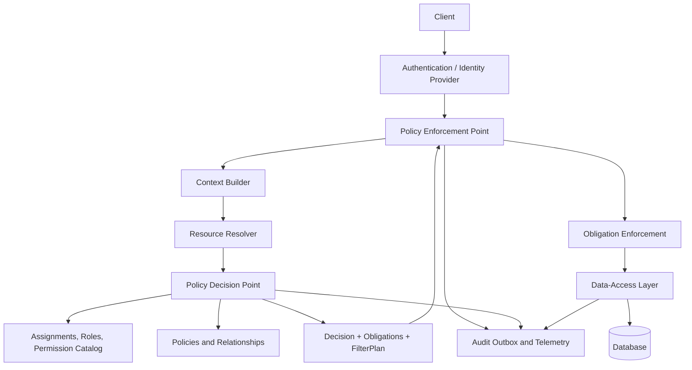
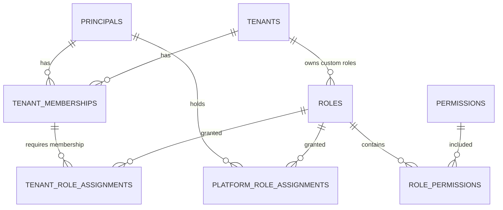

# Enterprise Authorization Architecture

**Version:** 1.4.1
**Status:** Reference architecture and implementation specification (baseline). It is a specification, not an implemented or verified system: see "Document scope and evidence levels". v1.4.1 is a targeted corrective revision of v1.4 (see Appendix A.1 and the revision history).
**Supersedes:** v1.4

This document is a reusable baseline, not a requirement to implement every pattern. Choose the simplest design that satisfies the product's resource model, risk, scale, and compliance requirements. Record major choices in an ADR.

**Reading guide.** Sections and rules are labelled:

- **[Baseline]** Recommended for most enterprise applications; the contract two independent teams can implement compatibly.
- **[Optional]** Adopt only when a documented requirement needs it. Where a capability is optional, this document still states the minimum safety rules to follow if you adopt it.
- **Assumption An** A design choice that depends on business requirements not known to this document. Each assumption is listed in Appendix C with its trade-off and the condition for changing it. Treat assumptions as defaults to confirm, not as facts.
- **Rule structure.** Important rules are stated as a design rule (what to do), an invariant (what must always hold), the enforcement mechanism (what makes it hold), and a test (how it is verified). A rule whose mechanism or test is only specified is **not** guaranteed; the evidence matrix in Appendix D says which invariants have been exercised and which have not.

Appendices at the end: A (change logs), B (finding resolution matrices), C (assumptions and open decisions), D (verification evidence and invariant matrix).

### Document scope and evidence levels

This document contains several kinds of content. They are different things, and v1.4 labels them separately so that a specification is not mistaken for a verified system.

| Level | Meaning | Where | Status in v1.4 |
|---|---|---|---|
| Reference architecture | Components, responsibilities, invariants, decisions | Sections 1 to 7, 9 to 23, 26 | Specified |
| Implementation specification | Contracts precise enough for two teams to build compatibly: types, algorithms, tables, error codes | Sections 8, 10 to 15, 22, 23 | Specified |
| Executable DDL | SQL intended to run as written on PostgreSQL 15 or newer | Section 8.3 (`authz_v1_4_1_reference.sql`, seed data `authz_v1_4_1_reference_seed.sql`) | Executed on PostgreSQL 16.2 (embedded server, sandbox). Not executed in any target environment |
| Pseudocode and illustrative code | TypeScript types, SQL snippets, JSON examples | Elsewhere | Illustrative. Not compiled or run, unless the snippet is marked as executed |
| Test specification | Catalog of tests with expected results | Section 24 | Specified |
| Implemented tests | Test code exists | `authz_v1_4_1_reference_tests.py`, `filterplan_types.ts`, `doc_consistency_check.py` | A subset: 134 reference tests run by the harness (database invariants, a reference authorization path, a relay simulation, a reference FilterPlan validator, and 15 TypeScript compile-time cases) plus a document consistency check. This is **not product code** |
| Executed tests | Results exist | `authz_v1_4_1_reference_results.txt`, `authz_v1_4_1_typecheck_commands.txt`, `authz_v1_4_1_doc_check_results.txt`, Appendix D | 134 executed, 134 passed, 0 failed, in the sandbox (PostgreSQL 16.2, TypeScript 6.0.3). The v1.4 count of 94 was reproduced on the unmodified v1.4 artifacts before they were changed. Every other test in section 24 has not been run |
| Verified in a target environment | The product's own implementation exercised in its real environment | - | None |

Status vocabulary used in the test tables of section 24: implementation status `S` (specified only), `RI` (reference-implemented in the sandbox code above), `PI` (implemented in product code); execution status `NR` (not run), `PS` (passed in the sandbox), `PC` (passed in the product's CI). All rows currently read `S/NR` or `RI/PS`. No row reads `PI` or `PC`, because no product implementation was available to this revision.

**Phase exit criteria (section 25) require product-environment evidence. Sandbox results do not satisfy them.**

### Revision history

| Version | Summary |
|---|---|
| 1.2 | Restored baseline, terminology, diagram, tenant model, worked example, HTTP rules, TOCTOU; fixed schema/algorithm inconsistencies |
| 1.3 | Combining algorithm, platform vs tenant assignments, trusted context, failure matrix, FilterPlan, obligations, bulk, audit classes, revocation table, test catalog |
| 1.4 | Role ownership and membership invariants with DB enforcement; audit outbox semantics; typed FilterPlan with runtime validation; tenant-membership HTTP contract; cache grace aligned with the staleness SLA; permission context namespace; evidence levels and executed reference tests (Appendix A) |
| 1.4.1 | Corrective revision: stored assignment state versus effective authorization (suspension, reinstatement, removal); audit guarantees scoped to the event classes and trusted write boundary, with database-level audit capture for membership and assignment changes; FilterPlan types made field-specific with runtime validation kept authoritative; `ended_at` enforced by the database; role ownership examples, seed data, and naming made consistent; evidence matrix and checks re-run (Appendix A.1) |


---

## 1. Goals and recommended default baseline [Baseline]

### 1.1 Goals

- Least privilege, deny-by-default, fail-closed.
- Consistent enforcement across APIs, data access, exports, background jobs, and bulk operations.
- Explicit tenant isolation, auditable permission changes, and testable decisions.
- Support for human and machine identities.
- Separation of mandatory decisions from choices that depend on project requirements.

### 1.2 Recommended baseline

For most new enterprise applications, start with:

1. RBAC as the foundational grant mechanism.
2. A centrally managed permission catalog; no permissions outside the catalog.
3. Tenant isolation enforced server-side and in the data-access layer.
4. Tenant role assignments with scope; platform role assignments kept in a separate table (section 8).
5. PEPs applied consistently at API, service, and data-access boundaries.
6. A PDP that evaluates a trusted context and returns a decision (an in-process module with a stable interface is sufficient).
7. Authorization for single resources and for collections via a typed `FilterPlan`.
8. A documented combining algorithm and a failure-behavior matrix (sections 11 and 15).
9. Audit classified by event class with defined delivery guarantees (section 22).
10. Automated tests for allow, deny, tenant isolation, scope, expiry, filtering, bulk, and failure behavior.
11. Deny when there is no explicit `ALLOW`; fail closed when a required evaluator or dependency fails.
12. Advanced capabilities added only when requirements demand them.

### 1.3 Capabilities not required on day one [Optional]

- Explicit deny rules (Assumption A1)
- Advanced ABAC; ReBAC / relationship graph; per-resource ACLs
- Direct user permission grants
- Dedicated policy engine
- Database row-level security (RLS)
- Separation of duties (SoD), just-in-time (JIT) access, privileged access governance
- Break-glass access, impersonation, support access
- Delegation / on-behalf-of
- Role inheritance, group-to-role mapping
- Resource transfer between scopes
- Cached-decision grace during dependency failure

---

## 2. Terminology [Baseline]

Use these terms consistently. Do not alternate between "subject" and "principal".

| Term | Meaning |
|---|---|
| Principal | The identity whose authority is evaluated: a user, service account, or workload identity |
| Actor | The entity that actually initiates the current action. Usually the principal; differs under delegation or impersonation |
| Represented principal | The user on whose behalf an actor acts (section 18) |
| Context kind (`context_kind`) | The execution context of an authorization request: `TENANT` or `PLATFORM` |
| Tenant | Boundary for data separation, membership, and tenant-level administration |
| Resource / action | The protected object and the operation requested on it |
| Permission | Named capability, e.g. `document.update`. Each permission belongs to exactly one context kind; every `PLATFORM` permission key starts with `platform.` (section 6.1) |
| Role | A bundle of permissions of one role kind. **A role carries no scope** |
| Role ownership | Who defines a role: the platform (`is_system_defined = true`, no owning tenant) or exactly one tenant (custom role). Never inferred from `tenant_id IS NULL` alone (section 8.2.1) |
| Grant | A role assignment (or, in Option B, a direct grant) that confers a permission to a principal |
| Role assignment | A grant of a role to a principal. Tenant assignments are bounded by tenant, scope, and time; platform assignments by time |
| Stored assignment state | The persisted `status` of a role assignment row (`ACTIVE` or `REVOKED`). Expiry is not stored; it is derived from `valid_until` |
| Effective authorization | Whether an assignment can contribute to a decision at the time of a request: stored `ACTIVE`, inside its validity window, role assignable in the tenant, **and** the principal's membership `ACTIVE` in an `ACTIVE` tenant (section 8.5). A stored `ACTIVE` assignment is not necessarily effective |
| Assignment scope (`scope_type`, `scope_id`) | Where a tenant role assignment is valid |
| Resource scope | The organizational attributes a resource carries (`company_id`, `team_id`, ...) used to test scope coverage |
| Data scope | The set of records an operation may see or affect; expressed as a `FilterPlan` |
| Policy / policy bundle | A rule, or the versioned set of rules, used to decide access |
| Permission catalog | The versioned list of permissions and their metadata |
| Evaluation result | PDP-internal outcome: `ALLOW`, `DENY`, `NOT_APPLICABLE`, `INDETERMINATE` (section 11) |
| Decision | The outward result the PEP consumes: `ALLOW` or `DENY` plus metadata |
| Obligation | A requirement the PEP must enforce when applying a decision; **mandatory** or **advisory** |
| PEP / PDP | Policy Enforcement Point / Policy Decision Point |
| Authentication failure | Credential missing, invalid, or expired (HTTP 401); not an authorization decision |
| Authorization denial | The rules evaluated successfully and refused the action |
| Evaluation failure | The rules could not be evaluated reliably (`INDETERMINATE`); handled fail-closed |
| Visibility | Whether the principal holds the read-level permission, within scope, for a resource; used to choose 403 vs 404 (section 12) |

---

## 3. Reference architecture [Baseline]

### 3.1 Logical flow



- Authentication verifies identity; it does not imply authorization.
- The context builder produces a *trusted* context from authenticated identity and server-side lookups (section 10). Client-supplied values are hints, never inputs to a decision.
- The resource resolver loads the resource and its authoritative tenant and scope attributes using a tenant-predicated query (section 12).
- The PDP returns a decision; the PEP enforces it and its obligations before any data is read or changed.
- The data-access layer adds the tenant predicate and the authorization `FilterPlan` to every query on tenant-owned data (section 13).

PEP and PDP need not be separately deployed. They can be modules of one application if responsibilities stay separated.

### 3.2 Reference request flow

1. Authenticate the caller and validate the credential (failure: 401, no evaluation).
2. Validate the request shape (failure: 400/422, no evaluation).
3. Build the trusted context (section 10).
4. Resolve the resource and its authoritative attributes, where the action needs one (section 12).
5. PDP evaluates: invariants, candidates, combination, obligations (section 11).
6. PEP maps the result to a response per sections 11 and 12 and enforces obligations.
7. The data-access layer applies tenant predicate and `FilterPlan`; the action executes.
8. Audit events are emitted per class (section 22).

Do not rely on hiding UI elements as a security boundary. A PEP must protect every meaningful access path, including alternate endpoints, exports, background jobs, and bulk operations.

### 3.3 Responsibility matrix

| Component | Responsible for | Not responsible for | Main input -> output | Invariant | If a dependency fails |
|---|---|---|---|---|---|
| Identity provider | Authenticating principals; issuing tokens | Deciding access to resources | Credentials -> token | Tokens are signed, short-lived | Authentication fails (401) |
| Context builder | Building `TrustedContext` from validated token and server lookups | Evaluating policy | Token + request -> context | No client value enters a decision input | Cannot build -> `INDETERMINATE` |
| Resource resolver | Loading resource and authoritative tenant/scope attributes | Deciding access | Resource ref -> resource attributes | Lookup is always tenant-predicated | Cannot resolve -> `INDETERMINATE` |
| PEP | Calling PDP; enforcing decision and obligations; mapping to HTTP | Computing the decision | Request -> response | No action without explicit `ALLOW` | Treat as deny (section 15) |
| PDP | Evaluating grants, constraints, policies; producing decision, obligations, `FilterPlan` | Executing the action; building SQL | Context + resource -> decision | Algorithm of section 11 only | `INDETERMINATE` -> deny |
| Policy/catalog administration | Authoring, reviewing, publishing versions | Per-request decisions | Change -> published version | Changes versioned and audited | Keep last validated version |
| Data-access layer | Injecting tenant predicate; validating and applying `FilterPlan`; refusing unguarded queries | Choosing the scope | Query + plan -> parameterized SQL | No tenant-owned query without tenant predicate | Refuse to query |
| Database / RLS | Constraints; optional RLS as defense in depth | Replacing application authorization | SQL -> rows | Constraints in section 8 hold | Query fails; request fails |
| Audit outbox, relay, and sink | Durable recording of class A and C events through the supported write paths: the outbox row in the data's own database; at-least-once relay to the sink; de-duplication at the sink | Making a committed business change wait for the downstream sink; capturing events from writers that bypass the trusted write boundary (section 22.6) | Event -> outbox -> sink | Once a class A or C change commits through a supported path, its outbox event is committed with it. Classes B and D carry no such guarantee (section 22.1) | Outbox write fails: the change rolls back (classes A, C). Sink down: the change stays committed and the relay retries (section 15, rows 8a and 8b) |
| Cache | Speeding up reads of authorization data | Being a source of truth | Key -> value | Key includes all decision dimensions | Treat as miss |
| Client / frontend | UX only | Any security decision | - | Never trusted | - |

---

## 4. Authentication and identity lifecycle [Baseline]

Authentication and authorization are separate concerns.

- **OIDC / OAuth 2.0:** common for modern web/API login and delegated API access; OIDC adds identity information on top of OAuth 2.0.
- **SAML 2.0:** add when enterprise customers or an existing corporate IdP require it.
- **SCIM or equivalent provisioning:** can automate account/group provisioning and deprovisioning; it does not replace application authorization.
- **Joiner / mover / leaver (JML):** define how new users receive access, role/team changes are applied, and access is removed when a person leaves.
- **Machine identities:** give services their own identities and narrowly scoped credentials; do not borrow human accounts.

Token guidance:

- Validate issuer, audience, signature, expiry, and required claims.
- Keep access tokens short-lived (Assumption A4: at most 15 minutes) and define session termination and revocation behavior.
- Tokens carry identity, authentication assurance, and at most a tenant *selection hint*. They do not carry the permission set. Permissions are always read from the source of truth (section 23).
- Treat claims as inputs to context building, not proof that the caller can access any resource.
- Never trust client-supplied tenant, user, or scope IDs without server-side validation.
- A principal may belong to several tenants (Assumption A7). The active tenant is chosen per request or session and must be validated against an active membership.

---

## 5. Tenant, company, and department model [Baseline]

Do not equate `tenant`, `company`, `department`, and `scope`. Define their boundaries per product.

```text
Platform
├── Tenant: Corporate Group A
│   ├── Company A1
│   │   ├── Department Finance
│   │   └── Department Operations
│   └── Company A2
└── Tenant: Corporate Group B
    └── Company B1
```

This is an example, not a mandatory hierarchy.

- A tenant is the security and administration boundary at tenant level.
- Company and department are organizational levels inside a tenant. Do not assume every company is a tenant, or that every group is a tenant.
- Decide the tenant boundary from data-isolation needs, membership, administration, controlled data sharing, and organizational lifecycle.
- If companies in one group need very strict isolation, use separate tenants (or additional isolation mechanisms). If they share identity, administration, and controlled data, they may share a tenant and be separated by assignment scope.
- **Assumption A6:** every tenant-owned resource stores direct foreign keys to the organizational units it belongs to (`company_id`, `department_id`, `team_id`, ...). The baseline does not traverse an organizational hierarchy at decision time. If you need "all departments under company X" without denormalized keys, or org units form a graph rather than independent attributes, model it with the relationship capability (section 16) and record an ADR.

Tenant context must be derived server-side from identity and membership. Tenant isolation never relies on the frontend hiding data or on a client-supplied tenant ID.

---

## 6. Permission model and catalog [Baseline]

### 6.1 Naming

Use one grammar: `<resource>[.<subresource>].<action>`

Examples, tenant context: `document.read`, `document.update`, `document.share`, `project.member.manage`, `invoice.read_sensitive`, `document.export`, `role.manage`, `user_role.assign`. Examples, platform context: `platform.tenant.create`, `platform.role.manage`.

- Lowercase `snake_case` within tokens; dots are structural separators.
- Stable business-resource names and a controlled action vocabulary.
- Do not mix `read_document`, `document.read`, and `Document.Read`.
- Permissions describe business capabilities, not screens or menus.
- Separate sensitive permissions (`invoice.read_sensitive`, `platform.user.impersonate`, `user_role.assign`).
- Distinguish collection-level from instance-level permissions only when the domain needs it.
- Every permission has a **context kind** (`TENANT` or `PLATFORM`), an owning module, a risk level (`LOW`, `HIGH`), and a description.
- **Context namespace rule:** a permission whose context kind is `PLATFORM` has a key that starts with `platform.`; a `TENANT` permission key never does. Rule: the key alone tells a reader (in code, policy, logs, and documentation) which context it belongs to. Invariant: `(key LIKE 'platform.%') = (context_kind = 'PLATFORM')`. Mechanism: a `CHECK` on `permissions` (section 8.3) plus catalog lint. Tests: T-N01 (executed in the sandbox), T-N02.
- Add linting/tests for duplicates, unknown tokens, naming drift, permissions missing a context kind, and violations of the namespace rule.

This is an application contract, not a universal standard.

### 6.2 Read-level (visibility) permission

Each resource type declares one permission that defines *visibility*, normally `<resource>.read`. Section 12 uses it to decide 403 vs 404.

### 6.3 Catalog versioning and migration

- Decide which permissions are a stable public contract.
- Define how permissions are added, renamed, or deprecated.
- Define how roles and assignments migrate when permissions change. A permission that no longer exists grants nothing (never silently allow).
- Keep policy bundle and application code version-aligned.
- Audit catalog changes.
- Do not delete a permission without assessing dependent roles, policies, assignments, and clients.
- Version the catalog as a whole (or the policy bundle), not each permission, unless a requirement says otherwise (section 26).

### 6.4 Administrative permissions, context, and compatibility

Administrative permissions are where tenant and platform meanings were easiest to confuse (for example `role.manage`). The catalog below fixes the context of each. A tenant-context permission always acts on the context tenant only; the `platform.` counterparts act on platform-level objects.

| Key | Context | Meaning | Risk |
|---|---|---|---|
| `role.read` | TENANT | Read roles and their permissions visible in the context tenant | LOW |
| `role.manage` | TENANT | Create, change, delete tenant custom roles and their permission sets | HIGH |
| `user_role.assign` | TENANT | Create tenant role assignments in the context tenant, within the granter's own authority | HIGH |
| `user_role.revoke` | TENANT | Revoke tenant role assignments in the context tenant | HIGH |
| `tenant_membership.manage` | TENANT | Add, suspend, and remove memberships in the context tenant | HIGH |
| `authz.deny.manage` | TENANT | Create explicit denies (only if A1 is enabled) | HIGH |
| `authorization_audit.read` | TENANT | Read authorization audit events of the context tenant | HIGH |
| `platform.tenant.create`, `platform.tenant.suspend` | PLATFORM | Create or suspend tenants | HIGH |
| `platform.role.manage` | PLATFORM | Create or change platform roles and shared (system-defined) tenant roles | HIGH |
| `platform.user_role.assign`, `platform.user_role.revoke` | PLATFORM | Create or revoke platform role assignments | HIGH |
| `platform.tenant.support_access` | PLATFORM | Open a support session in a tenant (section 19) | HIGH |
| `platform.user.impersonate` | PLATFORM | Impersonate a user (section 19) | HIGH |
| `platform.policy.publish` | PLATFORM | Publish a policy or catalog version (section 26) | HIGH |

**Compatibility note (v1.3 to v1.4).** The following v1.3 keys changed. v1.3 was a document only, so there is no data to migrate for readers who had not implemented it. Teams that did implement v1.3 names should follow the deprecation process of 6.3: add the new keys, map roles to them, switch callers, then retire the old keys, and update catalog rows, `role_permissions`, policies, test fixtures, and log queries.

| v1.3 key | v1.4 key | Reason |
|---|---|---|
| `tenant.create` | `platform.tenant.create` | Platform context namespace rule |
| `tenant.suspend` | `platform.tenant.suspend` | Platform context namespace rule |
| `tenant.support_access` | `platform.tenant.support_access` | Platform context namespace rule |
| `policy.publish` | `platform.policy.publish` | Platform context namespace rule |
| `user.impersonate` (6.1 example) | `platform.user.impersonate` | Platform context namespace rule |
| `role.assign` (6.1 example) | `user_role.assign` | v1.3 used two names for one capability |
| `role.read`, `role.manage`, `user_role.assign`, `user_role.revoke`, `authz.deny.manage`, `authorization_audit.read` | unchanged | Declared TENANT context |

**Runtime handling of invalid permissions.**

| Situation | Result | Mechanism | Test |
|---|---|---|---|
| Action is not in the catalog | `INDETERMINATE / UNKNOWN_PERMISSION`; HTTP 500, alert (a caller defect, never a user error). A build step must also check that every action declared in code exists in the catalog | PDP step A4 (section 11.3); CI check | T-N03 |
| Known permission whose context kind differs from the request's context kind | `DENY / CONTEXT_KIND_MISMATCH` | PDP step B3 | T-N04 |
| Role mapping mixes contexts (a tenant role containing a `platform.` permission) | Rejected at write time | `role_permissions` `CHECK` and composite foreign keys (section 8.3) | T-X10 (executed) |
| Deprecated permission | Still evaluated normally; usage is counted and logged | Catalog `deprecated_at` | T-N05 |

---

## 7. Roles, assignments, and scope [Baseline]

### 7.1 Role kinds and how administrators are represented

| Actor type | Representation | Notes |
|---|---|---|
| Platform administrator | Row in `platform_role_assignments` with a `PLATFORM` role (e.g. `platform_admin`) holding platform permissions (`platform.tenant.create`, `platform.tenant.suspend`, ...) | No tenant data permission by default |
| Tenant administrator | Row in `tenant_role_assignments` with the shared template role `tenant_admin` (section 8.2.2), `scope_type = TENANT` | Authority limited to that tenant |
| Tenant-scoped user | Row in `tenant_role_assignments` with a scoped assignment of a shared template role (e.g. `editor` at `COMPANY`/`company-a`) | Authority limited to that scope in that tenant |
| Platform staff accessing tenant data | Time-bound support session (section 19) that yields a limited `TENANT` context | Never ambient (Assumption A2) |

Invariants:

- A tenant role can never act as a platform role, and a platform role can never grant tenant data access. This is enforced by the database (section 8), not by convention.
- A missing `tenant_id` never widens authority. A `TENANT` context without a tenant is rejected; it is never reinterpreted as `PLATFORM`.
- A platform administrator does not have unlimited authority. Platform permissions are explicit catalog entries.

### 7.2 Worked example

Maya (principal) is an `ACTIVE` member of tenant X and holds, in tenant X, an assignment of the shared template role `editor` (section 8.2.2):

```text
Role:             editor            (permissions: document.read, document.create, document.update)
Assignment scope: COMPANY / company-a
```

Updating a document:

| Document | tenant | company | Result |
|---|---|---|---|
| doc-1 | X | company-a | Allowed (in scope) |
| doc-2 | X | company-b | Denied: out of scope (404, because Maya has no read-level visibility of company-b documents; section 12) |
| doc-3 | Y | company-a | Not found: tenant-predicated lookup never returns another tenant's row |

A request for doc-1 is evaluated by checking, in order: authenticated principal; active membership in tenant X; active, currently valid assignment; role grants `document.update`; resource tenant is X; resource `company_id = company-a`; mandatory constraints pass; mandatory obligations can be enforced. Only then is the update allowed.

### 7.3 Scope types (tenant assignments)

| `scope_type` | `scope_id` | Covers a resource when |
|---|---|---|
| `TENANT` | NULL | always (tenant ownership is checked separately) |
| `COMPANY` | company id | `resource.company_id = scope_id` |
| `DEPARTMENT` | department id | `resource.department_id = scope_id` |
| `TEAM` | team id | `resource.team_id = scope_id` |
| `RESOURCE` | resource id | `resource.id = scope_id` |
| `SELF` | NULL | `resource.owner_principal_id = principal.id` |

Support only the types you need and define how each maps to a resource attribute. `PLATFORM` is **not** a scope type; it is a context kind. `scope_id` is not proof of access: the evaluator must verify that the resource, loaded from the authoritative store, belongs to that scope. Do not assume a universal ordering between scope types.

### 7.4 Overlapping assignments

A principal may hold several assignments for the same permission (e.g. `TENANT` and `TEAM`, or two `TEAM` scopes). The effective grant set is the **union** of the scopes of all currently valid assignments that confer the permission. Revoking one assignment leaves the others in force. Overlap never reduces authority (there is no implicit deny); restriction comes only from mandatory constraints and, if enabled, explicit deny (A1).

### 7.5 Time and lifecycle

- `valid_from`: when the assignment starts to apply (null = immediately).
- `valid_until`: when it stops applying (null = no expiry); exclusive.
- `status`: administrative state, `ACTIVE` or `REVOKED`. Do not store `EXPIRED`; it is derived.
- The evaluator always compares the server clock with `valid_from` and `valid_until`. Never depend on a scheduled job to flip a status before denying access.
- `REVOKED` takes effect per the revocation contract (section 23).

```text
(valid_from IS NULL OR valid_from <= now)
AND
(valid_until IS NULL OR now < valid_until)
```

### 7.6 Direct user permission grants

**Option A (recommended default):** permissions are granted only through roles. The algorithm, admin UI, and APIs contain no direct grants.

**Option B:** direct grants supported (tenant context only; platform direct grants are not supported). Add `principal_permissions` (section 8.2) and define: allow vs deny; combination with role grants (union with role grants); whether they may exceed a role's scope (no); who may create them; approval, expiry, and audit. Do not describe direct grants anywhere unless schema, admin API, algorithm, and tests support them.

### 7.7 Groups and role inheritance [Optional]

- Group membership does not grant a role unless a group-to-role mapping is explicitly modelled and audited.
- If role inheritance is supported: define parent-child relationships, prevent or detect cycles, limit depth, define precedence and conflict handling, define cache invalidation when the hierarchy changes, audit hierarchy changes, and test multi-level inheritance and cycles.
- Neither belongs in the baseline unless required.

---

## 8. Logical data model and invariants

### 8.1 Entity relationship overview (baseline entities)



### 8.2 Entities

Tier: **B** = baseline, **O** = optional, **L** = later phase.

| Entity | Tier | Key / unique | Foreign keys | Fields and invariants |
|---|---|---|---|---|
| `principals` | B | PK `id` | - | `principal_type` (`USER`,`SERVICE`), `status` (`ACTIVE`,`DISABLED`), `created_at`, `updated_at` |
| `tenants` | B | PK `id` | - | `status` (`ACTIVE`,`SUSPENDED`), `created_at` |
| `tenant_memberships` | B | PK `id`; unique `(tenant_id, principal_id)` | `tenant_id`, `principal_id` | `status` (`ACTIVE`,`SUSPENDED`,`REMOVED`), `created_at`, `ended_at`. `ended_at` is set if and only if `status = 'REMOVED'`, enforced by a `CHECK` and a `BEFORE` trigger for every writer (8.5). Only an `ACTIVE` membership can **receive** a new assignment (trigger, 8.3). Stored assignments of a `SUSPENDED` membership are preserved but not effective; `REMOVED` revokes them (8.5). The PDP re-checks status at runtime (11.3, B2) |
| `permissions` | B | PK `id`; unique `key`; unique `(id, context_kind)` | - | `context_kind` (`TENANT`,`PLATFORM`), `resource_type`, `action`, `risk_level`, `deprecated_at`. `CHECK ((key LIKE 'platform.%') = (context_kind = 'PLATFORM'))` |
| `roles` | B | PK `id`; unique `(id, role_kind)`; unique `(tenant_id, key)` NULLS NOT DISTINCT | `tenant_id` nullable | `role_kind` (`TENANT`,`PLATFORM`), `key`, `is_system_defined`. Valid combinations and immutability: section 8.2.1 |
| `role_permissions` | B | PK `(role_id, permission_id)` | `(role_id, role_kind)` -> roles; `(permission_id, context_kind)` -> permissions | `CHECK (role_kind = context_kind)`: a tenant role can never hold a platform permission and vice versa |
| `tenant_role_assignments` | B | PK `id`; partial unique (see 8.4) | `tenant_id`; `(tenant_id, principal_id)` -> memberships; `(role_id, role_kind)` -> roles | `tenant_id NOT NULL`; role must be `TENANT` kind and (system-defined or owned by the same tenant), and membership must be `ACTIVE` when the assignment is created, both enforced by trigger (8.3); scope fields per 7.3; lifecycle fields per 7.5 |
| `platform_role_assignments` | B | PK `id`; partial unique | `principal_id`; `(role_id, role_kind)` -> roles | **No `tenant_id`, no scope.** Role must be `PLATFORM` kind. `approval_reference` required |
| `principal_permissions` | O (Option B) | PK `id` | as tenant assignments | Direct grants, tenant context only |
| `principal_denies` | O (A1) | PK `id` | as tenant assignments | Explicit deny, tenant context only; `reason` and `approval_reference` required; created only by holders of a high-risk permission such as `authz.deny.manage` |
| `resource_relationships` | O | PK `id` | `tenant_id` | `(subject, relation, object)` with status and validity; tenant-bound |
| `delegation_records` | O | PK `id` | `tenant_id`, actor, represented principal | Allowed permissions/scope, validity, status, `created_by` (only if delegation is stored rather than carried in tokens) |
| `support_sessions` | O | PK `id` | `tenant_id`, platform principal | Limited role, `approved_by`, validity, status (section 19) |
| `catalog_versions` | L | PK `version` | - | `published_at`, `published_by`, `checksum` (section 26) |
| `authorization_change_events`, `access_decision_events`, `audit_outbox` | B | PK `event_id` | - | Section 22. Events for membership and assignment changes are written by database triggers (8.3, 22.6) |

Cross-cutting rules: every tenant-owned table carries `tenant_id NOT NULL`; timestamps are UTC; soft-delete or revocation is preferred to destructive deletion where auditability matters; no `NULL`, missing field, and empty string carry different meanings unless this document says so (here, `NULL scope_id` is meaningful only for `TENANT` and `SELF`).

### 8.2.1 Role ownership invariants

| Role kind | `tenant_id` | `is_system_defined` | Meaning | May be assigned in | Created by |
|---|---|---|---|---|---|
| `PLATFORM` | NULL | true | Platform role such as `platform_admin` | `platform_role_assignments` only | Platform release or `platform.role.manage` |
| `TENANT` | NULL | true | Shared template role defined by the platform for all tenants, such as `editor`; key has no `custom.` prefix | `tenant_role_assignments` of any tenant (the assignment row is always tenant-scoped) | Platform release or `platform.role.manage` |
| `TENANT` | a tenant id | false | Custom role owned by exactly one tenant; key starts with `custom.` | `tenant_role_assignments` of that tenant only | A tenant administrator with `role.manage` |
| any other combination | - | - | **Invalid**, for example `TENANT` with NULL `tenant_id` and `is_system_defined = false` | rejected | - |

| Rule | Invariant | Enforcement mechanism (section 8.3) | Test |
|---|---|---|---|
| Ownership is explicit | `(tenant_id IS NULL) = is_system_defined`, and a `PLATFORM` role is always system-defined with NULL `tenant_id` | `CHECK roles_ownership_ck` | T-RO01, T-RO02 |
| Keys cannot collide across owners | Custom role keys start with `custom.`; system role keys never do | `CHECK roles_key_namespace_ck` | T-RO06 |
| Ownership cannot change | `role_kind`, `tenant_id`, `is_system_defined` are immutable after insert. Promoting or re-homing a role means creating a new role | `BEFORE UPDATE` trigger `roles_immutable_ownership` | T-RO05 |
| A tenant role is assignable only where it belongs | The role is `TENANT` kind and (`is_system_defined` or `roles.tenant_id = assignment.tenant_id`) | `BEFORE INSERT/UPDATE` trigger on `tenant_role_assignments`; a `CHECK` cannot reference another table | T-RO03, T-RO04, T-RO07 |
| Platform and tenant kinds do not mix | `role_kind` of assignment must equal the role's kind; a role may hold only permissions of its own context kind | Composite foreign keys plus `CHECK (role_kind = context_kind)` | T-X04, T-X10 |

Rules for queries and code:

- Never infer a role's type or owner from `tenant_id IS NULL` alone. Use `role_kind` and `is_system_defined`. In a tenant context a role is usable when `r.role_kind = 'TENANT' AND (r.is_system_defined OR r.tenant_id = :context_tenant)` (see 8.7).
- A shared template role is a shared *definition*. Assignments of it are always tenant-scoped rows, so tenant A's assignment never grants anything in tenant B.
- Changing the permission set of a shared template role affects every tenant and therefore requires `platform.role.manage`.
- Historical revoked assignment rows that predate these rules are tolerated and stay editable. The role/tenant ownership check runs on insert and when `role_id` or `tenant_id` changes (see 8.6).

### 8.2.2 Roles named in this document and their ownership category

Every role key used in an example, a test, or the seed data belongs to exactly one category of 8.2.1. Role keys are lowercase.

| Role key | `role_kind` | `tenant_id` | `is_system_defined` | Category | Used in | In seed data |
|---|---|---|---|---|---|---|
| `platform_admin` | `PLATFORM` | NULL | true | Platform role | 7.1, 27.4 | Yes |
| `tenant_admin` | `TENANT` | NULL | true | Shared template role | 7.1 | Yes |
| `viewer`, `editor`, `manager`, `exporter` | `TENANT` | NULL | true | Shared template role | 7.2, 9.2, 13.5, 24, 27 | Yes |
| `custom.reviewer` (illustration) | `TENANT` | a tenant id | false | Tenant-owned custom role | 8.2.1 | No: created per tenant at runtime |

- No other category exists in the baseline. In particular, `tenant_admin`, `editor`, and `manager` are **shared templates**, never tenant-owned; a tenant that wants its own variant creates a custom role whose key starts with `custom.` (for example `custom.editor`), which is a different key from the shared `editor`.
- The seed data below creates only system-defined roles. It satisfies the same constraints as runtime writes (tests T-RO09 to T-RO11, executed in the sandbox) and the migration checks of 8.6 return nothing on it.
- Upper-case forms of these keys, and any role name that is not in this table, are not used anywhere in this document (check T-RO12).

### 8.3 Reference DDL (PostgreSQL 15 or newer)

**Status of this DDL.** It is executable as written on PostgreSQL 15 or newer. It was executed on PostgreSQL 16.2 (embedded server, sandbox) together with the seed data below and the reference tests of Appendix D (companion files `authz_v1_4_1_reference.sql` and `authz_v1_4_1_reference_seed.sql`). It has **not** been executed in any target environment, reviewed by a database administrator, or run under load. Not included: the optional entities of 8.2 (`principal_permissions`, `principal_denies`, `resource_relationships`, `delegation_records`, `support_sessions`, `catalog_versions`), the decision-event tables of section 22, RLS policies, and application tables. The `GRANT` statements at the end need a role named `authz_app`, which is cluster-level and is created by the test harness, not by this script.

Needs adaptation for other engines: `NULLS NOT DISTINCT` (PostgreSQL 15+; elsewhere use expression indexes), `plpgsql` triggers with `SECURITY DEFINER` (use the engine's equivalent), `gen_random_uuid()` (PostgreSQL 13+), and partial indexes (use filtered indexes where supported).

Known gaps in this DDL:

- A database owner or superuser can disable the triggers (`ALTER TABLE ... DISABLE TRIGGER`, `session_replication_role = replica`). The DDL cannot prevent that; section 22.6 states the consequence and the detection that is proposed.
- The audit triggers capture class A events for membership and assignment changes only. Other class A changes (roles, permissions, policy and catalog publication, support sessions, transfers) must be written to `audit_outbox` by the trusted service in the same transaction, which this DDL does not do for them.
- The class B local queue, class C read/export events, and the relay are not part of this DDL.
- `created_by` and `revoked_by` are not foreign keys; `updated_at` is not maintained automatically; the outbox purge job is not defined; READ COMMITTED is assumed (8.5).

```sql
CREATE TABLE principals (
  id uuid PRIMARY KEY,
  principal_type text NOT NULL CHECK (principal_type IN ('USER','SERVICE')),
  status text NOT NULL CHECK (status IN ('ACTIVE','DISABLED')),
  created_at timestamptz NOT NULL DEFAULT now(),
  updated_at timestamptz NOT NULL DEFAULT now()
);

CREATE TABLE tenants (
  id uuid PRIMARY KEY,
  status text NOT NULL CHECK (status IN ('ACTIVE','SUSPENDED')),
  created_at timestamptz NOT NULL DEFAULT now()
);

-- ended_at is set if and only if the membership is REMOVED (database-enforced, see trigger below)
CREATE TABLE tenant_memberships (
  id uuid PRIMARY KEY,
  tenant_id uuid NOT NULL REFERENCES tenants(id),
  principal_id uuid NOT NULL REFERENCES principals(id),
  status text NOT NULL CHECK (status IN ('ACTIVE','SUSPENDED','REMOVED')),
  created_at timestamptz NOT NULL DEFAULT now(),
  ended_at timestamptz,
  UNIQUE (tenant_id, principal_id),
  CONSTRAINT memberships_ended_at_ck CHECK ((status = 'REMOVED') = (ended_at IS NOT NULL))
);

CREATE TABLE permissions (
  id uuid PRIMARY KEY,
  key text NOT NULL UNIQUE,
  context_kind text NOT NULL CHECK (context_kind IN ('TENANT','PLATFORM')),
  resource_type text NOT NULL,
  action text NOT NULL,
  risk_level text NOT NULL CHECK (risk_level IN ('LOW','HIGH')),
  deprecated_at timestamptz,
  UNIQUE (id, context_kind),
  CONSTRAINT permissions_context_prefix_ck
    CHECK ((key LIKE 'platform.%') = (context_kind = 'PLATFORM'))
);

CREATE TABLE roles (
  id uuid PRIMARY KEY,
  role_kind text NOT NULL CHECK (role_kind IN ('TENANT','PLATFORM')),
  tenant_id uuid REFERENCES tenants(id),
  key text NOT NULL,
  is_system_defined boolean NOT NULL,
  UNIQUE (id, role_kind),
  UNIQUE NULLS NOT DISTINCT (tenant_id, key),
  -- ownership: system-defined <=> no owning tenant; platform roles are always system-defined
  CONSTRAINT roles_ownership_ck CHECK (
    ((tenant_id IS NULL) = is_system_defined)
    AND (role_kind <> 'PLATFORM' OR (tenant_id IS NULL AND is_system_defined))
  ),
  -- key namespace: tenant custom roles use 'custom.', system roles never do
  CONSTRAINT roles_key_namespace_ck CHECK ((tenant_id IS NOT NULL) = (key LIKE 'custom.%'))
);

-- ownership fields are immutable: promoting or re-homing a role means creating a new role
CREATE FUNCTION trg_roles_immutable_ownership() RETURNS trigger LANGUAGE plpgsql AS $$
BEGIN
  IF NEW.role_kind IS DISTINCT FROM OLD.role_kind
     OR NEW.tenant_id IS DISTINCT FROM OLD.tenant_id
     OR NEW.is_system_defined IS DISTINCT FROM OLD.is_system_defined THEN
    RAISE EXCEPTION 'role ownership fields are immutable' USING ERRCODE = 'check_violation';
  END IF;
  RETURN NEW;
END $$;
CREATE TRIGGER roles_immutable_ownership BEFORE UPDATE ON roles
  FOR EACH ROW EXECUTE FUNCTION trg_roles_immutable_ownership();

CREATE TABLE role_permissions (
  role_id uuid NOT NULL,
  role_kind text NOT NULL,
  permission_id uuid NOT NULL,
  context_kind text NOT NULL,
  PRIMARY KEY (role_id, permission_id),
  FOREIGN KEY (role_id, role_kind) REFERENCES roles (id, role_kind),
  FOREIGN KEY (permission_id, context_kind) REFERENCES permissions (id, context_kind),
  CHECK (role_kind = context_kind)
);

CREATE TABLE tenant_role_assignments (
  id uuid PRIMARY KEY,
  tenant_id uuid NOT NULL REFERENCES tenants(id),
  principal_id uuid NOT NULL,
  role_id uuid NOT NULL,
  role_kind text NOT NULL DEFAULT 'TENANT' CHECK (role_kind = 'TENANT'),
  scope_type text NOT NULL
    CHECK (scope_type IN ('TENANT','COMPANY','DEPARTMENT','TEAM','RESOURCE','SELF')),
  scope_id text,
  status text NOT NULL CHECK (status IN ('ACTIVE','REVOKED')),
  valid_from timestamptz,
  valid_until timestamptz,
  created_at timestamptz NOT NULL DEFAULT now(),
  created_by uuid NOT NULL,
  revoked_at timestamptz,
  revoked_by uuid,
  reason text,
  approval_reference text,
  FOREIGN KEY (tenant_id, principal_id)
    REFERENCES tenant_memberships (tenant_id, principal_id),
  FOREIGN KEY (role_id, role_kind) REFERENCES roles (id, role_kind),
  CHECK ((scope_type IN ('TENANT','SELF')) = (scope_id IS NULL)),
  CHECK (valid_from IS NULL OR valid_until IS NULL OR valid_until > valid_from),
  CHECK ((status = 'REVOKED') = (revoked_at IS NOT NULL))
);

CREATE UNIQUE INDEX uq_active_tenant_assignment
  ON tenant_role_assignments (tenant_id, principal_id, role_id, scope_type, scope_id)
  NULLS NOT DISTINCT
  WHERE status = 'ACTIVE';

-- All trigger functions are SECURITY DEFINER with a fixed search_path, so the invariants and the
-- audit capture below hold for every writer, including roles that have no privilege on the tables
-- these functions touch (audit_outbox, tenant_memberships, tenant_role_assignments).

-- Role ownership and ACTIVE-membership invariants for tenant assignments (new assignments only).
CREATE FUNCTION trg_tenant_assignment_integrity() RETURNS trigger
LANGUAGE plpgsql SECURITY DEFINER SET search_path = public, pg_temp AS $$
DECLARE
  r_kind text; r_tenant uuid; r_sys boolean; m_status text;
BEGIN
  IF TG_OP = 'UPDATE' AND OLD.status = 'REVOKED' AND NEW.status <> 'REVOKED' THEN
    RAISE EXCEPTION 'a revoked assignment cannot be reactivated; create a new assignment'
      USING ERRCODE = 'check_violation';
  END IF;

  -- role ownership is checked on insert and whenever role or tenant change; historical
  -- revoked rows that predate this rule are tolerated and stay editable (see section 8.6)
  IF TG_OP = 'INSERT' OR NEW.role_id IS DISTINCT FROM OLD.role_id
     OR NEW.tenant_id IS DISTINCT FROM OLD.tenant_id THEN
    SELECT role_kind, tenant_id, is_system_defined INTO r_kind, r_tenant, r_sys
      FROM roles WHERE id = NEW.role_id;
    IF r_kind IS DISTINCT FROM 'TENANT' OR NOT (r_sys OR r_tenant = NEW.tenant_id) THEN
      RAISE EXCEPTION 'role % is not assignable in tenant %', NEW.role_id, NEW.tenant_id
        USING ERRCODE = 'check_violation';
    END IF;
  END IF;

  -- Only an ACTIVE membership may RECEIVE a new ACTIVE assignment. Stored assignments of a
  -- SUSPENDED membership are preserved but are not effective (see section 8.5).
  IF NEW.status = 'ACTIVE' AND (TG_OP = 'INSERT' OR OLD.status <> 'ACTIVE') THEN
    -- FOR SHARE blocks a concurrent membership status change until this transaction ends
    SELECT status INTO m_status FROM tenant_memberships
     WHERE tenant_id = NEW.tenant_id AND principal_id = NEW.principal_id
       FOR SHARE;
    IF m_status IS DISTINCT FROM 'ACTIVE' THEN
      RAISE EXCEPTION 'principal % has no ACTIVE membership in tenant %',
        NEW.principal_id, NEW.tenant_id USING ERRCODE = 'check_violation';
    END IF;
  END IF;
  RETURN NEW;
END $$;
CREATE TRIGGER tenant_assignment_integrity
  BEFORE INSERT OR UPDATE ON tenant_role_assignments
  FOR EACH ROW EXECUTE FUNCTION trg_tenant_assignment_integrity();

-- ended_at is set if and only if the membership is REMOVED, for every writer.
--   entering REMOVED   : ended_at = the supplied value, else now()
--   REMOVED -> REMOVED : repeated removal is idempotent; ended_at may not be changed
--   leaving REMOVED    : ended_at is cleared (history lives in the audit events)
CREATE FUNCTION trg_membership_before() RETURNS trigger
LANGUAGE plpgsql SECURITY DEFINER SET search_path = public, pg_temp AS $$
BEGIN
  IF TG_OP = 'INSERT' THEN
    IF NEW.status = 'REMOVED' AND NEW.ended_at IS NULL THEN NEW.ended_at := now(); END IF;
    RETURN NEW;
  END IF;
  IF NEW.status = 'REMOVED' AND OLD.status <> 'REMOVED' THEN
    NEW.ended_at := COALESCE(NEW.ended_at, now());
  ELSIF NEW.status = 'REMOVED' AND OLD.status = 'REMOVED' THEN
    IF NEW.ended_at IS DISTINCT FROM OLD.ended_at THEN
      RAISE EXCEPTION 'ended_at of a removed membership cannot be changed'
        USING ERRCODE = 'check_violation';
    END IF;
  ELSIF OLD.status = 'REMOVED' AND NEW.status <> 'REMOVED' THEN
    NEW.ended_at := NULL;
  END IF;
  RETURN NEW;
END $$;
CREATE TRIGGER membership_before
  BEFORE INSERT OR UPDATE ON tenant_memberships
  FOR EACH ROW EXECUTE FUNCTION trg_membership_before();

-- Membership removed: revoke the principal's ACTIVE assignments in the same transaction.
-- Fires only on the transition into REMOVED, so a repeated removal revokes nothing twice.
CREATE FUNCTION trg_membership_ended() RETURNS trigger
LANGUAGE plpgsql SECURITY DEFINER SET search_path = public, pg_temp AS $$
BEGIN
  IF NEW.status = 'REMOVED' AND OLD.status <> 'REMOVED' THEN
    UPDATE tenant_role_assignments
       SET status = 'REVOKED', revoked_at = now(), reason = 'MEMBERSHIP_ENDED'
     WHERE tenant_id = NEW.tenant_id AND principal_id = NEW.principal_id
       AND status = 'ACTIVE';
  END IF;
  RETURN NEW;
END $$;
CREATE TRIGGER membership_ended
  AFTER UPDATE OF status ON tenant_memberships
  FOR EACH ROW EXECUTE FUNCTION trg_membership_ended();

CREATE TABLE platform_role_assignments (
  id uuid PRIMARY KEY,
  principal_id uuid NOT NULL REFERENCES principals(id),
  role_id uuid NOT NULL,
  role_kind text NOT NULL DEFAULT 'PLATFORM' CHECK (role_kind = 'PLATFORM'),
  status text NOT NULL CHECK (status IN ('ACTIVE','REVOKED')),
  valid_from timestamptz,
  valid_until timestamptz,
  created_at timestamptz NOT NULL DEFAULT now(),
  created_by uuid NOT NULL,
  revoked_at timestamptz,
  revoked_by uuid,
  reason text NOT NULL,
  approval_reference text NOT NULL,
  FOREIGN KEY (role_id, role_kind) REFERENCES roles (id, role_kind),
  CHECK (valid_from IS NULL OR valid_until IS NULL OR valid_until > valid_from),
  CHECK ((status = 'REVOKED') = (revoked_at IS NOT NULL))
);

CREATE UNIQUE INDEX uq_active_platform_assignment
  ON platform_role_assignments (principal_id, role_id)
  WHERE status = 'ACTIVE';

-- Audit outbox: lives in the same database as the data whose change it records.
CREATE TABLE audit_outbox (
  event_id uuid PRIMARY KEY,
  event_class text NOT NULL CHECK (event_class IN ('A','C')),
  occurred_at timestamptz NOT NULL DEFAULT now(),
  payload jsonb NOT NULL,
  status text NOT NULL DEFAULT 'PENDING' CHECK (status IN ('PENDING','SENT')),
  attempts integer NOT NULL DEFAULT 0,
  last_attempt_at timestamptz,
  sent_at timestamptz,
  CHECK ((status = 'SENT') = (sent_at IS NOT NULL))
);
CREATE INDEX audit_outbox_pending_idx ON audit_outbox (occurred_at) WHERE status = 'PENDING';

-- Database-level audit capture (class A) for membership and assignment changes. The event is
-- written by the same statement's transaction, so it commits or rolls back with the change.
-- The actor comes from the session settings app.actor_id / app.correlation_id / app.reason that a
-- trusted service sets with SET LOCAL; a direct write has no actor and is flagged unattributed.
CREATE FUNCTION audit_emit(p_event_type text, p_payload jsonb) RETURNS void
LANGUAGE sql SECURITY DEFINER SET search_path = public, pg_temp AS $$
  INSERT INTO audit_outbox (event_id, event_class, payload)
  VALUES (gen_random_uuid(), 'A',
          p_payload || jsonb_build_object(
            'event_type', p_event_type,
            'actor_id', NULLIF(current_setting('app.actor_id', true), ''),
            'actor_attributed', NULLIF(current_setting('app.actor_id', true), '') IS NOT NULL,
            'correlation_id', NULLIF(current_setting('app.correlation_id', true), ''),
            'reason', NULLIF(current_setting('app.reason', true), ''),
            'db_user', session_user))
$$;

CREATE FUNCTION trg_audit_membership() RETURNS trigger
LANGUAGE plpgsql SECURITY DEFINER SET search_path = public, pg_temp AS $$
BEGIN
  IF TG_OP = 'INSERT' THEN
    PERFORM audit_emit('membership.added', jsonb_build_object(
      'membership_id', NEW.id, 'tenant_id', NEW.tenant_id, 'principal_id', NEW.principal_id,
      'new_status', NEW.status));
  ELSIF NEW.status <> OLD.status THEN
    PERFORM audit_emit('membership.status_changed', jsonb_build_object(
      'membership_id', NEW.id, 'tenant_id', NEW.tenant_id, 'principal_id', NEW.principal_id,
      'old_status', OLD.status, 'new_status', NEW.status));
  END IF;
  RETURN NULL;
END $$;
CREATE TRIGGER audit_membership
  AFTER INSERT OR UPDATE ON tenant_memberships
  FOR EACH ROW EXECUTE FUNCTION trg_audit_membership();

CREATE FUNCTION trg_audit_assignment() RETURNS trigger
LANGUAGE plpgsql SECURITY DEFINER SET search_path = public, pg_temp AS $$
BEGIN
  IF TG_OP = 'INSERT' THEN
    PERFORM audit_emit(TG_TABLE_NAME || '.created', jsonb_build_object(
      'assignment_id', NEW.id, 'principal_id', NEW.principal_id, 'role_id', NEW.role_id,
      'tenant_id', to_jsonb(NEW) -> 'tenant_id', 'scope_type', to_jsonb(NEW) -> 'scope_type',
      'scope_id', to_jsonb(NEW) -> 'scope_id'));
  ELSIF NEW.status <> OLD.status THEN
    PERFORM audit_emit(TG_TABLE_NAME || '.status_changed', jsonb_build_object(
      'assignment_id', NEW.id, 'principal_id', NEW.principal_id,
      'tenant_id', to_jsonb(NEW) -> 'tenant_id',
      'old_status', OLD.status, 'new_status', NEW.status, 'assignment_reason', NEW.reason));
  END IF;
  RETURN NULL;
END $$;
CREATE TRIGGER audit_tenant_assignment
  AFTER INSERT OR UPDATE ON tenant_role_assignments
  FOR EACH ROW EXECUTE FUNCTION trg_audit_assignment();
CREATE TRIGGER audit_platform_assignment
  AFTER INSERT OR UPDATE ON platform_role_assignments
  FOR EACH ROW EXECUTE FUNCTION trg_audit_assignment();

-- Reference privilege model: the application role can write memberships and assignments, can read
-- the catalog, and has NO privilege on audit_outbox, cannot call audit_emit, and does not own the
-- tables (so it cannot disable or alter the triggers).
REVOKE ALL ON audit_outbox FROM PUBLIC;
REVOKE EXECUTE ON FUNCTION audit_emit(text, jsonb) FROM PUBLIC;
GRANT SELECT, INSERT, UPDATE ON tenant_memberships, tenant_role_assignments TO authz_app;
GRANT SELECT ON principals, tenants, permissions, roles, role_permissions TO authz_app;
```

Seed data (system-defined roles and the document catalog of 27.4; companion file `authz_v1_4_1_reference_seed.sql`):

```sql
INSERT INTO permissions (id, key, context_kind, resource_type, action, risk_level) VALUES
  (gen_random_uuid(), 'document.read',                  'TENANT',   'document',          'read',          'LOW'),
  (gen_random_uuid(), 'document.create',                'TENANT',   'document',          'create',        'LOW'),
  (gen_random_uuid(), 'document.update',                'TENANT',   'document',          'update',        'LOW'),
  (gen_random_uuid(), 'document.delete',                'TENANT',   'document',          'delete',        'HIGH'),
  (gen_random_uuid(), 'document.share',                 'TENANT',   'document',          'share',         'LOW'),
  (gen_random_uuid(), 'document.export',                'TENANT',   'document',          'export',        'HIGH'),
  (gen_random_uuid(), 'role.read',                      'TENANT',   'role',              'read',          'LOW'),
  (gen_random_uuid(), 'role.manage',                    'TENANT',   'role',              'manage',        'HIGH'),
  (gen_random_uuid(), 'user_role.assign',               'TENANT',   'user_role',         'assign',        'HIGH'),
  (gen_random_uuid(), 'user_role.revoke',               'TENANT',   'user_role',         'revoke',        'HIGH'),
  (gen_random_uuid(), 'tenant_membership.manage',       'TENANT',   'tenant_membership', 'manage',        'HIGH'),
  (gen_random_uuid(), 'authz.deny.manage',              'TENANT',   'authz',             'deny.manage',   'HIGH'),
  (gen_random_uuid(), 'authorization_audit.read',       'TENANT',   'authorization_audit','read',         'HIGH'),
  (gen_random_uuid(), 'platform.tenant.create',         'PLATFORM', 'tenant',            'create',        'HIGH'),
  (gen_random_uuid(), 'platform.tenant.suspend',        'PLATFORM', 'tenant',            'suspend',       'HIGH'),
  (gen_random_uuid(), 'platform.role.manage',           'PLATFORM', 'role',              'manage',        'HIGH'),
  (gen_random_uuid(), 'platform.user_role.assign',      'PLATFORM', 'user_role',         'assign',        'HIGH'),
  (gen_random_uuid(), 'platform.user_role.revoke',      'PLATFORM', 'user_role',         'revoke',        'HIGH'),
  (gen_random_uuid(), 'platform.tenant.support_access', 'PLATFORM', 'tenant',            'support_access','HIGH'),
  (gen_random_uuid(), 'platform.user.impersonate',      'PLATFORM', 'user',              'impersonate',   'HIGH'),
  (gen_random_uuid(), 'platform.policy.publish',        'PLATFORM', 'policy',            'publish',       'HIGH');

INSERT INTO roles (id, role_kind, tenant_id, key, is_system_defined) VALUES
  (gen_random_uuid(), 'PLATFORM', NULL, 'platform_admin', true),
  (gen_random_uuid(), 'TENANT',   NULL, 'tenant_admin',   true),
  (gen_random_uuid(), 'TENANT',   NULL, 'viewer',         true),
  (gen_random_uuid(), 'TENANT',   NULL, 'editor',         true),
  (gen_random_uuid(), 'TENANT',   NULL, 'manager',        true),
  (gen_random_uuid(), 'TENANT',   NULL, 'exporter',       true);

INSERT INTO role_permissions (role_id, role_kind, permission_id, context_kind)
SELECT r.id, r.role_kind, p.id, p.context_kind
FROM (VALUES
  ('platform_admin','platform.tenant.create'), ('platform_admin','platform.tenant.suspend'),
  ('platform_admin','platform.role.manage'),   ('platform_admin','platform.user_role.assign'),
  ('platform_admin','platform.user_role.revoke'),
  ('tenant_admin','role.read'), ('tenant_admin','role.manage'), ('tenant_admin','user_role.assign'),
  ('tenant_admin','user_role.revoke'), ('tenant_admin','tenant_membership.manage'),
  ('tenant_admin','authorization_audit.read'),
  ('viewer','document.read'),
  ('editor','document.read'), ('editor','document.create'), ('editor','document.update'),
  ('manager','document.read'), ('manager','document.create'), ('manager','document.update'),
  ('manager','document.delete'), ('manager','document.share'),
  ('exporter','document.read'), ('exporter','document.export')
) AS m(role_key, perm_key)
JOIN roles r ON r.key = m.role_key AND r.is_system_defined
JOIN permissions p ON p.key = m.perm_key;
```

Why two assignment tables instead of one with a nullable `tenant_id` (decision D1, Appendix C): the database itself guarantees that a tenant query can never return a platform row, that a tenant assignment always has a tenant and a membership relationship, and that `NULL tenant_id` can never be mistaken for platform authority. The cost is one more table and one more evaluation branch. A single-table design needs a discriminator plus more complex `CHECK`s and trigger logic, and every tenant query must remember to filter on the discriminator.

### 8.4 Re-grant and uniqueness

The partial unique indexes `uq_active_tenant_assignment` and `uq_active_platform_assignment` (section 8.3) allow a revoked assignment to be granted again as a **new row**, while preventing two `ACTIVE` rows for the same principal, role, and scope. A revoked assignment is terminal: it cannot be reactivated (trigger), so history is never rewritten.

`scope_id` is NULL for `TENANT` and `SELF` scopes, so the tenant index needs `NULLS NOT DISTINCT` (PostgreSQL 15+, Assumption A8). On older versions use an expression index with `COALESCE(scope_id, '')` or separate partial indexes. A partial index on `ACTIVE` does not prevent overlapping validity windows; if you need scheduled grants or history, define temporal-uniqueness rules separately. Tests: T-X14 (executed in the sandbox).

### 8.5 Membership lifecycle, stored state, and effective authorization

#### 8.5.1 Two different things

- **Stored assignment state** is what the row says: `status` is `ACTIVE` or `REVOKED`, plus `valid_from` and `valid_until`.
- **Effective authorization** is whether the assignment can contribute to a decision **now**. An assignment is effective only if all of these hold: its stored status is `ACTIVE`; the current time is inside its validity window; its role is assignable in the tenant (8.2.1); the principal's membership in the tenant is `ACTIVE`; and the tenant is `ACTIVE` (PDP step B2).

A stored `ACTIVE` assignment is therefore not necessarily effective. The reference grant lookup of 8.7 is the single definition of the membership, validity, and ownership part of this condition; the tenant status is checked by step B2.

#### 8.5.2 Lifecycle rules

| # | Rule | Kind |
|---|---|---|
| R1 | Only a membership in `ACTIVE` status may **receive** a new tenant role assignment | Invariant, database-enforced (trigger) |
| R2 | A transition to `SUSPENDED` preserves existing stored `ACTIVE` assignments. They grant nothing while the membership is suspended | Design rule; enforced by the grant lookup and PDP step B2 |
| R3 | On reinstatement (`SUSPENDED` to `ACTIVE`), preserved assignments become effective again **only if** they are still valid: not expired, not revoked meanwhile, role still assignable | Design rule; enforced by the grant lookup |
| R4 | A transition to `REMOVED` permanently revokes every `ACTIVE` assignment of that principal in that tenant, in the same transaction. Reinstating a removed membership never restores them; new grants are required | Invariant, database-enforced (trigger) |
| R5 | `ended_at` is set if and only if the membership is `REMOVED` | Invariant, database-enforced (`CHECK` plus trigger) |

| Event | Membership | Stored assignments | Effective? | Mechanism |
|---|---|---|---|---|
| Add member | New row `ACTIVE` | None | Once granted | Trusted service; database trigger writes the audit event (22.6) |
| Suspend | `ACTIVE` to `SUSPENDED` (reversible) | Stay `ACTIVE` | **No**, while suspended | Trusted service; no cascade; same invalidation event as removal (23.1) |
| Reinstate | `SUSPENDED` to `ACTIVE` | Unchanged | Yes, if still valid (R3) | Trusted service |
| Remove | to `REMOVED`; `ended_at` set | Every `ACTIVE` one becomes `REVOKED`, reason `MEMBERSHIP_ENDED` | No, permanently | `AFTER UPDATE` trigger `membership_ended`, same transaction |
| Re-add after removal | `REMOVED` to `ACTIVE` (same row); `ended_at` cleared | Old ones stay `REVOKED` | No, until new grants | Trusted service |
| Create an assignment while `SUSPENDED` or `REMOVED` | unchanged | Rejected | - | `BEFORE INSERT` trigger on `tenant_role_assignments` (R1) |

Decisions and reasons:

- **Revoke on removal; preserve on suspension.** Keeping rows `ACTIVE` after removal would let a later reinstatement silently restore authority; deleting loses history. Suspension is reversible by design, so its assignments are kept, but they are not effective.
- **R1 concerns creation only.** The trigger checks the membership when an assignment is created (or turned `ACTIVE`). It does not touch existing assignments when a membership is suspended.
- **Creation path and race.** The trigger reads the membership row with `FOR SHARE`, which serializes it against a concurrent status change. If the assignment transaction takes the lock first, the removal waits, then its trigger revokes the new assignment. If the removal takes the row lock first, the assignment insert waits, sees `REMOVED`, and is rejected. This holds under READ COMMITTED (the default) because the trigger's statements take a fresh snapshot; under stricter isolation levels expect serialization errors and retry. Tests: T-M05 (both orders, executed in the sandbox).

#### 8.5.3 Every authorization path applies the membership check

The check lives in one evaluation path, not in each endpoint. No code may read `tenant_role_assignments` or `tenant_memberships` to decide access except through it.

| Path | How the membership status is enforced |
|---|---|
| Single resource (`check`) | PDP step B2 and the grant lookup (8.7) |
| Collection or list (`resolveDataScope`) | The same grant lookup; no effective grant gives a `FALSE` plan and no query (13.2) |
| Bulk (`authorizeBulk`) | Derived from the same `resolveDataScope` plan, never from per-item cached decisions (13.6) |
| Background jobs, scheduled tasks, message consumers, async exports | Evaluated **when the work runs**, not when it was enqueued. The job carries `principalId` and `tenantId`, never a precomputed decision. A job whose membership is no longer `ACTIVE` is refused and is not retried as allowed |
| Downloads, exports, and any other tenant-scoped read | Through the same PDP entry points |

Cache: a transition out of `ACTIVE` (suspension or removal) raises the same invalidation event, so cached decisions are purged within the staleness bound (23.1); the optional grace exception never serves an entry that an invalidation event has purged (23.3).

Evidence: the reference design (four paths through one choke point) was executed in the sandbox (T-M08 to T-M12). The product's own paths are not verified (T-M18).

#### 8.5.4 `ended_at`

Design rule: `ended_at` is a database-enforced invariant, not a service convention. Mechanism: `CHECK memberships_ended_at_ck` (`(status = 'REMOVED') = (ended_at IS NOT NULL)`) plus the `BEFORE INSERT OR UPDATE` trigger `membership_before`.

| Situation | Behavior |
|---|---|
| Entering `REMOVED` | `ended_at` is the value the writer supplied, otherwise `now()`; it is never NULL |
| Repeated removal (`REMOVED` to `REMOVED`, for example an idempotent retry) | Nothing changes: `ended_at` stays, no assignment is revoked again, no new audit event. An attempt to change `ended_at` of a removed membership is rejected |
| Unrelated update of a removed membership | `ended_at` is unchanged |
| Leaving `REMOVED` (reinstatement) | `ended_at` is cleared; the removal history stays in the audit events (22.6) |
| Direct SQL, any writer | The same rules apply, because they are in the database. Setting `ended_at` on a non-removed row, or nulling it on a removed row, is rejected |

Decision (needs human confirmation, Appendix C): clearing `ended_at` on reinstatement keeps the invariant simple; a separate `last_removed_at` column was not added because the audit events already hold that history. Tests: T-M13 to T-M17 (executed in the sandbox).

#### 8.5.5 Audit capture and the trusted write boundary

Membership and assignment changes produce class A audit events from **database triggers** in the same transaction as the change (22.6). A trusted service sets the actor, correlation id, and reason with `SET LOCAL`; a direct write has no actor and is recorded as unattributed. Limits and the privileged-bypass cases are in 22.6.

Deployment controls (not covered by the DDL): grant `INSERT`/`UPDATE` on `tenant_memberships` and `tenant_role_assignments` only to the application role; do not make that role the table owner; give it no privilege on `audit_outbox`; restrict who owns the schema and who is a superuser.

### 8.6 Migrating existing data to the v1.4.1 invariants

Run this before adding the constraints and triggers to a database that already holds data. The detection queries, the `NOT VALID` then `VALIDATE` sequence, and the `ended_at` backfill were executed against a scratch database seeded with violations (tests T-MIG01 to T-MIG03). They were not run against any real data.

```sql
-- roles that violate the ownership rule
SELECT id FROM roles WHERE NOT (((tenant_id IS NULL) = is_system_defined)
  AND (role_kind <> 'PLATFORM' OR (tenant_id IS NULL AND is_system_defined)));
-- roles whose key breaks the custom. namespace
SELECT id FROM roles WHERE (tenant_id IS NOT NULL) <> (key LIKE 'custom.%');
-- ACTIVE assignments of REMOVED memberships (assignments of SUSPENDED memberships are legitimate)
SELECT a.id FROM tenant_role_assignments a JOIN tenant_memberships m
  ON m.tenant_id = a.tenant_id AND m.principal_id = a.principal_id
  WHERE a.status = 'ACTIVE' AND m.status = 'REMOVED';
-- ACTIVE assignments whose role is not assignable in that tenant
SELECT a.id FROM tenant_role_assignments a JOIN roles r ON r.id = a.role_id
  WHERE a.status = 'ACTIVE'
    AND (r.role_kind <> 'TENANT' OR NOT (r.is_system_defined OR r.tenant_id = a.tenant_id));
-- permissions that violate the platform. namespace rule
SELECT id FROM permissions WHERE (key LIKE 'platform.%') <> (context_kind = 'PLATFORM');
-- memberships where ended_at disagrees with the status
SELECT id FROM tenant_memberships WHERE (status = 'REMOVED') <> (ended_at IS NOT NULL);
```

Procedure:

1. Take a backup and freeze role, membership, and assignment administration for the duration.
2. Run the detection queries and let a human decide each case: for a role, which row of the table in 8.2.1 it was meant to be (never guess automatically); for an `ACTIVE` assignment of a `REMOVED` membership, revoke it with reason `MIGRATION_INACTIVE_MEMBERSHIP`; for an assignment whose role is not assignable, revoke it with reason `MIGRATION_ROLE_NOT_ASSIGNABLE` and re-grant a correct role if the access is still wanted; for permissions, rename or reclassify the key; for `ended_at`, set it to the best known removal time (from audit data if any, otherwise the migration time, recorded as such) for `REMOVED` rows, and clear it for the others.
3. Add the checks as `NOT VALID` first (new writes are checked at once, existing rows are not), fix the violators, then `ALTER TABLE ... VALIDATE CONSTRAINT`. Validation fails while violators remain (T-MIG02a), which is the intended safety net.
4. Install the triggers last. The audit triggers capture changes from that moment on; earlier changes are not backfilled into the outbox.
5. Historical `REVOKED` rows that still reference a non-assignable role are tolerated; the trigger rechecks the role only on insert or when `role_id` or `tenant_id` change (T-M06).
6. Record the migration as a class A audit event with the counts per category.

### 8.7 Reference grant lookup

This query returns the currently valid tenant grants of one principal for one permission in one tenant. It joins the membership and role-ownership rules, so a suspended member, a revoked or expired assignment, another tenant's row, or a non-assignable role is never returned. It is the reference definition of **effective authorization** for tenant assignments (8.5.1): a stored `ACTIVE` assignment of a `SUSPENDED` or `REMOVED` member is never returned. It was executed in the sandbox (T-G07, T-M08 to T-M12).

```sql
SELECT a.id, a.scope_type, a.scope_id
FROM tenant_role_assignments a
JOIN roles r ON r.id = a.role_id AND r.role_kind = 'TENANT'
            AND (r.is_system_defined OR r.tenant_id = a.tenant_id)
JOIN role_permissions rp ON rp.role_id = r.id
JOIN permissions p ON p.id = rp.permission_id AND p.key = :permission AND p.context_kind = 'TENANT'
JOIN tenant_memberships m ON m.tenant_id = a.tenant_id AND m.principal_id = a.principal_id
                         AND m.status = 'ACTIVE'
WHERE a.tenant_id = :context_tenant AND a.principal_id = :principal AND a.status = 'ACTIVE'
  AND (a.valid_from IS NULL OR a.valid_from <= :now)
  AND (a.valid_until IS NULL OR :now < a.valid_until);
```

The query reads the tenant assignment table only. Platform grants come from `platform_role_assignments` and are selected by `context_kind`, never mixed with these rows. `:now` must come from the server's clock (or the database clock) consistently, never from the client.

---

## 9. Assignment scope vs data scope [Baseline]

- **Assignment scope:** "Where is this role grant valid?" Example: `editor` only for `company-a`. Stored on the assignment. The role itself has no scope.
- **Resource scope:** the org-unit attributes a resource carries (`company_id`, `team_id`, ...).
- **Data scope:** "Which records can this operation see or affect?" Derived at decision time as the union of the scopes of the principal's valid grants for the permission, intersected with the tenant. For collections it is delivered as a `FilterPlan` (section 13).

A permission cannot be given a scope directly. Scope enters only through the assignment (and, if you adopt them, resource relationships).

### 9.1 Authoritative sources

Identify one source of truth per rule, for example:

- `documents.team_id` is the truth for which team owns a document.
- A membership table is the truth for team membership.
- A relationship table is the truth for resource sharing.
- A validated `tenant_id` on the resource is the truth for tenant ownership.

Never keep one relationship in several tables without a synchronization rule and a designated authoritative source. Avoid duplicating a rule in API code, policy code, and SQL.

### 9.2 Default data scope

1. Check tenant ownership.
2. Compute the union of covering scopes from valid grants (table in 7.3).
3. Apply team membership or other relationship conditions where the domain needs them.
4. Apply the result in the server-side query (section 13).

If the access model becomes more complex (sharing, inheritance, several relationship types, org graphs), consider the relationship capability. ReBAC is not required from the start.

Worked example for scope vs data scope: Maya holds `editor` at `TEAM team-17` and `TEAM team-22` in tenant X. For `document.read` on a collection her data scope is `tenant_id = X AND team_id IN (team-17, team-22)`. For `document.update` on `doc-9` (`team_id = team-30`) the evaluator finds no covering scope, so the result is `DENY / OUT_OF_SCOPE`.

---

## 10. Trusted authorization context and attributes [Baseline]

### 10.1 Contract

The context is built by the server. Nothing in it may come directly from a client-controlled field.

```typescript
type PrincipalType = "USER" | "SERVICE";
type AssuranceLevel = "BASIC" | "MFA" | "STEP_UP";

type TrustedContext = {
  contextKind: "TENANT" | "PLATFORM";
  tenantId?: string;                 // present iff contextKind = "TENANT"; derived per 10.3
  principalId: string;               // from the validated token
  principalType: PrincipalType;
  actorId: string;                   // equals principalId unless delegation/impersonation
  representedPrincipalId?: string;   // only with a verified delegation (section 18)
  authentication: {
    method: string;
    authenticatedAt: string;         // ISO-8601 UTC, from the identity provider
    assuranceLevel: AssuranceLevel;
  };
  environment: {
    requestTime: string;             // ISO-8601 UTC, server clock
    sourceIp?: string;               // from trusted proxy chain only
  };
  correlationId: string;             // generated or validated by the server
};

type ResourceRef = {
  type: string;
  id?: string;                       // requirements per action class: section 12.1
  destination?: { scopeType: string; scopeId?: string };   // create / transfer
};

type AuthorizationRequest = {
  context: TrustedContext;
  action: string;                    // a permission key from the catalog
  resource: ResourceRef;
};
```

Client-supplied values are carried separately and never reach the PDP as decision inputs:

```typescript
type ClientHints = {
  requestedTenantId?: string;        // a selection hint, validated per 10.3
  filters?: unknown;                 // user filters, validated per 13.3
};
```

### 10.2 Attribute registry

Policy and constraints may use only attributes registered here. Add one row per attribute.

| Attribute | Type | Authoritative source | Usable in policy | Required | Validation / notes |
|---|---|---|---|---|---|
| `principal.id` | uuid | Validated token (`sub`) | Yes | Yes | Issuer and audience verified |
| `principal.status` | enum | `principals` table | Yes | Yes | Must be `ACTIVE` |
| `tenant.id` | uuid | Derived (10.3) | Yes | Yes (TENANT) | Never from client |
| `membership.status` | enum | `tenant_memberships` | Yes | Yes (TENANT) | Must be `ACTIVE` |
| `authentication.assuranceLevel` | enum | Identity provider | Yes | Yes | Used by step-up obligations |
| `environment.requestTime` | timestamp | Server clock | Yes | Yes | Never client time |
| `environment.sourceIp` | ip | Trusted proxy chain | Yes | No | Only if proxy chain is verified |
| `resource.tenant_id` | uuid | Resource store | Yes | Yes | Must equal `tenant.id` |
| `resource.company_id`, `department_id`, `team_id` | id | Resource store | Yes | Per resource type | Used by scope coverage |
| `resource.owner_principal_id` | uuid | Resource store | Yes | If `SELF` scope used | Never from request body |
| `resource.status`, `resource.classification` | enum | Resource store | Yes | Per policy | Enum membership validated |
| `client.requestedTenantId` | uuid | Client | **No** (hint only) | No | Validated against membership |
| `client.role`, `client.is_admin`, any permission or scope flag | any | Client | **No** | - | Ignored; never read by the PDP |

Rules:

- A **required** attribute that is missing, malformed, or unobtainable from its authoritative source makes the result `INDETERMINATE` (cause `MISSING_REQUIRED_ATTRIBUTE` or `EVALUATION_FAILURE`). Never default it to a permissive value. It also raises an alert, because it usually indicates a data defect.
- An **optional** attribute that is absent is "unknown"; any constraint depending on it fails closed.
- Distinguish data used for business logic from data allowed to justify access. Only the "usable in policy" rows above may be used for the latter.
- Attributes carrying an expiry (such as authentication time) are checked against it.

### 10.3 Tenant resolution

1. Take the tenant selection hint (path, header, session selection).
2. Look up `tenant_memberships` for `(hint, principalId)` using the server's own store.
3. If the tenant is not `ACTIVE`, or the membership is absent or not `ACTIVE`: result `DENY / TENANT_SUSPENDED` or `DENY / NOT_A_MEMBER`, and the HTTP response is the fixed `403 tenant_access_denied` of section 12.4. The response is identical when the id is well-formed but no such tenant exists, when the tenant exists but the principal has no membership, when the membership is `SUSPENDED` or `REMOVED`, and when the tenant itself is suspended. Implementation rule: one lookup of `(tenantHint, principalId)` joined to the tenant status; no separate "does the tenant exist" query and no distinct code path per case. A malformed tenant hint (not a valid id format) is a request error: `400 invalid_request`.
4. Otherwise `context.tenantId = hint`.
5. For any instance action, the resource is later loaded with a tenant-predicated query (section 12); a mismatch yields not-found.

Example: a client calls `GET /documents/doc-42` with `X-Tenant: tenant-b`. Its token identifies a principal that is an active member of `tenant-a` only. Step 2 finds no membership; the request is denied with `403 tenant_access_denied` before any resource lookup, and the identical response is returned if `tenant-b` does not exist at all. Sending `X-Tenant: tenant-a` with a body containing `"role": "admin"` has no effect, because the body field is not in the attribute registry as usable.

---

## 11. Evaluation, decisions, and the combining algorithm [Baseline]

### 11.1 Two types, deliberately separate

```typescript
type EvaluationState = "ALLOW" | "DENY" | "NOT_APPLICABLE" | "INDETERMINATE";

type ReasonCode =
  | "ALLOW_GRANT"
  | "NO_GRANT"                    // NOT_APPLICABLE
  | "OUT_OF_SCOPE"
  | "NOT_A_MEMBER"
  | "TENANT_SUSPENDED"
  | "TENANT_MISMATCH"
  | "PRINCIPAL_INACTIVE"
  | "CONTEXT_KIND_MISMATCH"
  | "CONSTRAINT_FAILED"
  | "EXPLICIT_DENY"               // only when A1 extension is enabled
  | "EVALUATION_FAILURE"          // INDETERMINATE
  | "MISSING_REQUIRED_ATTRIBUTE"  // INDETERMINATE
  | "UNKNOWN_PERMISSION"          // INDETERMINATE: action is not in the catalog (caller defect)
  | "OBLIGATION_UNSUPPORTED";     // raised by the PEP

// PDP-internal. Visible to the PDP, the audit pipeline, and operators.
type EvaluationResult = {
  state: EvaluationState;
  reasonCode: ReasonCode;
  matchedGrantIds: string[];
  obligations: Obligation[];
  filterPlan?: FilterPlan;
  policyVersion: string;
  failedDependency?: string;
};

// Outward contract consumed by the PEP.
type Decision = {
  effect: "ALLOW" | "DENY";
  reasonCode: ReasonCode;         // for logs and audit only; never serialized to clients
  evaluationFailed: boolean;      // lets the PEP choose 503/500 instead of 403/404
  obligations: Obligation[];      // empty unless effect = ALLOW
  policyVersion: string;
  correlationId: string;
};
```

### 11.2 Mapping

| Evaluation state | Typical reason codes | `Decision.effect` | `evaluationFailed` | PEP behavior | Seen by |
|---|---|---|---|---|---|
| `ALLOW` | `ALLOW_GRANT` | `ALLOW` | false | Enforce obligations, then proceed | PDP, PEP, audit |
| `DENY` | `OUT_OF_SCOPE`, `NOT_A_MEMBER`, `TENANT_SUSPENDED`, `TENANT_MISMATCH`, `PRINCIPAL_INACTIVE`, `CONTEXT_KIND_MISMATCH`, `CONSTRAINT_FAILED`, `EXPLICIT_DENY` | `DENY` | false | Refuse; HTTP per section 12 | PDP, PEP (log), audit |
| `NOT_APPLICABLE` | `NO_GRANT` | `DENY` | false | Refuse; HTTP per section 12 | PDP, PEP (log), audit |
| `INDETERMINATE` | `EVALUATION_FAILURE`, `MISSING_REQUIRED_ATTRIBUTE`, `UNKNOWN_PERMISSION` | `DENY` | true | Refuse; 503 or 500; alert | PDP, PEP (log), audit |

Rules:

- `NOT_APPLICABLE` is never `ALLOW`. `INDETERMINATE` is never `ALLOW` and is never presented as a plain authorization denial (not 403/404).
- Clients never receive the evaluation state or the reason code. Logs and audit receive both.
- Explicit denial, no grant, and evaluation failure all result in `effect = DENY`, but they are different events for audit, alerting, and HTTP mapping.

### 11.3 Combining algorithm

**Chosen algorithm: deny-overrides over mandatory constraints (and over explicit deny when A1 is enabled); otherwise an explicit allow is required.** Baseline (role-only, no explicit deny) evaluation, in this order:

**Phase A: context.**
A1. If authentication is invalid, stop: 401 (not an authorization decision).
A2. If the request is malformed, stop: 400/422.
A3. Build the trusted context. If a required attribute cannot be obtained because of a dependency failure or defect, state = `INDETERMINATE`.
A4. Check that `action` is a key of the permission catalog; otherwise state = `INDETERMINATE / UNKNOWN_PERMISSION` (a caller defect, section 6.4).

**Phase B: invariants** (all must hold; a failure here is final and cannot be overridden by any grant).
B1. Principal exists and is `ACTIVE`, else `DENY / PRINCIPAL_INACTIVE`.
B2. For `TENANT` context: the tenant is `ACTIVE`, else `DENY / TENANT_SUSPENDED`; the membership is `ACTIVE`, else `DENY / NOT_A_MEMBER`. One lookup answers both, and both map to the same HTTP response (12.4). A `SUSPENDED` membership is denied here even though its stored assignments remain `ACTIVE` (8.5).
B3. The requested permission's context kind equals `contextKind`, else `DENY / CONTEXT_KIND_MISMATCH`.
B4. For instance actions: resource tenant equals `tenantId` (already guaranteed by the tenant-predicated lookup; a miss is "not found", mapped in section 12), else `DENY / TENANT_MISMATCH`.

**Phase C: collect candidates** (all collected before combining; none is skipped because another is missing).
C1. Grants: from `tenant_role_assignments` (TENANT context) or `platform_role_assignments` (PLATFORM context) that are `ACTIVE`, within the validity window, with a role that confers the permission. Option B adds direct grants.
C2. Applicable mandatory constraints: resource state, attribute rules, SoD, relationship checks, assurance requirements.
C3. Explicit denies (only if A1 is enabled): `principal_denies` rows and policy-level deny rules.
If any lookup in C fails, record `failedDependency`.

**Phase D: combine.**
D1. If any applicable explicit deny exists: `DENY / EXPLICIT_DENY`. This takes precedence over a missing grant, so a missing grant never hides an explicit deny.
D2. Else if any lookup in C failed: `INDETERMINATE / EVALUATION_FAILURE`.
D3. Else if there are no grants: `NOT_APPLICABLE / NO_GRANT`.
D4. Else compute the effective scope set (union of covering scopes, section 9). For an instance action, if no grant covers the resource: `DENY / OUT_OF_SCOPE`. For a collection action, produce the `FilterPlan` from the union.
D5. If any mandatory constraint fails: `DENY / CONSTRAINT_FAILED`.
D6. Otherwise `ALLOW / ALLOW_GRANT`.

**Phase E: obligations.** Merge obligations from matched grants, policies, and constraints (section 14). The PEP verifies that it can enforce every mandatory obligation; otherwise it refuses with `OBLIGATION_UNSUPPORTED`.

Properties required of any implementation:

- The result and reason code must equal those of the sequential definition above. An implementation may stop early (for example after a Phase B failure, which no grant can override), but only if the outcome is provably identical. A property-based test compares an optimized evaluator with the reference (T-C09).
- When several denial reasons apply, the reason code follows the precedence in 11.4. Within Phase D, `EXPLICIT_DENY` outranks D2 to D5, so a missing grant never hides an explicit deny.
- Platform and tenant grants are never mixed: the grant source is selected by `contextKind` (Phase C1).
- Baseline has no explicit deny (Assumption A1). If it is not enabled, the code path and schema in 8.2 must not exist, and tests must show an attempt to create a deny is rejected. If it is enabled, each deny must be traceable to a source (row or policy rule), a creator, a reason, and an approval.
- Do not claim explicit deny exists in pseudocode, admin UI, or documentation if it is not implemented end to end.

### 11.4 Reason-code precedence (for audit consistency)

When several reasons could apply, report the first that matches in this order:

1. `INDETERMINATE` caused by a failure to build the context or to read data needed by Phase A or B (`EVALUATION_FAILURE`, `MISSING_REQUIRED_ATTRIBUTE`, `UNKNOWN_PERMISSION`).
2. Phase B denials: `PRINCIPAL_INACTIVE`, `NOT_A_MEMBER`, `TENANT_SUSPENDED`, `CONTEXT_KIND_MISMATCH`, `TENANT_MISMATCH`.
3. `EXPLICIT_DENY` (only if A1 is enabled).
4. `INDETERMINATE` caused by a failure in Phase C lookups (`EVALUATION_FAILURE`).
5. `NO_GRANT`.
6. `OUT_OF_SCOPE`.
7. `CONSTRAINT_FAILED`.

This ordering is for reporting. The effect is `DENY` in every case; only the audit record, alerting, and HTTP mapping differ.

### 11.5 One evaluation path for every access path

Phases A to E apply identically to single-resource checks, collection scope resolution, bulk operations, and the execution of background or asynchronous work (table in 8.5.3). A job is evaluated when it runs, with the principal and tenant it carries; no path may reuse a decision computed at enqueue time or read assignments directly. Product-level evidence for this is not available (T-M18).

---

## 12. Resource requirements, resolution, and HTTP mapping [Baseline]

### 12.1 When a resource ID is required

| Action class | Resource ID | Required before evaluation | Notes |
|---|---|---|---|
| Instance (read, update, delete one resource) | Required | Resolve resource with a tenant-predicated query; load authoritative `tenant_id` and scope attributes | Missing ID is a request error (400/422), never an implicit "any" |
| Collection (list, search, export) | Absent | A `FilterPlan` contract (section 13) | Cannot be evaluated without it; if scope cannot be resolved the request is refused |
| Create | Absent (resource does not exist yet) | `destination` scope (parent org unit) resolved and checked | The permission is checked against the destination scope before anything is created |
| Action without a resource instance (for example `role.manage`, tenant context) | Absent | An explicit target scope in the request (tenant or platform) | Evaluated like create against the target scope |

Rules:

- If resource context is required but cannot be determined, never allow.
- "Not found" is never treated as "allowed", and never as "denied because nonexistent" in a way that differs from "not visible" (12.3).
- For instance actions the PEP resolves the resource first, then asks the PDP; the PDP receives authoritative attributes from the resolver, not from the request.

### 12.2 Resolution order

1. Authenticate (401 on failure).
2. Validate request shape (400/422).
3. Build context and tenant (section 10.3).
4. Resolve the resource with `WHERE tenant_id = :tenant AND id = :id`.
5. If no row: respond not found (404). A row in another tenant is indistinguishable from no row.
6. Call the PDP with the resolved resource.
7. Map the outcome using 12.3.

The tenant predicate in step 4 is a security control, not an optimization. Returning 404 never replaces authorization: every data-access path still enforces authorization.

### 12.3 Mapping internal outcomes to HTTP (Assumptions A3, A13)

Rule for resources: if the principal has **visibility** of the resource (holds the visibility permission within scope, section 6.2) but lacks the requested action, return 403 `forbidden`. If it lacks visibility, return 404 `not_found`.

Rule for tenant selection: the tenant hint is the caller's own assertion about where it wants to act, so failure is a 403 `tenant_access_denied` that is identical in every sub-case (no enumeration). It is deliberately different from resource 404, which would be ambiguous with a wrong URL.

| Situation | Internal result | HTTP | Error code | May reveal to client |
|---|---|---|---|---|
| No credentials, invalid, or expired | not evaluated | 401 | `unauthenticated` | That authentication is needed |
| Malformed request or invalid context (including a malformed tenant hint) | not evaluated | 400 or 422 | `invalid_request` | Validation problems about the client's own input |
| Invalid user filter | not evaluated | 400 | `invalid_filter` | Which of the client's own filter fields is invalid |
| Tenant hint well-formed, but the tenant does not exist | `DENY / NOT_A_MEMBER` | 403 | `tenant_access_denied` | Nothing; same as the next three rows |
| Tenant exists, principal has no membership | `DENY / NOT_A_MEMBER` | 403 | `tenant_access_denied` | Nothing |
| Membership `SUSPENDED` or `REMOVED` (including removed during a session) | `DENY / NOT_A_MEMBER` | 403 | `tenant_access_denied` | Nothing |
| Tenant itself suspended | `DENY / TENANT_SUSPENDED` | 403 | `tenant_access_denied` | Nothing |
| Resource absent, or in another tenant | not found | 404 | `not_found` | Nothing |
| Resource exists in the tenant, principal lacks visibility | `DENY` or `NOT_APPLICABLE` | 404 | `not_found` | Nothing; byte-identical to the previous row apart from `correlationId` |
| Visible resource, action not permitted | `DENY` or `NOT_APPLICABLE` | 403 | `forbidden` | That the action is not permitted |
| Collection, some rows filtered out | `ALLOW` with a `FilterPlan` | 200 | - | Only authorized rows and aggregates |
| Collection, principal has no list permission at all | `NOT_APPLICABLE` | 403 | `forbidden` | That the action is not permitted |
| Create, referenced parent not visible | `DENY` or `NOT_APPLICABLE` | 404 | `not_found` | Nothing |
| Create, parent visible but action not permitted | `DENY` | 403 | `forbidden` | That the action is not permitted |
| `INDETERMINATE` (dependency failure) | `INDETERMINATE` | 503 with `Retry-After` | `authorization_unavailable` | "Temporarily unavailable"; retry allowed |
| `INDETERMINATE` (defect, invalid plan, unknown permission) | `INDETERMINATE` | 500 | `internal_error` | Generic error and correlation ID |
| Mandatory step-up obligation unmet | `ALLOW` with a mandatory obligation, unmet | Challenge as defined by the API contract (401 or 403, one choice per API) | `step_up_required` | That stronger authentication is needed |

Rules:

- Use the same mapping on equivalent endpoints (API, export, bulk, async job results).
- Response bodies, error codes, headers, and timing must not distinguish "not found" from "not visible", and must not distinguish the four tenant sub-cases.
- Never return role catalogs, policy expressions, other principals' permissions, or reason codes to clients. Detailed reasons live in access-controlled logs.
- An `INDETERMINATE` outcome is never reported as 403 or 404.
- HTTP codes are not a substitute for server-side authorization.

### 12.4 Error response contract

Every error body has the same shape. The `message` is a fixed text per code; it never echoes a tenant id, resource id, permission, or policy detail.

```json
{ "error": "tenant_access_denied",
  "message": "Access to the requested tenant is not permitted.",
  "correlationId": "c-7f21" }
```

| Code | Fixed message | Extra fields allowed |
|---|---|---|
| `unauthenticated` | Authentication is required. | Authentication challenge header per scheme |
| `invalid_request` | The request is invalid. | `details`: the client's own invalid fields only |
| `invalid_filter` | The filter is invalid. | `details`: the client's own invalid filter fields only |
| `tenant_access_denied` | Access to the requested tenant is not permitted. | None |
| `forbidden` | You do not have permission to perform this action. | None |
| `not_found` | The requested resource was not found. | None |
| `authorization_unavailable` | Authorization is temporarily unavailable. Retry later. | `Retry-After` header |
| `internal_error` | An internal error occurred. | None |
| `step_up_required` | Additional authentication is required. | Challenge as defined by the API contract |

Protection against tenant enumeration:

- Same status, error code, message, and header set for the four tenant sub-cases. Response headers must not echo the tenant hint, and the body never contains the tenant id.
- One membership lookup (10.3); no extra query or distinct code path on any sub-case. Timing is not made constant, but no branch performs additional distinguishing work.
- Rate-limit repeated `tenant_access_denied` per principal and per source address to slow probing.
- The real cause (`NOT_A_MEMBER` or `TENANT_SUSPENDED`) is recorded only in the internal class B audit event.
- A membership removed during a session takes effect on the next request (the token carries no tenant authority). Long-lived connections bound to a tenant must re-check membership on each message or be closed on the invalidation event (section 23).

Distinguishing `tenant_access_denied` from `forbidden`: both are 403, but the first means "you may not act in that tenant at all" and the second means "you may act there but not do this". This reveals nothing about tenants the caller does not know, because the first code is identical for tenants that do not exist.

---

## 13. Collection and bulk authorization [Baseline]

### 13.1 Contracts

- `check(request) -> Decision` for single resources.
- `resolveDataScope(request) -> DataScopeDecision` for list, search, export.
- `filterQuery(query, plan, tenantPredicate, userFilter)` in the trusted data-access layer.
- `authorizeBulk(request, ids)` for batch operations (13.5).

```typescript
type DataScopeDecision = {
  effect: "ALLOW" | "DENY";
  reasonCode: ReasonCode;
  evaluationFailed: boolean;
  filterPlan?: FilterPlan;        // present iff effect = ALLOW
  obligations: Obligation[];
  policyVersion: string;
};
```

If `effect = DENY`, no query is issued. A plan is never inferred when `resolveDataScope` fails.

### 13.2 FilterPlan contract

**Design rule:** a plan is data, never code. **Invariant:** only registered fields, with the operators registered for their type and operands of the right type, can reach SQL generation. **Mechanism:** the typed contract below, one authoritative runtime validator used at the API boundary and again in the data-access layer, and parameterized translation. **Tests:** T-P. A reference validator and translator were executed in the sandbox against PostgreSQL 16.2, and the static types were compiled with TypeScript 6.0.3 (T-P20 to T-P23); product code has not been tested.

#### Types

The static types are field-specific: the operators and operand types allowed for a field follow from that field's type in a registry, so most invalid combinations do not compile. They are written for TypeScript; companion file `filterplan_types.ts`.

```typescript
export type FieldType = "ID" | "STRING" | "ENUM" | "NUMBER" | "BOOLEAN" | "TIMESTAMP";
export type Origin = "authz" | "user";

export type FieldDef = {
  readonly type: FieldType;
  readonly nullable: boolean;
  readonly authz: boolean; // usable in an authorization plan produced by the PDP
  readonly user: boolean;  // usable in a client-supplied filter
};
export type FieldRegistry = Readonly<Record<string, FieldDef>>;

// Operand type per field type. Timestamps are ISO-8601 strings with an explicit offset.
type OperandOf = {
  ID: string; STRING: string; ENUM: string; NUMBER: number; BOOLEAN: boolean; TIMESTAMP: string;
};
// Value operators allowed per field type (IN and the null operators are handled separately).
type ValueOps = {
  ID: "EQ"; STRING: "EQ"; ENUM: "EQ";
  NUMBER: "EQ" | "NE" | "LT" | "LTE" | "GT" | "GTE";
  BOOLEAN: "EQ";
  TIMESTAMP: "LT" | "LTE" | "GT" | "GTE";
};
// Array operand of IN. There is no IN on BOOLEAN or TIMESTAMP (decision D5), so those are never.
type InOperand = {
  ID: string[]; STRING: string[]; ENUM: string[]; NUMBER: number[]; BOOLEAN: never; TIMESTAMP: never;
};

type PredicateOfField<K extends string, D> = D extends FieldDef
  ?
      | { field: K; operator: ValueOps[D["type"]]; value: OperandOf[D["type"]] }
      | ([InOperand[D["type"]]] extends [never]
          ? never
          : { field: K; operator: "IN"; values: InOperand[D["type"]] })
      | (D["nullable"] extends true ? { field: K; operator: "IS_NULL" | "IS_NOT_NULL" } : never)
  : never;

export type FieldsFor<R extends FieldRegistry, O extends Origin> = {
  [K in keyof R & string]: R[K][O] extends true ? K : never;
}[keyof R & string];

export type Predicate<R extends FieldRegistry, O extends Origin> = {
  [K in FieldsFor<R, O>]: PredicateOfField<K, R[K]>;
}[FieldsFor<R, O>];

export type FilterPlan<R extends FieldRegistry, O extends Origin> =
  | { kind: "TRUE" }
  | { kind: "FALSE" }
  | { kind: "PREDICATE"; predicate: Predicate<R, O> }
  | { kind: "AND" | "OR"; children: FilterPlan<R, O>[] };

// Example registry; it mirrors the registry of the reference validator.
export const DOCUMENT_FIELDS = {
  id:                 { type: "ID",        nullable: false, authz: false, user: true },
  tenant_id:          { type: "ID",        nullable: false, authz: false, user: false },
  company_id:         { type: "ID",        nullable: true,  authz: true,  user: true },
  team_id:            { type: "ID",        nullable: true,  authz: true,  user: true },
  owner_principal_id: { type: "ID",        nullable: false, authz: true,  user: true },
  status:             { type: "ENUM",      nullable: false, authz: true,  user: true },
  title:              { type: "STRING",    nullable: false, authz: false, user: true },
  priority:           { type: "NUMBER",    nullable: true,  authz: false, user: true },
  is_confidential:    { type: "BOOLEAN",   nullable: false, authz: true,  user: true },
  created_at:         { type: "TIMESTAMP", nullable: false, authz: false, user: true },
  archived_at:        { type: "TIMESTAMP", nullable: true,  authz: false, user: true },
} as const satisfies FieldRegistry;

export type DocumentFields = typeof DOCUMENT_FIELDS;
export type AuthzPlan = FilterPlan<DocumentFields, "authz">;
export type UserPlan = FilterPlan<DocumentFields, "user">;
```

Operators by field type (the same table the runtime validator uses; nullable fields additionally accept `IS_NULL` and `IS_NOT_NULL`):

| Field type | Value operators | `IN` operand |
|---|---|---|
| `ID`, `STRING`, `ENUM` | `EQ` | `string[]` |
| `NUMBER` | `EQ`, `NE`, `LT`, `LTE`, `GT`, `GTE` | `number[]` |
| `BOOLEAN` | `EQ` | none |
| `TIMESTAMP` | `LT`, `LTE`, `GT`, `GTE` | none |

The runtime registry additionally carries `column` (the internal column, never taken from a client or a policy result) and `enumValues` for `ENUM` fields. These never appear in the static types.

There is no `boolean[]` and no `IN` on `TIMESTAMP`: `IN` over a two-valued domain is either redundant or always true, and `IN` over instants is better expressed with comparisons. This is a deliberate decision (D5, section 30).

**What the static types do and do not give you.** They provide authoring-time guidance for plans written in TypeScript against a literal registry. They are **not** a validator, and compile-time acceptance never implies that a plan is valid.

| Prevented at compile time (T-P21) | Not prevented at compile time (runtime validator only) |
|---|---|
| An operator that is wrong for the field type (`LT` on a string, `NE` on an ID) | Any plan that arrives as JSON from a client, a policy engine, or storage, or that passes through a cast or `any` (T-P23) |
| `IN` on a `BOOLEAN` or `TIMESTAMP` field | `ENUM` membership (the static operand type is `string`) |
| A scalar operand for `IN`, an array operand for `EQ`, an operand of the wrong type | Timestamp format and offset; `null` values; array size; plan depth and node count |
| `IS_NULL` on a non-nullable field; an unknown field | Whether the registry matches the real schema and columns |
| A field that is not allowed for the origin (for example `tenant_id` in a user filter) | The tenant predicate, which the data-access layer injects independently |

Invalid fields, operators, operand types, and combinations must be rejected by the runtime validator **before translation or execution** (T-P18, T-P19, T-P22), and the runtime validation below is not weakened to match what the static types can express. No claim of complete compile-time type safety is made.

#### Runtime validation rules

| # | Rule | Internal rejection code |
|---|---|---|
| 1 | `kind` is one of `TRUE`, `FALSE`, `PREDICATE`, `AND`, `OR`; `children` is an array for `AND`/`OR` | `malformed`, `unknown_kind` |
| 2 | A predicate carries only the keys `field`, `operator`, `value`, `values` | `unknown_key` |
| 3 | `field` exists in the resource registry and is usable for the origin (authorization plan or user filter) | `field_not_allowed` |
| 4 | `operator` is in `OPERATORS_BY_TYPE[type]`, or is `IS_NULL`/`IS_NOT_NULL` on a nullable field. Valid field plus valid operator can still be invalid together (for example `BOOLEAN` with `LT`) | `operator_not_allowed` |
| 5 | Value operators take `value` (a scalar); `IN` takes `values` (an array); a scalar to `IN` or an array to another operator is rejected | `scalar_required`, `in_requires_array` |
| 6 | Operand type equals the field type exactly. No coercion: a boolean is not a number, `"5"` is not `5` | `type_mismatch` |
| 7 | `null` is never an operand of a value operator, nor an element of an `IN` array. Use `IS_NULL` | `null_value_not_allowed` |
| 8 | `IS_NULL` and `IS_NOT_NULL` take no operand | `operand_not_allowed` |
| 9 | `ENUM` operands are members of `enumValues` | `enum_value_invalid` |
| 10 | `TIMESTAMP` operands are ISO-8601 date-times with an explicit offset (or `Z`); they are normalized to UTC; a value without an offset is rejected | `timestamp_offset_required`, `timestamp_invalid` |
| 11 | `IN` has at most 1000 elements (A10); an empty array is valid and means `FALSE` | `in_too_large` |
| 12 | Plan depth is at most 5 and node count at most 50 (A10) | `depth_exceeded`, `size_exceeded` |

Never accept SQL fragments, functions, raw expressions, operator text, or column names from a client or a policy result. Column names come only from the registry.

#### Where validation happens and how failures surface

| Origin | Validated | Failure | HTTP | Code |
|---|---|---|---|---|
| User filter (query string or body) | At the API boundary against `usableInUserFilter`, and again in the data-access layer | Client error | 400 | `invalid_filter`, with `details` naming only the client's own fields |
| Authorization plan from the PDP | In the data-access layer against `usableInAuthzPlan`, before translation | Server defect: result is `INDETERMINATE`, no query is issued | 500 | `internal_error`, with an alert |
| Final composition | In the data-access layer | Tenant predicate missing: the layer refuses to run the query | 500 | `internal_error`, with an alert |

#### Semantics

- **Empty values:** `IN` with `[]` is `FALSE`; `AND` with no children is `TRUE`; `OR` with no children is `FALSE`. `NOT` is not supported in the baseline.
- **Null:** only `IS_NULL` and `IS_NOT_NULL` match on nullness. `EQ`, `NE`, comparisons, and `IN` never match a NULL column (SQL three-valued logic). So `NE 5` excludes rows where the column is NULL; to include them use `OR(NE 5, IS_NULL)`.
- **Time:** comparisons are on instants, normalized to UTC. Naive date-times and date-only strings are rejected.
- **Constants:** `TRUE` adds no restriction beyond the tenant predicate; `FALSE` returns zero rows and the data layer may skip the query.
- **Limits:** depth 5, 50 nodes, `IN` up to 1000 values (Assumption A10).

### 13.3 Composing the final query

The data-access layer composes the predicate as:

```text
tenantPredicate AND authzFilterPlan AND userFilter
```

- `tenantPredicate` is injected by the data-access layer from `TrustedContext.tenantId` for every query on a tenant-owned table, **independently of the `FilterPlan`**. A plan cannot remove or override it. The data layer refuses to run a query on a tenant-owned table that lacks it (T-P12).
- `authzFilterPlan` comes from `resolveDataScope`.
- `userFilter` is validated against `usableInUserFilter` fields and operators; it can only narrow the result.
- If a mandatory security predicate cannot be produced or applied, return nothing and fail per section 15. Never fall back to an unfiltered query.

### 13.4 Pagination, sorting, aggregation

- Predicates are applied before `ORDER BY`, `LIMIT`/offset or cursor, `COUNT`, aggregates, facets, autocomplete, and exports.
- Sort fields must be allow-listed; the sort key must include a unique tie-breaker (such as `id`).
- Cursors are signed and bound to the principal, tenant, and a hash of the effective plan and user filter; a cursor from another scope is rejected.
- Counts and aggregates are computed under the same predicate.

### 13.5 Example: decision to parameterized query

Maya holds `editor` at `TEAM team-17` and `TEAM team-22` in tenant X and requests `GET /documents?status=ACTIVE`.

`resolveDataScope` returns:

```json
{
  "effect": "ALLOW",
  "filterPlan": {
    "kind": "PREDICATE",
    "predicate": { "field": "team_id", "operator": "IN", "values": ["team-17", "team-22"] }
  },
  "obligations": [],
  "policyVersion": "2026.10.1"
}
```

The data-access layer builds (pseudocode, parameterized):

```sql
SELECT id, title, status, team_id
FROM documents
WHERE tenant_id = $1        -- from TrustedContext, injected by the data layer
  AND team_id = ANY($2)     -- authorization FilterPlan
  AND status = $3           -- validated user filter
ORDER BY created_at DESC, id DESC
LIMIT $4;
-- $1 = 'X', $2 = ['team-17','team-22'], $3 = 'ACTIVE', $4 = 50
```

If the plan were `FALSE`, the response is an empty page and no query is needed. If the user supplies `tenant_id` in a filter, it is rejected (not in `usableInUserFilter`) and the tenant predicate is unchanged.

### 13.6 Bulk operations (Assumption A9)

Select the mode per endpoint and publish it in the API contract.

| Mode | Use for (default) | Behavior |
|---|---|---|
| All-or-nothing | Sensitive writes (bulk delete, bulk role change, transfers) | If any requested item is not authorized or not found, nothing changes |
| Partial success | Low-risk writes and idempotent operations | Authorized items are processed; response lists per-item results |
| Per-item decisions (read/export) | Bulk read, export | Return only authorized items; unauthorized items are omitted |

Evaluation and mutation:

- De-duplicate the requested IDs, then determine the authorized set with one set-based query:
  `SELECT id FROM documents WHERE tenant_id = :t AND id = ANY(:ids) AND <authz plan>`.
- Items absent from the result are reported identically as "not found" (nonexistent, other tenant, not visible, or unauthorized for a hidden resource), so the response never discloses which case applies.
- For all-or-nothing, perform the mutation in one transaction with `WHERE id = ANY(:ids) AND tenant_id = :t AND <plan>` and compare the affected row count with the number of requested distinct IDs; roll back on mismatch.
- If evaluation fails for the whole batch (PDP down): 503, nothing processed. If it fails for some items in partial mode: those items are not processed and reported as `FAILED`; never treated as allowed.
- Audit: one batch event plus per-item events for mutations and for denials worth recording (section 22).
- The authorized set comes from the same effective grants as a single-resource check (8.5.3): a principal whose membership is `SUSPENDED` or `REMOVED` gets an empty authorized set.
- Never skip a denied item silently in a sensitive operation: use all-or-nothing, or return explicit per-item results.

Example (partial mode):

```http
POST /documents:bulk-archive
{ "ids": ["d1", "d2", "d3"] }
```

```json
{
  "results": [
    { "id": "d1", "status": "OK" },
    { "id": "d2", "status": "NOT_FOUND" },
    { "id": "d3", "status": "FAILED" }
  ]
}
```

`NOT_FOUND` is also what a cross-tenant or invisible ID returns; `FAILED` means the item could not be evaluated or processed and may be retried.

---

## 14. Obligations [Optional]

Obligations are requirements the PEP must enforce when applying an `ALLOW`. If the system does not yet support obligations, say so; do not return them as an implemented capability.

### 14.1 Contract

```typescript
type ObligationBase = { mandatory: boolean };

type Obligation = ObligationBase & (
  | { type: "ALLOWED_FIELDS"; fields: string[] }           // whitelist of fields that may be returned
  | { type: "REQUIRE_STEP_UP_AUTH"; maxAgeSeconds: number }
  | { type: "REQUIRE_JUSTIFICATION" }
  | { type: "WATERMARK_EXPORT" }
);
```

`ALLOWED_FIELDS.fields` is the list of fields **permitted** in the output. Everything else is removed. (v1.2 and v1.3 used `MASK_FIELDS`, whose meaning was ambiguous.)

### 14.2 Enforcement points

| Obligation | Enforced by | When |
|---|---|---|
| `REQUIRE_STEP_UP_AUTH` | PEP | Before any data access; compare `authentication.assuranceLevel` and `authenticatedAt` with `maxAgeSeconds` |
| `REQUIRE_JUSTIFICATION` | PEP / service | Before data access or mutation; recorded in audit |
| `ALLOWED_FIELDS` | Data-access layer (projection) and serializer (second line of defense) | At query projection and at serialization, so excluded fields are never fetched where avoidable |
| `WATERMARK_EXPORT` | Export service | At export generation |

### 14.3 Rules

- Mandatory obligation the PEP cannot enforce: refuse (`OBLIGATION_UNSUPPORTED`); the action does not execute and no data is returned. Never ignore it and return `ALLOW`.
- Advisory obligation the PEP does not recognize: proceed, and increment a metric.
- Sending an obligation to the client is not enforcement.
- **Merge rules** when several policies contribute: `ALLOWED_FIELDS` -> intersection of field lists; `REQUIRE_STEP_UP_AUTH` -> the smallest `maxAgeSeconds`; `REQUIRE_JUSTIFICATION` and `WATERMARK_EXPORT` -> present if any contributor requires them; if the merge is impossible (for example an empty intersection that makes the response meaningless) the PEP refuses.
- **No leakage:** a field excluded by `ALLOWED_FIELDS` must be absent from every response path: normal responses, error bodies, search snippets and highlights, exports, response caches, webhooks, and audit payloads.
- Obligations that depend on deciding which rows are visible do not replace row filtering.

---

## 15. Failure behavior matrix [Baseline]

General rules: no authorization data failure ever produces an allow; telemetry failures never block requests; audit failures follow the event class (section 22). Every refusal stops at the PEP, before the service or database is called, unless stated.

| # | Dependency / failure | Effect on evaluation | Required behavior | Request continues? | Cache usable? | Audit / telemetry | Retry / recovery |
|---|---|---|---|---|---|---|---|
| 1 | PDP or remote policy engine unavailable | No decision | Refuse; 503. The service and database are not called | No | No cached *allow*; extension in 23.3 only | Class B event, alert on rate | One bounded retry for the decision call; circuit breaker; auto-recover |
| 2 | Policy store or bundle unreadable | PDP cannot load rules | If a validated bundle is already loaded, keep using it within the policy-staleness bound (23.1). With no valid bundle (startup), PDP is not ready: refuse all | Only with loaded valid bundle | Not applicable | Alert; log bundle version in use | Retry fetch with backoff; rollback to last validated version |
| 3 | Authorization database (assignments, roles, permissions) unavailable | Cannot determine grants | `INDETERMINATE`; 503 | No | Cache may be read only within staleness bounds (23.1); expired entries are misses | Class B event; alert | Recover when DB returns; no manual allow |
| 4 | Membership / relationship service unavailable | Cannot verify membership or relationship | `INDETERMINATE` for operations that need it; 503. Operations that do not depend on it are unaffected | No (for dependent operations) | Same as row 3 | Class B event; alert | Backoff; recover |
| 5 | `resolveDataScope()` fails | No plan | `DataScopeDecision` = `DENY` with `evaluationFailed`; 503. **No query is issued** | No | No | Class B event; alert | Retry the call; never build an ad hoc filter |
| 6 | `FilterPlan` invalid or cannot be translated | Defect | `INDETERMINATE`; 500; **no query is issued** | No | No | Alert (P1: defect); correlation ID | Fix code/policy; roll back version |
| 7 | Mandatory obligation cannot be enforced | PEP-level failure | Refuse; the action does not run; fetched data is discarded and never serialized | No | No | Class B event `OBLIGATION_UNSUPPORTED`; alert | Fix PEP or policy; rollback |
| 8a | Outbox write fails (the audit table in the data's own database cannot be written, including when the audit trigger of 22.6 cannot write) | Mandatory event cannot be recorded | Class A: the whole transaction rolls back, including a membership or assignment change whose audit trigger failed (T-U13); class C mutation: rolls back; class C read or export: no data is released. Response 500 `internal_error`. Nothing was committed | No | Not applicable | Alert; counted | The caller may retry the whole operation |
| 8b | Downstream audit sink or relay unavailable (outbox rows already committed) | None on the decision or on the committed change | The business change **stays committed**; class C operations proceed because their event is already durable; the relay retries; class B events stay in the durable local queue; class D events are dropped and counted (loss permitted for D only) | Yes | Not applicable | Backlog age and depth metrics; alert at 5 min (warning) and 30 min (critical), A11 | Relay retries with exponential backoff and jitter; at-least-once; the sink de-duplicates by `event_id`; `PENDING` rows are never purged |
| 8c | Class B local queue cannot accept the event (queue full or storage failure) | None on the decision | The refusal stands (the request was already refused). The event is **lost**: this is the only sanctioned loss of a class B event; `audit_events_lost_total` is incremented and an alert fires | Yes (already refused) | Not applicable | Alert; counted | Restore queue capacity; lost events cannot be recovered |
| 9 | Metrics or tracing backend unavailable | None | Drop or buffer telemetry; do not block | Yes | Not applicable | Alert through an independent channel | Recover automatically |
| 10 | Cache unavailable or stale beyond bound | None (cache is not a source of truth) | Treat as a miss and read the source of truth; stale entries are ignored; `INDETERMINATE` or errors are never cached | Yes if the source answers; else as rows 3/4 | n/a | Cache hit/miss and invalidation-error metrics | Rebuild lazily |
| 11 | Policy or context version cannot be verified | Bundle provenance unknown | Treat the bundle as invalid (row 2); version-keyed cache entries are unusable | Per row 2 | No | Alert | Redeploy a verified version |

Data that must never be returned: any row produced by a query lacking the tenant predicate or the authorization plan; any field excluded by a mandatory `ALLOWED_FIELDS`; any result when a mandatory obligation could not be enforced.

---

## 16. PDP/PEP contract, models, and policy engines

### 16.1 Contract

```typescript
check(request: AuthorizationRequest): Promise<Decision>;
resolveDataScope(request: AuthorizationRequest): Promise<DataScopeDecision>;
```

Illustrative, not a mandatory signature. Validate inputs at the boundary.

PEP coverage must include: API routes/controllers, service and data-access layers as appropriate, exports/reports, background jobs, scheduled tasks, message consumers, bulk operations, and administrative changes to roles, grants, policies, and memberships. For sensitive operations do not rely on a particular controller having called authorization; use wrappers, decorators, or conventions backed by tests.

### 16.2 RBAC, ABAC, ReBAC, ACL, PBAC

| Model | Main question | Typical use |
|---|---|---|
| RBAC | What permissions come with a role? | Common application permissions |
| ABAC | Do attributes of principal, resource, action, and environment satisfy a rule? | Ownership, classification, time, risk |
| ReBAC | Is there a relevant relationship? | Membership, folder inheritance, sharing |
| ACL | Which principals or groups are listed on a resource? | Per-document sharing |
| PBAC | Which policy governs this decision? | Policy-driven authorization using other model inputs |

These complement each other. Start with RBAC; add the others only for concrete requirements. For each condition, define one authoritative source: for example company equality is an attribute rule, project membership is a relationship.

Consider a dedicated policy engine only when you can answer: where policies are stored and reviewed; how they are versioned, tested, published, and rolled back; how trusted attributes are supplied; what happens on timeout or unavailability; how cache and propagation delay are handled; how decisions are audited and explained. A separate service is not required merely because the architecture names a PDP.

---

## 17. Concurrency, TOCTOU, and resource transfer

### 17.1 TOCTOU [Baseline]

TOCTOU occurs when a checked condition changes between the authorization check and the action. Example: the system verifies a document belongs to `team-17`, ownership then changes, and the update proceeds on the stale result.

Mitigations:

- For sensitive operations, check authorization and mutate in one transaction where possible.
- Re-check mutable attributes (tenant ownership, team membership, owner, relationships) inside the transaction.
- Put predicates in `UPDATE`/`DELETE` so the row must still satisfy the conditions at write time.
- Use locking, isolation levels, or optimistic concurrency where appropriate.
- For decisions from an external PDP, define the consistency window and revalidation strategy (section 23).
- Do not claim that one transaction solves every TOCTOU case; effectiveness depends on the isolation level, where relationship data lives, and where policy is evaluated.

```sql
UPDATE documents
SET title = :new_title
WHERE id = :document_id
  AND tenant_id = :trusted_tenant_id
  AND team_id = ANY(:authorized_team_ids);
```

Always check the affected row count. Zero rows means the resource no longer satisfied the conditions; a successful statement is not proof that an update happened.

### 17.2 Resource transfer between scopes [Optional]

If a resource can move between org units or tenants, checking only the current scope is not enough. Minimum safety rules if you adopt it:

1. Require permission on the **source** scope and on the **destination** scope; both are evaluated against authoritative attributes. Permission at the destination only, or at the source only, is insufficient.
2. The destination must exist and belong to a tenant allowed by policy. By default, cross-tenant transfer is not supported; if needed it is a separate capability with its own permission and approval.
3. Perform the check and the change in one transaction, with predicates that re-verify the source scope at write time (17.1). No half-applied state.
4. After commit, invalidate cached decisions and update search indexes, object-storage metadata, related resources, and relationships so the old scope cannot be used after the move.
5. Audit the transfer with source and destination scope and the actor.

---

## 18. Service accounts, delegation, and acting on behalf of a user [Optional]

When a service acts for a user, distinguish:

- **Actor:** the service or workload initiating the request.
- **Represented principal:** the user on whose behalf it acts.
- **Target resource:** what is being accessed.
- **Delegation context:** evidence and limits allowing the service to represent the user.

Rules:

- Do not turn a delegated request into a plain user request and lose the identity of the acting service. `TrustedContext` carries `actorId` and `representedPrincipalId` separately.
- Do not assume a service may use all of a user's permissions. By default, effective access is the **intersection** of the represented principal's permissions and the service's own granted capability, except for explicitly classified system-owned operations.
- Verify token audience, expiry, issuer, delegation claims, and related constraints; use token exchange or an on-behalf-of flow where the identity system supports it.
- Audit both the actor and the represented principal.
- Avoid confused-deputy problems by checking audience, tenant, resource, and intended use of tokens.
- Never use a service account to bypass a user's authorization.

---

## 19. Impersonation, support access, and break-glass [Optional]

These are separate capabilities, not part of ordinary RBAC.

**Cross-tenant support access (Assumption A2).** Platform staff have no ambient access to tenant data. To work in a tenant they open a **support session** (`support_sessions`):

- Requires a platform permission such as `platform.tenant.support_access`, an approval or justification, and a short expiry.
- The session binds one tenant and a limited role; evaluation then runs in a `TENANT` context where the actor is the platform principal and the effective permissions are those of the session's role only.
- The UI shows the support state to the tenant's users where appropriate; sessions can be ended and revoked at any time.
- Audit (class A for open/close, class C for actions): the real actor, the tenant, the approval reference, and the actions taken. Never replace the original actor with another user.
- Post-use review.

**Impersonation of a user** (acting as that user) is a stricter variant: time-limited, approved, visibly flagged, limited in allowed actions, and audited with both the real actor and the impersonated principal. It never bypasses tenant isolation or other invariants.

**Break-glass:** time-bound, strongly authenticated, alerted, reviewed, and logged.

These may be deferred, but the ADR should treat them as distinct capabilities.

---

## 20. Multi-tenant isolation and database RLS [Baseline / Optional RLS]

Treat tenant isolation as a mandatory invariant:

- Resolve the active tenant from validated membership (section 10.3).
- Check resource tenant ownership via tenant-predicated lookups (section 12.2).
- Include tenant IDs in queries, uniqueness constraints, indexes, and cache keys.
- Background jobs carry explicit tenant context; a job without one is refused.
- Cross-tenant support/admin access is a separate, limited, fully audited capability (section 19).
- Test cross-tenant read, update, delete, search, export, download, bulk, and async access.
- The data-access layer, not the caller, injects the tenant predicate (section 13.3).

**RLS (defense in depth) [Optional].**

- RLS does not replace application authorization; the application still checks action, role, scope, and business policy.
- Define the trusted database context and how it is set and reset safely per transaction or connection checkout. Connection pooling must not leak tenant context between requests.
- Restrict roles that can bypass RLS.
- Test isolation through the application and through relevant direct database paths.
- If RLS is not used, document the replacement measures at the application and data-access layers.

---

## 21. Enterprise governance [Optional]

Add according to risk and customer or compliance requirements:

- **Separation of duties (SoD):** prevent incompatible privilege combinations (initiating and approving the same transaction).
- **Access reviews / recertification:** periodically confirm access remains necessary.
- **Approval workflows:** capture approver, reason, timestamp, and outcome for sensitive grants.
- **Just-in-time (JIT) access:** time-bound elevation with expiry and possibly step-up authentication.
- **Delegated administration:** a delegated admin cannot grant beyond their own grantable authority (for example only roles whose permissions are a subset of their own, within their own scope). Define tightly controlled bootstrap and break-glass exceptions.
- **Privileged-role protection** and periodic cleanup of stale assignments and disabled identities.

Protect administrative actions with their own permissions (see the catalog in 6.4: `role.read`, `role.manage`, `user_role.assign`, `user_role.revoke`, `tenant_membership.manage`, `authz.deny.manage`, `authorization_audit.read` in tenant context, and their `platform.` counterparts) and make sure changes to memberships, roles, and policies pass through a PEP.

---

## 22. Audit, delivery guarantees, and integrity [Baseline]

### 22.1 Event classes, transaction boundaries, and delivery

Definitions:

- **Outbox:** the table `audit_outbox` (section 8.3), located in the **same database as the data whose change it records**. It is written inside the transaction that makes the change.
- **Durable audit:** the event row is committed in the outbox. It does **not** mean that the downstream audit store has acknowledged it. Sink acknowledgment is not required in the baseline.
- **Relay:** a process that reads `PENDING` outbox rows, delivers them to the sink at least once, and marks them `SENT` after the sink acknowledges.
- **Sink:** the downstream audit store. It de-duplicates by `event_id`.
- **Trusted write boundary:** the set of write paths for which the guarantee below holds (22.6).

**Guarantee, and its scope.** For events of class A and class C, when the operation goes through a supported write path, a committed change or released sensitive data has a committed outbox event: either both exist or neither does. The trail may *overstate* (an event for an access that then failed). The guarantee does **not** apply to:

- class B and class D events (the loss conditions are in the table);
- changes that bypass the trusted write boundary, including a table owner or superuser who disables the triggers (22.6);
- class A changes for which no service path or trigger has been implemented (8.3, known gaps);
- loss or tampering of the outbox storage itself (22.3).

Failure to **record** an event and failure to **deliver** an already recorded event are different cases:

| Case | Situation | Result |
|---|---|---|
| 1. Outbox persistence failure | The outbox row cannot be written | The business transaction rolls back (class A, class C mutation); a class C read or export releases no data. Nothing was committed |
| 2. Relay or sink outage | The outbox row is committed, delivery fails | The business transaction **stays committed**. The relay retries with backoff; rows stay `PENDING`; an alert fires on backlog; recovery is automatic. New requests are not blocked and nothing is rolled back |
| 3. Class C "durable before the result" | Class C requires durable audit before the result | Satisfied when Case 1 does not occur: the outbox row is committed before the result or data is released. Sink acknowledgment is not awaited |

Per event class:

| Class | Events | Mandatory | Created, and transaction boundary | Operation fails or rolls back if the event cannot be durably recorded | If relay or sink is unavailable | Loss permitted? (precise conditions) | Retry, idempotency, duplicates, recovery |
|---|---|---|---|---|---|---|---|
| A | Security-critical administrative changes: role, assignment, membership, policy, catalog, support session open/close, transfers | Yes | Inside the transaction of the change, before commit. For membership and assignment changes the **database trigger** writes it (22.6); for other class A changes the trusted service writes it in the same transaction | Yes: the whole transaction rolls back; response 500 | The change stays committed; relay retries | **No**, for a committed change through a supported path. Missing events are possible only through the cases excluded above | `event_id` is the outbox primary key (a trigger event gets `gen_random_uuid()` at creation); at-least-once relay; the sink has a unique constraint on `event_id`; `PENDING` rows are never purged; alert at 5 min / 30 min (A11) |
| C, mutation | State-changing operations with a `HIGH`-risk permission, support or impersonation actions | Yes | As class A | As class A | As class A | As class A | As class A |
| C, read or export | Sensitive reads and exports, step-up-gated reads | Yes (Assumption A5) | Its own short transaction on the outbox of the database that serves the read, committed **before** data is released | Yes: no data is released; response 500 | The operation proceeds (the event is already durable) | **No** for released data; the event may overstate if the release then fails | As class A |
| B | Denials, evaluation failures, obligation failures | Yes | After the decision. There is no business change to persist: the action was refused. Written to a durable local queue | **No**: the refusal stands | Events stay in the local queue and are forwarded when the sink returns | **Yes, only** when the local queue itself cannot accept the write (full, storage failure): counted in `audit_events_lost_total`, alert (row 8c) | Source-generated `event_id`; the sink de-duplicates |
| D | Routine successful reads and low-risk writes | No (configurable; sampling allowed) | At response time; not coupled to any transaction | No | Dropped or buffered; counted | **Yes, by design**: sampling, and dropping when the sink is down or the buffer is full; counted | Duplicates tolerated |
| E | Operational diagnostics | Not audit | Telemetry pipeline | Never blocks | Never blocks | Yes | Not applicable |

Relay and delivery rules:

- **At-least-once.** A relay may deliver an event twice (it can crash after the sink accepted it and before it marks the row `SENT`). The sink must treat `event_id` as an idempotency key (insert-if-absent), and consumers must be idempotent.
- **Concurrency.** Several relays may run; each claims rows with `FOR UPDATE SKIP LOCKED`.
- **Ordering** is not guaranteed across events. If order matters, sort by `occurred_at` and a per-source sequence.
- **Retention.** Purge `SENT` rows after the retention period; never purge `PENDING` rows.
- **Detect loss and backlog:** oldest-pending-age gauge, queue depth, `audit_events_lost_total`, sequence-gap detection, and alerts on all of them (thresholds A11).
- Do not block routine reads because metrics, tracing, or class D audit is unavailable. Do refuse sensitive operations (classes A, C) when their event cannot be committed.
- Permission changes and security-relevant denials generally need strong coverage; low-risk high-volume events may be sampled.

Evidence: the atomicity of change and outbox event, the rollback when the outbox write fails (including through the audit trigger), the relay outage after persistence, recovery, and duplicate delivery were executed in the sandbox against the reference DDL and a **simulated** relay and sink (T-U01, T-U09 to T-U15, T-F08, T-F14, T-U02, T-U06). A real relay, a real sink, the class B local queue, class C read/export ordering (T-U07, T-F13), and the loss semantics of classes B and D (T-U16) are specified and not run.

**Stricter optional variant.** Some regimes require the sink to acknowledge before a change takes effect. That cannot be had by delaying the commit of a change that shares a transaction with the outbox without making the data store depend on the sink. If it is required, stage the change as pending inside the transaction, activate it after the sink acknowledges, and define the timeout and the effect of sink unavailability (the change simply stays pending). Record an ADR. This is not the baseline.

### 22.2 Content

Audit must answer: who acted (actor); on whose behalf (represented principal); what action; on which resource; in which tenant and scope; what decision and reason-code category; which policy and catalog version; when; correlation ID; success or failure; and for permission changes, who changed what with before/after values.

Distinguish three streams: authorization change events, access decision events, and business activity logs. They may share a store with distinct types or use separate tables; separate physical tables are optional. Separate `access_decision_events` rows record the evaluation state and reason code.

### 22.3 Integrity and privacy

- Restrict who can read, modify, and delete audit data.
- Never log access tokens, refresh tokens, passwords, or secrets; avoid excess personal or sensitive data (including fields excluded by `ALLOWED_FIELDS`).
- For high-assurance systems, consider append-only storage, tamper-evident controls, or an independent log system.
- Define retention and access policy.

### 22.4 Observability

Monitor allow/deny rates, evaluation failures by cause, evaluator and PDP latency, timeouts, cache hit rate and invalidation errors, obligation failures, adapter usage (section 25.2), policy version in use per instance, and audit backlog.

### 22.5 Consistency across several stores

Authorization data (roles, assignments, memberships), business data, the policy and catalog store, and the audit store may live in different stores. **This architecture provides no transaction that spans them, and nothing here should be read as claiming one.**

- Each store has its own transaction boundary and, for class A and C events, its own outbox in that store.
- Authorization changes and business changes are separate transactions. A business operation that needs an authorization change (for example creating a resource and assigning its owner) is a sequence with a defined order and compensation, not an atomic step. The baseline avoids such coupling.
- Policy and catalog publication: the pipeline records the class A intent event in the outbox of the publishing store, then activates the version. Activation without a recorded event is not allowed. If activation fails after the event was recorded, a compensating "publication failed" event is written. Instances converge per 23.1.
- The PDP reads authorization data in its own snapshot; it does not see uncommitted business changes. Consistency between stores is eventual, bounded by the staleness limits of 23.1, and TOCTOU is handled per 17.1.

### 22.6 Trusted write boundary, bypass, and reconciliation

**Decision (needs human confirmation, Appendix C).** The membership-removal audit gap of v1.4 is closed with a database-level mechanism, not by trusting the application service alone. Triggers on `tenant_memberships`, `tenant_role_assignments`, and `platform_role_assignments` write the class A event in the same transaction as the change (DDL in 8.3). The membership-removal trigger that revokes assignments is **not** what captures the audit event; separate audit triggers do, and the cascade of revocations produces its own events. The trusted service no longer writes these particular events itself (to avoid duplicates); it sets the actor with `SET LOCAL app.actor_id`, `app.correlation_id`, and `app.reason`. A write without an actor is still captured and is flagged `actor_attributed = false`.

| Write path | Event captured? | Evidence |
|---|---|---|
| Trusted service (with `SET LOCAL`) | Yes, attributed; the settings do not leak into the next transaction | T-U10 |
| Direct SQL by any role that can write the tables | Yes, flagged unattributed | T-U09 |
| Application role with no privilege on `audit_outbox`, not the owner, not a superuser | Yes (the trigger functions are `SECURITY DEFINER`). The role cannot insert, update, or delete outbox rows, cannot call `audit_emit`, cannot disable triggers, and cannot switch to replica mode | T-U11 |
| Table owner or superuser who disables a trigger, or a superuser using `session_replication_role = replica` | **No.** Not preventable by the DDL. In replica mode the assignments are not revoked either; the stale `ACTIVE` assignment is still not effective because the membership check denies it | T-U12, T-U12b |
| `TRUNCATE` and schema changes | Not captured by row triggers. Revoke `TRUNCATE` from application roles; schema changes are governed by change control | Not tested |

**Required controls.** The application role is not the table owner and not a superuser; only a small, audited set of administrators can disable triggers; `audit_outbox` is writable only through `audit_emit`; the migration role is separate from the runtime role. These are deployment controls; the DDL demonstrates the restricted-role case only.

**Reconciliation (proposed, not implemented as a job).** Purpose: detect the cases the database cannot prevent, that is a privileged bypass. Detection scope: (1) memberships that are `REMOVED` but have no `REMOVED` event; (2) `ACTIVE` assignments whose membership is `REMOVED`. The two reference queries were executed in the sandbox and flagged exactly the seeded bypass cases (T-U12, T-U12b). Recovery: no automatic repair; raise an alert; a human revokes the stale assignments as in 8.6 and writes a compensating audit event marked as reconciled. Verification requirement: run the queries against seeded bypass cases in the product environment. The scheduled job, its interval, its alert routing, and its access to events after the outbox retention window (it must then read the sink) are **not implemented** and are not a proof that the gap is closed.

**Limitations.** Events for changes outside the three tables, and for changes made by a privileged bypass, are not guaranteed. The outbox storage itself can be lost or altered by a privileged user (22.3).

---

## 23. Caching, revocation consistency, and non-functional requirements [Baseline]

### 23.0 Terms

| Term | Meaning | Default |
|---|---|---|
| Cache TTL | Maximum age of an entry before it must be re-read from the source | Decisions at most 60 s |
| Invalidation delay | Time from the commit of a change until event-driven invalidation purges the entry. Not guaranteed; the TTL is the backstop | Bounded by the TTL |
| Maximum staleness SLA | Longest time a revoked grant or removed membership can still be honored in **normal operation** | 60 s for assignments and memberships (A4) |
| Grace period | An **exception outside the SLA**: serving cached decisions beyond it while a dependency is unavailable (23.3) | Disabled. If enabled, at most 300 s (A12) |
| Fail mode | What happens when data is unavailable | Always closed: deny. Grace is not fail-open, because it only serves a decision that was previously computed as an allow and never invents one |

### 23.1 Source of truth and staleness (Assumption A4)

Defaults below are **assumptions** to confirm against business risk; the trade-off is more load and latency for shorter staleness. `HIGH`-risk permissions bypass caches entirely and read the source of truth on every request.

| Data | Source of truth | Invalidation / refresh | Default max staleness | If it cannot be refreshed | Cached allow after revocation? | How to test |
|---|---|---|---|---|---|---|
| Role assignments | `tenant_role_assignments`, `platform_role_assignments` | Event-driven invalidation by tenant and principal; TTL as backstop | 60 s | Entry expires; read source; if source down, deny (row 3) | Only within 60 s | T-V01 |
| Role-permission mappings | `role_permissions` | Event-driven on admin change; TTL | 300 s (immediate invalidation on event) | As above | Only within bound | T-V03 |
| Tenant memberships | `tenant_memberships` | Event-driven on every status change (suspend, reinstate, remove); TTL | 60 s | Deny for dependent operations | Only within 60 s | T-V02 |
| Resource relationships | `resource_relationships` or domain tables | Event-driven; TTL | 60 s (realtime for sharing-sensitive resources) | Deny for dependent operations | Only within bound | T-V02 |
| Direct grants / explicit denies (if used) | Their tables | Event-driven with priority for denies | 60 s | As assignments | Only within bound | T-V01 |
| Delegation / support sessions | `delegation_records`, `support_sessions` | Event-driven; bounded by token and session expiry | 60 s | Deny | Never beyond session expiry | T-V01 |
| Policy bundle / catalog version | Published version store | Pull with convergence; instances report version | 300 s to converge across instances | Keep last validated bundle (row 2) | Not applicable | T-V06 |
| Cached decisions | Derived | Keyed per 23.2; invalidated by epoch changes | at most the smallest bound of the data they depend on (60 s) | Treated as a miss (the optional grace exception of 23.3 is the only deviation) | Only within bound | T-V04, T-V09 |
| Token claims | Identity provider | Re-issue / expiry | Access token at most 15 min | Reject token | Claims confer no permissions; membership and grants are re-read | T-V05 |

Do not apply one TTL to all data: risk differs. If no business requirement fixes the numbers, use the defaults above and record the choice in an ADR.

### 23.2 Cache keys

A key must include every dimension that influences the result: `contextKind`, `tenantId`, `principalId` (and `actorId`/`representedPrincipalId` if present), `action`, resource id or scope attributes, the principal-and-tenant authorization epoch (a counter bumped on any change affecting them), `policyVersion`, and any assurance level the decision depends on. Never key on `user_id + action` alone. Never cache `INDETERMINATE` or an error as an allow, and avoid caching decisions that depend on fast-changing attributes without invalidation.

### 23.3 Cached-decision grace during dependency failure [Optional, disabled by default]

**Status.** Disabled unless an approved exception exists. Enabling it is a documented **risk acceptance**, not a tuning option.

**Relation to the staleness SLA.** Grace is an exception that sits **outside** the 60-second SLA. If it is enabled, the published SLA statement must say so: "Revocation takes effect within 60 s, except while a declared dependency outage is in effect and grace is enabled for the operation, when it can take up to 300 s." The two numbers are not blended: 60 s is normal operation, 300 s is the outage exception.

**Governance.** Enabling grace needs an ADR approved by the system owner and a named security owner. The ADR lists the eligible operations and permissions, carries an expiry or review date (at least every six months), and is reviewed after any incident involving revocation. Without that record the setting stays off.

**Activation condition.** Only while the circuit breaker for the authorization data dependencies (section 15, rows 1, 3, and 4) has been open for at least 10 s (A12). It deactivates automatically when the breaker closes.

**Eligible scope.** Read actions on `LOW`-risk permissions in a `TENANT` context, on resource types listed in the ADR.

**Excluded (with rationale).**

- Writes and destructive operations: acting on a revoked right is irreversible.
- Exports: data leaves the system and cannot be recalled.
- `HIGH`-risk permissions, which include every administrative permission of 6.4: highest impact of a stale grant.
- `PLATFORM` context: cross-tenant reach.
- Support and impersonation sessions: their authority is time-bound by design.
- Step-up-gated operations and requests involving delegation: their assurance cannot be reconstructed from a cached decision.

**Entry requirements.** The entry was created while dependencies were healthy and within the normal staleness bound at creation; it carries its `policyVersion` and authorization epoch; its absolute age since creation is at most the grace limit (300 s). Any invalidation event received (membership removal, assignment revocation, role-permission change, policy version change) purges the entry, so grace never serves a decision for a principal or tenant with a known revocation. Revocation semantics are therefore: normally effective within the SLA; during grace, bounded by the grace limit.

**Residual risk.** If the invalidation channel is down at the same time, revocations are not seen and the worst case is the grace limit.

**Observability.** Audit flag `served_from_grace`, a metric, and an alert while grace is active. Tests: T-V08 to T-V14 (specified, not run).

### 23.4 Other non-functional requirements

- Define p50/p95/p99 latency and throughput targets for `check`, `resolveDataScope`, and the policy-load path; in-process versus remote PDP; availability; timeout and retry behavior; degraded-mode behavior.
- Fail closed for protected operations when required context, PDP, relationship store, or policy is unavailable. A timeout is never an implicit allow.
- Do not blindly retry non-idempotent business operations.
- Define audit retention, privacy, and access controls (section 22).

---

## 24. Threat modeling and test catalog [Baseline]

Start threat modeling in design. Cover horizontal and vertical privilege escalation, cross-tenant access, platform/tenant confusion, IDOR/BOLA, mass assignment, stale tokens and caches after revocation, authorization/mutation races, collection/export/bulk leakage, filter-injection, delegated-admin misuse, confused-deputy and impersonation abuse, policy dependency outages, malformed context, obligation bypass, and audit-sink failures.

Also maintain an endpoint inventory and automatically test PEP coverage; test equivalent paths (API, export, jobs, bulk); use fuzz and property-based tests for tenant/resource ID combinations where useful; review policy diffs and regression-test high-risk permissions in CI.

Test catalog. "Finding" refers to Appendix B. The review rounds all use the P0/P1/P2 numbering, so the mark decides the table: no mark refers to B.2 (the review of v1.2, addressed in v1.3); a dagger (for example `P1-2†`) refers to B.1 (the review of v1.3, addressed in v1.4); a double dagger (for example `P1-2‡`) refers to B.3 (the review of v1.4, addressed in v1.4.1).

### 24.0 Test record format, fixtures, and status

Each test is defined by: ID; objective (the invariant it checks); preconditions and fixture; input; expected decision, status, and body; expected side effects; verification method; implementation status; execution status. To keep the catalog readable, the tables below combine objective, preconditions, and input in the **Scenario** column, and the expected decision, status or body, and side effects in the **Expected** column. The verification method is stated once per group, and every row has a **Status** column in the form `implementation/execution` (legend in the front matter).

Standard fixtures, unless a row says otherwise: tenants X and Y; principals maya, omar, priya, each an `ACTIVE` member of tenant X (maya also of Y where stated); shared template roles `viewer`, `editor`, `manager`; documents `doc-1` (company-a, team-17), `doc-2` (company-b, team-30), and `doc-9` (team-30) in tenant X plus one document in tenant Y; the permissions of 27.4; policy version `2026.10.1`.

Rows marked `RI/PS` ran in the sandbox against **reference artifacts** (the reference DDL, a reference validator, a simulated relay). They show that the specified behavior is achievable and consistent; they do not test any product. The same IDs are intended to be reused for product tests, which must still be written and run. Rows marked `S/NR` are specified only.


### 24.1 Combining algorithm

*Verified by:* unit and property tests of the PDP; the optimized evaluator is compared with a reference evaluator.

| ID | Scenario | Expected | Finding | Status |
|---|---|---|---|---|
| T-C01 | No grant, no explicit deny | `NOT_APPLICABLE` -> deny, `NO_GRANT` | P0-1 | S/NR |
| T-C02 | Valid grant covers resource; constraints pass | `ALLOW` | P0-1 | S/NR |
| T-C03 | Valid grant and applicable explicit deny (A1 enabled) | `DENY / EXPLICIT_DENY` | P0-1 | S/NR |
| T-C04 | No grant but applicable explicit deny (A1 enabled) | `DENY / EXPLICIT_DENY`, not `NO_GRANT` | P0-1 | S/NR |
| T-C05 | Grant lookup fails | `INDETERMINATE`, deny; never `NO_GRANT` | P0-1 | S/NR |
| T-C06 | Required attribute missing or invalid | `INDETERMINATE / MISSING_REQUIRED_ATTRIBUTE` | P0-1, P0-3 | S/NR |
| T-C07 | Grant matches; mandatory constraint fails | `DENY / CONSTRAINT_FAILED` | P0-1 | S/NR |
| T-C08 | Two applicable constraints disagree | Deny (deny-overrides) | P0-1 | S/NR |
| T-C09 | Optimized evaluator vs reference evaluator on generated inputs | Same state and reason code | P0-1 | S/NR |
| T-C10 | A1 not enabled: attempt to create an explicit deny | Rejected; no deny code path reachable | P0-1 | S/NR |
| T-C11 | `TENANT` and `TEAM` assignments overlap | Union; allowed if either covers | P1-9 | S/NR |
| T-C12 | Explicit deny found and another lookup fails | `DENY / EXPLICIT_DENY`; failure also logged | P0-1 | S/NR |

### 24.2 Platform vs tenant model

*Verified by:* database integration tests for table constraints (T-X04, T-X05, T-X09, T-X10, T-X13, T-X14); API-level tests for context rules.

| ID | Scenario | Expected | Finding | Status |
|---|---|---|---|---|
| T-X01 | Tenant role used for a platform action | `DENY / CONTEXT_KIND_MISMATCH` | P0-2 | S/NR |
| T-X02 | Platform role used in tenant context | No tenant grant (`NO_GRANT`) | P0-2 | S/NR |
| T-X03 | Assignment from tenant A used in tenant B context | Not selected; deny | P0-2 | S/NR |
| T-X04 | Insert a platform assignment referencing a `TENANT` role (positive control: a platform assignment with a `PLATFORM` role is accepted) | Rejected by the database (composite foreign key on role kind); the control is accepted | P0-2 | RI/PS |
| T-X05 | Insert a tenant assignment for a principal whose membership is `REMOVED`, `SUSPENDED`, or absent; and for an `ACTIVE` membership (positive control) | Rejected by the database trigger in the first three cases (no row written); accepted for `ACTIVE` | P1-2† | RI/PS |
| T-X06 | Tenant A admin accesses tenant B | Deny (404 for resources) | P0-2 | S/NR |
| T-X07 | Platform admin reads tenant data without support session | Deny | P0-2 | S/NR |
| T-X08 | Platform staff with approved support session | Only session-role permissions in the session tenant; audited | P0-2 | S/NR |
| T-X09 | Platform assignment without `approval_reference` | Rejected | P0-2 | RI/PS |
| T-X10 | Tenant role given a platform permission | Rejected by database (`role_kind = context_kind`) | P0-2 | RI/PS |
| T-X11 | Tenant-scoped request with no tenant | Rejected; never treated as `PLATFORM` | P0-2 | S/NR |
| T-X12 | Principal in tenants A and B selects B | A's assignments are not applied | P0-2 | S/NR |
| T-X13 | Insert a tenant assignment with a NULL `tenant_id` | Rejected (`NOT NULL`); a missing tenant is never read as platform authority | P0-2, P1-2† | RI/PS |
| T-X14 | Assignment integrity: duplicate `ACTIVE` tenant-wide assignment; re-grant after revoke; `TENANT` scope with a `scope_id`; `TEAM` scope without a `scope_id`; `valid_until` not after `valid_from` | Duplicate rejected (`NULLS NOT DISTINCT`); re-grant accepted as a new row; the other three rejected | P0-2 | RI/PS |

### 24.3 Trusted context and attributes

*Verified by:* API-level tests (status, body, headers, side effects) and one static check (T-A08).

| ID | Scenario | Expected | Finding | Status |
|---|---|---|---|---|
| T-A01 | maya (an `ACTIVE` member of tenant X only) sends `X-Tenant: Y`, a tenant that exists | `403`, body exactly `{"error":"tenant_access_denied","message":"Access to the requested tenant is not permitted.","correlationId":"<id>"}`; no resource lookup; class B event `DENY / NOT_A_MEMBER` | P0-3, P2-1† | S/NR |
| T-A02 | Client sends `role=admin` or `is_admin` | Ignored; no effect | P0-3 | S/NR |
| T-A03 | Required attribute missing | `INDETERMINATE` | P0-3 | S/NR |
| T-A04 | Attribute of wrong type from client / from authoritative source | 422 / `INDETERMINATE` | P0-3 | S/NR |
| T-A05 | Valid identity, no membership | Deny | P0-3 | S/NR |
| T-A06 | Resource tenant differs from context tenant | Not found | P0-3 | S/NR |
| T-A07 | Client-supplied owner id | Ignored; owner read from the resource store | P0-3 | S/NR |
| T-A08 | Static check: `ClientHints` fields reach PDP inputs | Build fails | P0-3 | S/NR |
| T-A09 | The same request with a tenant id that does not exist | Byte-identical to T-A01 except `correlationId`: same status, headers, and body | P2-1† | S/NR |
| T-A10 | maya's membership is `REMOVED`, then (separately) `SUSPENDED`; also a removal that happens during a session | The same `403 tenant_access_denied` on the next request; a long-lived tenant-bound connection re-checks membership or is closed | P2-1† | S/NR |
| T-A11 | The tenant is suspended | The same `403 tenant_access_denied`; `TENANT_SUSPENDED` appears only in the internal audit event | P2-1† | S/NR |
| T-A12 | Compare shape and headers across the four tenant sub-cases; repeat the attempt many times | No tenant id in any body or header; no header differences; repeated attempts are throttled per the rate-limit policy | P2-1† | S/NR |
| T-A13 | Malformed tenant hint (not a valid id format) | `400 invalid_request`; no membership lookup | P2-1† | S/NR |

### 24.4 Failure behavior

*Verified by:* fault-injection tests that stop or break the dependency and assert that no downstream call or query happens; T-F08 and T-F14 at database and relay level.

| ID | Scenario | Expected | Finding | Status |
|---|---|---|---|---|
| T-F01 | PDP down | 503; no service call and no data query | P0-4 | S/NR |
| T-F02 | Policy store unreadable after startup / at startup | Keep validated bundle / not ready, refuse all | P0-4 | S/NR |
| T-F03 | Authorization database down | 503; no stale allow beyond bound | P0-4 | S/NR |
| T-F04 | Relationship service down | Dependent operations 503; others unaffected | P0-4 | S/NR |
| T-F05 | `resolveDataScope` fails | Zero queries on resource tables | P0-4 | S/NR |
| T-F06 | Invalid or untranslatable `FilterPlan` | 500; zero queries | P0-4 | S/NR |
| T-F07 | Mandatory obligation cannot be enforced | No mutation; no data serialized | P0-4 | S/NR |
| T-F08 | Outbox insert fails while an administrative change (class A) is in progress | The whole transaction rolls back and nothing persists; response `500 internal_error` | P0-4, P1-3† | RI/PS |
| T-F09 | Class B audit sink down | Request proceeds as refused; events retained; backlog alert | P0-4 | S/NR |
| T-F10 | Metrics/tracing backend down | Requests unaffected | P0-4 | S/NR |
| T-F11 | Cache down or stale | Source of truth read; stale ignored; errors never cached | P0-4 | S/NR |
| T-F12 | Policy version cannot be verified | Bundle treated as invalid | P0-4 | S/NR |
| T-F13 | Class C read or export: the outbox event cannot be committed | No data is released; response `500`; nothing disclosed | P1-3†, P1-12 | S/NR |
| T-F14 | The outbox row is committed and the downstream sink is unavailable | The business change stays committed; rows stay `PENDING` with growing `attempts`; backlog age is measurable and alerts at the thresholds; new requests are unaffected | P1-3† | RI/PS |

### 24.5 Evaluation states and HTTP

*Verified by:* unit tests of the mapping and API-level tests.

| ID | Scenario | Expected | Finding | Status |
|---|---|---|---|---|
| T-E01 | `NOT_APPLICABLE` | `Decision.effect = DENY` | P1-1 | S/NR |
| T-E02 | `INDETERMINATE` | `DENY`, `evaluationFailed = true`, 503/500 | P1-1 | S/NR |
| T-E03 | Client response body | Contains neither state nor reason code | P1-1 | S/NR |
| T-E04 | Audit/log record | Contains state and reason code | P1-1 | S/NR |
| T-E05 | Explicit deny vs no grant vs failure | Distinct audit events and alerts | P1-1 | S/NR |
| T-H01 | No or expired credentials | `401 unauthenticated` | P1-10 | S/NR |
| T-H02 | Resource exists, no visibility | `404 not_found`, byte-identical to a nonexistent resource | P1-10 | S/NR |
| T-H03 | Visible, action not permitted | `403 forbidden` | P1-10 | S/NR |
| T-H04 | Collection with partial visibility | 200 with subset | P1-10 | S/NR |
| T-H05 | No list permission at all | `403 forbidden` | P1-10 | S/NR |
| T-H06 | Evaluation failure | `503 authorization_unavailable` with `Retry-After`, or `500 internal_error`; never 403 or 404 | P1-10 | S/NR |
| T-H07 | Same case through API, export, bulk | Same status | P1-10 | S/NR |
| T-H08 | Body and headers for not-found vs not-visible | Identical | P1-10 | S/NR |
| T-H09 | Invalid request body | 400/422 before authorization | P1-10 | S/NR |

### 24.6 Resource requirements

*Verified by:* API-level tests.

| ID | Scenario | Expected | Finding | Status |
|---|---|---|---|---|
| T-R01 | Instance action without id | 400/422; not evaluated | P1-3 | S/NR |
| T-R02 | Collection action without a filter contract | Refused | P1-3 | S/NR |
| T-R03 | Create where destination scope is not permitted | Denied; nothing created | P1-3 | S/NR |
| T-R04 | Nonexistent vs invisible resource | Identical response | P1-3 | S/NR |
| T-R05 | Resource not found | Never treated as allowed | P1-3 | S/NR |
| T-R06 | Action with no resource instance, target scope outside authority | Denied | P1-3 | S/NR |

### 24.7 FilterPlan

*Verified by:* the reference validator and translator executed against PostgreSQL in the sandbox; product unit tests of its own validator and integration tests of its data-access layer.

| ID | Scenario | Expected | Finding | Status |
|---|---|---|---|---|
| T-P01 | Plan `FALSE` | Zero rows | P1-4 | RI/PS |
| T-P02 | Empty `AND`, empty `OR`, empty `IN` | `TRUE`, `FALSE`, `FALSE` | P1-4 | RI/PS |
| T-P03 | User filter tries to override `tenant_id` | Rejected; tenant predicate present | P1-4 | RI/PS |
| T-P04 | Field not in the allowlist; operator not in the allowlist; field usable by users but not by the authorization plan | Rejected (`field_not_allowed`, `operator_not_allowed`); never dropped | P1-4 | RI/PS |
| T-P05 | Null handling: `EQ null`; `IN` with a null element; `IS_NULL` on a non-nullable field; `IS_NULL` on a nullable field; `NE` on a column that has NULLs | The first three rejected (`null_value_not_allowed`, `operator_not_allowed`); `IS_NULL` matches only NULL rows; `NE` excludes NULL rows | P1-4 | RI/PS |
| T-P06 | Timestamps with an offset, with `Z`, and without an offset | Offset normalized to UTC and compared as instants; no offset rejected (`timestamp_offset_required`) | P1-4 | RI/PS |
| T-P07 | Plan deeper than 5; more than 50 nodes; `IN` with more than 1000 values | Each rejected (`depth_exceeded`, `size_exceeded`, `in_too_large`) | P1-4 | RI/PS |
| T-P08 | Cursor from another principal, tenant, or plan | Rejected | P1-4 | S/NR |
| T-P09 | `COUNT` under the same predicate as the row query | The count equals the rows returned | P1-4 | RI/PS |
| T-P10 | Sort on non-allow-listed field | Rejected | P1-4 | RI/PS |
| T-P11 | SQL metacharacters in an operand; injection through the field name; through the operator text; an extra raw-SQL key in the predicate | Operand treated as data and the table is intact; the other three rejected (`field_not_allowed`, `operator_not_allowed`, `unknown_key`) | P1-4 | RI/PS |
| T-P12 | Query on tenant-owned table lacking tenant predicate | Data layer refuses | P1-4 | RI/PS |
| T-P13 | `IN` with `string[]` (authorization plan plus a user filter) and with `number[]`; `IN` with `boolean[]`; an element of the wrong type; a number sent as a string; a boolean sent to a NUMBER field | `string[]` and `number[]` accepted; `boolean[]` rejected because `IN` is not allowed on BOOLEAN (D5); wrong-typed element, `"5"` for NUMBER, and `true` for NUMBER rejected (`type_mismatch`) | P1-4 | RI/PS |
| T-P14 | A scalar passed to `IN`; an array passed to `EQ` | Rejected (`in_requires_array`, `scalar_required`) | P1-4 | RI/PS |
| T-P15 | Valid field and valid operator, invalid together (`BOOLEAN` with `LT`; `TIMESTAMP` with `IN`); an ENUM value outside the enumeration | Rejected (`operator_not_allowed`, `enum_value_invalid`) | P1-4 | RI/PS |
| T-P16 | Aggregates, facets, and autocomplete | Only authorized rows contribute | P1-4 | S/NR |
| T-P17 | A user filter that is invalid; an authorization plan from the PDP that is invalid | `400 invalid_filter` with `details` naming only the client's own fields; `500 internal_error`, an alert, and no query issued | P1-4 | S/NR |
| T-P18 | Eleven invalid plans (operator/field mismatch, operand type, unknown field, null operator, forbidden origin) | Each is rejected before translation: neither the translator nor the database is called | P2-1‡ | RI/PS |
| T-P19 | Malformed structures: unknown kind, non-object plan, children not an array, predicate not an object, null operator, missing field | Each rejected with the expected internal code | P2-1‡ | RI/PS |
| T-P20 | Compile-time positives under `tsc --strict`: valid operator/field combinations, typed `IN` arrays, null operators on nullable fields | Compile without error | P2-1‡ | RI/PS |
| T-P21 | Compile-time negatives, one `tsc` run each: `LT` on a string; `IN` on boolean or timestamp; string for a NUMBER; unknown field; `IS_NULL` on a non-nullable field; `tenant_id` or a user-only field in the wrong origin; array for `EQ`; scalar for `IN`; `NE` on an ID | Each fails to compile | P2-1‡ | RI/PS |
| T-P22 | The JSON payload of T-P23 given to the runtime validator | Rejected (`operator_not_allowed`) | P2-1‡ | RI/PS |
| T-P23 | A cast of wire data (`JSON.parse(...) as UserPlan`) containing an invalid operator | Compiles (limitation: static types do not validate data) | P2-1‡ | RI/PS |

### 24.8 Obligations

*Verified by:* API-level tests with a PEP that supports and one that does not support each obligation.

| ID | Scenario | Expected | Finding | Status |
|---|---|---|---|---|
| T-O01 | Mandatory obligation unsupported | Refused; no action | P1-5 | S/NR |
| T-O02 | Advisory obligation unsupported | Proceeds; metric | P1-5 | S/NR |
| T-O03 | Two `ALLOWED_FIELDS` | Intersection applied | P1-5 | S/NR |
| T-O04 | Step-up not satisfied | No data; challenge | P1-5 | S/NR |
| T-O05 | Excluded field in response, error, export, snippet, cache, audit | Absent everywhere | P1-5 | S/NR |
| T-O06 | Unmergeable obligations | Refused | P1-5 | S/NR |

### 24.9 Bulk

*Verified by:* API-level tests with database state checks.

| ID | Scenario | Expected | Finding | Status |
|---|---|---|---|---|
| T-B01 | Mixed allow/deny, all-or-nothing | Nothing changed | P1-6 | S/NR |
| T-B02 | Mixed allow/deny, partial | Only authorized items changed; per-item results | P1-6 | S/NR |
| T-B03 | Ids from another tenant | Reported as not found | P1-6 | S/NR |
| T-B04 | Dependency failure mid-batch, all-or-nothing | Rolled back | P1-6 | S/NR |
| T-B05 | Dependency failure mid-batch, partial | Unevaluated items not processed, `FAILED` | P1-6 | S/NR |
| T-B06 | Nonexistent vs forbidden id | Indistinguishable | P1-6 | S/NR |
| T-B07 | Duplicate ids | De-duplicated | P1-6 | S/NR |
| T-B08 | Audit for a batch | Batch event plus per-item events | P1-6 | S/NR |
| T-B09 | Item scope changes during the batch | Row count check fails or excludes item | P1-6 | S/NR |

### 24.10 Static-grant adapter

*Verified by:* unit, configuration, and CI checks.

| ID | Scenario | Expected | Finding | Status |
|---|---|---|---|---|
| T-S01 | Adapter has no entry for a request | Deny (no implicit allow) | P1-7 | S/NR |
| T-S02 | Endpoint not in the approved list | Adapter unusable | P1-7 | S/NR |
| T-S03 | Production profile, dynamic RBAC returns no grant | No fallback to adapter | P1-7 | S/NR |
| T-S04 | Adapter data unavailable | Deny | P1-7 | S/NR |
| T-S05 | Adapter request | Metric incremented | P1-7 | S/NR |
| T-S06 | CI at Phase 2 exit with adapter list non-empty | Build fails | P1-7 | S/NR |

### 24.11 Revocation and caching

*Verified by:* fault-injection and timing tests against the real cache and PDP.

| ID | Scenario | Expected | Finding | Status |
|---|---|---|---|---|
| T-V01 | Revoke assignment | Denied within 60 s | P1-8 | S/NR |
| T-V02 | Remove membership or relationship | Denied within 60 s | P1-8 | S/NR |
| T-V03 | Remove permission from a role | Denied within bound | P1-8 | S/NR |
| T-V04 | Cache cannot refresh | No allow beyond staleness bound | P1-8 | S/NR |
| T-V05 | Token issued before a membership change | Membership re-read; denied if removed | P1-8 | S/NR |
| T-V06 | Mixed policy versions during rollout | Decisions labelled with version; no cross-version cache hits | P1-8 | S/NR |
| T-V07 | `HIGH`-risk permission | Source of truth read per request | P1-8 | S/NR |
| T-V08 | Cache hit within the TTL | Served from the cache with no source read; the result equals the source's | P2-2† | S/NR |
| T-V09 | Revoke an assignment, remove a membership, change a role-permission mapping (grace disabled) | Invalidation events purge the entries; access is denied within 60 s | P2-2† | S/NR |
| T-V10 | An authorization dependency is unavailable, grace disabled | `503 authorization_unavailable`; no cached allow is served | P2-2† | S/NR |
| T-V11 | Dependency unavailable, grace enabled, an eligible read (`LOW` risk, `TENANT` context) | Served from an entry created while healthy and younger than 300 s; audit flag `served_from_grace`; metric and alert | P2-2† | S/NR |
| T-V12 | Grace enabled; a write, an export, a `HIGH`-risk permission, `PLATFORM` context, a delegated request, a support session | Never served from grace; `503` | P2-2† | S/NR |
| T-V13 | A revocation event is received during grace | The entry is purged; the request is denied or `503`; never served | P2-2† | S/NR |
| T-V14 | Measure revocation latency in normal operation and in a declared outage with grace enabled | At most 60 s normally and at most 300 s in the outage; both match the published SLA statement | P2-2† | S/NR |

### 24.12 Scope and role

*Verified by:* database integration test (T-G07) and unit tests of scope coverage.

| ID | Scenario | Expected | Finding | Status |
|---|---|---|---|---|
| T-G01 | `editor` at company A, update document in company A | Allow | P1-9 | S/NR |
| T-G02 | Same principal, document in company B of the same tenant | Deny (404 by visibility) | P1-9 | S/NR |
| T-G03 | Same principal, document in tenant Y | Not found | P1-9 | S/NR |
| T-G04 | Revoke one of two overlapping assignments | The other still applies | P1-9 | S/NR |
| T-G05 | Same role at two scopes | Scopes behave independently | P1-9 | S/NR |
| T-G06 | `SELF` scope | Only own resources | P1-9 | S/NR |
| T-G07 | Reference grant lookup (8.7): expired, not-yet-valid, revoked, role without the permission, another tenant's row, and a `SUSPENDED` member's assignment; and the validity-window boundary | Only valid grants of `ACTIVE` members are returned; 1 s after `valid_until` the expiring grant is gone and the future-dated grant has started | P1-9 | RI/PS |

### 24.13 Transfer and audit

*Verified by:* database and relay tests for T-U01, T-U02, T-U06; API-level tests for transfers and class C.

| ID | Scenario | Expected | Finding | Status |
|---|---|---|---|---|
| T-TR01 | Permission at destination only | Deny | P1-11 | S/NR |
| T-TR02 | Permission at source only | Deny | P1-11 | S/NR |
| T-TR03 | Cross-tenant transfer | Rejected by default | P1-11 | S/NR |
| T-TR04 | Failure during transfer | No half-applied state | P1-11 | S/NR |
| T-TR05 | After commit | Old scope cannot access; caches and indexes updated | P1-11 | S/NR |
| T-TR06 | Audit | Records source and destination | P1-11 | S/NR |
| T-U01 | An administrative change together with its outbox event | Both commit together or neither does | P1-3†, P1-12 | RI/PS |
| T-U02 | Duplicate delivery: the relay crashes after the sink accepted the event | The sink holds exactly one row for the `event_id`; the outbox row ends `SENT` | P1-3†, P1-12 | RI/PS |
| T-U03 | Outbox backlog | Alert fires at 5 min (warning) and 30 min (critical) | P1-12 | S/NR |
| T-U04 | Denial | Event records state and reason code | P1-12 | S/NR |
| T-U05 | Audit payload | No tokens or secrets | P1-12 | S/NR |
| T-U06 | Relay recovery: the sink returns after an outage | All `PENDING` rows are delivered and marked `SENT`; no event is lost | P1-3† | RI/PS |
| T-U07 | Class C read or export | The event is committed before data is released; if it cannot be committed, no data is released | P1-3† | S/NR |
| T-U08 | (Merged) reconciliation of removals without events | Covered by T-U12 (reference queries) and T-U17 (product job) | P1-2† | S/NR |
| T-U09 | Direct SQL removal of a membership (no service), triggers enabled | Membership and assignment events are written in the same transaction, flagged `actor_attributed = false` | P1-2‡ | RI/PS |
| T-U10 | Service-style removal with `SET LOCAL` actor, correlation id, reason; then the next transaction | Events carry actor, correlation id, reason; the settings do not leak into the next transaction | P1-2‡ | RI/PS |
| T-U11 | Restricted application role (no privilege on `audit_outbox`, not the owner, not a superuser) removes a membership; then tries to tamper | Its removal still emits events and revokes assignments; it cannot insert, update, or delete outbox rows, call `audit_emit`, disable triggers, or switch to replica mode | P1-2‡ | RI/PS |
| T-U12 | Privileged bypass: a table owner disables the audit trigger and removes a membership; and, as T-U12b, a superuser uses replica mode | No membership event is written (documented limitation); in replica mode no revocation either, yet the stale `ACTIVE` assignment is not effective; the reference reconciliation queries flag exactly these cases | P1-2‡ | RI/PS |
| T-U13 | Outbox persistence failure while the audit trigger runs (membership removal; membership insert) | The change and its cascade fail and roll back; nothing is half-applied | P1-2‡ | RI/PS |
| T-U14 | Relay or sink outage after the trigger-written events are durably persisted | The removal stays committed; events stay `PENDING`; attempts are counted | P1-2‡ | RI/PS |
| T-U15 | Recovery plus duplicate delivery of trigger-written events | Every event is in the sink exactly once; none is `PENDING` | P1-2‡ | RI/PS |
| T-U16 | Loss semantics: class B local queue cannot accept an event; class D event dropped | Class B: lost, counted, alert, refusal stands. Class D: dropped by design, counted | P1-2‡ | S/NR |
| T-U17 | Scheduled reconciliation job in the product (interval, alert routing, access to the sink after outbox retention) | Seeded bypass cases are detected and alerted | P1-2‡ | S/NR |

### 24.14 Carried over from v1.2 (updated)

*Verified by:* a mix of API-level and database tests, as in v1.2.

| ID | Scenario | Expected | Status |
|---|---|---|---|
| T-Z01 | Expired assignment whose `status` is still `ACTIVE` | Deny | S/NR |
| T-Z02 | Revoked assignment | Deny | S/NR |
| T-Z03 | Inactive principal or membership | Deny | S/NR |
| T-Z04 | Client modifies `tenant_id`, `role_id`, `user_id` in a request | No privilege change | S/NR |
| T-Z05 | Concurrent change of scope or ownership during update | No update outside authorized scope | S/NR |
| T-Z06 | Delegated admin grants beyond own authority | Deny | S/NR |
| T-Z07 | Service acting on behalf of a user | Limited by both identities; both audited | S/NR |
| T-Z08 | Impersonation or support session | Real actor and represented principal audited | S/NR |
| T-Z09 | Role hierarchy cycle (if inheritance supported) | Rejected | S/NR |
| T-Z10 | RLS context missing or leaked (if RLS used) | No cross-tenant access | S/NR |

### 24.15 Role ownership, membership lifecycle, catalog naming, and migration

*Verified by:* database integration tests (T-RO, T-M, T-N01, T-MIG) and unit or lint tests (T-RO08, T-N02 to T-N06).

| ID | Scenario | Expected | Finding | Status |
|---|---|---|---|---|
| T-RO01 | Create roles with each valid combination: `PLATFORM` / NULL tenant / system-defined; `TENANT` / NULL tenant / system-defined; `TENANT` / a tenant / custom | Accepted | P1-1† | RI/PS |
| T-RO02 | Create roles with invalid combinations: `TENANT` / NULL / custom; `TENANT` / tenant / system-defined; `PLATFORM` / tenant / custom; `PLATFORM` / NULL / custom | Each rejected by `roles_ownership_ck` | P1-1† | RI/PS |
| T-RO03 | Assign the custom role of tenant A to a principal in tenant B | Rejected by the assignment trigger | P1-1† | RI/PS |
| T-RO04 | Use a platform role in a tenant assignment | Rejected | P1-1† | RI/PS |
| T-RO05 | Turn a tenant custom role into a shared role: by dropping `tenant_id`; by flipping `is_system_defined`; by both; by both plus renaming the key | Each rejected (check or immutability trigger) | P1-1† | RI/PS |
| T-RO06 | A custom role key without `custom.`; a system role key with `custom.` | Rejected by `roles_key_namespace_ck` | P1-1† | RI/PS |
| T-RO07 | Assign one shared template role in tenants A and B | Accepted as two separate tenant-scoped rows | P1-1† | RI/PS |
| T-RO08 | Code or query that infers ownership from `tenant_id IS NULL` alone | Flagged by lint or review rule | P1-1† | S/NR |
| T-RO09 | Seed data applied: the six named roles, the catalog, and role-permission rows | Each role has the documented category; no row violates the ownership, key-naming, permission-context, or role-permission rules | P2-3‡ | RI/PS |
| T-RO10 | Naming regression: tenant-owned `tenant_admin` or `editor` without `custom.`; system-defined `custom.reviewer`; a shared template that names a tenant; a tenant-owned platform role; `custom.editor` next to the shared `editor` | The first four are rejected; `custom.editor` is accepted | P2-3‡ | RI/PS |
| T-RO11 | Assign the seeded `tenant_admin` and `editor` in two tenants; assign the seeded `platform_admin` in a tenant | Both shared templates are assignable in both tenants; `platform_admin` is rejected | P2-3‡ | RI/PS |
| T-RO12 | Document check: role keys in this document | Only the six keys of 8.2.2 and `custom.` examples, all lowercase, consistent with the seed data | P2-3‡ | RI/PS |
| T-M01 | Remove a membership that holds `ACTIVE` assignments | In the same transaction all become `REVOKED` with reason `MEMBERSHIP_ENDED` | P1-2† | RI/PS |
| T-M02 | After removal: create an assignment; reactivate a revoked assignment; reactivate the membership | The first two rejected; reinstating the membership does not resurrect old assignments | P1-2† | RI/PS |
| T-M03 | Suspend a membership | Stored assignments stay `ACTIVE` in the table (stored state; they are not effective, see T-M09); creating a new assignment is rejected | P1-2† | RI/PS |
| T-M04 | PDP decision for a principal whose membership is `SUSPENDED` or `REMOVED` while an assignment row is still `ACTIVE` (stale row or cache) | `DENY / NOT_A_MEMBER` (403 `tenant_access_denied`) | P1-2† | S/NR |
| T-M05 | Race between creating an assignment and removing the membership, in both orders | Assignment first: the removal waits and then revokes it. Removal first: the insert is rejected. No `ACTIVE` assignment survives | P1-2† | RI/PS |
| T-M06 | Edit a revoked assignment (for example its reason) | Allowed: ownership checks run only on insert or when role or tenant change | P1-1† | RI/PS |
| T-M07 | Check that only the service role of the product database can write memberships and assignments | Other database roles are refused (the executed tests used direct SQL to show the invariants hold for any writer; this row checks the grants) | P1-2† | S/NR |
| T-M08 | `ACTIVE` membership with a valid stored assignment, evaluated through the four reference paths (single, list, bulk, job) | All four paths allow exactly the in-scope document | P1-1‡ | RI/PS |
| T-M09 | `ACTIVE` -> `SUSPENDED` while the stored assignment stays `ACTIVE`; a job enqueued before the suspension runs afterwards | The stored row stays `ACTIVE`, but single, list, bulk, and the late-running job all deny | P1-1‡ | RI/PS |
| T-M10 | `SUSPENDED` -> `ACTIVE` with: an assignment still valid; one that expired meanwhile; one revoked meanwhile | Only the still-valid assignment is effective again; the expired and the revoked ones stay ineffective | P1-1‡ | RI/PS |
| T-M11 | `ACTIVE` -> `REMOVED`, then reinstated, then a new grant | Assignments `REVOKED` (`MEMBERSHIP_ENDED`); all paths deny, also after reinstatement; only the new grant is effective | P1-1‡ | RI/PS |
| T-M12 | Static check of the reference design | No authorization path reads assignments or memberships directly; all use one choke point | P1-1‡ | RI/PS |
| T-M13 | Service-style removal (status only, with `SET LOCAL` actor) | The database sets `ended_at`; the assignment is revoked in the same transaction; `revoked_at` equals `ended_at` | P2-2‡ | RI/PS |
| T-M14 | Direct SQL: enter `REMOVED` without `ended_at`; null `ended_at` on a removed row; set `ended_at` on a non-removed row; supply an explicit value | Never a removed row with a null `ended_at`; the second and third are rejected; the supplied value is kept | P2-2‡ | RI/PS |
| T-M15 | Repeated removal (idempotent retry) | `ended_at` and `revoked_at` unchanged; no new revocation and no new audit event | P2-2‡ | RI/PS |
| T-M16 | Unrelated update of a removed membership | `ended_at` unchanged | P2-2‡ | RI/PS |
| T-M17 | Reinstatement, then removal again | Reinstatement clears `ended_at`; the later removal sets a later `ended_at` | P2-2‡ | RI/PS |
| T-M18 | Product: every real authorization path (API single, list, bulk, background job, export) for `SUSPENDED` and `REMOVED` members | Every path denies; a job enqueued earlier is refused when it runs | P1-1‡ | S/NR |
| T-N01 | A `platform.` key with `TENANT` context; a key without the prefix with `PLATFORM` context | Both rejected by `permissions_context_prefix_ck` | P2-3† | RI/PS |
| T-N02 | Catalog lint over all keys | Fails on grammar, prefix rule, or missing context kind | P2-3† | S/NR |
| T-N03 | `check` with an action not in the catalog | `INDETERMINATE / UNKNOWN_PERMISSION`; `500 internal_error`; alert | P2-3† | S/NR |
| T-N04 | A `TENANT` request for a `platform.*` action, and the reverse | `DENY / CONTEXT_KIND_MISMATCH` | P2-3† | S/NR |
| T-N05 | A deprecated permission | Evaluated normally; usage counted and logged | P2-3† | S/NR |
| T-N06 | Rename migration from v1.3 keys to v1.4 keys | Roles hold the new keys; old keys retired; no principal gains or loses access | P2-3† | S/NR |
| T-MIG01 | Detection queries (8.6) on a database seeded with violations | Each query flags the seeded rows | P1-1†, P1-2† | RI/PS |
| T-MIG02 | `NOT VALID` then `VALIDATE` sequence | New writes are checked at once; `VALIDATE` fails while violators remain; after remediation it succeeds and detection returns nothing | P1-1†, P1-2† | RI/PS |
| T-MIG03 | `ended_at` migration: detect REMOVED rows without `ended_at` and non-removed rows with it; backfill; add the constraint `NOT VALID`; validate | Detection finds exactly the two inconsistent rows; after backfill and clearing the constraint validates | P2-2‡ | RI/PS |

### 24.16 Document consistency checks

*Verified by:* `doc_consistency_check.py`, run on this document and the companion files (results in `authz_v1_4_1_doc_check_results.txt`).

| ID | Scenario | Expected | Finding | Status |
|---|---|---|---|---|
| T-DOC01 | Every `RI/PS` row of section 24 has executed and passed in a results file; every executed test has a row | Both directions match | P2-4 | RI/PS |
| T-DOC02 | Counts stated in the front matter and Appendix D | Equal the results files | P2-4 | RI/PS |
| T-DOC03 | Code blocks of 8.3 and 13.2 | Identical to `authz_v1_4_1_reference.sql`, `authz_v1_4_1_reference_seed.sql`, and `filterplan_types.ts` | P2-4 | RI/PS |
| T-DOC04 | Phrases known to contradict the clarified membership and audit rules (the list is in the script) | None present | P1-1‡, P1-2‡ | RI/PS |
| T-DOC05 | Every test ID mentioned in the text | Has a catalog row | P2-4 | RI/PS |

---

## 25. Implementation phases and exit criteria

### 25.1 Phase 1: Secure authorization skeleton

Scope:

- Trusted authentication and context builder; tenant membership validation.
- Shared PEP; deny-by-default; security invariants.
- Core audit (classes A and B).
- A minimal RBAC path, or the **static-grant adapter** (25.2), so the PEP has something to allow.
- Threat model and foundational security tests.

Exit criteria:

- Unauthenticated requests are rejected; cross-tenant requests are rejected; requests without a matching grant are rejected.
- All in-scope endpoints go through the PEP, or have a documented, approved exception.
- Tenant data cannot be reached by swapping IDs in a request.
- Audit records the key events.
- Any use of the static-grant adapter is limited to the approved list in 25.2; **Phase 1 is not complete if any bypass exists outside that list.**
- Exit criteria are evidenced by tests run against the product (`PI/PC`). The sandbox rows (`RI/PS`) of section 24 do not satisfy them.
- CI runs the foundational authorization tests (T-A, T-C01, T-C02, T-F01, T-X11, T-S).

### 25.2 Static-grant adapter (temporary)

The adapter is a transitional data source for the PDP that reads grants from a versioned configuration file. It exists only so the PEP can be rolled out before dynamic RBAC is ready.

- **Scope:** only endpoints or modules listed in an approved, reviewed `adapter-scope` file; no wildcards.
- **No implicit allow:** a request without a matching entry is denied. The adapter cannot return `ALLOW` for an unknown principal, tenant, or action.
- **Same rules apply:** invariants (tenant, membership) and constraints still run; the adapter supplies grants only.
- **Observability:** metric `authz_static_grant_requests_total{endpoint}` and a log field; a dashboard shows remaining traffic.
- **Production safety:** a production configuration profile rejects adapter entries not in the approved list; the production path never falls back to the adapter when dynamic RBAC returns no grant (T-S03).
- **Failure:** if adapter or legacy data is unavailable, deny (row 3 of section 15).
- **Removal criteria:** an endpoint leaves the list when dynamic RBAC covers it and its tests pass. The whole adapter is removed before Phase 2 exit; keeping an entry beyond that needs an ADR exception with an expiry date. CI fails if the list is non-empty at Phase 2 exit (T-S06).

### 25.3 Phase 2: Scoped RBAC and collection authorization

Scope: permission catalog and naming lint; roles; tenant and platform assignments with lifecycle fields; assignment scope; expiry and validity checks; the data model and constraints of section 8; `FilterPlan` for list/search/export/bulk; admin APIs; cache and revocation semantics; endpoint-coverage checks.

Exit criteria:

- Assignments can be created, scoped, revoked, and managed; platform and tenant assignments are separate and the database rejects invalid combinations (T-X04, T-X05, T-X10).
- Expired assignments are denied even if `status` was not updated (T-Z01).
- Collection endpoints return only permitted data; pagination, count, export, and bulk operations apply the same predicates (T-P, T-B).
- Failure matrix rows 1 to 6 are implemented and tested (T-F01 to T-F06).
- The static-grant adapter is removed (T-S06).
- Revocation SLA measured (T-V01, T-V02).
- Role ownership and membership invariants hold in the **product database** (T-RO, T-M, T-X05, T-X13), and existing data was migrated as in 8.6 (T-MIG).
- Audit: a change and its outbox event commit together, and the relay recovers and de-duplicates (T-F08, T-F14, T-U01, T-U02, T-U06) in the product environment.
- The error contract of 12.4 is implemented, including the identical `tenant_access_denied` responses (T-A01, T-A09 to T-A13).
- Suspension, reinstatement, and removal semantics hold on every product path (T-M08 to T-M12, T-M18); `ended_at` is database-enforced (T-M13 to T-M17); database-level audit capture works and its limits are accepted (T-U09 to T-U15, T-U17); seed data and migrations pass the ownership and naming checks (T-RO09 to T-RO11).
- CI verifies key allow/deny cases.

### 25.4 Phase 3: Advanced policy and relationships [Optional, per requirement]

Scope as needed: ABAC, ReBAC, ACL; direct grants (Option B); explicit deny (A1); policy engine or bundle; obligations; delegation; groups and role inheritance.

Exit criteria:

- The authoritative source for each attribute and relationship is defined (section 10.2, 9.1).
- The combining algorithm is implemented as specified and tested, including `INDETERMINATE` handling and ordering invariance (T-C).
- Evaluator and dependency failures fail closed (T-F).
- Mandatory obligations are enforced or refused (T-O).
- Policy changes pass diff review and regression tests; versions are published per section 26.
- Cache consistency and propagation delay are documented and tested (T-V06).
- Delegation and confused-deputy scenarios are tested (T-Z07).

### 25.5 Phase 4: Enterprise governance and scale [Optional, per requirement]

Scope as needed: access reviews, approvals, JIT, SoD, delegated admin, break-glass, impersonation and support access; SSO/SCIM, RLS, caching, observability; revocation, availability, and policy rollout under load.

Exit criteria: selected governance controls implemented and tested; delegated admins cannot grant beyond authority (T-Z06); support access and break-glass are time-bound, alerted, audited, and reviewed (T-X08); revocation SLA and availability targets measured under load; policy rollout and rollback rehearsed.

### 25.6 Migration from legacy authorization

1. Inventory endpoints, data-access paths, jobs, and exports, with their legacy checks.
2. Run the new PDP in **shadow mode**: evaluate every request, log differences against the legacy decision, enforce only the legacy one.
3. Review and resolve differences; each resolved difference becomes a test.
4. Switch enforcement per endpoint to the new PEP; keep the legacy check as a logged comparison for a defined period.
5. Remove the legacy path and the static-grant adapter. No endpoint may remain on legacy outside an approved, dated exception.

---

## 26. Policy publication, versioning, and rollback [Baseline minimum / Optional advanced]

Minimum for every deployment:

- Policy and catalog changes go through review and automated tests before release.
- A published unit has a **version identifier** (catalog or policy-bundle version); the PDP reports the version it uses; every decision and audit event records it.
- Rollback means redeploying the previous validated version; instances that cannot verify a bundle treat it as invalid (section 15, rows 2 and 11).
- Cache keys include the version (23.2); mixed-version operation during rollout is allowed only for a defined window, with decisions labelled by version. Prefer additive releases (add permissions first, remove later) to avoid incompatible versions.
- Who may change policy is controlled by a permission (for example `platform.policy.publish`), and changes are class A audit events.

Advanced (when a policy engine or bundles are used): pre-publish validation and policy-diff review, staged rollout with convergence checks, per-instance version reporting dashboards, automatic rollback on error-rate or evaluation-failure thresholds.

---

## 27. Worked end-to-end examples [Baseline]

Domain: a neutral document service. Resource `document` has `tenant_id`, `company_id`, `team_id`, `owner_principal_id`, `status`. Maya is an active member of tenant X with role `editor` at `TEAM team-17` and `TEAM team-22` (assignments valid and `ACTIVE`).

### 27.1 Flow 1: allowed collection read

`GET /documents?status=ACTIVE`, header `X-Tenant: X`.

1. The client sends the request. 2. Authentication validates the token (`sub = maya`). 3. The PEP validates request shape. 4. The context builder looks up membership `(X, maya)`: `ACTIVE`. Context:

```json
{
  "contextKind": "TENANT", "tenantId": "X",
  "principalId": "maya", "principalType": "USER", "actorId": "maya",
  "authentication": { "method": "oidc", "assuranceLevel": "MFA" },
  "environment": { "requestTime": "2026-10-22T09:00:00Z" },
  "correlationId": "c-7f21"
}
```

5. Action `document.read` on a collection, so the PEP calls `resolveDataScope`. 6. The PDP finds two valid assignments, computes the union of covering scopes, and returns `ALLOW` with the plan from 13.5 plus `ALLOWED_FIELDS [id,title,status,team_id]` (mandatory). 7. The data layer validates the plan and the user filter. 8. The database runs the parameterized query with `tenant_id = 'X'`, `team_id = ANY(...)`, `status = 'ACTIVE'`. 9. The serializer applies `ALLOWED_FIELDS` again. 10. A class D audit event is written (sampled). 11. The client receives `200` with only authorized rows.

### 27.2 Flow 2: denied update of an invisible resource

`PATCH /documents/doc-9`, `doc-9` has `tenant_id = X`, `team_id = team-30`.

1. to 3. As above. 4. The resolver runs `WHERE tenant_id = 'X' AND id = 'doc-9'` and finds the row. 5. `check(document.update)`: invariants pass; one grant exists (`editor`); neither `team-17` nor `team-22` covers `team-30`: `DENY / OUT_OF_SCOPE`. 6. The PEP checks visibility: Maya's `document.read` scopes do not cover `team-30`, so she has no visibility. 7. Response: `404`, identical to a nonexistent document. 8. A class B audit event records the state and reason:

```json
{
  "event_id": "e-0193", "class": "B", "correlationId": "c-7f22",
  "tenantId": "X", "actorId": "maya", "action": "document.update",
  "resource": { "type": "document", "id": "doc-9" },
  "state": "DENY", "reasonCode": "OUT_OF_SCOPE", "policyVersion": "2026.10.1"
}
```

If instead Maya could read `doc-9` but lacked `document.update`, the response would be `403`.

### 27.3 Flow 3: PDP unavailable

`GET /documents`: steps 1 to 4 as in Flow 1. At step 5 the call to `resolveDataScope` times out; one bounded retry also fails.

- The PEP treats it as `INDETERMINATE` (`evaluationFailed = true`), returns `503`, and **issues no query on `documents`**.
- A class B event and an alert are raised. No cached allow is used (section 15, row 1).
- When the PDP recovers, requests succeed without any manual action.

### 27.4 Catalog, roles, and mapping example

| Permission | Context kind | Risk | Visibility permission? |
|---|---|---|---|
| `document.read` | TENANT | LOW | Yes |
| `document.create` | TENANT | LOW | No |
| `document.update` | TENANT | LOW | No |
| `document.delete` | TENANT | HIGH | No |
| `document.share` | TENANT | LOW | No |
| `document.export` | TENANT | HIGH | No |
| `platform.tenant.create` | PLATFORM | HIGH | n/a |

`viewer`, `editor`, `manager`, and `exporter` are shared template roles (`role_kind = TENANT`, no owning tenant, `is_system_defined = true`, section 8.2.1); `platform_admin` is a platform role.

| Role (kind) | Permissions |
|---|---|
| `viewer` (TENANT) | `document.read` |
| `editor` (TENANT) | `document.read`, `document.create`, `document.update` |
| `manager` (TENANT) | `editor` permissions plus `document.delete`, `document.share` |
| `exporter` (TENANT) | `document.read`, `document.export` |
| `platform_admin` (PLATFORM) | `platform.tenant.create` |

Mapping of permission, assignment scope, resource scope, and data scope:

| Principal | Assignment | Allowed actions | Data scope for `document.read` |
|---|---|---|---|
| Maya | `editor` @ `TEAM team-17`, `TEAM team-22` | read, create, update | `tenant = X AND team_id IN (team-17, team-22)` |
| Omar | `viewer` @ `TENANT` | read | `tenant = X` |
| Priya | `editor` @ `COMPANY company-a` | read, create, update | `tenant = X AND company_id = company-a` |

The permission says which action is allowed; the data scope says which records. Holding `document.update` does not imply access to every document.

---

## 28. Production readiness checklist

- [ ] Every protected operation has server-side enforcement.
- [ ] Combining algorithm is documented, implemented per section 11.3, and tested (T-C).
- [ ] No implicit allow on missing grant, missing context, or dependency failure.
- [ ] Platform and tenant assignments are separate; database constraints enforce the invariants.
- [ ] `NULL tenant_id` never confers system authority; tenant-scoped requests never fall back to `PLATFORM`.
- [ ] Trusted context schema and attribute registry exist; client-controlled attributes are not decision inputs.
- [ ] Failure behavior matrix is implemented and tested.
- [ ] Evaluation result and outward decision are separate types; mapping tested.
- [ ] Resource ID requirements per action class are enforced.
- [ ] `FilterPlan` registry, limits, and composition rules are implemented; no raw SQL from policy or client.
- [ ] Tenant predicate injected by the data layer on every tenant-owned query.
- [ ] Obligations are enforced or refused; no leakage of excluded fields.
- [ ] Bulk semantics are published per endpoint and tested.
- [ ] Static-grant adapter has an approved list, metrics, and a removal date (or is removed).
- [ ] Revocation and cache staleness defaults are confirmed or replaced; `HIGH`-risk permissions bypass caches.
- [ ] HTTP 401/403/404 mapping implemented consistently across equivalent endpoints.
- [ ] Resource transfer (if supported) checks source and destination, atomically.
- [ ] Audit classes A to E implemented with delivery guarantees; backlog alerts exist.
- [ ] Permission naming is validated automatically; catalog versioning exists.
- [ ] Policy version recorded in decisions and audit.
- [ ] TOCTOU mitigations exist for sensitive mutations.
- [ ] Delegation, support access, and impersonation (if present) audit actor and represented principal.
- [ ] Threat model and test catalog are maintained; PEP coverage is tested automatically.
- [ ] Governance features are selected according to risk and customer needs.
- [ ] Role ownership invariants (8.2.1) are enforced by the database; existing data was migrated per 8.6.
- [ ] Only `ACTIVE` memberships receive assignments; ending a membership revokes its assignments; the race is tested (8.5).
- [ ] The audit outbox lives in the data's own database; the relay is at-least-once with de-duplication at the sink; backlog alerts exist; "durable audit" is defined as a committed outbox row (22.1).
- [ ] Tenant-selection failures return the fixed `403 tenant_access_denied`; the error contract of 12.4 is implemented.
- [ ] Cache grace is disabled unless an approved exception exists, and the published SLA statement names the exception (23.3).
- [ ] The `platform.` namespace rule is enforced by the database and by lint; unknown permissions fail closed (6.4).
- [ ] Suspended memberships grant nothing: single, list, bulk, jobs, and exports all use the one evaluation path, and jobs are evaluated when they run (8.5.3).
- [ ] The audit guarantee is stated only for class A and C through the trusted write boundary; the loss semantics of classes B and D are accepted; the privileged-bypass limitation and an owner for the reconciliation job exist (22.1, 22.6).
- [ ] `ended_at` is enforced by the database; the migration of 8.6 was run.
- [ ] Seed data and migrations satisfy the ownership and naming rules; shared templates and `custom.` roles are explicit (8.2.2).
- [ ] FilterPlan static types are treated as guidance only; the runtime validator runs before translation (13.2).
- [ ] Every invariant above has a **product-environment** test result recorded, not only a specification (Appendix D).

---

## 29. ADR prompts

Record decisions for:

1. Tenant boundary: is a company or corporate group a tenant?
2. Org-unit model: denormalized keys on resources (A6) or a relationship model.
3. Platform and tenant assignment tables (D1) and how administrators are represented.
4. System roles vs tenant custom roles.
5. Permission grammar, catalog ownership, versioning and migration.
6. Role-only (Option A) or direct grants (Option B).
7. Explicit deny: supported or not (A1); source and authority to create one.
8. Groups and role inheritance.
9. Combining algorithm and reason-code precedence.
10. ABAC/ReBAC/ACL requirements and authoritative attribute and relationship sources.
11. In-process vs remote PDP and policy-engine choice.
12. Trusted context contents and the attribute registry.
13. Where resource-level authorization is enforced (route, service, data access, RLS).
14. 403 vs 404 rule and the visibility permission per resource type (A3).
15. Bulk modes per endpoint (A9) and `FilterPlan` limits (A10).
16. Obligations: supported types and behavior when unsupported.
17. Token claims, revocation SLA, cache staleness, and whether cached-decision grace is accepted as a risk exception, with a named owner and expiry (A4, A12, 23.3).
18. Audit classes, which operations are class C, the meaning of "durable audit" (committed outbox row versus sink acknowledgment), alert thresholds, retention, access, and delivery guarantees (A5, A11, 22.1).
19. Delegation model, service-account policy, support access, impersonation, break-glass.
20. Resource transfer: supported or not, cross-tenant or not.
21. Tenant isolation and whether RLS is warranted.
22. Required SoD, reviews, approvals, JIT, and delegated-admin controls.
23. Latency, availability, and degraded-mode requirements.
24. Policy publication and rollback process; static-grant adapter exceptions.
25. Role ownership model: shared template roles versus tenant custom roles (8.2.1).
26. Membership lifecycle: revoke on removal, suspend semantics, service-role write grants (8.5).
27. Tenant-selection failure response: `403 tenant_access_denied` versus 404 (A13, 12.3).
28. Permission context namespace and the v1.3 to v1.4 key mapping (6.4).
29. Suspension semantics: stored assignments preserved but not effective, and the invalidation events for suspension and reinstatement (8.5, 23.1).
30. Audit capture for membership and assignment changes: database triggers versus the service; the privilege model (`SECURITY DEFINER`, ownership, superuser); owner and interval of the reconciliation job (22.6).
31. `ended_at` on reinstatement: clear it, or add a separate removal-history column (8.5.4).
32. Static typing of FilterPlan: languages and tooling beyond TypeScript (13.2).

---

## 30. Decision status table

Status: **decided** (this document fixes it), **recommended** (default; confirm), **optional**, **unresolved** (needs business input).

| Topic | Status | Choice | Reason | Trade-off | Sections | Open question | Condition to change |
|---|---|---|---|---|---|---|---|
| Combining algorithm | decided | Deny-overrides on constraints; explicit allow required; ordered phases | Deterministic and testable | Stricter than "first match" | 11 | - | A compliance need for another model |
| Explicit deny | recommended: not in baseline (A1) | Extension with its own schema | RBAC baseline stays simple | Cannot express exceptions to broad grants | 8, 11 | Do you need exceptions such as legal hold? | A concrete exception requirement |
| System vs tenant assignment | decided (D1) | Two tables; role kinds; DB constraints | Isolation guaranteed by the database | Extra table and branch | 7, 8 | - | A requirement for hybrid assignments |
| Cross-tenant platform access | recommended (A2) | Support sessions only | No ambient access | More process | 19 | Approval workflow owner | Customer contracts that need it |
| Data-scope enforcement | decided | Data layer injects tenant predicate and plan | Cannot be bypassed by callers | Data layer must be mandatory | 13 | - | - |
| Org-unit model | recommended (A6) | Denormalized keys | Simple, testable | Duplicated keys | 5, 9 | Are org units a graph? | Hierarchy traversal needed |
| 403 vs 404 | recommended (A3) | By visibility | Prevents enumeration | Slightly harder debugging | 12 | Product preference | Support needs more detail |
| Revocation and staleness numbers | recommended (A4) | 60 s / 300 s / 15 min | Balances load and risk | Windows where revoked access still works | 23 | Business risk tolerance | Compliance or incident findings |
| Cached grace on outage | optional; disabled by default; an exception outside the 60 s SLA (A12) | Off. If enabled: approved ADR, `LOW`-risk `TENANT` reads only, at most 300 s | Avoids extending revocation windows | Lower availability during outages | 23 | Availability targets; who owns the risk acceptance | Approved exception with an expiry date |
| Audit transaction semantics (D4) | decided (transactions); recommended (class C scope, A5) | Outbox in the data's own database. Outbox write fails: roll back or release no data. Relay or sink down: the change stays committed and the relay retries. Durable = committed outbox row. The guarantee covers class A and C through the trusted write boundary only (22.1) | Sensitive actions are never unrecorded through supported paths, and business availability does not depend on the sink | Audit lags by the backlog; classes B and D may lose events; privileged bypass is not captured | 15, 22 | Which operations are class C; whether regulation needs sink acknowledgment | A regulation requiring sink acknowledgment (stricter variant in 22.1) |
| Bulk semantics | recommended (A9) | Mode per endpoint class | Matches risk | More API surface | 13.6 | Endpoint-by-endpoint choice | Product requirements |
| Direct grants | optional | Option A (role-only) | Easier to govern | Less flexible | 7.6 | - | Concrete need |
| RLS | optional | Defense in depth | Extra containment | Operational complexity | 20 | - | Regulatory isolation needs |
| Role ownership (D2) | decided | Explicit `is_system_defined`; immutable ownership fields; DB checks and trigger | No ownership inferred from `tenant_id IS NULL` | Promoting a role needs a new role | 8.2.1 | - | A product need to re-home roles |
| Membership lifecycle (D3) | decided (clarified in v1.4.1) | Stored assignment state is separate from effective authorization. Suspension preserves stored assignments but they grant nothing; reinstatement makes still-valid ones effective again; removal revokes in the same transaction and is never silently restored | No silent restoration of authority after removal; suspension stays reversible | Stale `ACTIVE` rows exist during suspension and rely on the membership check on every path | 8.5 | - | A requirement that suspension also revokes |
| `FilterPlan` `IN` scope (D5) | decided | `IN` only for `ID`, `STRING`, `ENUM`, `NUMBER`; none for `BOOLEAN` or `TIMESTAMP` | One typed array per kind, no useless operators | Cannot express `IN` over booleans or instants | 13.2 | - | A concrete use case |
| Permission context namespace (D6) | decided | `platform.` prefix for every `PLATFORM` permission | Context is visible in code, policy, and logs | Renames from v1.3 keys | 6.1, 6.4 | - | A different naming convention in an existing catalog |
| Tenant-selection failure response (A13) | recommended | `403 tenant_access_denied`, identical for every sub-case | No tenant enumeration | Differs from the 404 used for resources | 12.3, 12.4 | Whether product prefers 404 | API conventions |
| Audit capture of membership and assignment changes (D7) | decided, pending human confirmation (A15) | Database triggers write the class A events in the same transaction; the service sets the actor with `SET LOCAL` | Closes the direct-write gap for non-privileged writers | `SECURITY DEFINER` functions and owner/superuser controls are required; privileged bypass remains and is only detected by reconciliation | 8.5.5, 22.6 | DBA policy on `SECURITY DEFINER` | A regulation or policy requiring another capture mechanism |
| `ended_at` on `REMOVED` memberships (D8) | decided, pending human confirmation (A16) | Database-enforced: set if and only if `REMOVED`; cleared on reinstatement | No divergence between status and timestamp for any writer | Removal history lives only in audit events | 8.5.4 | Need to query removal history in SQL | A reporting requirement |
| Resource transfer | optional | Same-tenant, source and destination checks | Prevents scope laundering | Extra rules | 17.2 | Is transfer needed? | Feature request |

---

## 31. References

Verify each link before publishing; URLs and page structure may have changed.

- NIST SP 800-162, *Guide to Attribute Based Access Control (ABAC) Definition and Considerations*: https://csrc.nist.gov/pubs/sp/800/162/upd2/final
- OWASP Authorization Cheat Sheet: https://cheatsheetseries.owasp.org/cheatsheets/Authorization_Cheat_Sheet.html
- OWASP API Security Top 10: https://owasp.org/API-Security/
- Open Policy Agent documentation: https://www.openpolicyagent.org/docs
- Open Policy Agent, data filtering: https://www.openpolicyagent.org/docs/filtering
- PostgreSQL Row Security Policies: https://www.postgresql.org/docs/current/ddl-rowsecurity.html
- PostgreSQL `CREATE POLICY`: https://www.postgresql.org/docs/current/sql-createpolicy.html
- PostgreSQL `CREATE INDEX` (including `NULLS NOT DISTINCT`): https://www.postgresql.org/docs/current/sql-createindex.html
- Google Research, *Zanzibar: Google's Consistent, Global Authorization System*: https://research.google/pubs/zanzibar-googles-consistent-global-authorization-system/
- RFC 7644, *System for Cross-domain Identity Management (SCIM) Protocol*: https://www.rfc-editor.org/rfc/rfc7644
- OpenFGA documentation: https://openfga.dev/docs
- SpiceDB documentation: https://authzed.com/docs

**Implementation note:** Map each requirement to concrete endpoints, data-access paths, database constraints, tests, and operational ownership. Do not add every advanced model by default; add complexity only when a documented requirement needs it.

---

## Appendix A. Change logs

### A.1 v1.4 to v1.4.1

A targeted corrective revision. Findings come from the review of v1.4 and are marked with a double dagger (‡) where they appear next to IDs from earlier reviews.

| Finding | Sections changed | What changed | Why |
|---|---|---|---|
| P1-1 suspension versus assignment state | 2, 7.1, 8.2, 8.5 (rewritten), 8.7, 11.3, 11.5 (new), 13.6, 23.1, 24.15 | Stored assignment state and effective authorization defined separately; rules R1 to R5; lifecycle table; the membership check placed in one evaluation path for single, list, bulk, jobs, and exports; the migration detection query no longer treats assignments of suspended memberships as violations | v1.4 said "receive or hold an `ACTIVE` assignment" while its own table kept assignments `ACTIVE` during suspension |
| P1-2 audit guarantees | 3.3, 8.3, 8.5.5, 15 (rows 8a, 8b, 8c), 22.1 (rewritten), 22.6 (new), 24.4, 24.13 | The global guarantee scoped to class A and C through the trusted write boundary; per-class table of mandatory, transactional, failure, outage, and loss semantics; outbox persistence failure separated from relay or sink outage; database triggers capture membership and assignment events; privileged bypass and an unimplemented reconciliation job stated as limitations | v1.4 promised "never understate" while classes B and D may lose events and a direct write skipped the audit event |
| P2-1 FilterPlan type safety | 13.2 (types rewritten), 24.7 | Field-specific, discriminated TypeScript types; table of what is and is not prevented at compile time; runtime validation unchanged and stated as authoritative | The v1.4 `Predicate` type accepted combinations the validator rejects, and the text claimed compile-time catching |
| P2-2 `ended_at` | 8.2, 8.3, 8.5.4 (new), 8.6, 24.15 | `CHECK` plus `BEFORE` trigger make `ended_at` set if and only if `REMOVED`; idempotent retries and immutability defined; migration step | Direct SQL could leave `REMOVED` with a null `ended_at` |
| P2-3 role naming, seeds | 7.1, 7.2, 8.2.2 (new), 8.3 (seed data), 24.15, 24.16 | One ownership category per named role; seed data under the same constraints; lowercase role keys; naming regression tests; document check | Shared templates (`tenant_admin`, `editor`, `manager`) could be read as tenant-owned, and upper-case keys appeared |
| Evidence integrity | Front matter, 24.0, 24.16 (new), Appendix D | The v1.4 count of 94 was reproduced on the unmodified artifacts before any change; counts, statuses, and matrix rebuilt from the actual run | The v1.4 count could not be taken as verified |

Corrections found while doing the work (not in the review): the audit trigger needed `SECURITY DEFINER` for a restricted role to be captured (found by a negative control); two flaws of the test harness itself (a relay batch limit and a reused variable name) were fixed in the harness, not in the DDL.

Decisions that need human confirmation: D7 (audit capture by database triggers), D8 (`ended_at` cleared on reinstatement), D3 as clarified (suspension preserves stored assignments), and the privilege model of 22.6 (assumptions A14 to A16, Appendix C).

Not changed: the role model, the combining algorithm, the HTTP and error contract, the cache and grace policy, the `platform.` namespace, and the failure semantics other than rows 8a to 8c.

### A.2 v1.3 to v1.4

Findings come from the review of v1.3. "Why" gives the reason for each change.

| Finding | Sections changed | What changed | Why |
|---|---|---|---|
| P1-1 role ownership | 2, 8.2, 8.2.1 (new), 8.3, 8.6 (new), 24.15 | Valid ownership combinations table; `roles_ownership_ck`, key-namespace check, immutability trigger, assignment trigger; queries must not infer ownership from `tenant_id IS NULL`; migration procedure | v1.3 allowed combinations such as `TENANT` / NULL tenant / not system-defined |
| P1-2 active membership | 8.2, 8.3, 8.5 (new), 11.3 (B2), 24.2, 24.15 | Trigger with `FOR SHARE` on the membership row; removal revokes assignments in the same transaction; suspend versus remove; race analysis; revised T-X05 | A foreign key checks existence, not `ACTIVE` status |
| P1-3 audit outbox | 3.3, 8.3 (`audit_outbox`), 15 (row 8 becomes 8a and 8b), 22.1 (rewritten), 22.5 (new), 24.4, 24.13 | Three failure cases separated; "durable audit" defined as a committed outbox row; table by class; relay at-least-once with de-duplication; no cross-store atomicity claimed | v1.3 mixed "outbox in the same transaction" with "rollback if the sink is down" |
| P1-4 FilterPlan | 13.2 (rewritten), 13.5, 24.7 | Typed operands (`string[]`, `number[]`), registry and `OPERATORS_BY_TYPE`, runtime rules, validation locations and error mapping, null, empty array, time semantics | v1.3 `FilterValue` could not express `number[]`, and `AllowedField` and `AllowedOperator` were undefined |
| P2-1 tenant membership HTTP | 10.3, 11.1 to 11.4, 12.3, 12.4 (new), 24.3, 24.5 | Fixed `403 tenant_access_denied`, identical for four sub-cases; error codes and fixed messages; enumeration protections | The status for "no membership" was not fixed consistently |
| P2-2 cache grace | 23.0 (new), 23.1, 23.3 (rewritten), 24.11 | Grace is an exception outside the 60 s SLA; disabled by default; approval, scope, exclusions, limit, activation, purge on events | A 5-minute grace contradicted the 60-second staleness SLA |
| P2-3 permission naming | 6.1, 6.4 (new), 7.1, 8.2, 8.3, 19, 21, 26, 27.4, 24.15 | `platform.` namespace rule with a database check; admin permission catalog; v1.3 to v1.4 mapping; unknown permission handling | `role.manage` and similar keys were ambiguous between contexts |
| P2-4 evidence levels | Front matter, 8.3, 24.0 (new), status column in 24, Appendix D | Evidence levels, status vocabulary, per-row status, invariant matrix, executed reference tests | A specification could be mistaken for a verified system |

Additional changes found during the regression review (not in the review prompt):

- The tenant `status` (`SUSPENDED`) was never checked by the algorithm. Step B2 now checks it, with reason `TENANT_SUSPENDED`, mapped to the same 403 as no membership.
- An action missing from the catalog was not handled. New step A4 and reason `UNKNOWN_PERMISSION` (`INDETERMINATE`, 500).
- The first draft of the assignment trigger blocked edits to historical revoked rows; it now rechecks the role only on insert or when `role_id` or `tenant_id` change (T-M06, section 8.6).
- Added the reference grant lookup (8.7, T-G07) because several rules depended on it.
- Added the tenant-context permission `tenant_membership.manage`, which the membership lifecycle needs.

New decisions: D2 role ownership, D3 membership lifecycle, D4 audit transaction semantics, D5 `IN` scope in `FilterPlan`, D6 `platform.` namespace (section 30). D1 (two assignment tables) is retained from v1.3.

### A.3 v1.2 to v1.3

**Security and correctness (P0)**

- Section 11 rewritten: ordered phases A to E, deny-overrides, reason-code precedence, explicit deny moved out of the baseline (A1) with its own schema; no short-circuit that can hide an explicit deny.
- Platform vs tenant: two assignment tables, role kinds, `role_permissions` `CHECK`, `context_kind` replaces the v1.2 `kind` and the `SYSTEM` scope type; platform administrators have no ambient tenant access; support sessions added (sections 7, 8, 19).
- Section 10: typed `TrustedContext`, attribute registry, tenant resolution, client hints separated from decision inputs.
- Section 15: failure behavior matrix (11 rows) with continue, cache, audit, and recovery columns.

**Contracts and semantics (P1)**

- `EvaluationResult` and `Decision` separated, with a mapping table (11.1, 11.2).
- Logical data model, ERD, DDL with constraints (section 8).
- Resource ID requirements by action class (12.1) and resolution order (12.2).
- `FilterPlan` semantics, registry, limits, composition, and a decision-to-SQL example (section 13).
- Obligations: `MASK_FIELDS` replaced by `ALLOWED_FIELDS`; mandatory vs advisory; enforcement points; merge rules; leakage rules (section 14).
- Bulk modes with examples (13.6).
- Static-grant adapter limits and removal criteria; legacy migration steps (25.2, 25.6).
- Revocation and staleness table; cache keys; optional grace (section 23).
- Role scope vs assignment scope clarified: roles carry no scope; overlapping assignments union (7.4).
- HTTP mapping tied to a visibility rule (12.3).
- Resource transfer rules (17.2).
- Audit classes and delivery guarantees (section 22).

**Improvements (P2)**

- Responsibility matrix (3.3), end-to-end examples (27), catalog and role mapping example (27.4), policy publication minimums (26), decision status table (30), expanded ADR prompts (29), consolidated test catalog (24).

**Kept from v1.2:** baseline and optional split, tenant/company/department model, assignment vs data scope, deny-by-default and fail-closed, typed `FilterPlan`, TOCTOU analysis, direct grants options, delegation, groups and role inheritance, impersonation and break-glass, audit integrity, RLS, catalog versioning, phase exit criteria, ADR prompts, existing tests.

---

## Appendix B. Finding resolution matrices

### B.1 v1.4 (review of v1.3)

B.1 records the state at v1.4; where v1.4.1 changed it, see A.1 and B.3. Finding IDs here (P1-1 to P1-4, P2-1 to P2-4) belong to the review of v1.3. B.2 uses the same numbering style for the earlier review; in section 24 the IDs of this table are written with a dagger.

"Status" separates what changed in the document from what is implemented or verified. In every row the product implementation and product tests are **not done**; no product code was available.

| Finding | Severity | Sections | Resolution | Document status | Evidence available |
|---|---|---|---|---|---|
| P1-1 | P1 | 2, 8.2, 8.2.1, 8.3, 8.6, 24.15 | Ownership table, DB checks and triggers, query rule, migration | Resolved | DDL and T-RO01 to T-RO07, T-M06, T-MIG executed in the sandbox; T-RO08 specified only |
| P1-2 | P1 | 8.2, 8.3, 8.5, 11.3, 24.2, 24.15 | `ACTIVE` membership trigger with row lock; removal revokes assignments; race analysis | Resolved | T-X05, T-X13, T-M01 to T-M03, T-M05 executed in the sandbox; T-M04 (PDP), T-M07 (grants), T-U08 (reconciliation) specified only |
| P1-3 | P1 | 3.3, 8.3, 15, 22.1, 22.5, 24.4, 24.13 | Three failure cases, outbox semantics, class table, relay rules, multi-store statement | Resolved | T-F08, T-F14, T-U01, T-U02, T-U06 executed against a simulated relay and sink; real relay and sink not implemented; T-F13, T-U07 specified only |
| P1-4 | P1 | 13.2, 13.5, 24.7 | Typed contract, registry, runtime rules, validation locations | Resolved | Reference validator executed (T-P01 to T-P07, T-P09 to T-P15); T-P08, T-P16, T-P17 specified only |
| P2-1 | P2 | 10.3, 11, 12.3, 12.4, 24.3, 24.5 | Fixed 403 contract and error catalog | Resolved with assumption A13 | None: API-level tests are specified only |
| P2-2 | P2 | 23.0, 23.1, 23.3, 24.11 | Grace as a documented exception outside the SLA | Resolved with assumptions A4, A12 | None: tests specified only |
| P2-3 | P2 | 6.1, 6.4, 7.1, 8, 19, 21, 26, 27.4, 24.15 | Namespace rule, admin catalog, mapping | Resolved | Database checks executed (T-N01, T-X10); lint and runtime tests (T-N02 to T-N06) specified only |
| P2-4 | P2 | Front matter, 8.3, 24.0, Appendix D | Evidence levels, statuses, matrix | Resolved | Counts in Appendix D |

### B.2 v1.3 (review of v1.2)

| ID | Severity | Sections | Resolution | Status |
|---|---|---|---|---|
| P0-1 | P0 | 11, 24.1 | Ordered phases; deny-overrides; explicit deny as extension (A1); reason precedence; tests T-C01 to T-C12 | Resolved |
| P0-2 | P0 | 2, 7, 8, 10, 11, 19, 24.2 | Two assignment tables, role kinds, DB constraints, `context_kind`, no ambient platform access; tests T-X | Resolved (decision D1 flagged for confirmation) |
| P0-3 | P0 | 10, 24.3 | `TrustedContext`, attribute registry, tenant resolution, client hints; tests T-A | Resolved |
| P0-4 | P0 | 15, 22, 23, 24.4 | Failure matrix with 11 rows; no-query rules; tests T-F | Resolved |
| P1-1 | P1 | 11.1, 11.2, 24.5 | Two types and mapping table | Resolved |
| P1-2 | P1 | 8 | ERD, entity table, DDL, invariants, tiers | Resolved |
| P1-3 | P1 | 12.1, 24.6 | Resource ID rules per action class | Resolved |
| P1-4 | P1 | 13.2 to 13.5, 24.7 | Registry, operators, null, timezone, limits, composition, example | Resolved |
| P1-5 | P1 | 14, 24.8 | `ALLOWED_FIELDS`, mandatory vs advisory, enforcement, merge | Resolved |
| P1-6 | P1 | 13.6, 24.9 | Three modes, set-based evaluation, response and audit rules | Resolved (modes per endpoint are a product choice, A9) |
| P1-7 | P1 | 25.1, 25.2, 24.10 | Approved list, no implicit allow, metrics, removal gate | Resolved |
| P1-8 | P1 | 23.1, 23.2, 24.11 | Table per data type with default numbers | Resolved with assumptions (A4) |
| P1-9 | P1 | 2, 7.2 to 7.4, 9 | Roles carry no scope; scope on assignment; union; examples | Resolved |
| P1-10 | P1 | 12, 24.5 | Resolution order and mapping table | Resolved with assumption (A3) |
| P1-11 | P1 | 17.2, 24.13 | Minimum safety rules; feature optional | Resolved (optional capability) |
| P1-12 | P1 | 22, 24.13 | Audit classes A to E, outbox, idempotency | Resolved with assumption (A5) |
| P2-1 | P2 | 3.3 | Responsibility matrix | Resolved |
| P2-2 | P2 | 27 | Allowed, denied, and failure flows | Resolved |
| P2-3 | P2 | 27.4 | Catalog and mapping example | Resolved |
| P2-4 | P2 | 26 | Baseline minimum and advanced notes | Partially resolved by design (advanced items are operational and optional) |
| P2-5 | P2 | 30, Appendix A | Decision table and change log | Resolved |

### B.3 v1.4.1 (review of v1.4)

IDs here are written with a double dagger in section 24. "Evidence status" uses the levels of the front matter. In every row the product implementation and product tests are **not done**.

| Finding | Resolution | Updated sections / artifacts | Verification performed | Evidence status | Remaining limitation |
|---|---|---|---|---|---|
| P1-1 Suspension versus assignment state | Stored state and effective authorization defined; R1 to R5; one evaluation path for every access path | 2, 7.1, 8.2, 8.5, 8.7, 11.3, 11.5, 13.6, 23.1, 24.15; DDL trigger comment; harness reference paths | T-M08 to T-M12 executed on the reference grant query and four reference paths; negative control (membership check on creation disabled) failed 7 tests | Specified; implemented in reference artifact; executed in sandbox | Product paths not verified (T-M18); PDP runtime check T-M04 specified only |
| P1-2 Audit guarantees | Guarantee scoped to class A and C and the trusted write boundary; per-class semantics; recording failure separated from delivery failure; membership-removal gap closed by database triggers; reconciliation labelled proposed | 3.3, 8.3, 8.5.5, 15, 22.1, 22.6, 24.4, 24.13; DDL triggers, `audit_emit`, grants | T-U09 to T-U15, T-F08, T-F14 executed (simulated relay and sink); negative controls (no-op audit function failed T-U09 to T-U14; invoker rights failed T-U11) | Specified; implemented in reference artifact; executed in sandbox | Privileged bypass not captured (T-U12 documents it); reconciliation job, real relay and sink, class B queue, class C read ordering, B/D loss semantics not implemented or not run (T-U07, T-U16, T-U17) |
| P2-1 FilterPlan type safety | Field-specific TypeScript types; claims qualified; runtime validation kept authoritative | 13.2, 24.7; `filterplan_types.ts` | T-P20, T-P21 (11 negatives, 3 positives), T-P23 executed with tsc 6.0.3; T-P18, T-P19, T-P22 on the reference validator | Specified; implemented in reference artifact; executed in sandbox | Types are guidance for TypeScript authors only; product validator and ORM integration not tested |
| P2-2 `ended_at` | Database `CHECK` plus trigger; idempotency and immutability defined | 8.2, 8.3, 8.5.4, 8.6, 24.15; DDL | T-M13 to T-M17, T-MIG03 executed; negative control (check and trigger removed) failed T-M13, T-M14, T-M17 | Specified; implemented in reference artifact; executed in sandbox | A privileged role can disable the trigger; the `CHECK` still applies; product DDL not available |
| P2-3 Role naming, seeds, migrations | One category per named role; seed data and naming regression tests; document check | 7.1, 7.2, 8.2.2, 8.3 seed, 24.15, 24.16; seed file; `doc_consistency_check.py` | T-RO09 to T-RO11 executed on the seed; T-RO12 by the document check; T-MIG01 to T-MIG03 on a scratch database | Specified; implemented in reference artifact; executed in sandbox | No product seeds or migrations were available to inspect; lint T-RO08 specified only |

---

## Appendix C. Assumptions and open decisions

| ID | Assumption (default) | Trade-off | Condition to change |
|---|---|---|---|
| A1 | No explicit deny in the baseline | Simpler, but no exceptions to broad grants | A concrete exception requirement (for example legal hold) |
| A2 | Platform staff reach tenant data only through support sessions | More process; no ambient access | Contracts requiring standing access |
| A3 | 404 when the principal lacks visibility; 403 when visible but not permitted | Prevents enumeration; harder debugging | Support needs; API conventions |
| A4 | Staleness: assignments, memberships, relationships 60 s; role mappings 300 s; policy convergence 300 s; access token 15 min; `HIGH`-risk permissions uncached | Shorter windows cost load and latency | Risk tolerance; compliance; incidents |
| A5 | Audit classes A and C: if the outbox event cannot be committed, the operation rolls back or releases no data. A downstream sink outage does not block them | Couples availability to the data's own database only, not to the sink | Audit infrastructure SLA; the definition of class C; a regulation that requires sink acknowledgment |
| A6 | Resources carry direct org-unit keys; no hierarchy traversal | Duplicated keys | Org hierarchies that need traversal |
| A7 | A principal may belong to several tenants; the tenant is chosen per request or session | More context handling | Single-tenant-per-user products |
| A8 | PostgreSQL 15 or newer (`NULLS NOT DISTINCT`) | Older versions need `COALESCE` indexes | Other databases |
| A9 | Bulk defaults: sensitive writes all-or-nothing; low-risk writes partial; reads per-item | More API variants | Endpoint-specific requirements |
| A10 | `FilterPlan` limits: depth 5, 50 nodes, `IN` up to 1000 | May restrict large scopes | Measured need |
| A11 | Audit backlog alerts: warning when the oldest `PENDING` outbox row is older than 5 min, critical at 30 min | Too tight pages on brief sink hiccups; too loose delays detection | Sink SLA; investigation needs |
| A12 | Cache grace, if enabled: absolute entry age at most 300 s; activates after the dependency breaker has been open 10 s | Longer revocation window during outages | Availability targets; risk acceptance by the security owner |
| A13 | Tenant-selection failures return `403 tenant_access_denied`, identical for nonexistent tenant, no membership, `SUSPENDED` or `REMOVED` membership, and suspended tenant | Differs from the 404 used for resources | API conventions; a preference for 404 everywhere |
| A14 | Suspension preserves stored assignments; they are not effective while suspended (the v1.4 design, clarified) | Cheap reinstatement, but stale `ACTIVE` rows exist and depend on the membership check on every path | A requirement that suspension also revokes |
| A15 | Membership and assignment audit events are written by database triggers; the trusted service does not write them | Closes the direct-write gap for non-privileged writers; needs `SECURITY DEFINER` functions and owner/superuser controls; privileged bypass remains | A DBA policy against `SECURITY DEFINER`; a regulation requiring another capture |
| A16 | `ended_at` is cleared on reinstatement; removal history lives in audit events | Simple invariant; no removal-history column | A need to query removal history in SQL |

Open decisions that need business input (the document gives a default but cannot decide safely):

1. Revocation tolerance: is a 60-second window acceptable for your risk profile (A4)?
2. Which operations are audit class C and therefore refuse when their outbox event cannot be committed (A5)? Does any regulation require sink acknowledgment (22.1, stricter variant)?
3. Is explicit deny needed (A1)?
4. Do platform staff need any standing read access to tenant metadata, and who approves support sessions (A2)?
5. Is cross-tenant resource transfer needed (17.2)?
6. Are org units independent attributes or a hierarchy (A6)?
7. Per-endpoint bulk mode and the 403/404 policy (A9, A3).
8. Is cached-decision grace acceptable for availability, who is the named security owner of that risk acceptance, and when does it expire (23.3, A12)?
9. Audit retention periods and privacy constraints.
10. Whether the two-table design (D1) is acceptable to the team, or a single table with discriminator is preferred.
11. Whether `403 tenant_access_denied` is acceptable for tenant-selection failures, or the product prefers 404 (A13).
12. Which database roles may write memberships and assignments in the product (T-M07).
13. The product's database engine, if not PostgreSQL 15 or newer (A8): the triggers and indexes need equivalents.
14. Confirm D7: membership and assignment audit events written by database triggers, with `SECURITY DEFINER` and the ownership controls of 22.6 (A15).
15. Confirm D8: `ended_at` cleared on reinstatement (A16), and that suspension preserves stored assignments (A14).
16. Who owns the reconciliation job, its interval, its alert routing, and its access to the sink after outbox retention (22.6).
17. Whether a language other than TypeScript needs static FilterPlan types (13.2).

---

## Appendix D. Verification evidence and invariant matrix

### D.1 What was executed

Environment of the sandbox runs: Python 3.12.3; `pgserver` 0.1.4 providing PostgreSQL 16.2; `psycopg` 3.3.6; Node v22.22.2; TypeScript 6.0.3. Nothing was run against a target environment.

| Command | Result |
|---|---|
| `python3 authz_v1_4_reference_tests.py`, run **first** on the unmodified v1.4 artifacts | exit 0; 94 executed, 94 passed; per-test lines identical to the stored v1.4 results file. This reproduces the v1.4 claim; it was not carried forward unchecked |
| `python3 authz_v1_4_1_reference_tests.py` | exit 0; **134 executed, 134 passed, 0 failed**; run twice with identical outcome. It includes 15 `tsc --noEmit --strict ...` runs (T-P20, T-P21, T-P23), one per case, recorded in `authz_v1_4_1_typecheck_commands.txt` |
| `python3 doc_consistency_check.py` | exit 0; 6 of 6 checks passed (`authz_v1_4_1_doc_check_results.txt`) |

Negative controls (the DDL was deliberately broken in a temporary copy and the suite rerun; each run exited 1):

| Mutation | Tests that failed |
|---|---|
| `ended_at` check and trigger removed | T-M13, T-M14, T-M17 |
| Audit function made a no-op | T-U09, T-U10, T-U11, T-U12, T-U13, T-U14 |
| Membership check on new assignments disabled | T-M02a, T-M03b, T-M05a, T-M05b, T-U12, T-X05b, T-X05c |
| Trigger function without `SECURITY DEFINER` and `EXECUTE` on `audit_emit` not revoked | T-U11 |

A fifth control (audit triggers dropped) aborted with an error when a later test referred to the dropped trigger, so it produced no per-test list and is not counted as evidence.

What the run found: the v1.4 migration query flagged `ACTIVE` assignments of `SUSPENDED` memberships, which contradicts the lifecycle (fixed in 8.6); the audit trigger needed `SECURITY DEFINER` for a restricted role (T-U11); and two harness flaws of mine (a relay batch limit, a reused variable name) were fixed in the harness. No other DDL defect was found.

### D.2 Executed tests by group

| Group | Count | IDs (sub-tests included) |
|---|---|---|
| T-RO | 20 | T-RO01a, T-RO01b, T-RO01c, T-RO02a, T-RO02b, T-RO02c, T-RO02d, T-RO03, T-RO04, T-RO05a, T-RO05b, T-RO05c, T-RO05d, T-RO06a, T-RO06b, T-RO07, T-RO09, T-RO10, T-RO11, T-RO12 |
| T-X | 17 | T-X04, T-X04b, T-X09, T-X10a, T-X10b, T-X10c, T-X10d, T-X05a, T-X05b, T-X05c, T-X05d, T-X13, T-X14a, T-X14b, T-X14c, T-X14d, T-X14e |
| T-N | 2 | T-N01a, T-N01b |
| T-M | 19 | T-M01, T-M02a, T-M02b, T-M02c, T-M03, T-M03b, T-M05a, T-M05b, T-M06, T-M08, T-M09, T-M10, T-M11, T-M12, T-M13, T-M14, T-M15, T-M16, T-M17 |
| T-U | 11 | T-U01a, T-U06, T-U02, T-U09, T-U10, T-U11, T-U12, T-U12b, T-U13, T-U14, T-U15 |
| T-F | 2 | T-F08, T-F14 |
| T-P | 56 | T-P01, T-P02a, T-P02b, T-P02c, T-P03, T-P03b, T-P04a, T-P04b, T-P04c, T-P05a, T-P05b, T-P05c, T-P05d, T-P05e, T-P06a, T-P06b, T-P06c, T-P07a, T-P07b, T-P07c, T-P09, T-P11a, T-P11b, T-P11c, T-P11d, T-P12, T-P13a, T-P13b, T-P13c, T-P13d, T-P13e, T-P13f, T-P14a, T-P14b, T-P15a, T-P15b, T-P15c, T-P10, T-P18, T-P19, T-P22, T-P20a, T-P20b, T-P20c, T-P21a, T-P21b, T-P21c, T-P21d, T-P21e, T-P21f, T-P21g, T-P21h, T-P21i, T-P21j, T-P21k, T-P23 |
| T-G | 3 | T-G07a, T-G07b, T-G07c |
| T-MIG | 5 | T-MIG01, T-MIG02a, T-MIG02b, T-MIG02c, T-MIG03 |
| T-DOC | 5 | T-DOC01, T-DOC02, T-DOC03, T-DOC04, T-DOC05 |

### D.3 Status of the catalog rows (section 24)

`RI/PS` (reference-implemented, passed in the sandbox): **74** rows. `S/NR` (specified, not run): **141** rows. `PI` or `PC` (product implemented, passed in product CI): **0** rows. A row can group several executed sub-tests.

Groups with no executed row: T-C, T-E, T-H, T-R, T-O, T-B, T-S, T-V, T-A, T-TR, T-Z. T-F is executed only for T-F08 and T-F14; T-U only for the audit-capture and relay tests listed in D.2.

### D.4 Invariant, enforcement, and evidence matrix

Evidence status: **Executed (sandbox, reference)** means the reference artifact named in the Artifact column was run and the listed tests passed; **Specified only** means no artifact exists. Product implementation is not done in any row.

| Invariant | Finding | Enforcement point | Artifact | Tests | Evidence status | Remaining limitation |
|---|---|---|---|---|---|---|
| Preserved assignments of a `SUSPENDED` member grant nothing; `REMOVED` revokes and is never restored | P1-1‡ | Grant lookup (8.7), PDP step B2, trigger `membership_ended` | DDL; reference grant query; reference paths in the harness | T-M08 to T-M12, T-M01, T-M02, T-G07 | Executed (sandbox, reference) | Product PDP not implemented; T-M04 specified only |
| Only an `ACTIVE` membership receives a new assignment | P1-1‡ | Trigger `trg_tenant_assignment_integrity` with `FOR SHARE` | DDL | T-X05, T-M03, T-M05 | Executed (sandbox, reference) | Isolation levels other than READ COMMITTED not exercised |
| The membership check applies on every path (single, list, bulk, job, export) | P1-1‡ | One evaluation path (8.5.3, 11.5) | Four reference paths with one choke point | T-M08 to T-M12 (reference), T-M18 (product) | Reference executed; product specified only | Shows the design works, not that the product has it |
| `ended_at` set iff `REMOVED`; idempotent; immutable while removed | P2-2‡ | `CHECK memberships_ended_at_ck`, trigger `membership_before` | DDL | T-M13 to T-M17, T-MIG03 | Executed (sandbox, reference) | A privileged role can disable the trigger; the `CHECK` still applies |
| Membership and assignment changes produce class A events in the same transaction | P1-2‡ | Triggers `audit_membership`, `audit_*_assignment`; `audit_emit` | DDL | T-U09, T-U10, T-U11 | Executed (sandbox, reference) | Privileged bypass not captured (T-U12); other class A changes not covered |
| Outbox persistence failure rolls the operation back | P1-2‡ | Same transaction | DDL | T-U13, T-F08, T-U01 | Executed (sandbox, reference) | Product services not available |
| Relay or sink outage, retry, recovery, duplicate delivery | P1-2‡ | Relay and sink unique constraint | Simulated relay and sink in the harness | T-U14, T-U15, T-F14, T-U06, T-U02 | Executed against a simulation | Real relay and sink not implemented |
| Reconciliation detects privileged bypass | P1-2‡ | Proposed scheduled job | Two reference queries in the harness | T-U12 (queries); T-U17 (job) | Queries executed; job specified only | Job, interval, alerting, sink access not implemented |
| Loss semantics of classes B and D; class C read ordering | P1-2‡ | Local queue, PEP, service | None | T-U16, T-U07, T-F13 | Specified only | No artifact |
| Role ownership, key naming, immutability, seed data | P2-3‡ | `CHECK`s, immutability trigger, assignment trigger | DDL; seed file | T-RO01 to T-RO11, T-M06, T-MIG01 | Executed (sandbox, reference) | No product seeds or migrations available |
| Role keys are consistent across the document | P2-3‡ | Document check | `doc_consistency_check.py` | T-RO12 | Executed | Covers this document only |
| FilterPlan static types are field-specific (guidance only) | P2-1‡ | TypeScript types | `filterplan_types.ts` | T-P20, T-P21, T-P23 | Executed with tsc 6.0.3 | Wire data and casts are not checked |
| FilterPlan runtime validation before translation | P2-1‡ | Runtime validator (authoritative) | Reference validator in the harness | T-P01 to T-P19, T-P22 | Executed against the reference validator | Product validator not tested |
| Tenant predicate injected by the data layer; unguarded queries refused | v1.3 P1-4 | Data-access layer | Reference guard | T-P03, T-P12 | Executed (sandbox, reference) | Product data layer not tested |
| Permission context namespace; role-permission contexts | v1.4 P2-3† | `CHECK`s and composite foreign keys | DDL | T-X10, T-N01 | Executed (sandbox, reference) | Lint and runtime handling (T-N02 to T-N06) specified only |
| Migration to the invariants | P1-1‡, P2-2‡ | Scripts | Scratch database in the harness | T-MIG01 to T-MIG03 | Executed on a scratch database | Real data not available |
| Combining algorithm and reason precedence | v1.3 P0-1 | PDP | None | T-C01 to T-C12 | Specified only | No artifact |
| HTTP and error contract (tenant hint, 12.3, 12.4) | v1.4 P2-1† | PEP and API | None | T-A01, T-A09 to T-A13, T-H01 to T-H09 | Specified only | No artifact |
| Cache revocation, grace exception, SLA statement | v1.4 P2-2† | Cache and PDP | None | T-V01 to T-V14 | Specified only | No artifact |
| Bulk semantics; obligations | v1.3 P1-6, P1-5 | PEP and data layer | None | T-B01 to T-B09, T-O01 to T-O06 | Specified only | No artifact |
| Evidence statuses and counts match the artifacts | P2-4 | Document check | `doc_consistency_check.py` | T-DOC01 to T-DOC05 | Executed | Does not verify any product |

### D.5 Regression and acceptance checks

`PASS` here means verified against the available artifact in the sandbox, not that prose was updated. `NOT VERIFIED` names the missing artifact.

| Check | Result | Evidence or reason |
|---|---|---|
| Role ownership and tenant/system role invariants | PASS (reference DDL) | T-RO01 to T-RO11 and the 94 unchanged v1.4 tests still pass against the changed DDL |
| Assignment eligibility and membership lifecycle | PASS (reference DDL and paths) | T-X05, T-M01 to T-M17 |
| Authorization across single, collection, bulk, background paths | PASS for the reference choke point; NOT VERIFIED for product paths | T-M08 to T-M12; no product code (T-M18) |
| Audit classes, outbox semantics, sink-outage behavior | PASS for class A and C outbox semantics on the reference DDL and a simulated relay; NOT VERIFIED for the rest | T-U01, T-U09 to T-U15, T-F08, T-F14; no class B queue, class C read path, real relay or sink (T-U07, T-U16, T-F13) |
| FilterPlan runtime validation before execution | PASS (reference validator) | T-P01 to T-P19, T-P22; NOT VERIFIED for the product validator |
| `tenant_access_denied` and the tenant-hint contract | NOT VERIFIED | No HTTP artifact (T-A01, T-A09 to T-A13 specified only) |
| Cache grace and staleness policy | NOT VERIFIED | No cache or PDP artifact (T-V specified only) |
| `platform.` namespace and permission-context consistency | PASS for the database checks; NOT VERIFIED for lint and runtime | T-N01, T-X10, T-RO09; T-N02 to T-N06 not run |
| Specification versus product evidence kept separate | PASS for this document's statuses and counts; NOT VERIFIED for any product | T-DOC01 to T-DOC05 |

### D.6 What this evidence does not show

- Nothing here was run against a product, a target database, production data, or load.
- The DDL ran on one engine and version only (PostgreSQL 16.2) and has not been reviewed by a database administrator.
- The relay and sink are simulations; real failure modes (network partitions, partial writes, clock skew) were not exercised.
- The audit guarantee does not extend to a table owner or superuser who disables triggers (T-U12), nor to classes B and D.
- The FilterPlan validator is a Python reference; the product's validator and its ORM or query-builder integration remain untested. The TypeScript types check TypeScript code only.
- Isolation levels other than READ COMMITTED were not exercised.

**Conclusion of this appendix:** v1.4.1 is a specification with a reference implementation of its database-level, validation-level, and static-typing invariants, verified in a sandbox. It is **not** an implemented or verified system.
